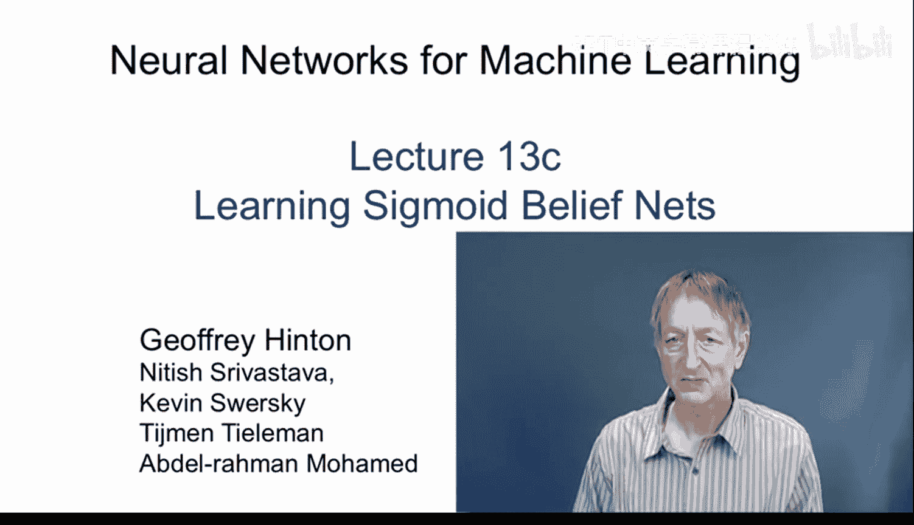
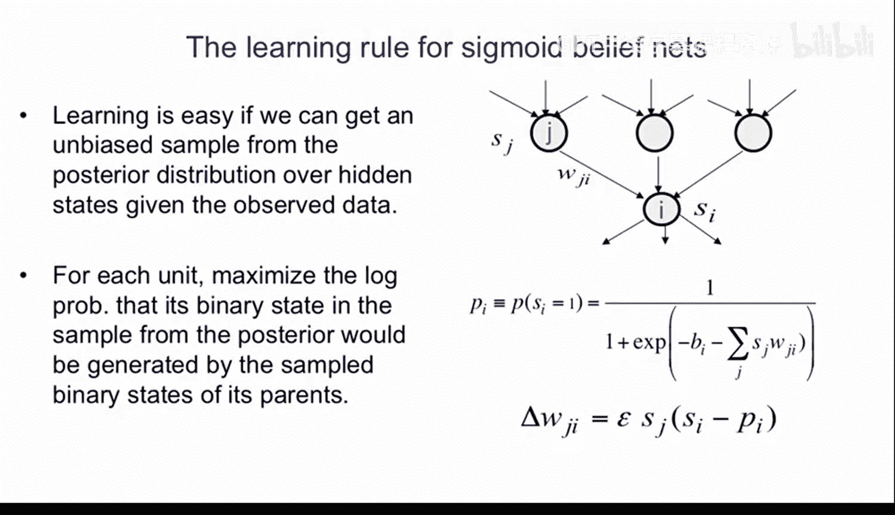
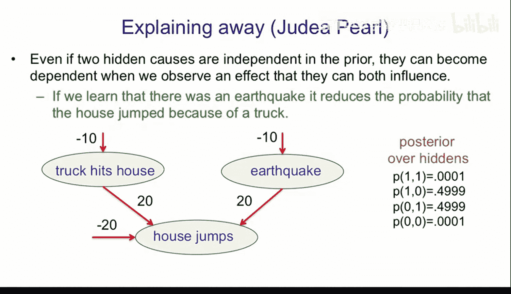
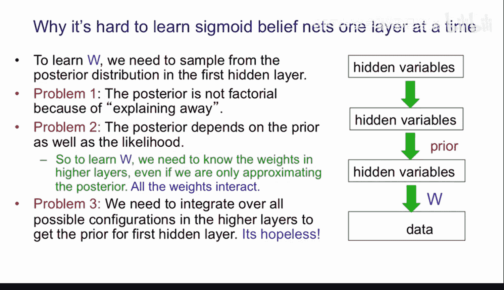
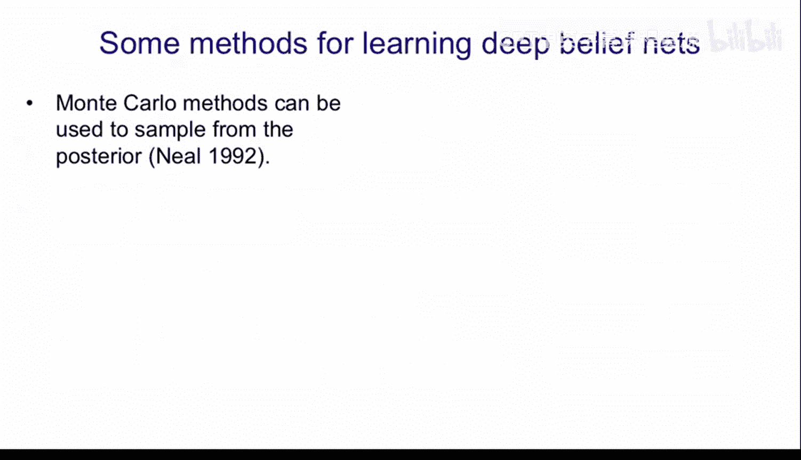
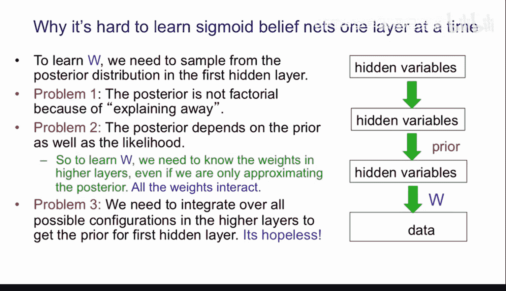
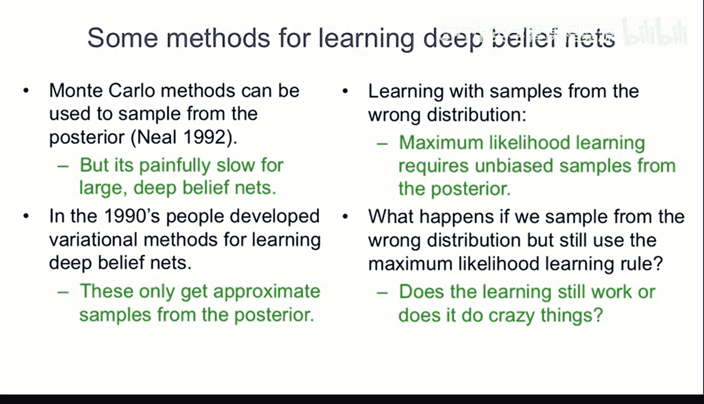

# Hinton@多伦多大学《机器学习的神经网络｜Neural Networks for Machine Learning 2016》claude-4s p62 -62-Lecture 13.3 — Learning sigmoid belief nets  -Neural Networks for Machine Le -BV1HtkUB2EZD_p62-

In this video。I'll talk about why it's difficult to learn sigmoid belief nets。

And then in the following two videos。I'll describe two different methods we discovered that allow us to do the learning。

The good news about learning in Sigma belief nets。Is that unlike Balswa machines。

 we don't need two different phases。We just need what an abalum machine would be the positive phase。

 That's because sigmoid belief next。Are what is called locally normalized models。

 So we don't have to deal with the partition function or its derivatives。

Another piece of good news about Sigmma belief nets。Is that if we could get unbiased samples。

From the posterior distribution over the hidden units， given a data vector。

Then learning would be easy。That is， we could follow the gradient specified by maximum likelihood learning。

In a mini batch stochastic kind of a way。The problem is。

That it's hard to get unbiased samples from the posterior distribution over the hidden units。

This is largely due to a phenomenon that Judea Peicles are explaining away。

And I'll explain explaining away in this video， and it's important to understand it。

Now， I'm going to talk about why it's difficult to learn sigmoid belief nets。As we've seen。

 it's easy to generate an unbiased sample once you've done the learning。

That is once we've decided on the weights in the network。

We can easily see the kinds of things the network believes in by generating samples from its model。

This is done top down one layer at a time。It's easy because it's a causal model。However。

Even if we know the weights， it's hard to infer the posterior distribution over hidden causes when we observe the visible effects。

The reason for this is that the number of possible patterns of hidden causes is exponential。

In the number of hidden notes。It's hard even to get a sample from the posterior。

Which is what we need if we're gonna do stochastic gradient descent。

So given this difficulty in sampling from the posterior。

 it's hard to see how we can learn sigmoid belief nets with millions of parameters。

 which is what we'd like to do。Notice this is a very different regime from the one normally used with graphical models。

There， they have interpretable models， and they're trying to learn dozens or maybe hundreds of parameters。

They're not typically trying to learn millions of parameters。Now。

 before I go into ways in which we can try and get samples from the posterior distribution。

I just want to tell you what the learning rule is if we could get those samples。

So if we can get an unbi sample from the posterior distribution over hidden states。

 given the observed data。Then， learning is easy。So here's part of a sigmoid belief mat。

And we're going to suppose that， for every note。We have a binary value。 So for node J。

 that binary value is S J。And that vector binary values is a global configuration for the net。

 which is a sample from the posterior distribution。In order to do maximum likelihood learning。

All we have to do。Is maximize the log probability。That the inferred binary state of unit， I。

Would be generated from the inferred binary states of its parents。

So the learning rule is local and simple。The probability。That the parents of I would turn eye on。

Is given by a logistic function。That involves the binary states of the parents。

And what we need to do is make that probability。Be similar to the actually observed binary value of I。

And although I'm not going to derive it here， the maximum likelihood learning rule for the weight W J I。

Is simply to change it in proportion 2。The state of J。

Times the difference between the binary state of I。And the probability。

That the binary states of his parents would turn it on。So， to summarize。

If we have an assignment of binary states draw all the hidden notes。

Then it's easy to do maximum likelihood learning。In our typical， stochastic way。

Where we sample from the posterior， and then we update the weights based on that sample。

And we average that update over a mini batch of samples。

So let's go back to the issue。Of why it's hard to sample from the posterior。

The reason it's hard to get an unbiased sample from the posterior over the hidden nodes。

Given an observed data vector at the leaf notes。Is a phenomenon called explaining away。

So if you look at this little sigmoid belief et here。

 it has two hidden causes and one observed effect。And if you look at the biases。

You'll see that the observed effect of a house just jumping is very unlikely to happen unless one of those causes is true。

But if one of those causes has happened， the 20 cancels are -20。

And now the house will jump with a probability of a half。

Each of the causes is itself rather unlikely， but not nearly as unlikely as a house spontaneously jumping。

So if you see the house jump， one plausible explanation。Is that a truck hit the house。A different。

 plausible explanation is there was an earthquake。And each of those has a probability of about each of the -10。

 whereas the house jumping spontaneously has a probability of about each of the -20。However。

 if you assume both hidden causes， that has a probability of E to the -20。

 So that's extremely unlikely， even if the House did jump。So assuming there was an earthquake。

Reduces the probability that the house jumped Look as a truck hit it。And we get an anti correlation。

Between the two hidden causes， when we've observed the house jumping。

Now if it is in the model itself， in the prior for the model。

These two hidden causes are quite independent。So if the house jumps。

There's basically an even chance that was because of a truck or because of an earthquake。

The posterior actually looks something like this。There's four possible patterns of hidden causes。

 given that the House jumped。Two of them are extremely unlikely。

Namely that a truck hit the house and there was an earthquake or that neither of those things happened。

The other two combinations are equally probable， and you'll notice they form an exclusive or。

We have two likely patterns of courses， which are just the opposites of each other。

That's explaining away。Now that we've understood explaining a away。Let's consider。

Let's go back to the issue of learning a deep sigmoid belief net。

So we're going to have multiple layers of hidden variables。

They're going to give rise to some data in our causal model。And we want to learn those weights。

 W between the first layer of hidden variables in the data。And let's see what it takes to learn W。

First of all， the posterior distribution over the first layer of hidden variables is not going to be factorial。

 They not independent in the posterior。And that's because of explaining your away。

So even if we just had that layer of hidden variables， once we've seen the data。

 they wouldn't be independent of one another。But because we have higher layers of hidden variables。

 they're not even independent in the prior。Those hidden variables in the layers above。Cre a prior。

And that prior will itself cause correlations between the hidden variables in the first layer。

To learn W， we need to know the posterior in the first hidden layer。

 or at least an approximation to it。And even if we're only approximating it。

We need to know all of the weights in higher layers in order to compute that prior term。In fact。

 it's even worse than that， because to compute that prior term。We need to。

Integrate out all the hidden variables in higher layers。 That is。

 we need to consider all possible patterns of activity in these higher layers。

And combine them all to compute the prior that the higher layers create for the first hidden layer。

Computing that price is a very complicated thing。So these three problems suggest that it's going to be extremely difficult to learn those weights。

 W。And in particular， we're not going to be able to learn them without doing a lot of work in the high layers to compute the prior。

So now we're going to consider some methods for learning deep belief nets。

The first one is the Monte Carlo method used by Raford Neal。

 and that Monte Carlo method basically does all the work。

That is， if we go back to the previous slide， it considers patternss activity over all the hidden variables。

And it runs a Markov chain that takes a long time to settle down， given a data vector。

And once it' settled down to thermal equilibrium， you get a sample from the posterior。

 but it's a lot of work。

So in large deep belief nets， this method's pretty slow。In the 1990s。

 people developed much faster methods for learning deep belief nets。

 which were called variational methods。In fact， this is where variational methods came from。

 at least for the artificial intelligence community。

The variational methods give up on getting unbiased samples from the posterior。

And they content themselves with just getting approximate samples。

That is samples from some other distribution that approximates the posterior。Now， as we saw before。

 if we have samples from the posterior， maximum likelihood learning is simple。

If we have samples from some other distribution。We could still use the maximum likelihood learning rule。

 but it's not clear what will happen。On the face of it。

 crazy things might happen if we're using the wrong distribution to get our samples。

There doesn't seem to be any guarantee that things will improve。In fact。

 there is a guarantee that something will improve。It's not the log probability that the model would generate the data。

But it is related to that。In fact， it's a lower bound on that mod probability。

And by pushing up the lower bound。We can usually push up the load probability。

