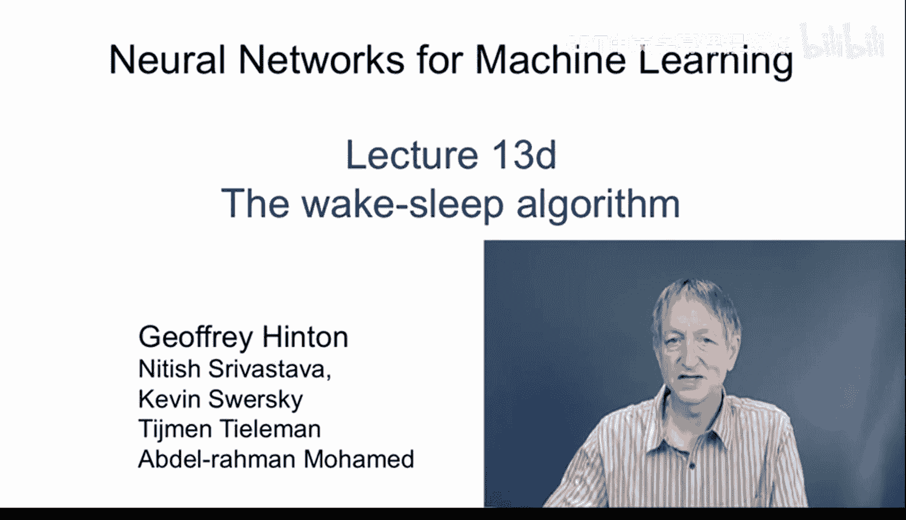
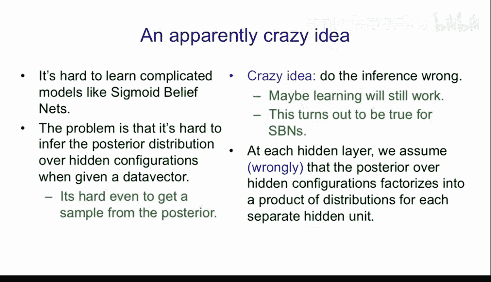
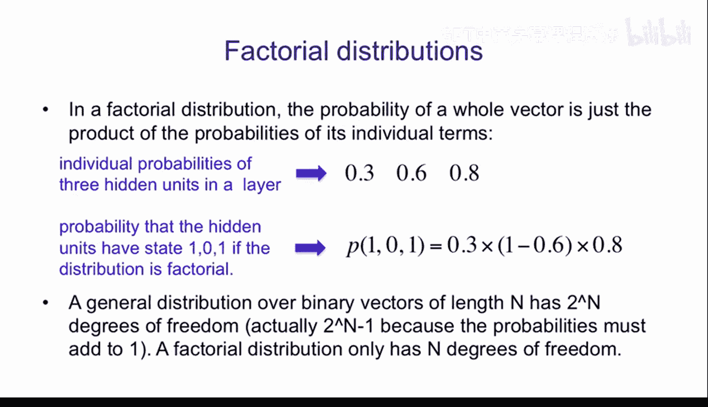
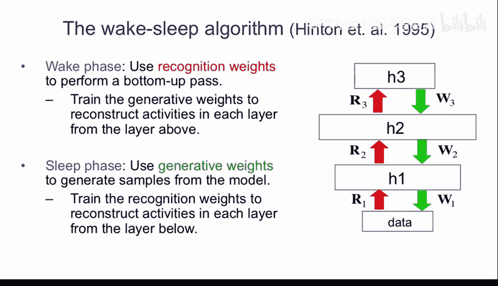
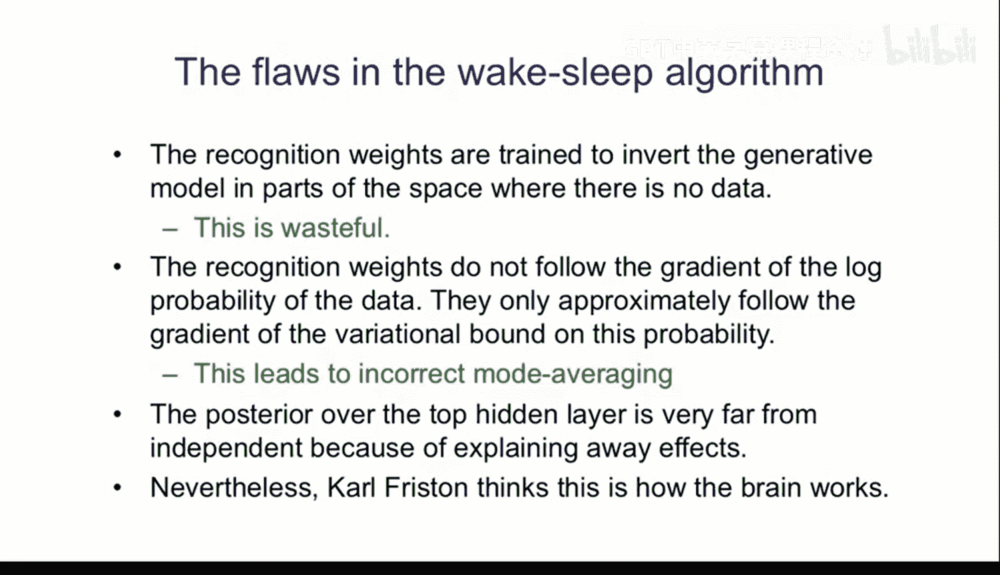
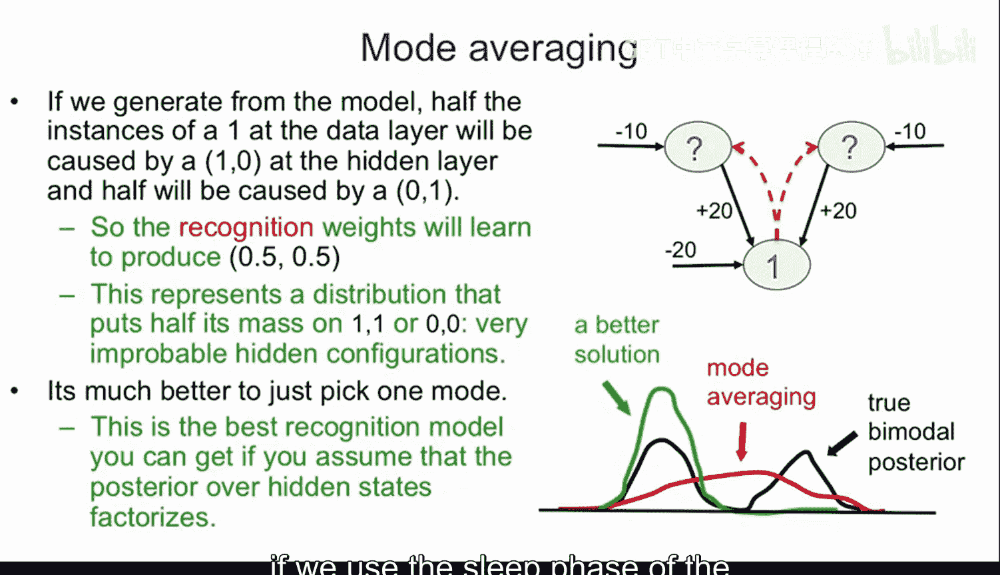

# Hinton@多伦多大学《机器学习的神经网络｜Neural Networks for Machine Learning 2016》claude-4s p63 -63-Lecture 13.4 — The wake sleep algorithm  -Neural Networks for Machine Learni -BV1HtkUB2EZD_p63-

In this video。I'll describe the first way we discovered。Forgetting sigma belief nets。

To learn efficiently。It's called the Wake sleep algorithm。

And it should not be confused with Balsmore machines。They have two phases。

 a positive and a negative phase。That could plausibly be related to wake and sleep。

But the Wake sleep algorithm。Is a very different kind of learning。

Mainly because it's for directed graphical models， like sigmoid belief nets。

Rather than for undirect geographicalal models like Balsman machines。

The idea is behind the wakeake sleep algorithm。LED to a whole new area of machine learning called variational learning。

Which didn't take off until the late 1990s。Despite early examples like the Wake sleep algorithm。

And is now one of the main ways of learning complicated graphical models in machine learning。

The basic idea behind these variational methods sounds crazy。

The idea is that since it's hard to compute the correct posterior distribution。

We'll compute some cheaper approximation to it， and then we'll do maximum likelihood learning anyway。

That is， we'll apply the learning rule that would be correct。

If we'd got a sample from the true posterior。And hope that it works， even though we haven't。

Now you could reasonably expect this to be a disaster。But actually the learning comes to your rescue。

So if you look at what's driving the weights during the learning。

When you use an approximate posterior。There are actually two terms driving the weights。

 One term is driving them。To get a better model of the data。

That is to make the Sigmoid belief net more likely to generate the observed data in the training set。

But there's another term that's added to that。That's actually driving the weights towards sets of weights for which the approximate posterior're using is a good fit to the real posterior。

It does this by manipulating the real posterior to try and make it fit the approximate posterior。

It's because of this effect， the variational learning of these models works quite nicely。

Back in the mid-90s， when we first came up with it。

 we thought this was an interesting new theory of how the brain might learn。

That idea has been taken up since by Carl Friston。Who strongly believes this is what's going on in real neural learning？

So we' are now gonna look in more detail。And how we can use an approximation to the posterior distribution。

For learning。To summarize。It's hard。To learn complicated models， like sigmoid belief nets。

Because it's hard to get samples from the true posterior distribution over hidden configurations when given a data vector。

And it's hard even to get a sample from that posterior。That it is hard to get an unbiased sample。

So the crazy idea is that we're going to use samples from some other distribution。

And hope that the learning will still work。And as we'll see。

That turns out to be true for sigmma belief net。So the distribution that we're going to use。

Is a distribution that ignores explaining away。We can assume wrongly that the posterior over hiddend configurations factorizes。

Into a product。Of distributions for each separate hidden unit。In other words。

 we're going to assume that given the data， the units in each hidden layer are independent of one another。

 as they are in a restricted boltsan machine。But in a restricted boss machine， this is correct。

Whereas in a sigmma of belief net his role。So let's quickly look at what a factorial distribution is。

In a factorial distribution， the probability of a whole vector is just the product of the probabilities of its individual terms。

So suppose we have three hidden units in the lay。And they have probabilities of being on of 03。

6 and 08。If we want to compute the probability。Of the hidden layerir， having the state 1，0，1。

We compute that by multiplying 03 by 1-。6。By。8。So the probability of a configuration of the hidden layer is just the product。

Of the individual pro letters。 That's why it's called factorial。In general。

 a distribution of binary vectors of length then will have two to the n degrees of freedom。Actually。

 it's only 2 to the n-1， because the probabilities must add to what。A factorial distribution。

 by contrast， only has n degrees of freedom。 It's a much simpler a beast。

So now I'm going to describe the wake sleep algorithm that makes use of the idea of using the wrong distribution。

And in this algorithm。We have a neural net that has two different sets of weights。

It's really a generative model。And so the weight sh in green for generative。

Are the weights of the model。Those are the weights that define the probability distribution over data vectors。

We've got some extra weights。 The weight shown in red for recognition weights。

And these are weights that are used for approximately getting the posterior distribution。That is。

 we're going to use these weights to get a factorial distribution of each hidden layer that approximates the posterior。

 but not very well。So in this algorithm， there's a wake phase。In the wake phase。

 you put data in at the visible layer at the bottom。And you do a forward pass through the network。

Using the recognition weight。And at each hidden layer。

 you make a stochastic binary decision for each hidden unit independently about whether it should be on or off。

So the forwardd pass gets a stochastic binary states for all of the hidden units。

Then once we have the stochastic binary states， we treat that as though it was a sample from the true posterior distribution given the data。

And we do maximum likelihood learning。But what we're doing maximum righthood learning for is not the recognition weights that we just used to get the approximate sample。

It's the generative weights that define our model。So you drive the system in the forward pass with the recognition weights。

But you learn the generative weights。In the sleep phase， you do the opposite。

You drive the system with the generative weights。That is。

 you start with a random vector of the top hidden layer。

You generate the binary states of those hidden units from there prior， in which they're independent。

And then you go down through the system。Generating states for each layer at a time。

And here you are using the generative model correctly。

That's how the generative model says you ought to generate data。

And so you can generate an unbiased sample from the model。

Having used the generative weights to generate an unbi sample。You then say。

 let's see if we can recover the hidden states from the data。

Or let's see if we can recover the hidden states at Lair H2 from the hidden states at Lair H1。

So you've trained the recognition weights to try and recover。

The hidden states that actually generated the states in the lab below。

So it's just the opposite of the weight phase。 Were now using the generative weights to drive the system。

And we're learning the recognition weights。It turns out that if you start with random weights。

And you alternate between weight phases and sleep phases。It learns a pretty good model。

There are flaws in this algorithm。The first floors are rather minor one。

Which is the recognition weights。Are learning to invert the generative model。

But at the beginning of learning， they're learning to invert the generative model in parts of the space where there isn't any data。

Because when you generate from the model， you' are generating stuff that looks very different from the real data。

 because the weights aren't any good。That's a waste， but it's not a big problem。

The serious problem with this algorithm。Is that the recognition weights。

Not only don't follow the gradient of the log probability， the data。

They don't even follow the gradient of the variational bound on this probability。

And because they're not following the right gradient。We get incorrect mode averaging。

 We shall explain on the next slide。A final problem。

Is that we know that the true posterior over the top hidden layer is bound to be far from independent because of explaining away effects。

And yet we're forced to approximate it。With a distribution that assumes independence。

This independence approximation might not be so bad for intermediate hidden layers。

 because if we're lucky， the explaining away effects that come from below。

Will be partially cancelled out by prior effects that come from above。

You'll see that in much more detail， later。Despite all these problems。

Carl Friston thinks this is how the brain works。When we initially came up with the algorithm。

 we thought it was an interesting new theory of the brain。

I currently believe that it's got too many problems to be how the brain works and that will find better algorithms。

So now， let me explain mode averaging， using the little model with the earthquake and the truck that we saw before。

Suppose we run the sleep phase， and we generate data from this model。Most of the time。

 those top two units will be off because they're very unlikely to turn on under their prior。

And because they're off。The visible unit。Will be firmly off。Because of its bias of -20。

Just occasionally。One time in about each to the -10。One of the two top units will turn on。

And it'll be equally often the left one and the right one。When that unit turns on。

 there's a probability of a half。That the visible unit will turn out。

So if you think about the occasions on which the visible unit turns on。Half those occasions。

Have the lefthanded unit on。The other half of those occasions have the right hand hidden unit on。

 and almost none of those occasions have neither or both units on。

So now think what the learning will do for the recognition weights。

Half the time we have a one on the visible there。The leftmost unit will be on at the top。

So it will actually learn to predict that that's on with a probability of0 0。5。

And the same for the right unit。So the recognition units will learn to produce a factorial distribution over the hidden layer。

Of 。5。5。Now， that factorial distribution puts a quarter of its mass on the configuration 11。

And another quarter of its mass on the configuration 0，0。

 And both of those are extremely unlikely configurations， given that the visible unit was on。

It would have been better just to pick one mode that as it would have been better for the visible unit just to vote for track or just to vote for earthquake。

That's the best recognition model you can have。That's the best recognition model you can have if you're forced to have a factorial model。

So even though the hidden configurations we dealing with。

 the best representative as the corners of a square。

I'll actually show it as if it was a one dimensional， continuous value。

And the true posterior is by modal。It's focused on 1，0 or 0，1， that's shown in black。

The approximation will learn if we use the sleep phase of the wake sleep algorithm。Is the red curve。

 which gives all four states of the hidden units equal probability。

And the best solution would have been to pick one of its states and give it all the probability mass。

That's the best solution。Because invarial learning。

We're manipulating the true posterior to make it fit the approximation were using。

Normally in learning， we're manipulating an approximation to fit the truth thing。

 But here it's backwards。