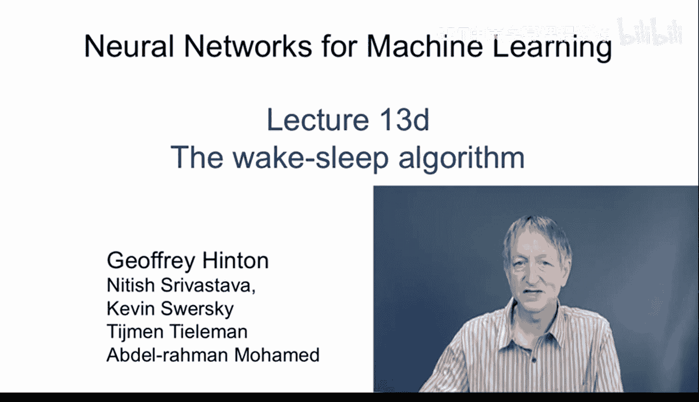
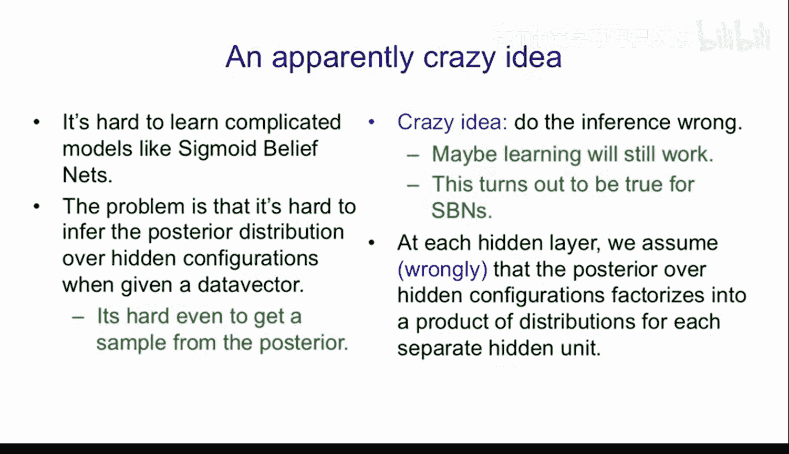
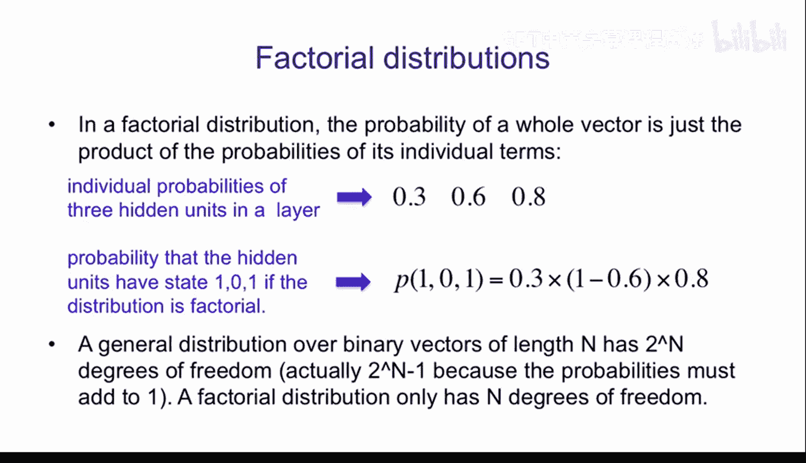
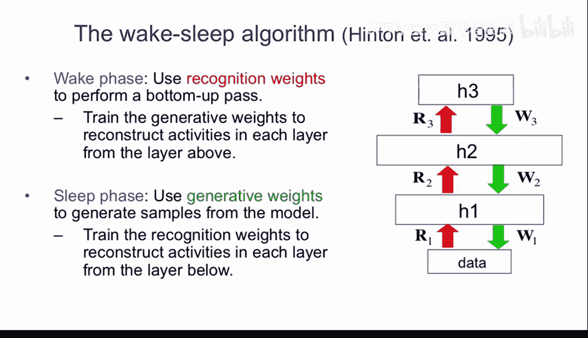
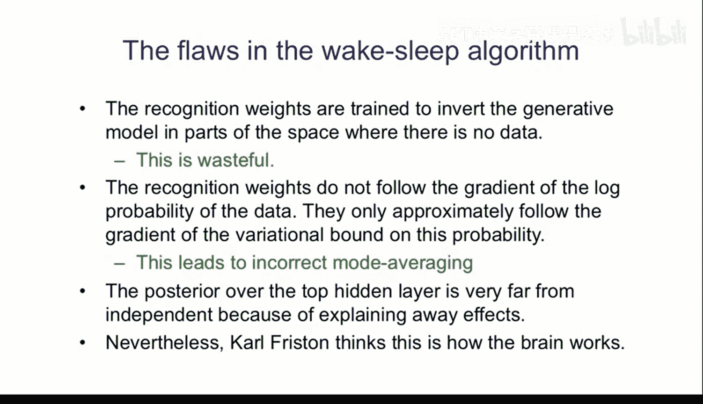
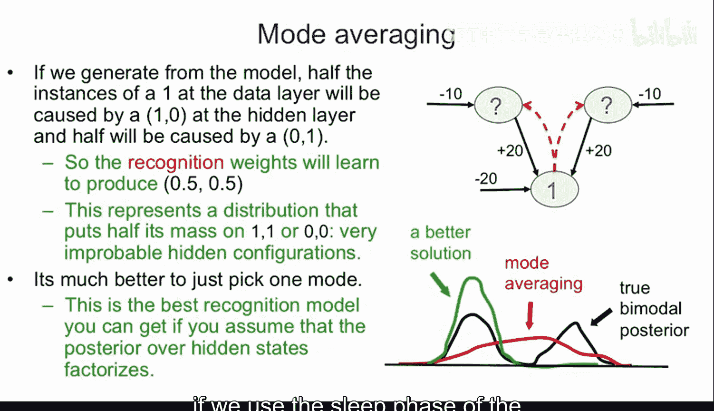

# 神经网络与机器学习：13.4：Wake-Sleep算法 🧠💤

在本节课中，我们将学习一种用于高效学习Sigmoid信念网络的早期方法——Wake-Sleep算法。我们将了解其核心思想、具体步骤，并探讨其优势与局限性。

---

## 概述

学习复杂的模型（如Sigmoid信念网络）是困难的，因为当给定一个数据向量时，很难从隐藏配置的真实后验分布中获取样本。Wake-Sleep算法提出了一个看似“疯狂”的想法：我们使用来自另一个分布的样本来近似后验分布，并希望学习过程仍然有效。这个想法后来催生了机器学习中一个全新的领域——变分学习。

## 核心思想：变分方法

变分方法的基本思想是：既然计算正确的后验分布很困难，我们就计算一个更廉价的近似，然后仍然进行最大似然学习。也就是说，我们应用一个学习规则，这个规则在我们从真实后验中获得样本时是正确的，并希望即使我们没有获得真实样本，它也能奏效。

这听起来可能行不通，但学习过程本身会起到“补救”作用。当我们使用近似后验时，驱动权重更新的实际上有两项：
1.  一项驱动权重，使模型能更好地拟合训练数据。
2.  另一项则驱动权重，使得我们使用的近似后验能更好地拟合真实后验。它通过操纵真实后验来尝试使其适应近似后验。

正是由于这种效应，这类模型的变分学习效果相当不错。

## 近似分布：因式分解假设

我们将使用的分布是一个忽略“解释消除”效应的分布。我们错误地假设，给定数据后，隐藏配置的后验分布可以**因式分解**为每个独立隐藏单元分布的乘积。

换句话说，我们假设给定数据后，每个隐藏层中的单元是相互独立的，就像在受限玻尔兹曼机中一样。但在Sigmoid信念网络中，这个假设并不成立。

### 什么是因式分布？

在因式分布中，整个向量的概率就是其各个分量概率的乘积。

**公式示例**：
假设一个隐藏层有三个单元，它们被激活的概率分别为 `0.3`、`0.6` 和 `0.8`。要计算隐藏层状态为 `[1, 0, 1]` 的概率，我们计算：
`P([1,0,1]) = 0.3 * (1-0.6) * 0.8`

通常，一个长度为 `n` 的二元向量分布有 `2^n - 1` 个自由度。而一个因式分布只有 `n` 个自由度，它是一个简单得多的对象。

## Wake-Sleep算法详解 🌀

Wake-Sleep算法利用了“使用错误分布”这一思想。在该算法中，神经网络有两组不同的权重：
*   **生成权重（绿色）**：定义模型数据向量概率分布的权重。
*   **识别权重（红色）**：用于近似获取后验分布的权重。

该算法包含两个交替进行的阶段：

### 1. Wake阶段（清醒期）

在Wake阶段，我们将数据输入底部的可见层，并使用**识别权重**进行前向传播。在每个隐藏层，我们为每个隐藏单元独立地做出随机的二元决策（开启或关闭）。

前向传播为所有隐藏单元获得了随机的二元状态。然后，我们将这些状态**视为**从给定数据的真实后验分布中采样的样本，并据此对**生成权重**进行最大似然学习。

**简单来说**：用识别权重驱动网络前向传播，但学习的是生成权重。

### 2. Sleep阶段（睡眠期）

在Sleep阶段，我们做相反的事情。我们使用**生成权重**来驱动系统。我们从顶层隐藏层的一个随机向量开始，根据其先验（独立）生成这些隐藏单元的二元状态，然后逐层向下，生成每一层的状态。这是生成模型定义的正确数据生成方式，因此我们能从模型中生成一个无偏样本。

生成样本后，我们尝试从数据中恢复隐藏状态（或从H1层的状态恢复H2层的状态）。也就是说，我们训练**识别权重**，使其尝试恢复实际生成了下层状态的隐藏状态。

**简单来说**：用生成权重驱动网络生成数据，但学习的是识别权重。

实践证明，如果从随机权重开始，并交替进行Wake阶段和Sleep阶段，模型可以学习到一个相当好的结果。

## 算法的局限性

尽管有效，Wake-Sleep算法存在一些缺陷：

1.  **次要问题**：在学习的初期，识别权重学习的是在数据空间之外的部分反转生成模型，因为此时模型生成的数据与真实数据差异很大。这是一种浪费，但不是大问题。
2.  **严重问题：模式平均**：识别权重不仅不遵循数据对数概率的梯度，甚至不遵循其变分下界的梯度。因为它们没有遵循正确的梯度，会导致不正确的“模式平均”。我们将在下一部分详细解释。
3.  **近似误差**：我们知道，由于解释消除效应，顶层隐藏层的真实后验分布远非独立，但我们却被迫用一个假设独立的分布来近似它。不过，对于中间隐藏层，这种近似可能没那么糟糕，因为来自下方的解释消除效应可能会被来自上方的先验效应部分抵消。

尽管存在这些问题，卡尔·弗里斯顿认为这就是大脑的工作方式。我们最初提出该算法时，也认为这是一个关于大脑如何学习的有趣新理论。但目前我认为它存在太多问题，不可能是大脑的工作方式，未来我们会找到更好的算法。

## 模式平均问题详解

让我们用之前见过的“地震与卡车”小模型来解释模式平均。

假设我们运行Sleep阶段，并从模型中生成数据。大多数时候，顶层的两个单元是关闭的。只是偶尔（概率极低），其中一个单元会开启，且左右单元开启的概率相等。当某个顶层单元开启时，可见单元有0.5的概率开启。

现在考虑可见单元开启的那些情况。其中一半情况是左侧隐藏单元开启，另一半是右侧隐藏单元开启，几乎不会出现两个都开或都不开的情况。

那么，识别权重的学习会怎么做呢？当可见单元为1时，有一半时间顶层左侧单元是开的，另一半时间右侧单元是开的。因此，识别权重将学会产生一个隐藏层的因式分布，其中每个单元开启的概率都是 `0.5`。

这个因式分布将其质量的四分之一放在了配置 `[1,1]` 上，另外四分之一放在 `[0,0]` 上。而给定可见单元开启时，这两种配置都极不可能出现。更好的做法是只选择一个模式（例如，只支持“卡车”或只支持“地震”），这是在被迫使用因式模型时所能得到的最佳识别模型。

**图示说明**：
即使我们处理的是隐藏配置，最佳表示是正方形的两个角（对应 `[1,0]` 和 `[0,1]`）。真实后验是双峰的（黑色曲线）。而如果我们使用Wake-Sleep算法的Sleep阶段，学习到的近似将是红色曲线，它给予隐藏单元的四种状态以相等的概率。最佳解决方案本应是选择其中一个状态并给予其全部概率质量。

在变分学习中，我们操纵真实后验以使其适应我们使用的近似。通常在学习中，我们是操纵一个近似去适应真实事物，但在这里是反过来的。

---

## 总结

本节课我们一起学习了Wake-Sleep算法。我们了解到，该算法通过交替进行“Wake”和“Sleep”两个阶段，使用因式分布的近似后验来学习Sigmoid信念网络的生成权重和识别权重。其核心的变分思想——用廉价近似代替真实后验并进行学习——为后来的变分学习方法奠定了基础。同时，我们也分析了该算法存在的模式平均等局限性。尽管它可能不是大脑或现代应用的最佳算法，但其开创性的思路在机器学习发展史上具有重要意义。