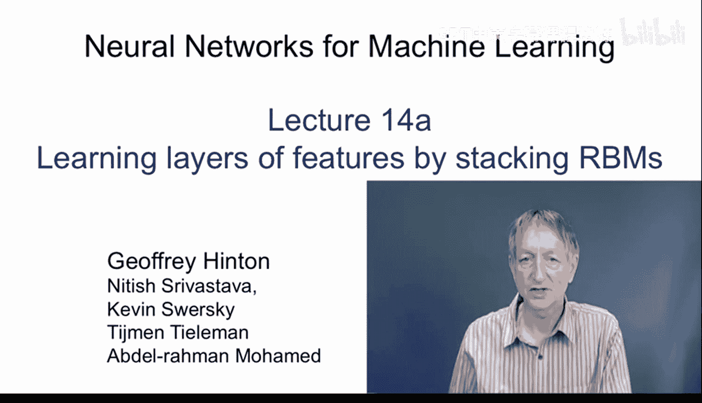
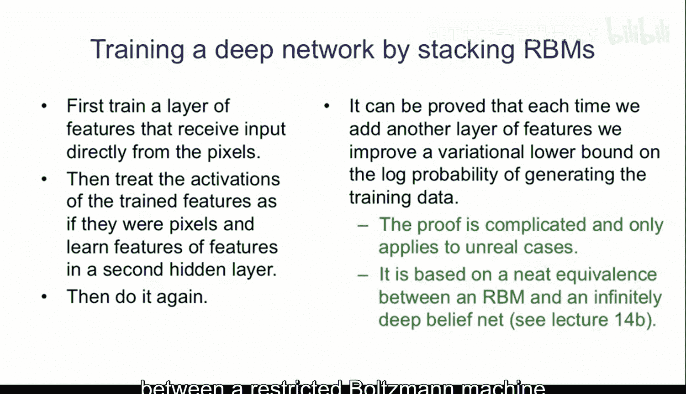
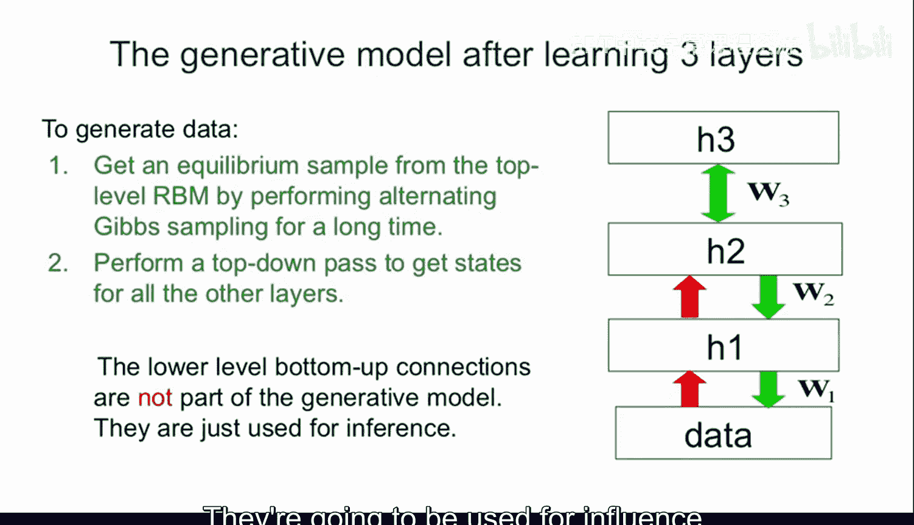
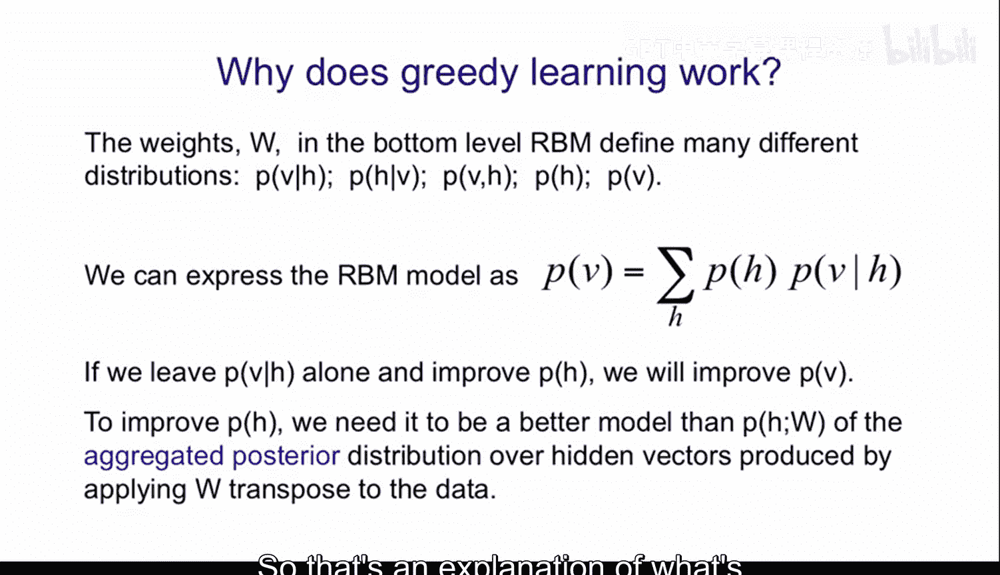
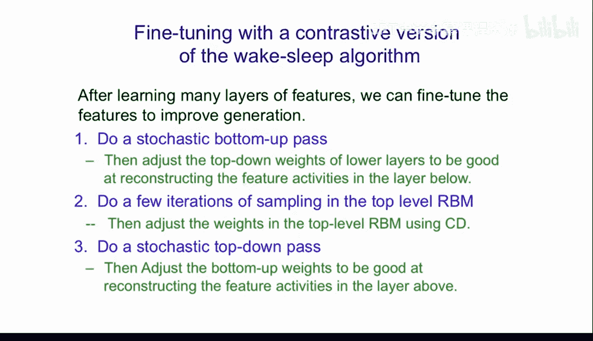
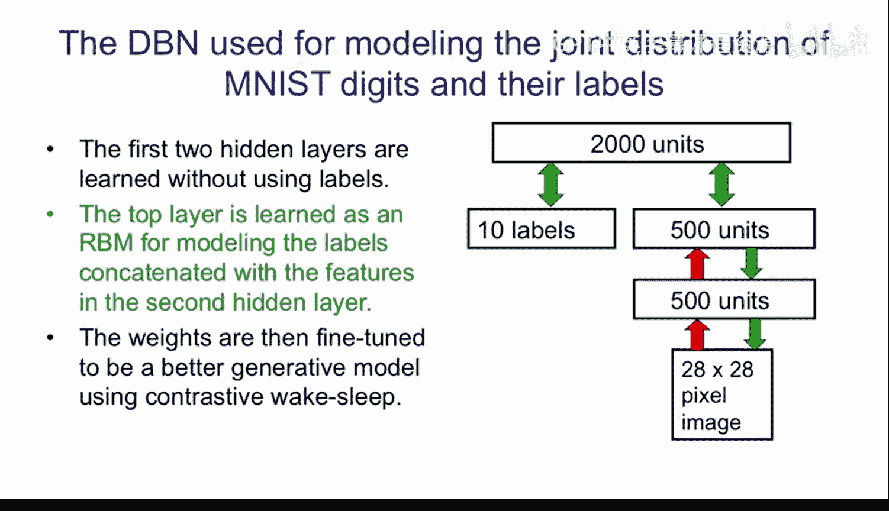

# Hinton@多伦多大学《机器学习的神经网络｜Neural Networks for Machine Learning 2016》claude-4s p64 -64-Lecture 14.1 — Learning layers of features by stacking RBMs  -Neural Network -BV1HtkUB2EZD_p64-

In this video。I'll talk about a different way of learning sigmoid belief net。This different method。

Arrived in an unexpected way。I stopped working on signaligma belief nets and went back to Balsman machines。

And discovered that restricted bolts machines could actually be learned fairly efficiently。

Given that a restricted bolts machine could efficiently learn a layer of nonlinear features。

It was tempting to take those features， treat them as data。

And apply another restricted bots machine to model the correlations between those features。

And one can continue like this， stacking one bolt of a machine on top of the next one to learn lots of layers of nonlinear features。

This eventually LED to a big resurgence of interest in deep neural nets。The issue then arose。

Once you've stacked up lots of restricted bolts and machines。

Each of which is learned by modeling the patterns of feature activities produced by the previous per machine。

Do you just have。A set of separate， restricted bulleting machines。

Or can they all be combined together into one model？Now anybody sensible。

Would expect that if you combine a set of restricted boltsman machines together to make one model。

 what you get would be a multi layer boltsman machine。However。

 a brilliant graduate student of mine called UIT figured out that that's not what you get。

You actually get something that looks much more like a sigmma belief net。 This was a big surprise。

It was very surprising to me that we'd actually solve the problem of how to learn deep sigmoid belief nets by giving up on it and focusing on learning undirected models like Bsman machines。

Using the efficient learning algorithm for restricted Balsman machines。

It's easy to train a layer of features that receive input directly from the pixels。

We can then treat the patterns of activation of those feature detectors。As if they were pixels。

And learn another layer of features in a second hidden layer。

We can repeat this as many times as we like。With each new layer of features， modeling。

The correlated activity in the features in the layer below。

It can be proved that each time we add another layer of features。

We improve a variational lower bound on the log probability that some combined model would generate the data。

The proof is actually complicated， and it only applies if you do everything just right。

 which you don't do in practice。But the proof is very reassuring because it suggests that something sensible is going on。

When you stack up restricted boltsma machines like this。The proof is based on a neat equivalence。

Between a restricted Boltiman machine and an infinitely deep belief net。

So here's a picture of what happens。When you learn two restricted bolts machines。

 one on top of the other， and then you combine them to make one overall model。

 which I call a deep belief net。So first， we learn one bolts from machine with its own weights。

Once that's been trained。We take the hidden activity patterns of that boltolsman machine。

When it's looking at data and we treat each hidden activity pattern as data for training a second boltzma machine。

So we just copy the binary states to the second boltman machine。

And then we learn another boltsman machine。Now， one interesting thing about this。

Is that if we start the second bolts from machine off。With W2 being the transpose of W1。

And with as many hidden units in H2 as it are in V。

Then the second bolts machine will already be a pretty good model of H1。

Because it's just the first model upside down。And for a restricted bolts from machine。

 it doesn't really care which you call visible and which you call hidden。

It's just a bipartite graph that's learned a model。After we've learned those two boltsman machines。

We're going to compose them together。To form a single model。And the single model looks like this。

It's top two layers。Adjust the same as the top restricted boltolsman machine。

So that's an undirected model with symmetric connections。

But its bottom two layers are a directed model， like a sigmoid belief net。

So what we've done is we've taken the symmetric connections between V and H1。

And we've thrown away the upgoing part of those and just kept the d going part to understand why we've done that is quite complicated。

And that will be explained in video 13 f。The resulting combined model。

He's clearly not a balsman machine。Cause its bottom layer of connections are not symmetric。

It's a graphical model that we call a deep belief net。

Where the lower layers are just like sigmoid belief nets。

And the top two layers form a restricted boltsman machine。So it's a kind of hybrid model。

If we do it with three boltsman machines stacked up。We get a hybrid model。 It looks like this。

The top two layers， again， are restricted bolts machine。

 and the layers below are directed layers like in a signaloid belief it。

To generate data from this model， the correct procedure is。First of all。

 you go backwards and forwards between H2 and H3 to reach equilibrium in that top level restricted boltolsman machine。

This involves alternating Gib sampling。Where you update all of the units in H3 in parallel。

 then update all of the units in H2 in parallel， then go back and update all of the units in H3 in parallel。

And you go backwards I've always like that for a long time until you've got an equilibrium sample from the top level restricted Bsman machine。

So the top level restricted bolt machine is defining the prior distribution over H2。

Once you've done that。You simply go once from H2 to H1。Using the generative connections， W 2。

And then whatever binary pattern you get in H1， you go once more to get generated data。

Using the weights W1。So we're performing a top down pass from H2 to get the states of all the other layers。

 just like in a signaloid belief in net。The bottom up connections shown in red at the lower levels and not part of the generative model。

They're actually going to be the transposes of the corresponding weights。

 So they're the transpose of W1 and the transpose of W2。They're going to be used for inference。

 but they're not part of the model。

Now， before I explain why stacking up Bolsman machines is a good idea。

I need to sort out what it means to average  two factorial distributions。

And it may surprise you to know that if I average two factorial distributions。

I do not get a factorial distribution。What i mean by averaging here。

Is taking a mixture of the distributions。 So you first pick one of the two at random。

 and then you generate from whichever one you picked。So you don't get a factorial distribution。

Suppose we have an RBM with four hidden units。And suppose we give it a visible vector。

Then given this visible vector。The posterior distribution over those four hidden units is factorial。

And let's suppose the distribution was that the first and second units have a probability of 0。

9 of turning on。And the last two have a probability。1 of turning on。

What it means for this to be factorial is that， for example。

 the probability that the first two units will both beyond on in a sample from this distribution。

Is exactly 0。81。i suppose we have a different input vector V2。

And the posterior distribution over the same four hidden units is now 01。1。9。9。

 which I chose just to make the math easy。If we average those two distributions。

The mean probability of each hidden unit being on is indeed the average of the means for each distribution。

So the means are 05。5。5。5。 But what you get is not a factorial distribution defined by those four probabilities to see that。

 consider the binary vector 1，100 over the hidden units。In the posterior for V1。

That has a probability of 0。9 to the 4， because it's 0。9 times 09 times 1。1 times 1-0。1。So， that's 0。

43。In the posterior for V2， this vector is extremely unlikely。It has a probability of one in 10000。

If we average those two probabilities for that particular vector。We'll get a probability of 。215。

And that's much bigger than the probability assigned to the vector 1，1，0，0。

By a factorial distribution。With means of 0。5。That probability will be 0。5 to the power of 4。

 which is much smaller。 So the point of all this is that when you average two factorial posteriorors。

 you get a mixture distribution that's not factorial。Now。

 let's look at why the greedy learning works。 That is why it's a good idea to learn one restricted bo machine。

And then learn a second restricted boltols from machine that models the patterns of activity in the hidden units of the first one。

The weights of the bottom level， restricted box machine。Actually define four different distributions。

 Of course， they define them in a consistent way。So the first distribution is the probability of the visible units given the hidden units。

And the second one is the probability of the hidden units given the visible units。

And those are the two distributions we use for running our alternating Markov chain that updates the visibles given the hiddens and then updates the hiddens given the visibles。

If we run that chain long enough。We'll get a sample from the joint distribution of VNH。

And so the weights clearly also define the joint distribution。

They also define the joint distribution more directly in terms of e to the minus the energy。

But for nets with a large number of units， we can't compute that If you take the joint distribution P of V and H。

 and you just ignore V。 We now have a distribution for H。

That's the prior distribution over H defined by this restricted bolt machine。And similarly。

 if we ignore H。We have the prior distribution over V defined by the restricted Bsman machine。 Now。

 we're going to pick a rather surprising pair of distributions from those four distributions。

We're going to define the probability that the restricted bolts machine assigns to a visible vector V。

As the sum overall hidden vectors。Of the probability designs to H times to the probability of V given H。

This seems like a silly thing to do because defining P of H is just as hard as defining P of V。

Nevertheless， we're going to define P of V that way。No。If we now leave P V given h alone。

But learn a better model of P of H。That is， learn some new parameters that give us a better model of P of H。

And substitute that in instead of the old model we had of P of H。

Will'll actually improve our model of V。And what we mean by a better model of P of H。

Is a prior over H that fits the aggregated posterior better。The aggregateggavated posterior。

Is the average overall vectors in the training set？Of the posterior distribution over age。

So what are we going to do？Is use our first RBM。To get this aggregated posterior。

And then use our second IBM。To build a better model of this aggregated posterior。

Than the first RBM has。And if we start the second RBM off as the first one upside down。

 it will start with the same model of the aggregated posterior as the first RBM heights。

 and then if we change the weights， we can only make things better。So that's an explanation。

Of what's happening。

Wenwei。Stack up RBms。Once we've learned a stack of bolts from machines and combined them together to make a deep belief net。

We can then actually fine tune the whole composite model using a variation of the wake sleep algorithm。

So we first learn many layers features by stacking up our BMs。

And then we want to fine tune both the bottom up recognition weights and the top 9 generative weights to get a better generative model。

And we can do this。By using three different learning rules。First， we do a stochastic bottom up pass。

And we adjust the top down generative weights of the lower layers。

To be good at reconstructing the feature activities in the layer below。

That's just as in the standard wake sleep algorithm。Then in the top level RBM。

 we go backwards and forwards a few times， sampling the hiddens of that RBM and the visibles of that RBM and the hiddens of that RBM and so on。

So that's just like the learning algorithm for RBMs。And having done a few iterations of that。

We do contrasted divergence learning。That is， we update the weights of the RBM using the difference between the correlations when activity first got to that RBM。

And the correlations after a few iterations in that RBM。

 we take that difference and use it to update the weights。And then the third stage。

We take the visible units of that top level RBM。It's lower low units。And starting there。

 we do a top down stochastic pass。Using the directed lower connections。

 which are just a sigmoid belief in it。Then having generated some data from that sigmma belief net。

We adjust the bottom up weights to be good at reconstructing the feature activities in the layer above。

So that's just the sleep phase of the wake sleep algorithm。

The difference from the standard weight sleep algorithm。

Is that that top level RBM acts as a much better prior over the top layers。

Than just a layer of units， which are assumed to be independent。

Which is what you get in a sigmoid belief net。Also， rather than generating data。

By sampling from the prior。What we're actually doing is looking at a training case going up to the top level RBM and just running a few iterations before we generate data。

So now we're going to look at an example。Where we first learned some RBMs。Stacking them up。

And then we do contrastive waket to find tune it。And then we look to see what it's like as a generative model and also for recognizing things。

So， first of all。We're going to use 500 binary hidden units to learn to model all 10 digit classes。

In images of 28 by 28 pixel cellss。Once we've learned that RBM。Without knowing what the labels are。

So it's unsupervised learning。We're going to take the patterns of activity in those 500 hidden units that they have when they're looking at data。

We're going to treat those patterns of activity as data， and we're going to learn another RBM。

That also has 500 units， and those two are learned without knowing what the labels are。

Once we've done that， we'll actually tell it the labels。

So the first two hidden layers are learned without labels。And then。We add a big top layer。

And we give it the 10 labels。 And you can think that we can catnate those 10 labels with the 500 units that represent features。

Except that the 10 labels are really one softm unit。Then we train that top level RBM。

To model the concatenation of the softmax unit for the 10 labels。

With the 500 feature activities that were produced by the two layers below。

Once we've trained the top level， RBM。We can then fine tune the whole system。

By using a trust you wake sleep。And then we'll have a very good generative model。

And that's the model that I showed you in the intro video。So if you go back。

And you find the introduction video for this course。You'll see what happens。When we run that model。

You'll see how good it is at recognition， and you can also see。

That is very good at generation In that introductory video， I promised you。

 you would eventually explain how it worked。And I think you've now seen enough to know what's going on when this model is learned。

