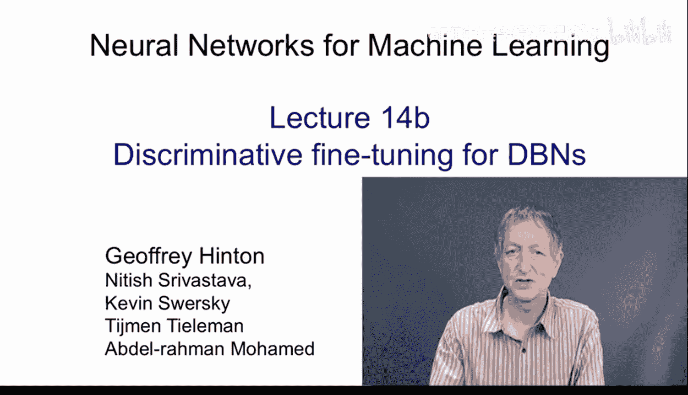
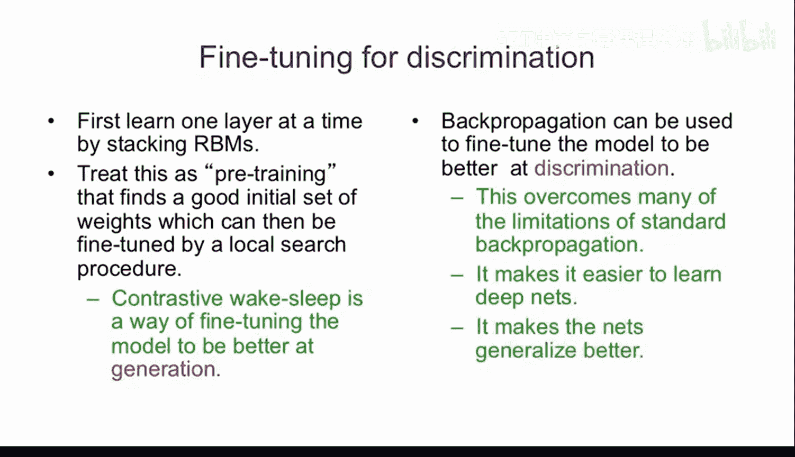
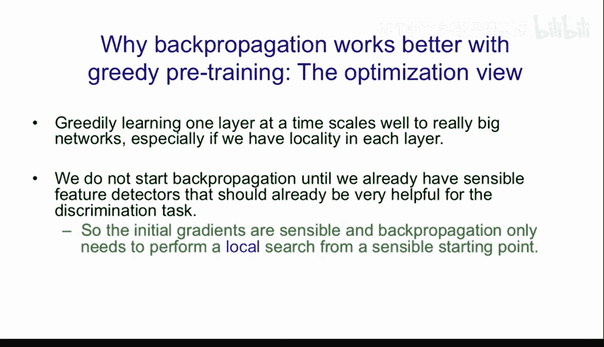
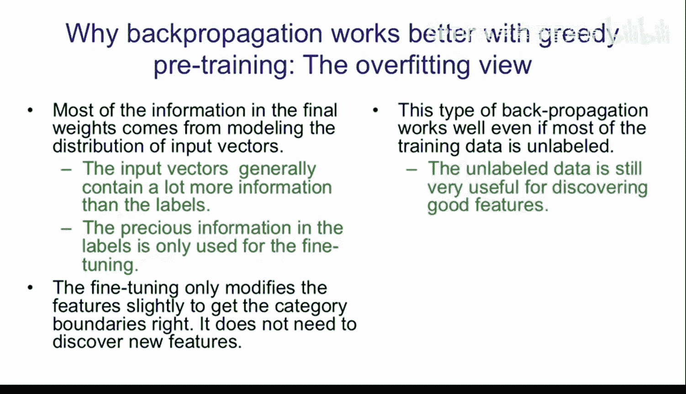
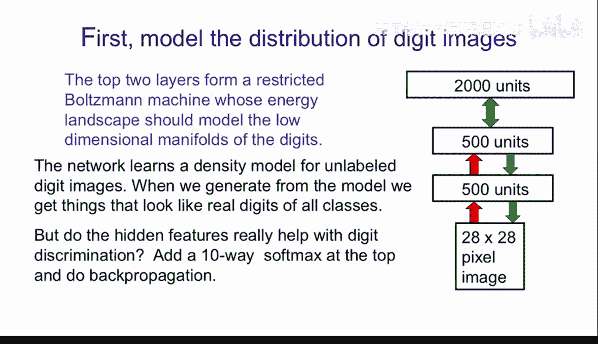
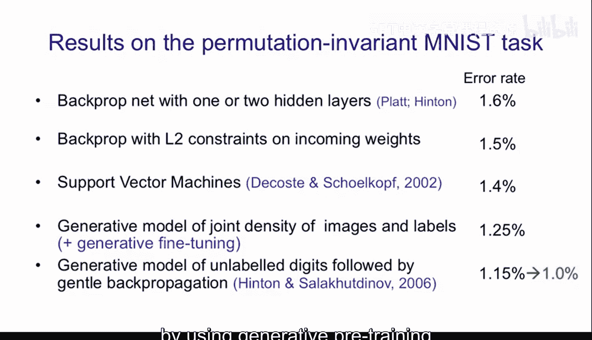
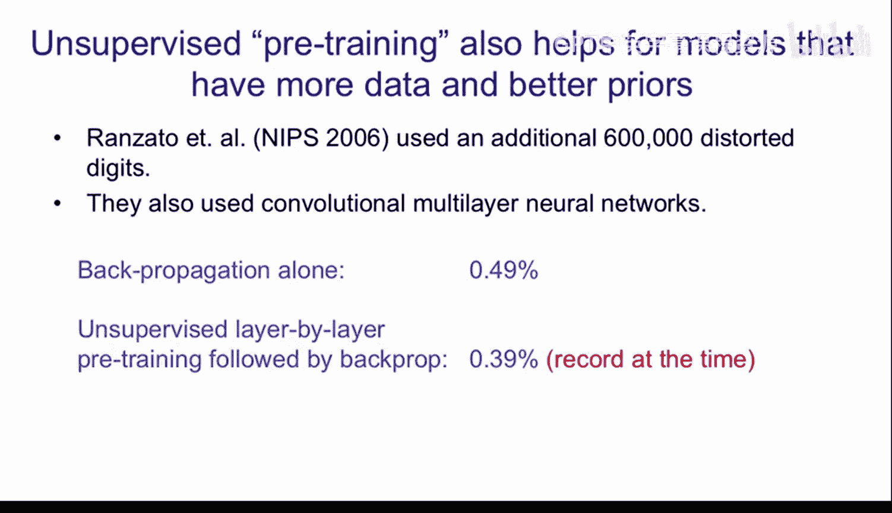
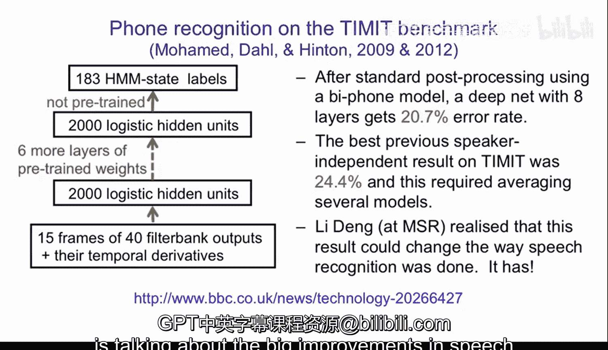

# Hinton@多伦多大学《机器学习的神经网络｜Neural Networks for Machine Learning 2016》claude-4s p65 -65-Lecture 14.2 — Discriminative learning for DBNs  -Neural Networks for Machin -BV1HtkUB2EZD_p65-

In this video。I am going to show how we can first learn a deep belief in it by stacking up restricted bolts machines。

And then we can treat that as a deep neural net that we fine tune discriminly。

So instead of fine tuning it to be better generation， as we did in the previous video。

We're going to fine tune it to be better at discriminating between classes。

This works very well and LED to a big renewal of interest in neural networks。In speech recognition。

It's had a major influence。And many leading groups are now switching to using deep neural nets in order to reduce the error rate in speech recognition。

I now want to talk about fine tuning these deep networks to be better at discrimination。

So we first learn one layer of features at a time by stacking up restricted Balsmore machines。

Then we treat this as pretraining。That finds a good initial set of weights in a deep neural network。

And we fine tune those weights using some local search procedure。In the previous video。

I showed you how to use contrastive wake sleep to fine tune a deep network。

So that it was better at generating its inputs。In this video。We're going to use bank propagation。

To fine tuna model to be better at discrimination。If we do this。

 it overcomes many of the standard limitations of that propagation。

It makes it much easier to learn deep nets。And it makes those nets generalized better。

We need to understand why back propagation works better。When we pre train the weights。

And there's really two effects。 there's an effect on optimization。

 and there's an effect on generalization。So the pre training scales really well if we have big networks。

 especially if each layer has locality。So if we're doing vision， for example。

 and we have local receptive fields in each layer。Then there's not much interaction between widely separate locations。

And so it's very easy to learn a big layer more or less in parallel。When we do pre training。

We don't start back propagation。Until we've already learned sensible feature detectors。

 And these feature detectors should be very helpful for discrimination。 So the initial gradients。

Are much more sensible than if we use random weights and back propagation doesn't need to do a global search。

 It just needs to do a local search， from a sensible starting point。

In addition to being easy to optimize， pre trained nets exhibit much less overfitting。

That's because most of the information in the final weights comes from modelling the distribution of input vectors and these input vectors。

 if you're dealing with something like images。Generally， contain a lot more information。Than labels。

A label typically only contains a few bits of information to constrain the mapping from input to output。

 whereas an image contains a lot of information。Which will constrain any generative model of a set of images。

The information in the labels is only used for the final fine tuning。And because by that stage。

 we've already decided on the feature detectors， we're not squandering that precious information。

 designing feature detectors from scratch。The fine tuning。

Only makes slight changes to the feature detectors we learned in the geneative pretraining phase。

And those are the changes required。To get the cash boundaries in the right place。

The important thing is that back propagation is not being required to discover new features。

 and so it doesn't need nearly as much labelled data。In fact。

 this type of learning works well when most of the data is unlabelled。

Because the generative pre training can make use of all that data。

 the unlabelled data is still very useful for discovering good features。

There is an obvious subjection to this kind of learning。

Which is that when we do generative pre training。We'll be learning lots of features that are useless for the particular discriminative task we want the net to do。

 Consider， for example， that you might want the net to discriminate between shapes。

Well you might want the net to discriminate between different poses of one shape。

They need very different features。And if you don't know the task in advance。

Youll inevitably learn features that are never used。When computers were much smaller。

That was a serious objection。But now that computers are large enough。

We can afford to learn features that are never used。And we can afford it。

Because among all the features we learn。There will be some that are much more useful than the raw inputs。

And that more than makes up for the fact。That we've learned some features that aren't helpful for the particular task we're interested in。

So let's apply this to modeling the Mnes digits。We'll now learn three hidden layers of features。

 entirely unsupervised。Once we've done that learning。When we generate from the model。

It will generate things that look like real digits。

And it'll generate them from all the different classes。

And it'll typically take a while before it switches from one class to another。

 and it will typically take a while before it switches from one class to another。

Because it'll tend to stay in the same ravine for a while before it jumps to another ravine。

But the question is， are the features that we've learned that way useful for doing discrimination？

So all we need to do is add a final10way softm at the top and find unit with back propagation。

And see if we do better than purely discriminative training。

So here's the results on the permutation invariant MIS task。

And what I mean by permutation invariant is if we were to apply a fixed random permutation to all the pixels。

 the same permutation to every test and training case。 The results of our algorithm wouldn't change。

That's clearly not true for something like a convolutional net。

A convolutional net's been told something about the task。By applying this fixed permutation。

We destroy all simple ways of telling the net something about the spatial structure of the task。

So if you apply standard back propagation。It's hard to do better than 1。6% errors。

John Platter and myself have both tried quite hard。

 applying standard back propagation with various different architectures。

 and we were both quite good at doing it。You can actually beat 1。6%。

By using constraints on the incoming weight factors of the hidden units。

If you use an appropriate restriction on the length of an incoming weight factor。

 you can do a bit better than 1。6%。Support vector machines。Can get 1。4%。

And this was one of the pieces of evidence that LED to support vector machines。

Supplanting back propagation。If you pre train a network using a stack of bolts for machines。

And then you fine tuneit to be better at generating the joint density of digits and image labels。

Then you can get down to 1。25%。If you train a stack of bolts from machines and simply put a 1way softmax on top and fine tune it。

You can get to 1。15% cent。And with more fiddling around， you can get that down to about 1%。

So you can do a lot better than standard back propagation。

And also better than the bullet vector machines。By using generative pre training。

Followed by discriminative fine。

Marcarellia Anzato， working in Yan Lacan's group。Also showed using a slightly different pre training method。

That pretrain helps for models that have more data and better prior。So they used an additional 60。

000 distorted digit images so that they had a lot more training data。

They also used a convolutional multi and neural network。And Yan's group is the best group。

At tuning those。With bank propagation alone， they managed to get down to 0。

49% when they did the unsupervised layer by layer pre training。Followed by back propagation。

They got down to 0 39 per cent， which at the time， was a record。

So you may remember this picture。From the first lecture。

This was one of the examples I gave of the successive neural nets。It's the same picture。back then。

 I said we could get down to 20。7%。By pre training。And then fine tuning with that propagation。

And that the previous and that the previous speaker independent record on timid was 24。4%。

Which actually required averaging several models。Li Deng at Microsoft Research。

Picked up on this result immediately。And collaborated on improving it。

And this has LED to a big change in speech recognition。If you look at this news story。

 it will refer you to a blog。Where the chief research officer for Microsoft is talking about the big improvements in speech recognition caused by using deep neural nets。

