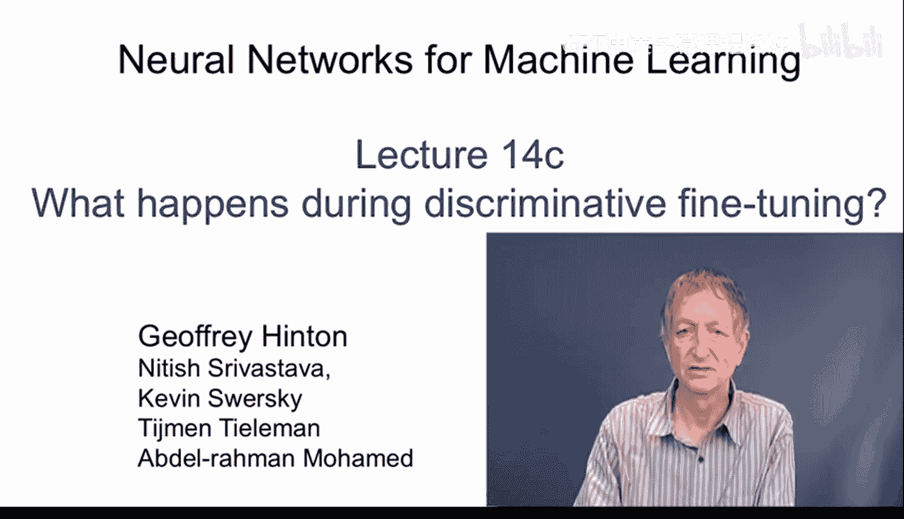
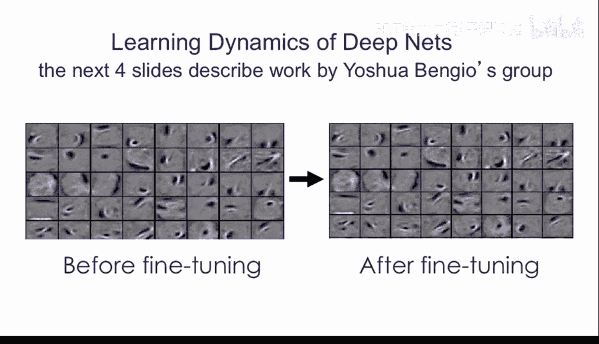
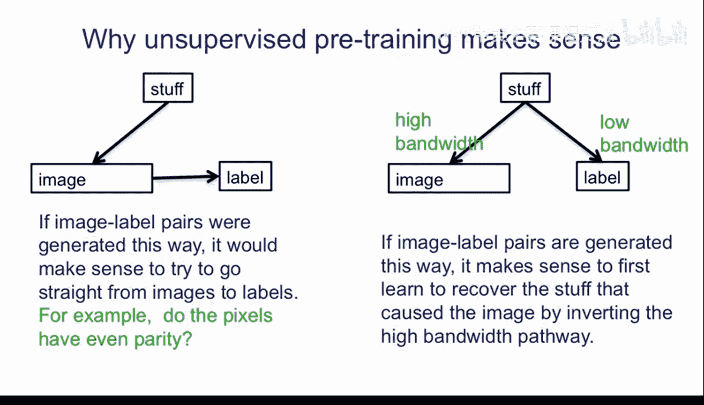

# Hinton@多伦多大学《机器学习的神经网络｜Neural Networks for Machine Learning 2016》claude-4s p66 -66-Lecture 14.3 — Discriminative fine tuning  -Neural Networks for Machine Lear -BV1HtkUB2EZD_p66-

In this video。We're look in more detail。And what happens when the neural network is discriminarily fine tuned。

After its's first been pre trained as a stack of boltsman machines。What we'll see。

Is that the weights and the lower layers hardly change at all。But that nevertheless。

 these tiny changes make a big difference in the classification performance of the neural net because they put the decision boundaries in the right places。

Well also see。That the effect of pretraining。Is to make deeper networks more effective than shallower ones。

Without pre training， it's often the other way around。Finally， I give a fairly general argument。

About why it makes sense to start by doing generative training。

And only after this is well underway to consider discriminative training。

So now we're gonna look at some work done in Yosa Benjo's lab。

Examining what happens during fine tuning。After a that's being generatively pretrained。

You you look on the left。There's the receptive fields in the first hidden layer of feature detectors。

After the general pre training， but before the fine tuning。Then on the right。

 there's the same receptive fields after the fine tuning。 And you'll see almost nothing has changed。

Nevertheless， the changes helped with discrimination。

Here's an example of how pre training reduces the test errors for networks with one hidden layer。

The task was discriminating between digits in a very large set of distorted digits。

And you can see that after the back propagation， find tuning。

The networks with pretrain almost always did better than the networks without pretraining。

The effect gets even bigger。If you use deeper networks。

 so here you can see that there's basically no overlap between the two distributions。

And the deep networks with pretraining have got better than the shallow networks。

And the deep networks without pre training have got worse than the shallow networks。

This is showing you the classification error。And the variation in classification error。

As you change the number of layers。When you're not doing pre training。

And you can see that two layers appears to be best。 And by the time you've got four layers。

 you're doing considerably worse。By contrast， if you use pretraining。

 four layers is better than two layers。There's much less variation。And the errors are lower。

This is a visualization， made with teany。Of what happens to the weights during training for both pre trained and non pre trained networks。

 and they're all plotted in the same space。 But you can see they form two distinct classes of networks。

The ones at the top。And networks without pretrain。 And the ones at the bottom are networks with pretrain。

Each point shows a model in function space。It's no use comparing weight vectors。

 because two nets might differ by having two of the hidden units swapped round。

So they behave exactly the same way。But the weights would look very different。

In order to compare network， you have to compare the functions that they're implementing。

And a way to do that is to have a suite of test cases。

And look at the outputs the networks produce on those test cases。

And then concatenate those outputs into one great long vector。

So if two networks produce very similar outputs on all the test cases。

That concatenated vector will be very similar for the two networks。

Now you take those concatenated output vectors。And you plot those in 2D using Tny。The colors。

Show the stages of training。So if you look at the networks at the top。

There's an initial blob in dark blue。And then you can see those all move in roughly the same direction。

In other words， the networks after one epoch of learning。

Are all more similar to one another than they art of the initial networks。

That's even more pronounced with the pretrain networks of the bottom。

So the color tells you which epoch you're in。The traions at the top， without pretraining。

Show that different networks end up in different places in function space。

 and they're quite widely spread。The tra is at the bottom。Show that with pre traininging。

You end up in a quite different region of function space。

And the networks tend to be more similar to one another。But the main point is there's no overlap。

 The kinds of solutions you find。 if you pre train the networks generatively are just qualitatively different from the kinds of solutions you find。

 If you start with small random weights。The last thing I want to say in this video。

Is to explain why pretraining makes sense。So let's imagine that the way we generated pairs of an image and a label。

Was by taking the stuff in the real world， using that to generate an image， for example。

 by taking a photograph or something。And then， having generated the image。

We attached a label to it that didn't depend on the stuff in the world。

So contingent on the image itself， the stuff in the world is irrelevant。

The label just depends on the pixels in the image。That would be the case， for example， if the label。

Told us whether the top left pixel was similar to the bottom right pixel。Now。

 if we generated images that way。Then it would make sense to try and learn a mapping from images to labels。

Because the labels depend directly on the images。But actually。

 it's more plausible that the way we generate image label pairs。

And by there being stuff in the world， that gives rise to an image。

And the reason the image has the name it has。Is because of the stuff in the world。

 not because of the pixels in the image。So you see a cow， you take a photograph。

And you call out a photograph of a cow because you were looking at a cow when you took it。Now。

 the point is there's a high bandwidth from the stuff in the world to the image。

And there's a low bandwidth from the stuff in the world to the label。For example， if I just say cow。

You don't know whether the cow was upside down， whether it was brown or black and white。

 whether it was alive or dead， How big it was， What else was in the image。

 Whether it was facing you or facing away from you。All of those things aren't conveyed by the label。

If you see an image with thousands and thousands of pixels。You typically know all of those things。

 you get much， much more information about the causes of an image by looking at the image than you do by looking at the label of the image。

So in that situation。Where there's a high bandwidth pathway。From the world to the image。

And a low bandwidth pathway from the world to the label because the label typically contains very few bits。

It makes much more sense。To try and recover the label。By first， inverting the high bandwidth pathway。

To get back to the stuff in the world that caused the image。

And then having recovered the stuff in the world that caused the image。

To decide what label it would be given。So that's a much more plausible model。

Of how we assign names to things in images。And that justifies having a pretraining phase。

Where you try and go from the image to its underlying causes。Followed by a disccrtive phase。

Where you try and go from those underlying causes to the label。

And perhaps you slightly fine tune for mapping from the image to the underlying causes。

