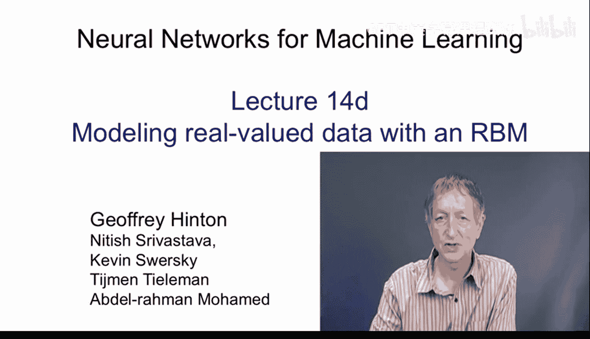
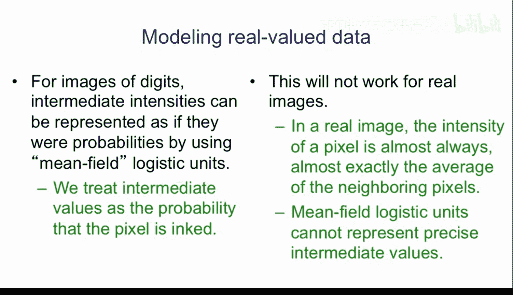
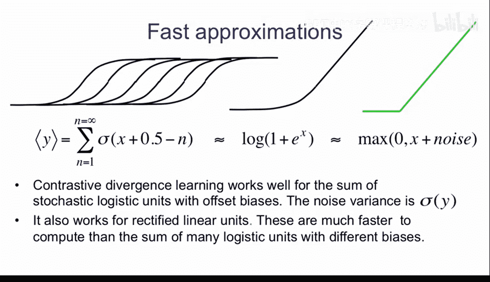
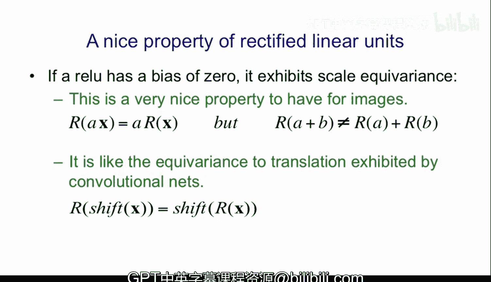

# Hinton@多伦多大学《机器学习的神经网络｜Neural Networks for Machine Learning 2016》claude-4s p67 -67-Lecture 14.4 — Modeling real valued data with an RBM  -Neural Networks for M -BV1HtkUB2EZD_p67-

In this video。I'm going to describe。😔，How to use an RBM to model real value data。

The idea is that we make the visible units instead of being binary stochastic units。

Be linear units with ghost in noise。When we do this， we get problems with learning。😔。

And it turns out a good solution to those problems。

Is to then make the hidden units be rectified linear units。

With linear goene units for the visibles and rectified linear units for the hiddens。

It's quite easy to learn a restricted Bs machine that makes a good model of real valued data。

We first used restricted Balser machines with images of handwritten digits。For those images。

Intermediaent intensities caused by a pixel being only partially inked can be modelled quite well。

By probabilities， that is numbers between 1 and 0 that are actually the probability of a logistic unit being on。

So we treat partially inked pixels。As having a probability of being inked。This is incorrect。

 but it works quite well。However， it won't work for real images。In real image。

 the intensity of a pixel is almost always， almost exactly the average of its neighbours。

So it's got a very high probability of being very close to that average and a very small probability of being a little further away。

And you can't achieve that with a logistic unit。Meinfield Lo units are unable to represent things like the intensity is 0。

69， but very unlikely to be 0。71 or 。67。

So we need some other kind of unit。The obvious thing to use is a linear unit with Gasian noise。

So we model pixels。As Gaussian variables。We can still use alternating Gi sampling to run the Markov chain required for contrasted divergence learning。

But we need to use a much smaller learning rate， otherwise it will tend to blow up。

The equation looks like this。The first term on the right hand side is a kind of parabolic containment function that stops things blowing up。

So the term in that sum contributed by the I visible unit。He's parabolic in shape。

 It looks like this。It's a parabola with its minimum of the bias of the ice unit。

And as the Ithe unit departs from that value。We add energy quadratically。

So that tries to keep the I visible unit close to B I。

The interactive term between the visible and the hidden units。Looks like this。

And if you differentiate that with respect to V I。You can see that you get a constant。

It's the sum of J。Of H， J，W I J divided by sigma I。So that term with its constant gradient。

 looks like this。And when you act together。That top down contribution to the energy was linear and the parabolic containment function。

You'll get a parabolic function。But with the mean shifted away from B。

 I and how much it shifted depends on the slope of that blue line。So the effect of the hidden units。

Is just to push the mean to one side。It's easy to write down an energy function like this。

 and it's easy to take derivatives of it。But when we try learning with it， we often get problems。

There were a lot of reports in the literature that people could not get these Gaussian binary RBMs to work。

And it is indeed extremely hard to learn tight variances for the visible units。

It took us a long time to figure out why it's so hard to learn those visible variances。

This picture helps。If you consider the effect that visible unit I has on hidden unit J。

When visible unit I has a small standard deviation sigma I。

That has the effect of exaggerating the bottom up weights。

That's because we need to measure the activity of I in units of its standard deviation。

So when the standard deviation is small。We need to multiply the weight by a lot。

If you look at the top down effect of J on I。That's multiplied by sigma I。

So when the standard deviation of a visible unit I is very small。The bottom up effects。

Get exaggerated。And the top down effects get attenuated。The result is that we have a conflict。

Where either we have bottom up effects that are much too big or top down effects that are much too small。

And the result is that the hidden units tend to saturate and be firmly on or off all the time。

And this will mess up learning。So， the solution。Is to have many more hidden units than visible units。

That allows small weights。Between the visible and hidden units。

To have big top down effects because there's so many hidden units。But of course。

 we really need the number of hidden units to change as that standard deviation sigma I gets smaller。

And on the next slide， we'll see how we can achieve that。

I'm going to introduce stepped sigmoid units。The idea is。

 we make many copies of each stochastic binary hidden unit。All the copies have the same weights。

And the same bias that's learned be。But in addition to that， adaptive biope。

They have a fixed offset to the bias。The first unit has an offset of -0。5。

The second unit has an offset of -1。5。The third one has an offset of -2。5， and so on。

If you have a whole family of sigmoid units like that。

With the bias changed by one between neighbouring members of the family。

The response curve looks like this。If the total input x is very low， none of them are turned on。

As X increases， the number that get turned on increases linearly。

This means that as the standard deviation on the previous slide gets smaller。

The number of copies of each hidden unit that get turned on gets bigger。

And we achieved just the effect we wanted， which is we get more top down effect。

To drive these visible units that have small standard deviations。Now。

 it's quite expensive to use a big population of binary stochastic units with offset biases because for each one of them。

We need to put the total input through the logistic function。

But we can make some faster approximations， which work just as well。

So the sum of the activities of a whole bunch of sigmoid units with offset biases。

Which is what's shown in that summation。Is approximately equal to log of1 plus E to the x。

And that in turn， is approximately equal。To the maximum of naught and X。

And we can add some noise to the X， if we want。So the first term in the equation looks like this。

The second term looks like that。And you can see that the sum of all those sigmoids in the first term。

Will be a curve like that。And we can approximate that by a linear threshold unit that has a value of zero and less it' above threshold。

 in which case its value increases linearly with its input。

Contrasted divergence learning works well for the sum of a bunch of stochastic logistic units with offset biases。

And in that case。You get a noise variance。That's equal to the logistic function。

Of the output of that sum。Alternatively， we can use that green curve and use rectified linear units。

They're much faster to compute because we don't need to go through the logistic many times。

And contrast divergence works just fine with those。

One nice property of rectified linear units。Is that if they have a bias of 0。

They exhibit scale equivaris。This is a very nice property to have for images。

What scaleic revariance means。Is that if you take an image X。

And you multiply all the pixel intensities by a scalar， a。

Then the representation of AX in the rectified linear units。

Will be just a times the representation of x。In other words。

 when we scale up all the inities in the image。We scale up the activities of all1 units。

But all the ratios stay the same。Recttified linear units aren't fully linear。

Because if you add together two images。The representation you get is not the sum of the representations of each image separately。

This property of scale equivari is quite similar to the property of translational equivaris the convolutional nets have。

So if we ignore the pooling for now in a convolutional net。

If we shift an image and look at the representation。

The representation of a shifted image is just a shifted version of the representation of the unshifted image。

So in a convolutional net， without pooling。Translations of the input just flow through the layers of the net without really affecting anything。

 The representation of every layer is just translated。

