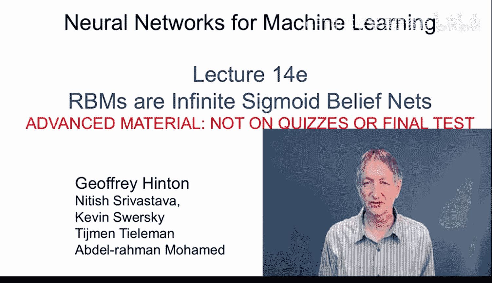
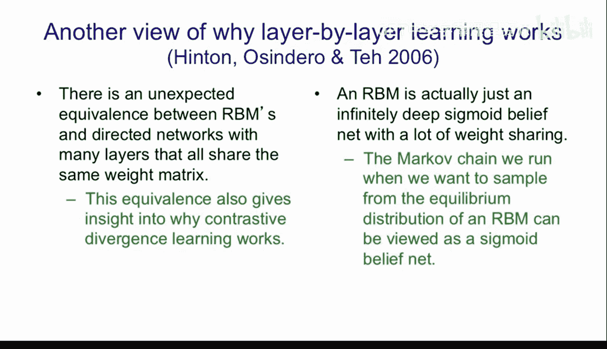
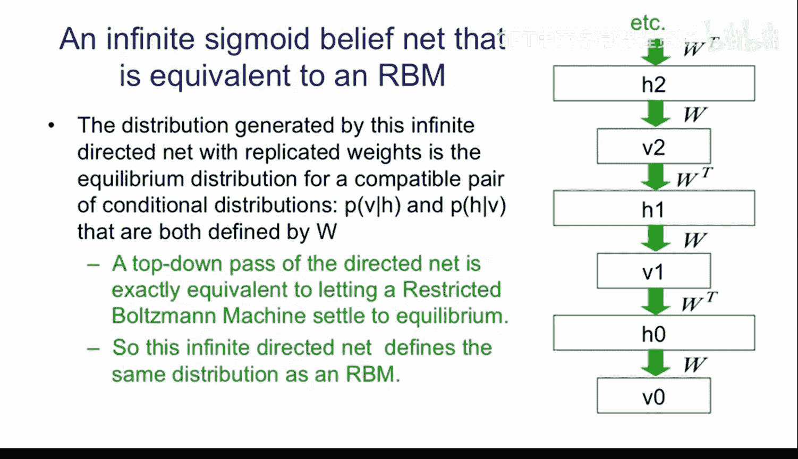
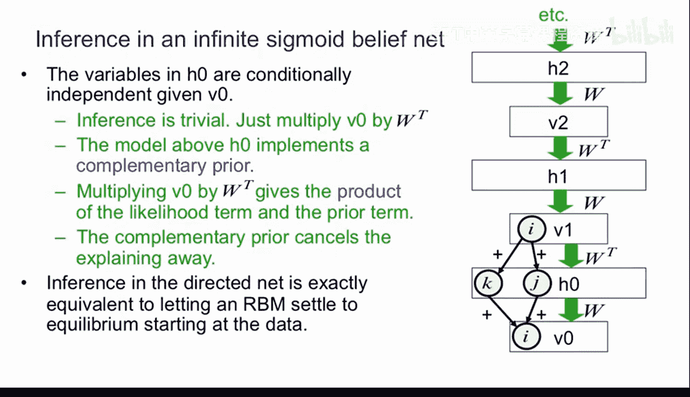
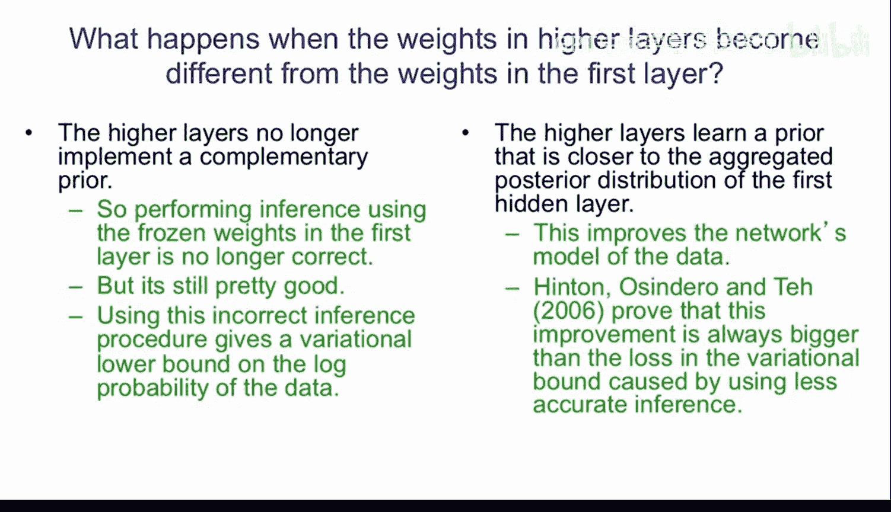
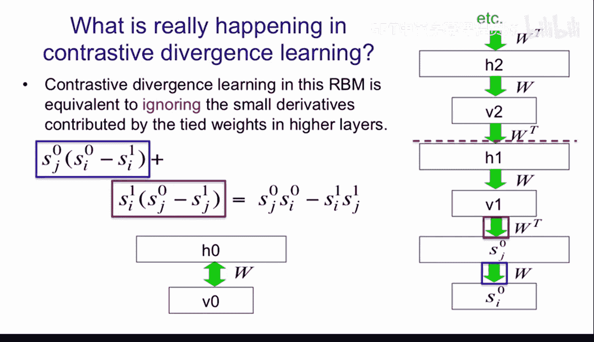
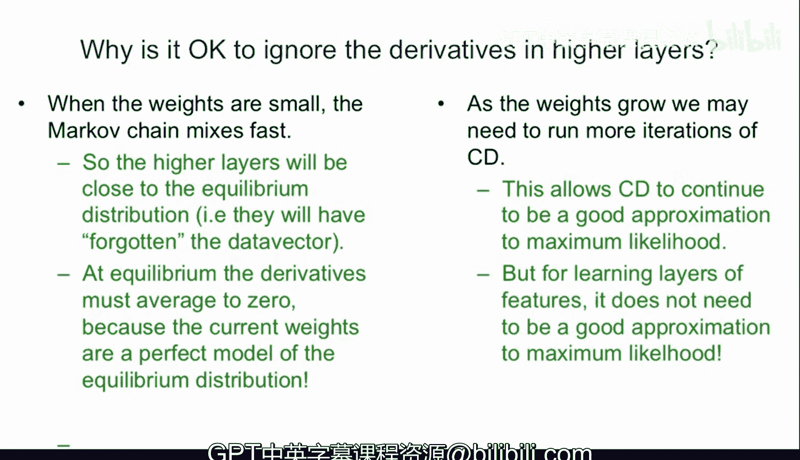

# Hinton@多伦多大学《机器学习的神经网络｜Neural Networks for Machine Learning 2016》claude-4s p68 -68-Lecture 14.5 — RBMs are infinite sigmoid belief nets  -Neural Networks for M -BV1HtkUB2EZD_p68-

In this video， I'm going to talk about some advanced material。

It's not really appropriate for a first course on neural networks。

But I know that some of you are particularly interested in the origins of deep learning。

And the content of this video is mathematically very pretty， so I couldn't resist putting it in。

U I T's insight that's stacking up restricted boltsing machines。

Gives you something like a sigmoid belief in net。Can actually be seen without doing any math。

 just by noticing。That a restricted bolt machine。Is actually the same thing as an infinitely deep sigmma belief net with shared weights。

Once again， weight sharing leads to something very interesting。

I'm now going to describe。A very interesting explanation of why layer by layer learning works。

It depends on the fact。That there's an equivalence between restricted Bsam machines。

 which are undirected models with symmetric connections。And infinitely deep directed networks。

In which every layer uses the same weight metrics。This equivalence also gives insight into why contrasted divergence learning works。

So an RBM is really just an infinitely deep sigmma belief in it with a lot of shared weights。

The Markov chain that we run。When we want a sample from an RBM。

Can be viewed as exactly the same thing as a sigmoid belief in it。

So， here's the picture。We have a very deep sigma belief in that， in fact， infinitely deep。

We use the same weights at every layer。We have to have all the V layers being the same size as each other and all the H layers being the same size as each other。

But V N H can be different sizes。The distribution generated by this very deep network。

 with replicated weights。Is exactly the equilibrium distribution that you get by alternating。

Between doing P of V given H and P of H， given V。Where both P of V given H and P of H given V are defined by the same weight matrix W。

And that's exactly what you do when you take a restricted boltsom machine and run a markov chain to get a sample from the equilibrium distribution。

So a top down pass， starting infinitely high up。In this directed net。

Is exactly equivalent to letting a restricted boltols machine settle to equilibrium。

They therefore define the same distribution。The sample that you get at v0。

If you run this infinite directed net。Will be an equilibrium sample of the equivalent RBM。

Now， let's look at inference in an infinitely deep sigmoid belief in net。So in inference。

 we start at v0， and then we have to infer the state of H0。Normally。

 this would be a difficult thing to do because of explaining away。If， for example。

 hidden units K and J。Both had big positive weights to visible unit I。

Then we would expect that when we observe that eye is on。

K and J become anti correlated in the posterior distribution。Let's explain you away。However。

 in this net。K and J are completely independent of one another when we do inference given V 0。

So the inference is trivial， we just multiply v0 by the transpoer W。

And put whatever we get through the logistic sigmoid。And then sample。

And that gives us binary states for the units in H 0。But the question is。

 how could they possibly be independent， given explaining away。The answer to that question。

Is that the model above H 0 implements what I call a complementary prior。

 It implements a prior distribution of H 0 that exactly cancels out the correlations in explaining away。

So for the example shown， the prior will implement positive correlations between K and J。

Explaining your way will cause negative correlations， and those will exactly cancel。

So what's really going on is that when we multiply。V0 by the transpose of the weights。

We're not just computing the likelihood term。 We're computing the product of a likelihood term。

 and a prior term。And that's what you need to do to get the posterior。

It normally comes as a big surprise to people。The when you multiply by double transpose。

Is the product of the prior and the posterior you computing。

So what's happening in this net is that the complementary prior implemented by all the stuff above H 0。

Exactly cancels that explain way。 makes inference very simple。

And that's true at every layer of this net。So we can do inference for every layer and get an unbiased sample of each layer。

Simply by multiplying v0 by w transpose。Then once we computed the binary state of H zero。

 we multiply that by w。Put that through the logistic sigmoid and sample。

 And that will give us a binary state for V1 and so on all the way up。

So just as generating from this model。Is equivalent to running the alternating Markov chain of a restricted Bser machine to equilibrium。

Performing inference in this model is exactly the same process in the opposite direction。

This is a very special kind of sigma belief net。In which inference is as easy as generation。

So here I've shown the generative weights that define the model。

And also they're transpos that are the way we do inference。And now what I want to show。

Is how we get the Balsman machine learning algorithm。

Out of the learning algorithm for directed sigmoid belief net。

So the learning rule for a sigmoid B D flat。Says that we should first get a sample from the posterior。

That's what the SJ and S I are thus samples from the posterior distribution。

And then we should change a weight， a generative weight。In proportion 2。

The product of the preciptic activity， S J。And the difference between the post synaptic activity。

 S I。And the probability of turning on I。Given all the binary states。Of the layer that S J is in。Now。

 if we ask， how do we compute P。Something very interesting happens。

If you look at inference in this network on the right， we first infer a binary state for H 0。

Once we've chosen that binary state。We then infer a binary state for V1 by multiplying H 0 by w。

Putting the result to the logistic， and then sampling。So if you think about how S I1 was generated。

 it was a sample from what we get if we put H0。Through the weight matrix W。And then。

 through the logistic。And that's exactly what we'd have to do。In order to compute P 0。

We'd have to take。The binary activities in H 0。And going downwards now through the green white W。

We will compute the probability of turning on unit I， given the binary states of its parents。

So the point is the process that goes from H0 to v1 is identical to the process that goes from H0 to v0。

And so S I1 is an unbiased sample。Of P 0。That means we can replace it in the learning wheel。

So we end up with a learning rule that looks like this。Because since we have replicated weights。

Each of those lines is the term in the learning rule that comes from one of those green weight matrices for the first green weight matrix here。

The learning rule。Is the presaptic state， S J 0。Times the difference between the postsynaptic state。

 S I0。And the probability that the binary states in H0 would turn on S。Which we could call P I 0。

But a sample with that probability is S I1。And so an unbiased estimate of the derivative can be got by plugging in S I1。

On that first line of the learning rule。Similarly， for the second weight matrix。

The learning rule is S I 1 into S J 0。Minus Pj 0。And an unbiased estimate of P J 0。Is S J 1。

And so that's an unbiased estimate of the learning rule for this second weight matrix。

And if you just keep going for all the weight matrices。

You get this infinite series and all the terms， except the very first term and the very last term。

 cancel out。And so you end up with the bolts machine learning rule。Which is just S J0 into S I 0。

Minus S J infinity into S I infinity。So let's go back and look at how we would learn an infinitely deep sigmoid belief in it。

We would start by making all the weight matrices the same。

 So we tie all the weight matrices together。And we learn。Using those tide weights。Now。

 that's exactly equivalent to learning your restricted boltsman machine。

The diagram on the right and the diagram on the left。Are identical。

We can think of the symmetric arrow in the diagram on the left。Ass just a convenient shorthand。

For an infinite directed net with tide weights。So we first learned that restricted boltsman machine。

Now we ought to learn it using maximum likelihood learning。

 but actually we're just going to use contrasted divergence learning， we're going to take a shortcut。

Once we've learned the first restricted boltolsum machine。

 what we could do is we could freeze the bottom level weights。We'll freeze the generative weight。

That define the model。We'll also freeze the weights we're going to use for inference to be the transpose of those generative weights。

So we freeze those weights。We keep all the other weights tied together。

 but now we're going to allow them to be different。From the weights in the bottom left。

But they're still all tied together。So learning the remaining weights tied together。

Is exactly equivalent to learning another restricted bo machine。

Namely and restricted bolts from machine。With H naught as its visible units， V1 is its hidden units。

And where the data。Is the aggregated posterior across H n。

That is if we want to sample a data vector to train this network。

What we do is we put in a real data vector at Vn。We do inference through those frozen weights。

And we get a binary vector H node， and we treat that as data for training the next restricted Gis machine。

And we can go up for as many layers as we like。And when we get fed up。

 we just end up with a restricted boltolsum machine at the top。

 which is equivalent to saying all the weights in the infinite directed net above there are still tied together。

But the weights below now will become different。Now。

 our explanation of why the inference procedure was correct involved the idea of a compliment prior created by the weights and the layers above。

And of course， when we change the weights in the layers above。

 it leave the bottom layer of weights fixed。The prior created by those changed weights is no longer exactly complementary。

So now our inference procedure。Using the frozen weights in the bottom layer is no longer exactly correct。

The good news is it's nearly always very close to correct。And with the incorrect inference procedure。

 we still get a variational bound on the log probability of the data。

The higher layers have changed because they've learned a prior。For the bottom hidden layer。

That's closer to the aggregated posterior distribution。And that makes the model better。

So changing the hidden weights makes the inference that we're doing at the bottom hidden layer incorrect。

 but gives us a better model。And if you look at those two effects。We proved that。

The improvement that you get in the variational bound from having a better model。

Is always greater than the loss that you get from inference being slightly incorrect。

So in this variational bound， you win when you learn the weights in higher layers。

Assuming you do it with correct maximum likelihood learning。

So now let's go back to what's happening in contrasted divergence landing。

We have the infinite net on the right。We have a restricted bolts for machine on the left。

 and they are equivalent。If we were to do maximum likelihood learning for the restricted bolts machine。

 it would be maximum likelihood learning for the infinite sigmoid belief in it。

But what we're going to do is we're going to cut things off。

We're going to ignore the small derivatives for the weights you get in the higher layers of the infinite sigmoid belief not。

So we cut it off where that dotted red line is。And now if we look at the derivatives。

The derivatives we're going to get look like this。They've got two terms。

The first term comes from that bottom layer of weights。AndWe've seen that before。

 the derivative for that bottom layer of weights is just the first line here。

The second line comes from the next layer of weights。That's this line here。

We need to compute the activities in H1。In order to compute the S J1 in that second line。

But we're not actually computing derivatives for the third layer of weights。

And when we take those first two terms， and we combine them。

We get exactly the learning rule for one step， contrasted divergence。

So what's going on in contrast divergence is we're combining weight derivatives for the lower layers and ignoring the weight derivatives in higher layers。

The question is， why can we get away with ignoring those higher derivatives。

When the weights are small。The markov chain mixes very fast。If the weights are 0。

 it mixes in one step。And if the Markov chain mixes fast。

 the higher layers will be close to the equilibrium distribution。I。

 they will have forgotten what the input was at the bottom layer。And now we have a nice property。

If the higher layers are sampled from the equilibrium distribution。We know。That the derivatives。

Of the log probability， the data with respect to the weights must average out to 0。

And that's because the current weights in the model are a perfect model of the equilibrium distribution。

 The equilibrium distribution is generated using those weights。

And if you want to generate samples from the equilibrium distribution。

 those are the best possible weights you could have。So we know the route is there a0。

As the weights get larger， we might have to run more iterations of contrasted divergence。

 which corresponds to taking into account more layers of that infinite sigmoid belief net。

That will allow contrast divergence to continue to be a good approximation to maximum likelihood。

And so if we're trying to learn a density model， that makes a lot of sense。As the weights grow。

 you run C D for more and more steps。If there's a statistician around， you give him a guarantee。

Then in in the infinite limit， you'll run Cd for infinitely many steps。

And then you have an asymptotic convergence result。

 which is the thing that keeps statisticians happy。Of course。

 it's completely irrelevant cause you'll never reach a point like that。There is， however。

 an interesting point here。If our purpose in using C is to build a stack of restricted bolts machines that learn multiple laser features。

It turns out。That we don't need a good approximation to maximum likelihood。

For learning multiple laser features， C D1 is just fine。In fact。

 it probably better than doing maximum likelihood。

