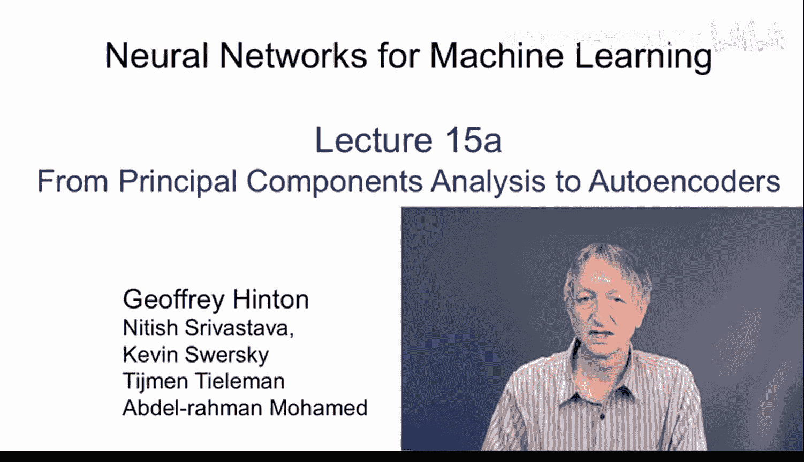
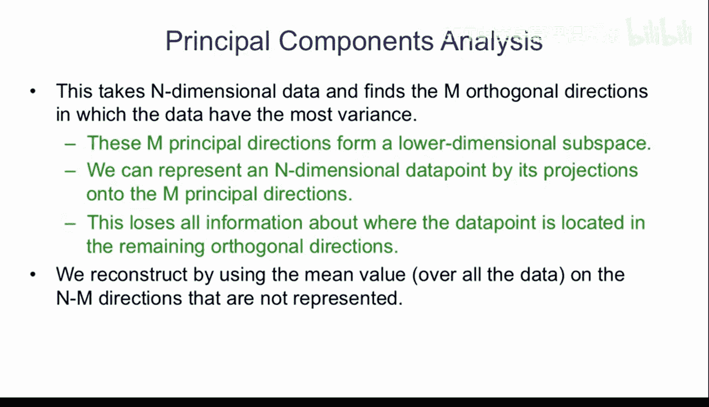
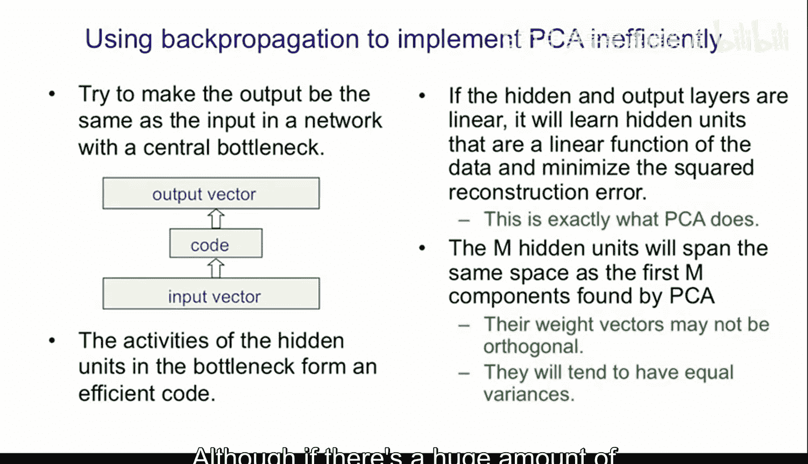
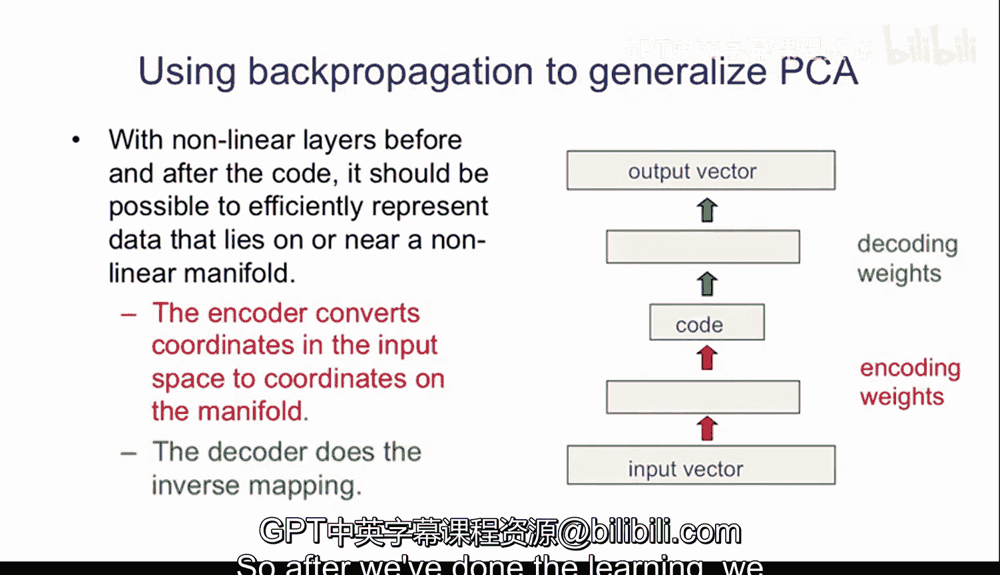

# Hinton@多伦多大学《机器学习的神经网络｜Neural Networks for Machine Learning 2016》claude-4s p69 -69-Lecture 15.1 — From PCA to autoencoders  -Neural Networks for Machine Learni -BV1HtkUB2EZD_p69-

In this video， I'm going to introduce principal components analysis。

 which is a very widely used technique in signal processing。

The idea of principal components analysis。Is that high dimensional data can often be represented using a much lower dimensional code。

This happens when the data lies near a linear manifold in the high dimensional space。

So the idea is if we can find this linear manifold。

 we can project the data onto the manifold and then just represent where it is on the manifold。

And we haven't lost much。Because in the directions， orthogonal to the manifold。

There's not much variation in the data。As we'll see。We can do this operation efficiently。

 using standard principle components methods。Or we can do it inefficiently。

Using a neural net with one hidden layer where both the hidden units and the output units are linear。

The advantage of doing with the neural net is that we can then generalize the technique to using deep neural nets。

In which the code is a nonlinear function of the input。

And our reconstruction of the data from the code is also a nonlinear function of the code。

This enables us to deal with curved manifolds in the input space。

So we represent data by where it gets projected on the curved manifold。

And this is a much more powerful representation。

In principle components analysis。We have n dimensional data。

And we want to represent it using less than n numbers。

And so we find M orthogonal directions in which the data has the most variance。

And we ignore the directions in which the data doesn't vary much。

The M principal directions form a lower dimensional subspace。

And we represent an n dimensional data point。By its projections on to these M directions in the low dimensional space。

So we've lost all information about where the data point is located in the remaining orthogonal directions。

But since these don't have much variance， we haven't lost that much information。

If we wanted to reconstruct the data point。From our representation， in terms of M numbers。

We would use the mean value。For all the n minus M directions that are not represented。

And then the error in our reconstruction。Would be the sum over all these unrepresented directions。

Of the squared difference between the value the data point had on that direction。

And the mean value in that direction。This is most easily seen in a picture。

So consider two dimensional data。That's distributed according to an elongated Gaussian like this。

The ellipse is meant to show a kind of one standard deviation contour of the Gaussian。

And consider a data point like that red one。If we used principal components analysis with a single component。

That component would be the direction in the data that had the greatest variance。

And so to represent the red point， we'd represent how far along that direction it lay。In other words。

 we represent the projection of the road point onto that line。I eat the green point。

When we need to reconstruct the red point。What will do。

Is simply use the mean value of all the data points。In the direction that we've ignored。

In other words， youll represent a point on that black line。

And so the loss in the reconstruction will be the square difference between the red point and the green point。

That is， we'll have lost the difference between the data point。And the mean value of all the data。

In the direction we're not representing， which is the direction of least variance。

And so would obviously have minimized our loss。If we choose to ignore the direction of least variance。

Now we can actually implement PCA or a version of it using back propagation。

 but it's not very efficient。So what we do is we make a network in which the output of the network。

Is the reconstruction of the data？And we try and minimize the squared error in the reconstruction。

The network has a central bottleneck。That only has M hidden units。

And those are going to correspond to the principal components or something like them。

So it looks like this。 We have an input vector。We project that onto a code vector。

 and from the code vector， we construct an output vector。

 and the aim is to make the output vector as similar as possible to the input vector。

The activities of the hidden units in the code vector form a bottleneck。

So the code vector is a compressed representation of the input vector。

If the hidden units and the output units are linear。Then an auto encodecoder like this。

We'll learn codes that minimize the squared reconstruction error。

And that's exactly what principal components analysis does。

It will get exactly the same reconstruction error as principal components analysis does。

But it won't necessarily have hidden units that correspond exactly to the principal components。

They will span the same space as the first end principle components。

But they may be a rotation in skewing of those axes。So the incoming weight vectors of the code unit。

Which what represent the directions of the components。May not be orthogonal。

And unlike principal components analysis， they will typically have equal variances。

But the space spanned by the incoming weight vectors of those code units。

Will be exactly the same as the space spanned by the M principal components。So in that sense。

 this network will do an equivalent thing to principal components。

It's just if we use stochastic gradient and descent learning for this network。

 it will typically be much less efficient。Then the algorithm used for principal components。

Although if there' is a huge amount of data， it might actually be more efficient。

The main point of implementing principal components analysis。Using back propagation in a neural net。

Is that it allows us to generalize principal components analysis。

 If we use a neural net that has linear layers before and after the code layer。

 it should be possible to represent data。That lies on a curved manifold。

Rather than a linear manifold in a high dimensional space。And this is much more general。

So our network would look something like this， the be I vector。

 and then one or more layers of nonlinear hidden units。Typically， we'll use logistic units。

Then there'll be a code layer， which might be linear units。And then following the code layer。

 therell be one or more layers of non nonlinear hidden units。And then there'll be an output vector。

 which we train to be as similar as possible to the input vector。

So this is a curious network in which we're using a supervised learning algorithm to do unsupervised learning。

The bottom part of the network。Is an encoder。Which takes the input vector and converts it into a code using a nonlinear mapping。

The top part of the network。Is a decoder。Which takess the nonlinear code。

And maps it back to a reconstruction of the input vector。So after we've done the learning。

We have mappings in both directions。