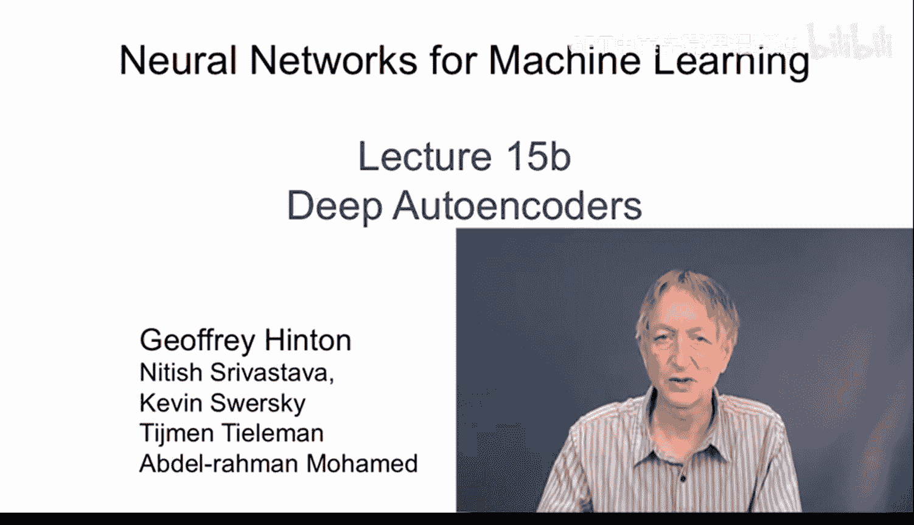
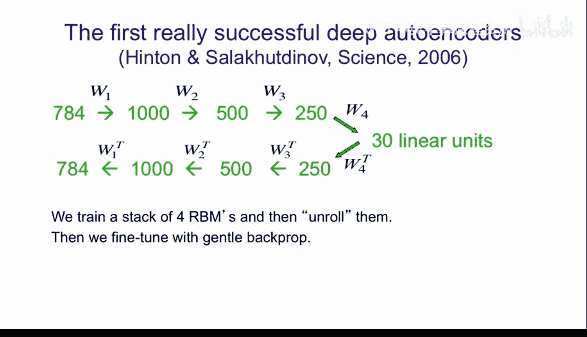
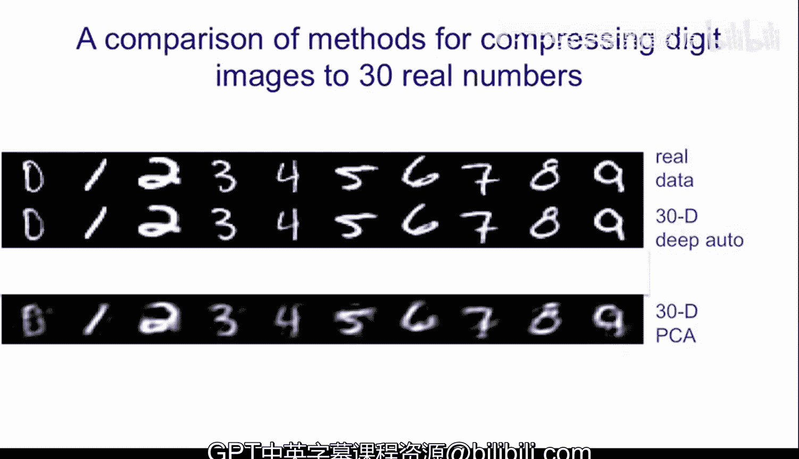

# Hinton@多伦多大学《机器学习的神经网络｜Neural Networks for Machine Learning 2016》claude-4s p70 -70-Lecture 15.2 — Deep autoencoders  -Neural Networks for Machine Learning-.zh_ -BV1HtkUB2EZD_p70-

In this video， we're going to look at the issue of training deep auto encoders。

People thought of these a long time ago in the mid 1980s。

 but they simply couldn't train them well enough for them to do significantly better than principal components analysis。

There were various papers published about them， but no good demonstrations of impressive performance。

After we developed methods of pre training deep networks one layer at a time。

Rus Salakudinov and I applied these methods to pre training deep auto encoders。

 and for the first time we got much better representations out of deep auto encoders than we could get from principal components analysis。

Deep water encoders。Always seemed like a really nice way to do dimensionality reduction。

 because it seemed like they should work much better than principal components analysis。

They provide flexible mappings in both directions， and the mappings can be nonlinear。

Their learning time should be linear or better。In the number of training cases。

And after they'd been learned。The encoding part of the network is fairly fast。

Because it's just a matrix multiply for each layer。Unfortunately。

It was very difficult to optimize deepwater encoders using back propagation。Typically。

 people tried small initial weights。And then the back propagated gradient died。So for deep networks。

They never got off the ground。But now we have much better ways to optimize them。

We can use unsupervised layer by layer pretraining。Or we can simply initialize the weights sensibly。

 as in echo state networks。The first really successful deepwater encounters。

Were learned by Ras Salakudov and I。In 2006， we applied them to the Mnes digits。So， we started with。

Images with 784 pixels。 and we then encoded those via three hidden layers。

Into 30 real valued activities in a central code layer。

We then decoded those 30 real valued activities。Back to784 reconstructed pixels。

We used a stack of restricted boltsman machines。To initialize the weights used for encoding。

And we then took the transpoes of those weights and initialized the decoding network with them。

So initially， the 784 pixels were reconstructed using a weight matrix that was just the transpose of the weight matrix used for encoding them。

But after the four restricted bolts machines had been trained and unrolled to give the transposers for decoding。

We then applied back propagation。To minimize the reconstruction error of the 784 pixels。In this case。

 we were using a cross entropy error。Because the pixels were represented by logistic units。

So that  error was back propagated through this whole deep net。

 And once we started back propagating the error。The weights used for reconstructing the pixels became different from the weights used for encoding the pixels。

Although they typically stayed fairly similar。

This worked very well。So if you look at the first row。That's one random sample from each digit class。

If you look at the second row。That's the reconstruction of the random sample。By the deep autoenr。

That uses 30 linear hidden units in its central layer。

So the data has been compressed to 30 real numbers and then reconstructed。If you look at the8。

You can see that the reconstruction is actually better than the data。

It's got rid of the little defect in the8 because it doesn't have the capacity to encode it。

If you compare that with linear principal components analysis， you can see it's much better。

A linear mapping to 30 real numbers。Cannot do nearly as good a job of representing the data。

