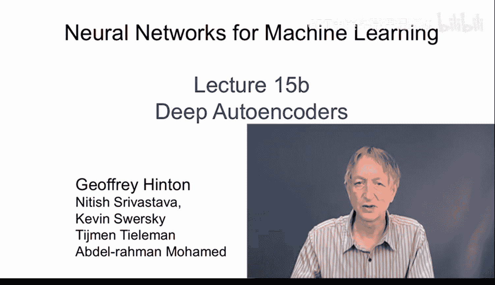
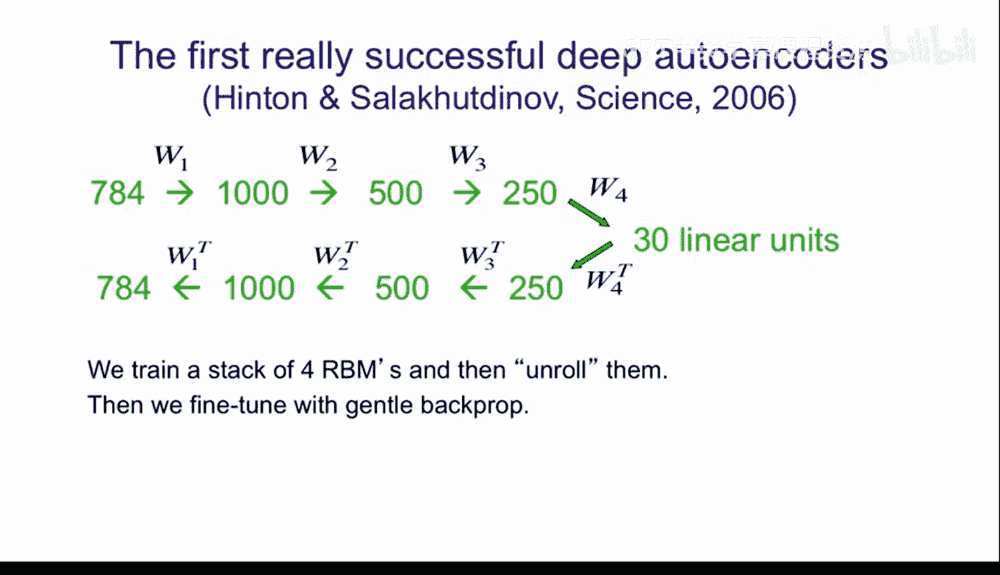
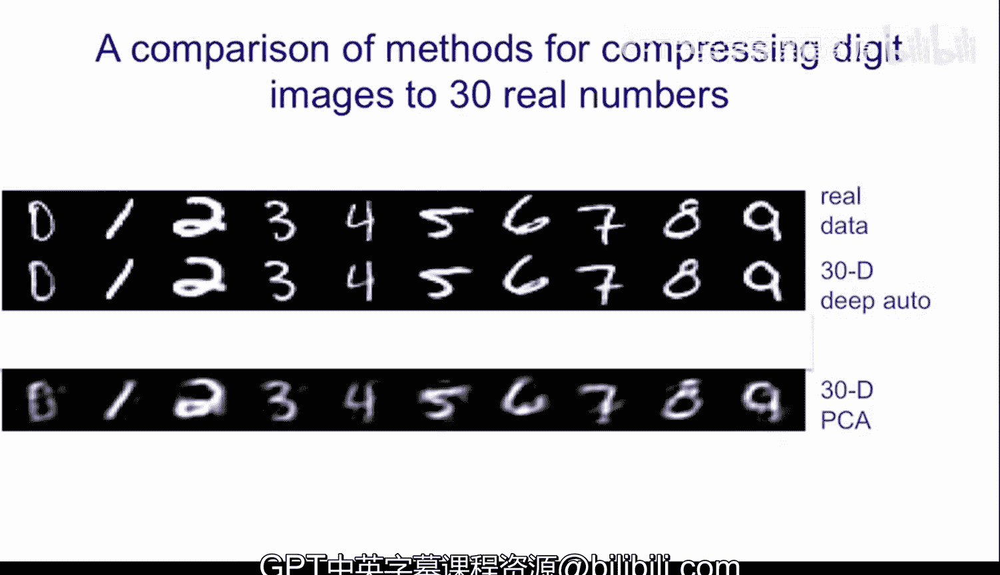

# 机器学习的神经网络：15.2：深度自编码器 🧠

在本节课中，我们将要学习如何训练深度自编码器。自编码器是一种用于数据降维和特征学习的神经网络。我们将探讨其历史背景、训练难点以及现代解决方案，特别是逐层预训练方法如何使其性能超越传统的主成分分析。

## 历史背景与训练难题

上一节我们介绍了自编码器的基本概念，本节中我们来看看其深度版本的发展历程。

深度自编码器在20世纪80年代中期就被提出。但当时人们无法有效地训练它们，导致其性能无法显著超越主成分分析。虽然有多篇相关论文发表，但始终缺乏令人印象深刻的性能演示。

## 现代训练方法：逐层预训练

在开发出逐层预训练深度网络的方法后，情况发生了改变。

Rus Salakhutdinov 和我将这种方法应用于深度自编码器的预训练。这是我们首次从深度自编码器中获得比主成分分析好得多的数据表示。

深度自编码器一直被认为是进行降维的绝佳方法，因为它们理应比主成分分析表现更好。以下是其理论优势：
*   它们能提供双向的、灵活的映射关系。
*   这些映射可以是非线性的。
*   其学习时间在训练样本数量上是线性或更优的复杂度。
*   学习完成后，网络的编码部分速度很快，因为每层只需进行一次矩阵乘法运算。

然而，使用反向传播优化深度自编码器曾经非常困难。通常，人们尝试使用小的初始权重，但反向传播的梯度会消失。因此，对于深度网络，训练根本无法有效启动。

## 解决方案与成功案例

现在，我们有了更好的优化方法。我们可以使用无监督的逐层预训练，或者像回声状态网络那样，对权重进行合理的初始化。

第一个真正成功的深度自编码器由 Rus Salakhutdinov 和我在2006年实现。我们将其应用于 MNIST 手写数字数据集。以下是我们的方法步骤：
1.  我们从784个像素的图像开始。
2.  通过三个隐藏层将其编码为中央编码层的30个实值激活单元。
3.  然后将这30个实值激活单元解码回784个重建像素。

我们使用堆叠的受限玻尔兹曼机来初始化编码部分的权重。然后，我们取这些权重的转置来初始化解码网络。因此，最初784个像素的重建使用的是编码权重的转置矩阵。

在四个受限玻尔兹曼机被训练并“展开”以提供解码转置器之后，我们应用反向传播来最小化784个像素的重建误差。在本例中，由于像素由逻辑单元表示，我们使用了交叉熵误差。

该误差通过整个深度网络进行反向传播。一旦开始反向传播误差，用于重建像素的权重就变得与用于编码像素的权重不同，尽管它们通常保持相当相似。

## 性能展示与对比

这种方法效果非常好。观察结果：
*   第一行显示每个数字类别的一个随机样本。
*   第二行显示由深度自编码器重建的随机样本，其中央层使用30个线性隐藏单元。数据被压缩为30个实数然后重建。
*   观察数字“8”，可以看到重建结果实际上比原始数据更好。它去掉了“8”上的小缺陷，因为网络没有能力编码它。

与线性主成分分析相比，深度自编码器要好得多。一个映射到30个实数的线性映射无法在表示数据方面做得如此出色。

## 总结

本节课中我们一起学习了深度自编码器的训练。我们回顾了其早期因梯度消失问题而难以训练的困境，并重点介绍了通过逐层无监督预训练（如使用受限玻尔兹曼机）来有效初始化权重的现代方法。这种方法使得深度自编码器能够学习到强大且非线性的数据低维表示，其性能显著超越了传统的线性降维方法（如主成分分析），并在MNIST等数据集上得到了成功验证。