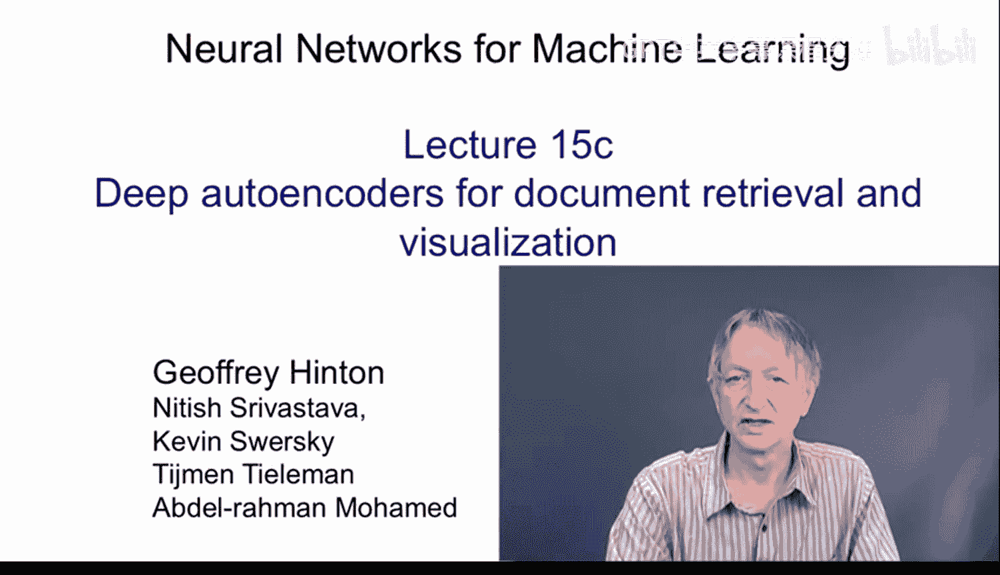
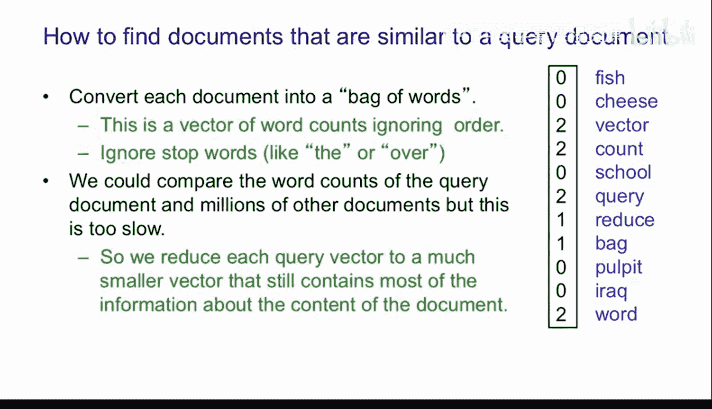
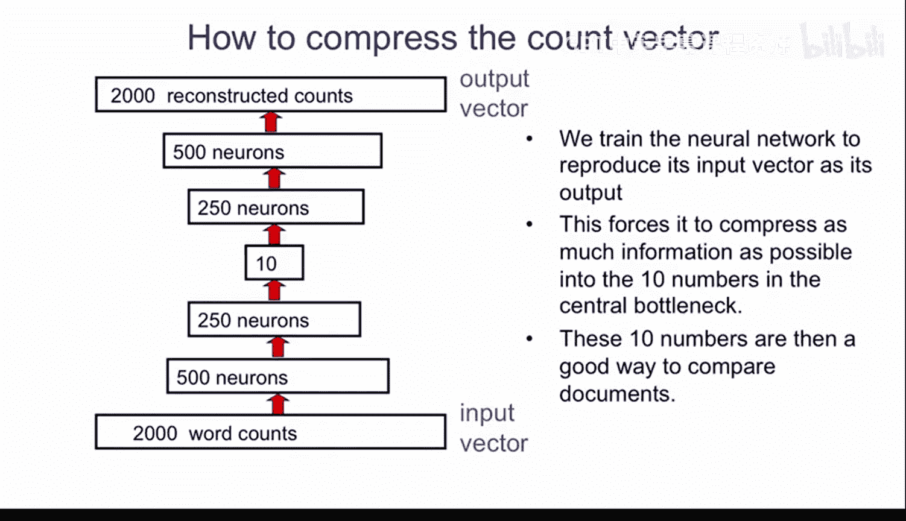
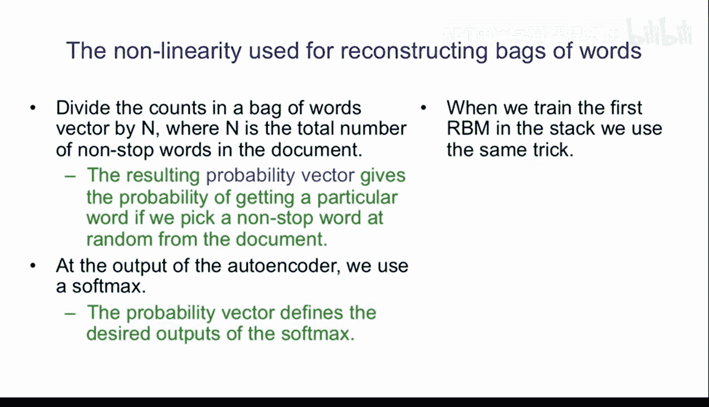
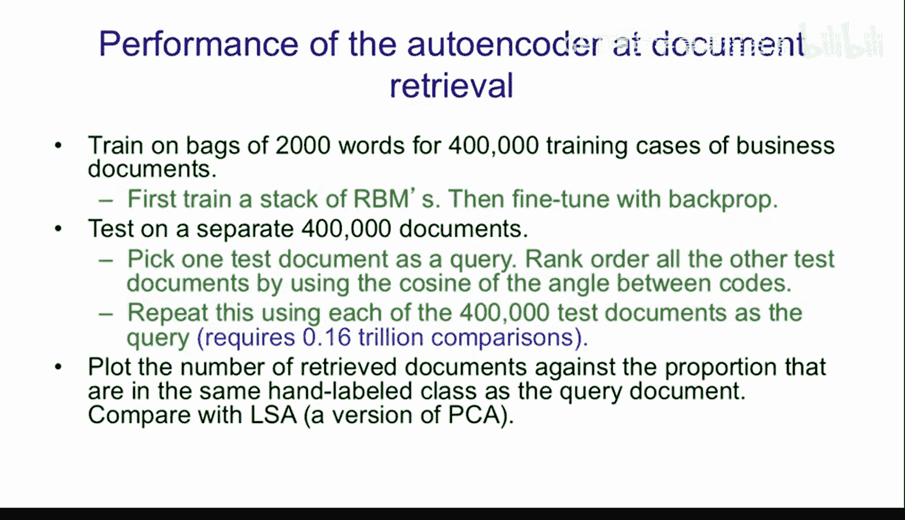
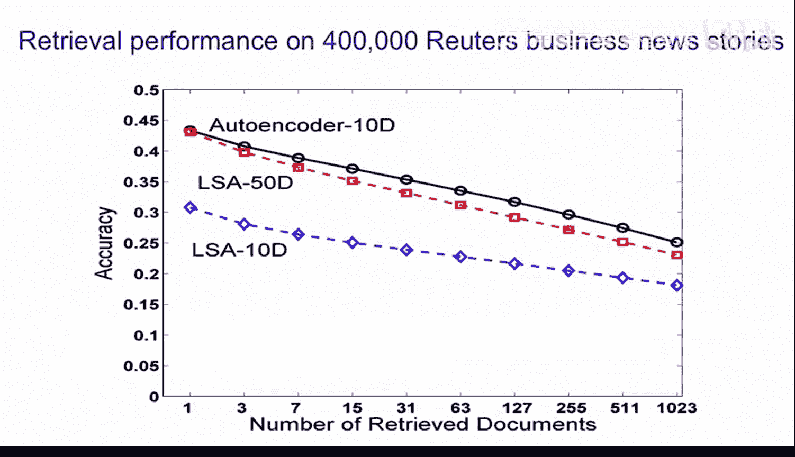
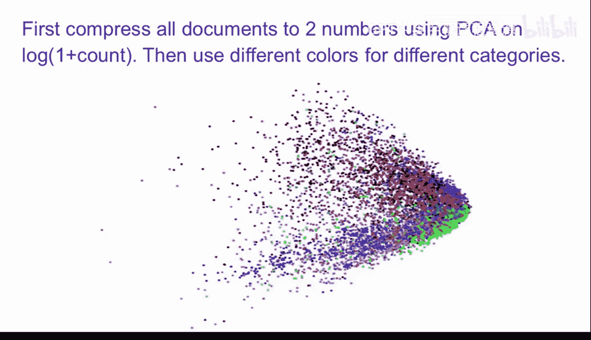

# Hinton@多伦多大学《机器学习的神经网络｜Neural Networks for Machine Learning 2016》claude-4s p71 -71-Lecture 15.3 — Deep autoencoders for document retrieval  -Neural Networks fo -BV1HtkUB2EZD_p71-

In this video。I'm going to talk about applying deep auto encoders。To document retrieval。

 there was a method developed some time ago called latent semantic analysis。

That amounts to applying principal components analysis to vectors of word counts extracted from documents。

The codes produced by latent semantic analysis can then be used for judging similarity between documents so they can be used for document retrieval。

Obviously， if deep auto encoders work much better than PCA。

We would expect to be able to extract much better codes using a deep auto encodecor than using latent amount analysis。

 and Russ Salakudinovly showed that that was indeed the case。Using a big database of documents。

We showed that 10 components extracted with a deepwater encoder are actually worth more than 50 components。

 extracted with a linear method like latent semantic analysis。

We also showed that if you make the code very small， having just two components。

You can use those two components for visualizing documents as a point in a two dimensional map。

And this， again， works much better than just extracting the first two principal components。

To find documents that are similar to a query document。

The first thing we do is convert each document into a big bag of words。In other words。

 we have a vector of word counts。That ignores the order of the words。

This clearly throws away quite a lot of information。

But it also retains a lot of information about the topic of the document。

We ignore words like the or over， which are called stop words because they don't have much information about the topic。

So if you look on the right。I've done the counts for various words。

 and they're actually the counts for the document on the left。

So if you look at what words we have nonze accounts for。

Their vector and count and query and reduce and bag and word。

That tells you quite a lot about what the document is about。Now。

 we could compare the word counts of the query document。

With the word cancel of millions of other documents。

But that would involve comparing quite big vectors。In fact， we use directors of size 2000。

So that will be slow。Alternatively， we could reduce each query vector to a much smaller vector that still contained most of the information about the content。

So here's how we do the reduction。We take a deep auto encoder。

And we compress the 2000 word counts down to 10 real numbers。

From which we can reconstruct the 2000 word counts。Although we can't reconstruct them very well。

We train the neural network。To reproduce its input vector it is output vector as well as possible。

 and that forces it to put as much information about the input into those 10 numbers as possible。

We can then compare documents using just 10 numbers。

That's going to be much faster。So there's one problem with this。😔。

Which is word counts aren't quite the same as pixels or real values。

What we do is we divide the counts in a bag of words by the total number of nontop words。

And that converts the vector of counts。Into a probability vector where the numbers add up to 1。

You can think of it as the probability of getting a particular word if you picked a word at random in the document。

As long as it' is not a stopoid。So at the output of the auto encoder。

We're using a great big 2000 way soft Mac。And are target values。

Are the probabilities of words when we reduce the count vector to a probability vector？

There's one further trick we have to do。

We treatat the word cancers probabilities。When we're reconstructing them。

But when we're using them to activate the first hidden layer。We multiply all the weights by n。

And that's because we have n different observations from that probability distribution。

If we left them as probabilities。The input units would have very small activities。

And wouldn't provide much input to the first hidden layer。

So we have this funny property that for the first restricted boltan machine。The bus up waits。

N times bigger than the top down weights。So how well does this work？

We trained using bags of 2000 words。On 4000 business documents from the Reuters dataset。

And these documents have been hand labeled。With about 100 different categories。

We first trained a stack of restricted bolts from machines。

And then we find tuned with back propagation。Using a 2000 way Softmax is the output。

And then we tested on a different set of 4000 documents。And to test。

 you pick one document to be the query， one of the test documents。

And then you rank order all the other test documents。

By using the cosine of the angles between the 10 dimensional vectors that the auto encodecor gives you。

You repeat this for each of the 4，000 possible test documents。And then， you plot。

The number of documents you're going to retrieve， that is how far down that rank list you're going to go。

Against the proportion。That are in the same hand labelbeled class as the query document。

This is not a very good measure of the quality of the retrieval。

But we're going to use the same measure for comparing with LSA。

 And so at least it's a fair comparison。

So here's the accuracy of the retrieval as a function of the number of retrieved documents。

And you'll see that an auto encoder。That's just using a code with 10 real numbers。

Hes doing better than latent semantic analysis using 50 real numbers。And of course。

 it's five times less work per document after you've got the code。

Lynt semantic analysis with 10 real numbers is much worse。

We can also do the same thing where we reduced to two real numbers。

And then instead of doing retrieval， we're just going to plot all the documents in a map。

But we're going to color that two dimensional point。

The corresponds to the two numbers produced by PCA。By the class of the document。

So we took the major classes of the documents。We gave those major classes different colors。

And then we used PCA on log of1 plus the count。The point of doing that。Is that it suppresses。

 counts with very big numbers。Which tends to make PCA work better。This is the distribution you get。

And you can see there is some separation of the classes。The green class is in one place。

 The red class is in a slightly different place。But the classes are very mixed up。

Then we did the same thing by using a deep auto encoder to reduce the documents to two numbers and again。

 plotting the documents in a two dimensional space， using those two numbers as the coordinates。

And here's what we got。It's a much better layout。It tells you much more about the structure of the data set。

You can see the different classes， and you can see that they're quite well separated。

We assume that the documents in the middle are ones which didn't have many words in them。

And therefore， it was hard to distinguish between the classes。

A visual display like this could be very useful。If， for example。

 you saw that one of those green dots。Was the accounts and earnings report from Enron。

You probably wouldn't want to buy shares in a company that had a green dot nearby。

