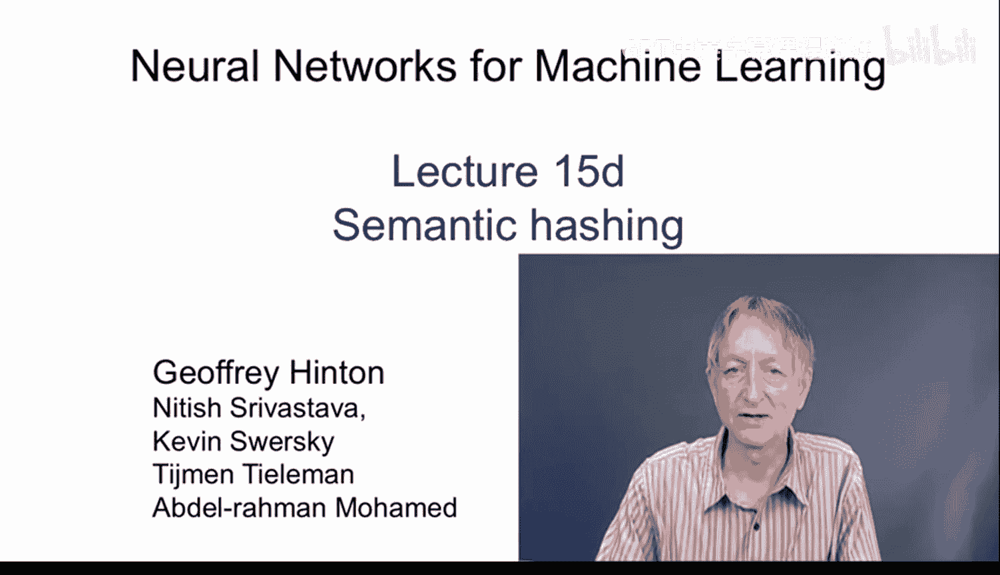
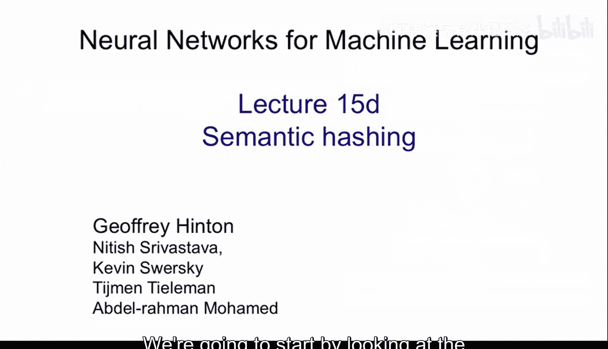
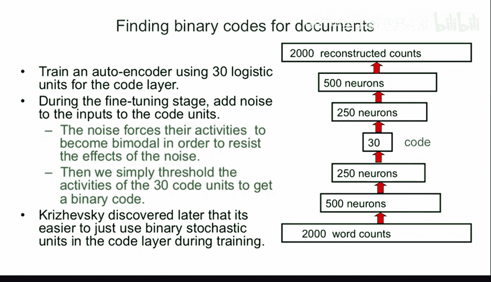
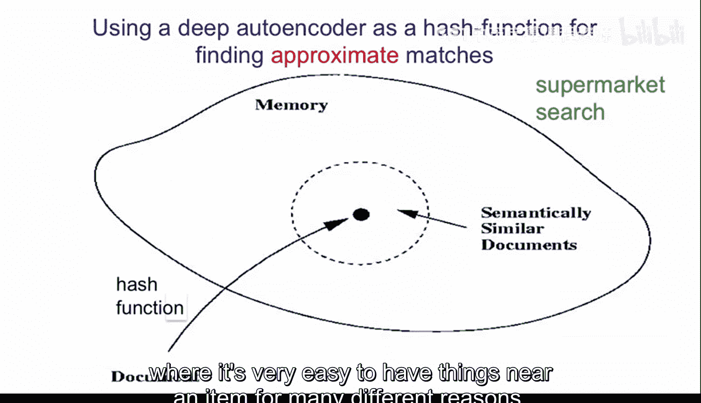
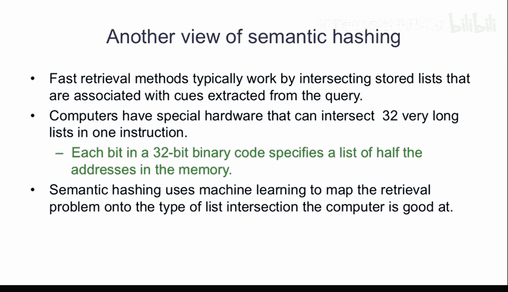

# Hinton@多伦多大学《机器学习的神经网络｜Neural Networks for Machine Learning 2016》claude-4s p72 -72-Lecture 15.4 — Semantic Hashing  -Neural Networks for Machine Learning-.zh_e -BV1HtkUB2EZD_p72-

In this video， Im going to describe a technique called semantic hashing。

That provides an extremely efficient way of finding documents similar to a query document。

The idea is to convert the document into a memory address。

And in that memory to organize things so that if you go to a particular address and look at the nearby addresses。

 you'll find documents that are very similar。This is much like a supermarket where if you go to the location where a particular product is stored and look around。

 you'll find similar products。

People have known for a long time。That if you could get binary descriptors of images。

You'd have a very good way of retrieving images quickly。Some binary descriptors are easy to get。

 For example， is it an indoor scene or an outdoor scene。

Is it a color image or a black and white image。But it's much harder。To get a list of， say。

30 binary descriptors。That are more or less orthogonal to one another， which is what you really need。

This is a problem that machine learning can help us with。

We're going to start by looking at the equivalent problem for documents。

But then we're going to apply it to images。So consider instead of getting real valued codes for documents。

Getting binary codes from the word cancer documents。We do this by training a deep auto encoder。

That has logistic units in its code layer。That by itself is not sufficient because the logistic units。

Will be used in their middle ranges where they have real values in order to convey as much information as possible about the 2000 word counts。

To prevent that， we add noise to the inputs to the code units during the fine tuning stage。

So we first train it as a stack of restricted bolt machines。

We then unroll those bolts machines by using the transposes of the weight matrices for the decoder。

And then we fine tune it with back propagation。And as we're doing that。

We add additional gaussian noise to the inputs to the code units。

In order to be resistant to that noise， the code units need to be either firmly on or firmly off。

And so the noise will encourage the learning to avoid the middle region of the logistic。

Where it conveys a lot of information， but it's very sensitive to noise in its inputs。A test time。

We simply threshold the logistic units in the middle there to get binary values。

So if we can train an auto encodecor like this。We will be able to convert。

The counts for a bag of words。Into a small number of binary values。 In other words。

 will have learned a set of binary features that are good for reconstructing the bag of words。

Later on， Alex Khrsevsky discovered。That we don't actually have to add Gaussian noise to the inputs to the 30 code units。

Instead， we can just make them stochastic binary units。So during the forward pass。

 we stochically pick a binary value using the output of the logistic。

And then during the backward pass， we pretend that wed transmitted the real value probability from the logistic。

 and that gives us a smooth gradient for back propagation。Once we've got these short binary codes。

We could， of course， do a sequential search where for each known document we store a code。

And then when a query document arrives， we first extract its code if it's not one of our known documents。

And then we compare the code with the codes of all the stored documents。

The comparisons can be very fast， because they can use。Special bit operations on a typical CPU。

 which can compare many bits in parallel。But we have to go through a very long list of documents。

 possibly billions。There's a much faster thing we can do。There's a much faster thing we can do。

We can treat the code as if it was a memory address。

So the idea is that we take a document。And we use our deep auto encodecor as a hash function that converts a document into a 30 bit address。

Now we have a memory with 30 bit addresseses。And in that memory。

 each address will have a pointer back to the documents that have that address。

If several documents have the same address， we can make a little list there。Now。

 if the auto encoder is successful in making similar documents， have similar addresses。

We have a very fast way of finding similar documents。You simply take the query document。

You go to the address in memory。That corresponds to its binary code。

And then you look at nearby addresses。 In other words， you start flipping bits in that address。

To access nearby addresses。And you can imagine a little hamming ball of nearby addresses that differ by just a few bits。

What we expect to find at those nearby addresses is semantically similar documents。

So we've completely avoided searching a big list。We simply computer memory address。Flip a few bits。

 and look up。The similar documents。It's extremely efficient。

 especially if we have a very large database， of， say， a billion documents。

We've completely avoided the serial search through a billion items。

I sometimes call this supermarket search because it's like what you would do in a supermarket。

Suppose you went to an unfamiliar supermarket。And you wanted to find anchos。

You might ask the teller at the supermarket。Where do you keep the cans of tuna fish？

You'd then go to that address in the supermarket， and you'd look around。Hopefully near there。

 there's things like cans of salmon。And maybe cansventuries。Of course， if you're unlucky。

 the Ans might have been stored in a completely different place next to the pizza toppings。

And that's the downside of this kind of search。Known as supermarket， it's essentially a 2D surface。

So it's really a 1D string of shelves， which have height， and that gives you 2D。

And so you only have two dimensions in which to locate things。And that's not sufficient。

To put all the things you'd like to be near one another， near one another。You'd like， for example。

 to have。The vegetarian version of things nearby or the kosher version of things nearby。

Or the slightly out of date version of things nearby by。 And in 2 D， you can't do all that。

But what we have here is a 30 dimensional supermarket。And that's a hugely more complex space。

 where it's very easy。To have things near an item for many different reasons。

 because of similarity along many different dimensions。

Here's another view of what we're doing in semantic hashing。

Most of the fast retrieval methods work by intersecting stored lists。

That are associated with cues extracted from the query。So Google， for example。

 will have a list of all the documents that contain some particular rare word。

 and when you use that rare word in your query，They will immediately have access to that list。

They then have to intersect that list with other lists in order to find a document that satisfies all the terms in your query。

Now， computers actually have special hardware。They can intersect 32 very long lists in a single machine instruction。

The hardware is called the memory bus。So each bit in a 32 bit binary address。

Specifies a list of half the addresses in memory。For example。

 if the bit is on and it's the first bit in the address， it specifies the top half of memory。

If the bid is off， it specifies the bottom half of memory。

What the memory bus is doing is intersecting。32 lists to find the one location that satisfies all 32 values in the binary code。

So we can think of semantic hashing。As a way of using machine learning。

To map the retrieval problem onto the type of list intersection the computer is good at。

As long as our 32 Bs correspond to meaningful properties of documents or images。

Then we can find similar ones very fast with no search at all。

