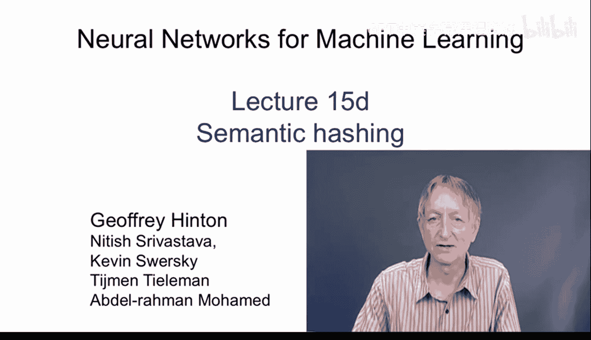
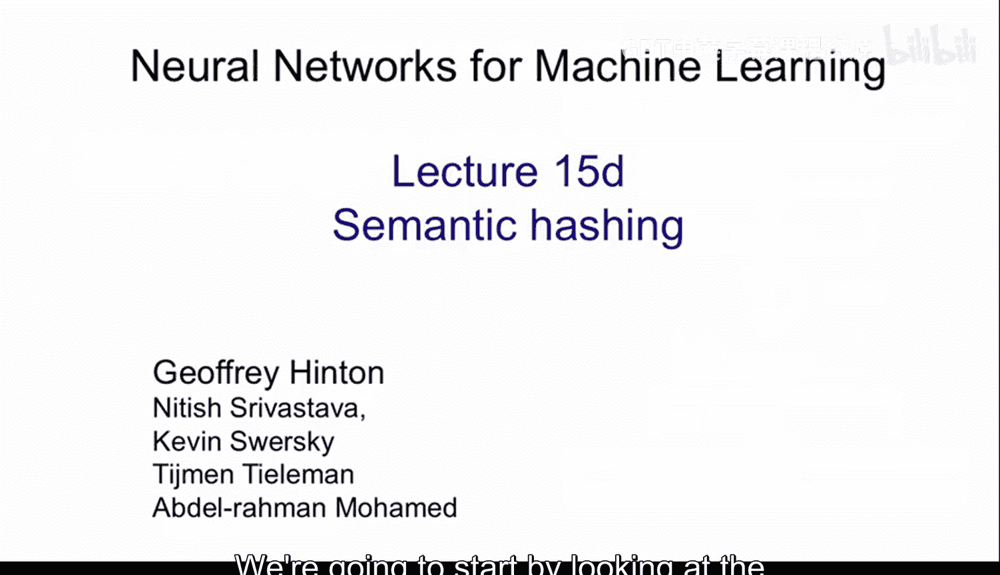
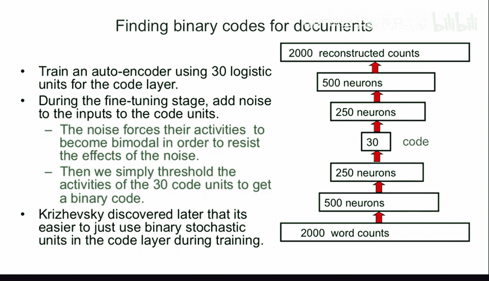
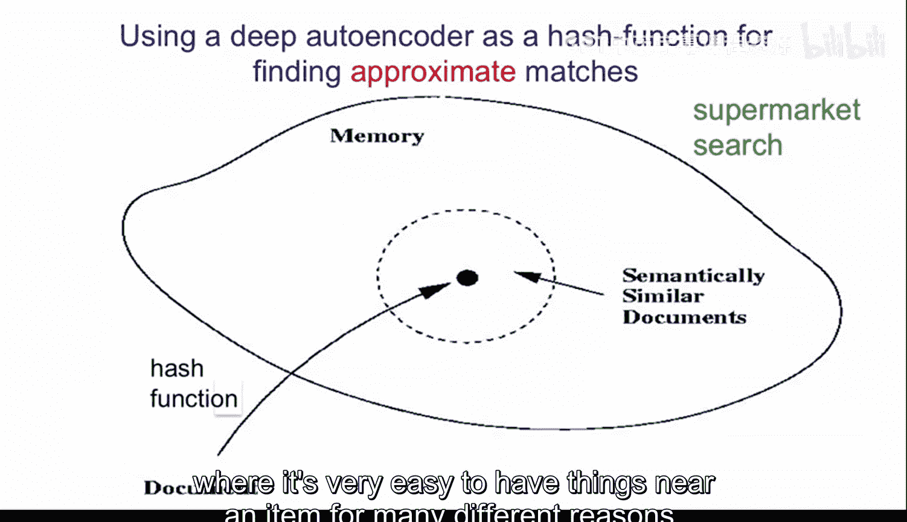
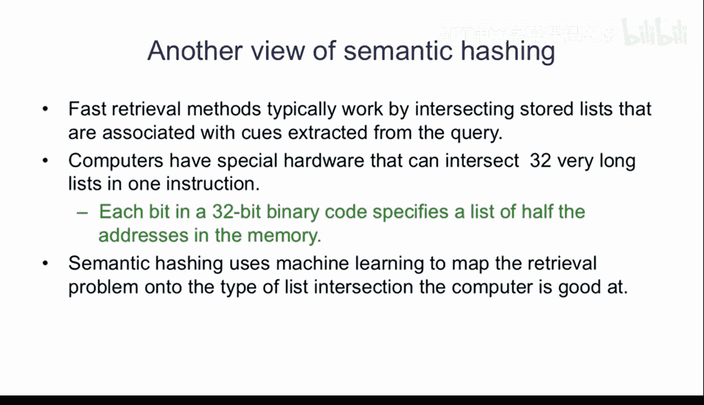

# 机器学习的神经网络：15.4：语义哈希 🗂️

在本节课中，我们将要学习一种名为“语义哈希”的技术。该技术提供了一种极其高效的方法，用于查找与查询文档相似的文档。其核心思想是将文档转换为一个内存地址，并在该内存中组织数据，使得当你访问特定地址并查看其附近地址时，就能找到非常相似的文档。这类似于在超市中，当你走到某个特定商品的存放位置并环顾四周时，就能找到相似的商品。

## 概述

语义哈希旨在解决大规模文档或图像检索的效率问题。传统方法需要遍历庞大的数据库，而语义哈希通过将高维数据（如文档的词袋表示）映射到低维的二进制码，并将此二进制码直接用作内存地址，从而实现了近乎即时的相似项查找。接下来，我们将详细探讨其工作原理、实现步骤以及优势。

## 从文档到二进制码

上一节我们介绍了语义哈希的基本概念，本节中我们来看看如何为文档生成有效的二进制描述符。

人们很早就认识到，如果能获得图像的二进制描述符，就能拥有一种快速检索图像的好方法。某些二进制描述符很容易获取，例如判断场景是室内还是室外，图像是彩色还是黑白。但要获得一组（例如30个）彼此大致正交的二进制描述符则困难得多，而这正是高效检索真正需要的。机器学习可以帮助我们解决这个问题。

我们将从文档的等价问题开始研究，然后再将其应用于图像。

因此，考虑为文档获取二进制码，而不是实值码。我们通过训练一个深度自编码器来实现这一点，该自编码器在其编码层使用逻辑单元。仅此还不够，因为逻辑单元为了尽可能多地传达关于2000个词频计数的信息，会倾向于在其中间值域（实数值）工作。

为了防止这种情况，我们在微调阶段向编码单元的输入添加噪声。具体步骤如下：

1.  首先，将其作为一堆受限玻尔兹曼机进行训练。
2.  然后，使用解码器权重矩阵的转置来“展开”这些玻尔兹曼机。
3.  接着，使用反向传播进行微调。在此过程中，我们向编码单元的输入添加额外的高斯噪声。

为了抵抗这种噪声，编码单元需要被坚定地“开启”或“关闭”。因此，噪声会促使学习过程避开逻辑单元的中间区域，因为该区域虽然能传达大量信息，但对其输入噪声非常敏感。在测试时，我们只需在逻辑单元的中间值处设置阈值，即可获得二进制值。

如果我们能训练出这样的自编码器，就能将词袋的计数转换为少量二进制值。换句话说，我们将学习到一组对重建词袋表示有益的二进制特征。

后来，Alex Krizhevsky 发现，实际上我们不必向30个编码单元的输入添加高斯噪声。相反，我们可以直接让它们成为随机二元单元。因此，在前向传播过程中，我们使用逻辑单元的输出概率随机选取一个二进制值；在反向传播过程中，我们假设传输的是逻辑单元输出的实值概率，这为我们提供了平滑的梯度用于反向传播。

## 利用二进制码进行高效检索

一旦我们获得了这些简短的二进制码，当然可以进行顺序搜索：为每个已知文档存储一个码，当查询文档到达时，首先提取其码（如果它不在已知文档中），然后将其码与所有存储文档的码进行比较。这种比较可以非常快，因为它可以在典型CPU上使用特殊的位操作并行比较多个位。但我们必须遍历一个可能包含数十亿文档的非常长的列表。

有一种更快的办法。我们可以将二进制码视为内存地址。

其思想是，我们取一个文档，并使用我们的深度自编码器作为哈希函数，将文档转换为一个30位的地址。现在我们拥有一个具有30位地址的内存空间。在该内存中，每个地址将包含一个指向具有该地址的文档的指针。如果多个文档具有相同的地址，我们可以在那里建立一个小列表。

现在，如果自编码器成功地使相似文档具有相似地址，我们就拥有了一种非常快速的查找相似文档的方法。你只需获取查询文档，前往其二进制码对应的内存地址，然后查看附近的地址。换句话说，你开始翻转该地址中的位，以访问附近的地址。你可以想象一个小的汉明球，其中的地址仅相差几位。我们期望在这些附近地址找到语义相似的文档。

这样，我们就完全避免了搜索一个大列表。我们只需计算内存地址，翻转几位，然后查找到相似文档。这种方法极其高效，尤其是在我们拥有非常庞大的数据库（例如十亿文档）时。我们完全避免了遍历十亿个项目的串行搜索。

我有时称之为“超市搜索”，因为它就像你在超市里会做的事。假设你去了一个不熟悉的超市，想找到凤尾鱼。你可能会问超市的收银员：“你们把金枪鱼罐头放在哪里？”然后你会去超市的那个地址，并环顾四周。希望在那附近，有像鲑鱼罐头这样的东西。当然，如果你运气不好，凤尾鱼可能被完全存放在另一个地方，比如披萨配料旁边。这就是这种搜索的缺点。

超市本质上是一个二维表面（一排排货架，加上高度，形成二维）。因此，你只有两个维度来定位物品，这不足以将所有你希望彼此靠近的物品都放在一起。例如，你可能希望素食版本、犹太洁食版本或稍微过期的版本都放在附近。在二维空间中，你无法做到所有这些。

但我们这里拥有的是一个30维的“超市”。这是一个复杂得多的空间，很容易让物品因为许多不同维度上的相似性而彼此靠近。

## 语义哈希的另一种视角

以下是语义哈希工作原理的另一种视图。

大多数快速检索方法通过**交集存储列表**来工作，这些列表与从查询中提取的线索相关联。例如，谷歌会有一个包含某个特定罕见词的所有文档的列表，当你在查询中使用该罕见词时，他们就能立即访问该列表。然后，他们必须将该列表与其他列表取交集，以找到满足你查询中所有条件的文档。

计算机实际上拥有特殊的硬件，可以在一条机器指令中交集32个非常长的列表。这种硬件被称为**内存总线**。因此，32位二进制地址中的每一位都指定了内存中一半地址的列表。例如，如果该位是开启的并且是地址的第一位，它指定了内存的上半部分；如果该位是关闭的，它指定了下半部分。

内存总线所做的就是**交集32个列表**，以找到满足二进制码中所有32个值的那个唯一位置。

因此，我们可以将语义哈希视为一种利用机器学习，将检索问题映射到计算机擅长的列表交集类型上的方法。只要我们的32位二进制码对应于文档或图像的有意义属性，我们就可以非常快速地找到相似的项，而无需任何搜索。

## 总结

本节课中，我们一起学习了语义哈希技术。我们了解到，通过训练一个深度自编码器为文档生成紧凑的二进制码，并将此二进制码直接用作内存地址，可以实现极其高效的相似文档检索。该方法的核心优势在于将高维相似性搜索问题，转化为在低维二进制地址空间中进行邻近查找的问题，从而完全避免了遍历整个数据库的昂贵操作。这就像拥有一个高维的“超市”，让语义相似的物品自然地聚集在相近的“货架地址”上。