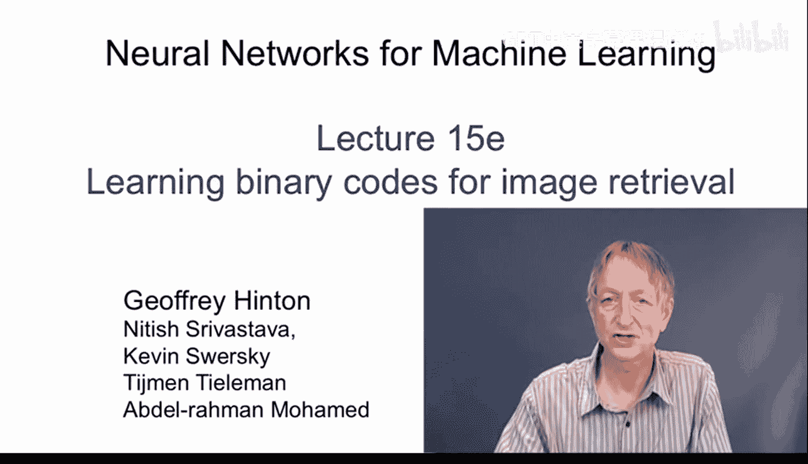
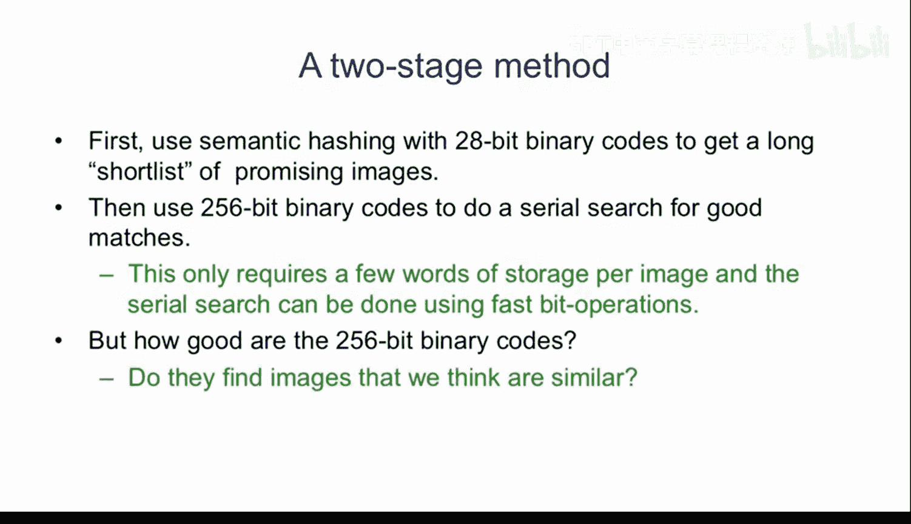
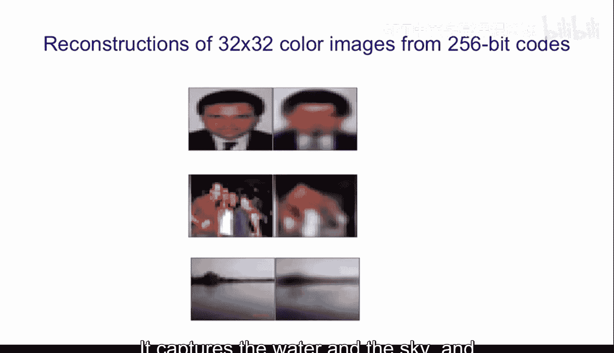
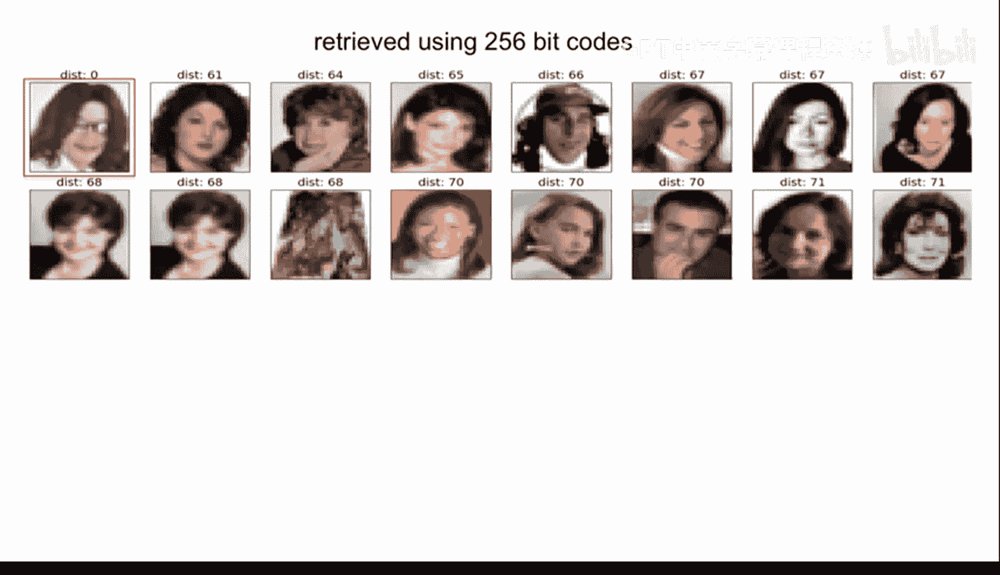
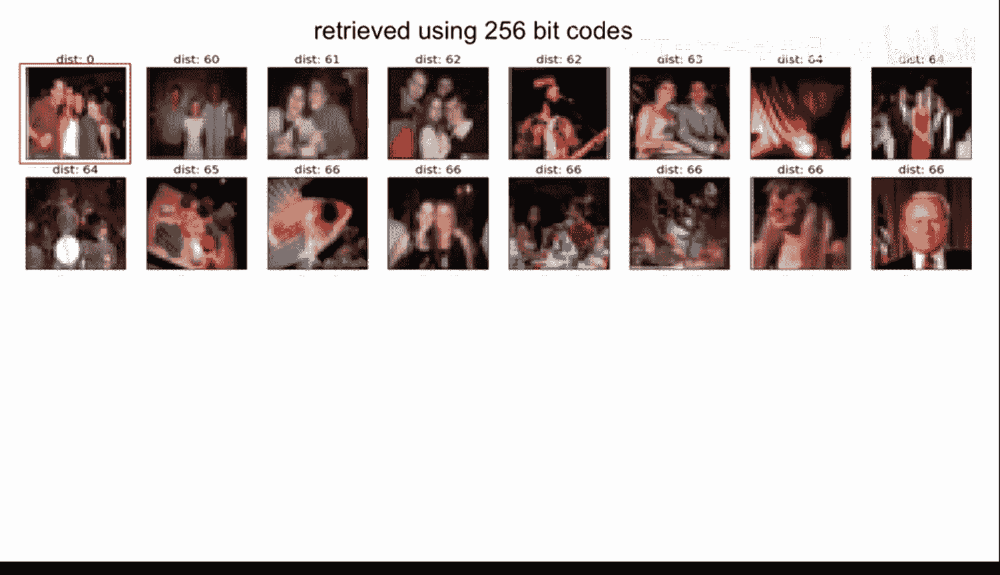
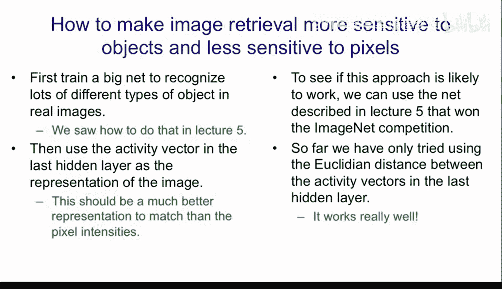

# Hinton@多伦多大学《机器学习的神经网络｜Neural Networks for Machine Learning 2016》claude-4s p73 -73-Lecture 15.5 — Learning binary codes for image retrieval  -Neural Networks f -BV1HtkUB2EZD_p73-

In this video。I' am going to talk about the use of binary codes for image retrieval for retrieving documents。

 people like Google have such good methods already that techniques like semantic hashing may not be of much value。

 but retrieving images is much more difficult。And methods that convert an image into a fairly large binary code of。

 say， 256 bits seem to work quite well。However， we don't want to do a very long sequential search。

Through vectors of 256 bits。So， semantic hashing。Can be used to first create a short list。

 and then we can get better quality matches by using longer binary codes in a serial search。

Now we're going to look at using binary codes for image retrieval。

Image retrieval at present is typically done using the captions。But why not use the images， too。

 They obviously contain a lot more information than the captions。

The basic problem is that pixels are not like words。

Individual pixels don't tell us much about the content of an image。Obviously。

 if we could recognise the objects in the images， then we'd have things that were much more like words。

But recognizings objects is hard。At least it was when we first did this work。Now。

 deep neural nets have got much better at it， and so that may well be the way to go。

So if we're not going to recognize the objects， maybe what we should do is extract a vector that has information about the content of the image。

 And the obvious thing to extract is a real valued vector。

But the problem is that matching real value vectors in a big database is slow。

 and it also requires a lot of storage for the real value vectors。

If we can extract a fairly short binary vector that contains a lot of information about the image。

 that's much easier to store and much faster to match。Even faster is to use a two stage method。

So first， we extract a short binary code of about 30 bits。

And that short binary code is used with semantic hashing to very rapidly get us a short list of promising images。

So we simply take the short binary code and flip a few bits in it to get candid images。

The candidatedid images can then be matched using 256 bit binary codes that are stored with each known image。

To search for much better matches than can be found with a 28 B binary code。

Even a 256 bit binary code only requires four words of memory per image。

And even though we're then going to do a serial search on these binary codes。

The search can be done very fast because it only requires a few operations to compare2 256 binary codes to find out how many bits they have in common。

The question is， how good is a binary code of that size。At retrieving images。

Are they going to find images that we think of as being similar？

So here's a net that was trained by Alex Khushevsky。It's working on small color images。

 So there only 32 pixels by 32 pixels。And he takes his input， the red。

 green and blue channels from those images。So there's 3000 inputs。

It then expands that to a larger number of hidden units。

Because we're going to go from real valued inputs。2 logistic hidden units。

 which probably have less capacity。We then progressively decrease the number of units in each layer until we get down to 256 Bs。

This encoder has about 67 million parameters， it's quite big。It takes a few days to train it。

On an NviIDdia GPU。And Alex trained it on 2 million images。

There's absolutely no theory to justify the architecture he used。We know we want a fairly deep net。

 It makes sense to make it get narrower as we go up。

But this particular architecture where you halve the number of units each layer is just a guess。

The interesting thing is。A guest like this already works quite well。And presumably。

 there are some other architectures that will work better。The first question to ask。

Is how well does an auto encodecor like this do at reconstructing the images。

 so here's a face image and its reconstruction。And you can see that from the reconstruction。

 you can tell what kind of an image it is。 Here's another example。Where it's a scene。

 probably at a party。You can't really tell what kind of a scene it is from the image。

 but you might guess that there are a number of people involved or you might not。

He is an outdoor scene。And you can see that the reconstruction captures a lot of information about the outdoor scene。

It captures the water and the sky and the fact that there's a thin strip of land。

So let's look at the quality of retrieval we can do。

With an auto encodeder that gives those kinds of reconstructions。

We'll start with a picture of Michael Jackson， in the red square。And Alex retrieved。

The most similar images。 And above each image， you can see how many bits it differed from Michael Jackson by。

And you'll notice there are all a fairly similar number of bits。In 256 Bs。

 differing by only 61 Bs is extraordinarily unlikely to happen by chance if they were random images。

It has to be a pretty similar image to differ by so few bits。

One nice thing about what's retrieved is with one exception， they're all faces。

If we look at the retrieval you get by using Euclidean distance on the raw pixels。

Then some of them are faces， but most of them aren't。So obviously。

 the auto encoder has understood something about faces。

That isn't in the information about Euclidean distance。It's clearly giving much better retrieval。

Let's take another example。Here we took the image of the party scene。And retrieve other images。

And you can see that about half of them have images you would think of as fairly similar。

 their other party scenes。They're typically other party scenes with something bright in the middle。

 like the original party scene。And you'll notice that most of the bad matches also have something bright in the middle。

So even though we're getting down to 256 bit binary codes through a lot of hidden layers。

Is still sensitive to quite a lot about the image structure and where the brighter patches are。

If you look at what Euclidean distance does， it's much worse。

Euclidean distance gets one other scene with a group of people。

And then everything else is fairly dissimilar。You'll notice with Euclidean distance。

 it often gets very smooth images。That's because if you can't match。

The high frequency variation in the image。He's better to match his average。

Than to get other stuff with high frequency variation that's out of phase。

So when you've got a complicated image， Euclidean distance will typically find smooth images to match it。

And that's because it's minimizing a square error in pixel space。

So obviously we'd like the image retrieval to be more sensitive to the content of the image。

 that is to the kinds of objects in their relationships in the image and less sensitive to the pixel intensities。

We can do that by first training a big net to recognize lots of different kinds of object in real images。

And we saw how to do that in lecture 5。Then we take the activity vector in the last hidden layer of the big net and use that as a representation of the image。

This should be much better than the pixel intensities at capturing information about the kinds of objects in the image。

So to see if this approach is likely to work。We used the net described in lecture 5 that won the image net competition。

So far， we've only tried it on Euclidean distance。Between the activity vectors in the last hidden layer。

But obviously， if it works for that。We could then take those activity vectors。

And build an auto encodecor on those to get them down to binary codes。

So let's first see if it works with Euclidean distance。It turns out it works really well。

We don't know yet whether it will work with binary codes。So in the column on the left。

You see the query images。And then to the right of them， you see all the things that were retrieved。

If you look at the elephant query image， you'll see that what gets retrieved is other elephants。

 but elephants with very different poses。So those images。

Wouldn't have a very good overlap in P space。Although the overlap wouldn't be that bad。

If you look at the Halloween pumpkins。You'll see that all the retrieved things are other Halloween pumpkins。

And some of them would have a pretty bad overlap in P space。Similarly， with the aircraft carrier。

We retrieve other images of aircraft carriers that are very different。So， we anticipate。

That if we could reduce these activity vectors。To short binary codes。

We would have a fast and effective way of retrieving similar images just by the content of the image。

We'll see in lecture 16。That we could actually combine。

The content of the image with the caption of the image to get an even better representation。

