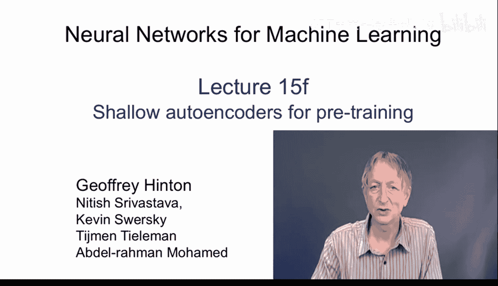
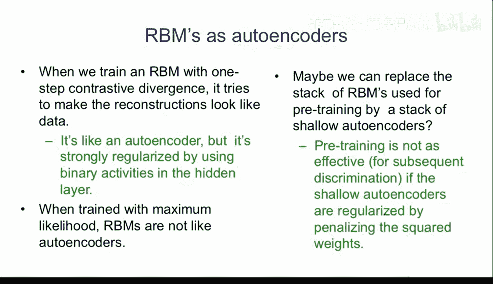
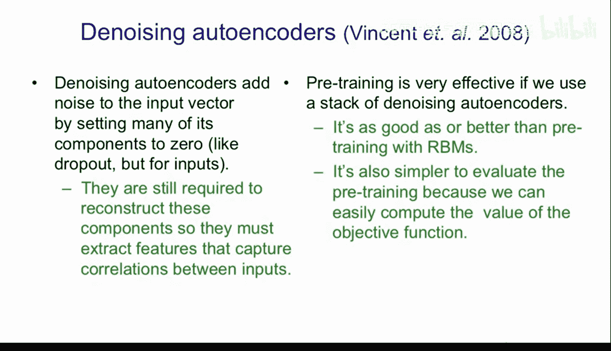
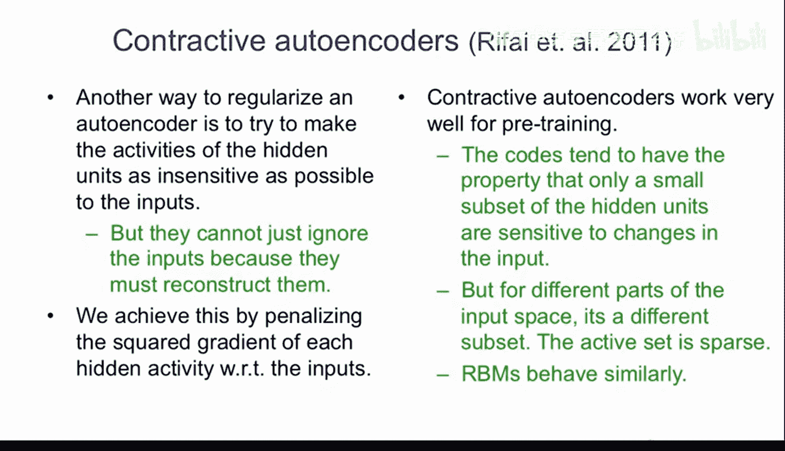
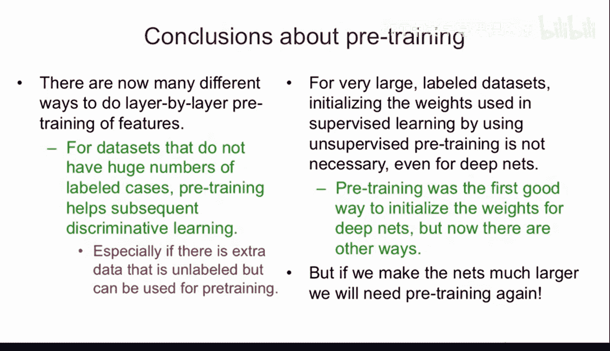

# Hinton@多伦多大学《机器学习的神经网络｜Neural Networks for Machine Learning 2016》claude-4s p74 -74-Lecture 15.6 — Shallow autoencoders for pre-training  -Neural Networks for M -BV1HtkUB2EZD_p74-

In this video。I'm going to talk about alternative pre training methods for learning deep neural nets。

I introduce pre training。Using restricted bolt machines， trained with contrasted divergence。

But after that， people discovered there are many other ways to pretrain laser features。And indeed。

 if you initialize the weights correctly， you may not need pre training at all。

 provided you have enough labeled data。

We've seen some of the neat things that can be done with the codes produced by deep water encoders。

I now want to consider shallow water encors that just have one hidden layer。

Restricted bolts from machines。Can be viewed as shallow auto encoders。

 particularly if they're trained with contrasted divergence。

Because they're trying to make the reconstructions look like the data。When viewed as an auto encoder。

A restricted Balum machine has very strong regularization。

Because the hidden units are only allowed to have binary activities。

 and this restricts their capacity a lot。If we train restricted bolt machines with maximum likelihood。

They're not at all like or encounters。One way to see that。Is if you had a pixel that was pure noise。

 an auto encodecoder would try to reconstruct whatever noise value it had。

A restricted boltsman machine trained with maximum likelihood would completely ignore that pixel and model it just using the bias for that input。

So since we can view a restricted Bs machine as a kind of strongly regularized auto encoder。

Maybe we can replace the RBMs that we use for pretraining。With a stack of auto encoders。

It turns out that if you do that， pre trainee is not as effective。

At least that's true if you use shallow water coders。

That areregularized just by penalizing the squared weights。

So stacking these auto encodecors doesn't work as well as stacking restricted boltman machines。

However， there's a different kind of auto encoder that does work as well。

And that's the denoising or encodeder。That's been studied extensively by the group in Montreal。

Denoising autoencors work by adding noise to each dimple vector by setting many of the components to 0。

But it's different components for different input vectors。This resembles dropout。

 but it's for the inputs rather than the hidden unit。

The denoing auto encodeder is still required to reconstruct the inputs that have been set to zero。

And so it can't just copy its input。The danger with the shallow water encoder is that if you give it enough hidden units。

 it might just copy each pixel to one hidden unit and then reconstruct that pixel from that hidden unit。

A denoisising auto encoder clearly can't do that。So it has to use hidden units to capture correlations between the inputs。

So that it can use the values of some inputs to help it reconstruct the inputs that have been zeroed out。

If we use a stack of dennoising autoenrs， pretrain is very effective。

The some cases in which RBM still work better， but in most cases。

 denoising auto encodederrs are more effective。 It's also much simpler to evaluate the pretrain using a denoising autoenr because we can easily compute the value of the objective function。

When we pre train a restricted boltser machine with contrasted divergence。

 we can't compute the value of the real objective function we're trying to minimize。

 So we often just use the squared reconstruction error， which is not actually what's being minimized。

In a denoising autoenr。We can print out the value of the thing we're trying to minimize。

 and that's very helpful。

One disadvantage of the denoy auto encoder。Is that it lacks the nice variational bound we get with of restricted boltum machines。

But that's only of theoretical interest because it only applies if the restricted B machine is trained with maximum likelihood。

Yet another kind of auto encoder is the contractive auto enr that was also developed by the group of Montreal。

The way this works is that we try to make the hidden activities be as insensitive as possible to the inputs。

Of course， the hidden units can't just ignore the inputs altogether because they have to be able to reconstruct them。

The way we achieve this insensivity。Is by penalizing the squared gradient of each hidden unit with respect to each input。

 So we try and make each hidden unit。So it won't change much。If we change an input value。

Contractive auto encoders also work very well for pre training。

Their codes tend to have the property that only a small subset of the hidden units are in their sensitive range for different parts of the space。

It's a different subset。And so this active set acts like a sparse coat。

The other hidden units are all saturated and are insensitive。

RBMs actually have a very similar behavior。After they've been trained。

 many of the hs will be saturated。And the working set of unsaturated ones will be different for different training cases。

I want to finish by summarizing my current view of pre training。

There are now many different ways to do layer by layer pre training。That discovers good features。

When our data set does not have a huge number of labels。

This way of discovering features before you ever use the labels is very helpful for the subsequent discriminative fine tuning。

It discovers the features without using the information in the labels。

And then the information in the labels is used for fine tuning the decision boundaries between classes。

It's especially useful if we have a lot of unlabelled data so that the pre training can do a very good job of discovering interesting features。

Using a lot of data。For very large labeled data sets， however。

Initializing the weights that are going to be used for supervised learning。

By using unsupervised pretraining。Is not necessary， even if the nets are deep。

Pre training was the first good way to initialize the weights for deep nets。

 but now we have lots of other ways。However， even if we have a lot of labels。

 if we make the nets much larger again。Will need pre training again。

So an argument I often have with people from Google。I they say we've got lots and lots of label data。

So we don't need regularization methods。 Our nets won't overfit anyway， because we got so much data。

The counter argument is， that's only because you're using nets that are much too small。

You should use much， much bigger nets on much， much more powerful computers。

 And then you'll start overfitting again， and you'll need these regularization methods like drop out and pre training。

If you ask which regime the brain is in， the brain is clearly in the regime where it's got huge numbers of parameters compared with the amount of data it's got。

And so for the brain， at least， regularization methods are very important。

