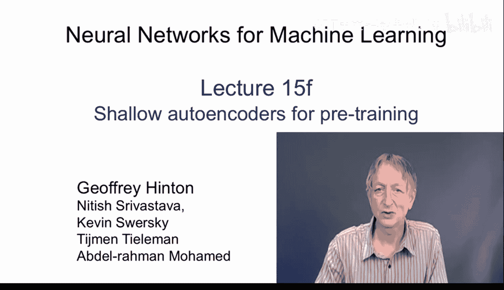
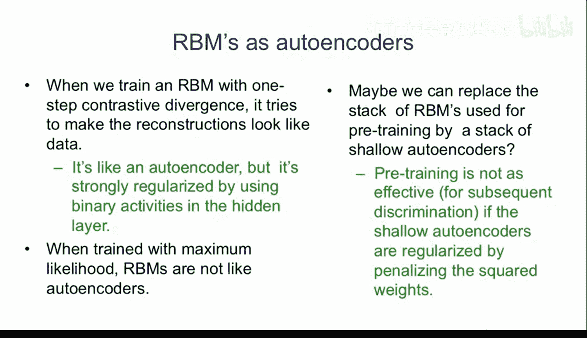
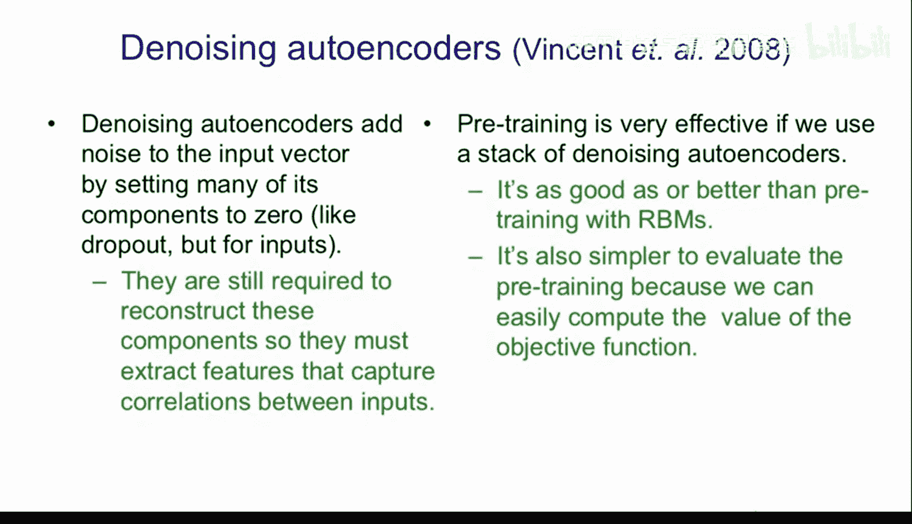
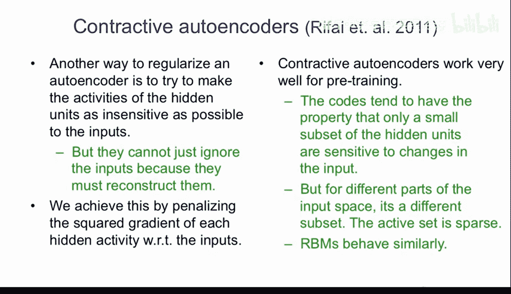
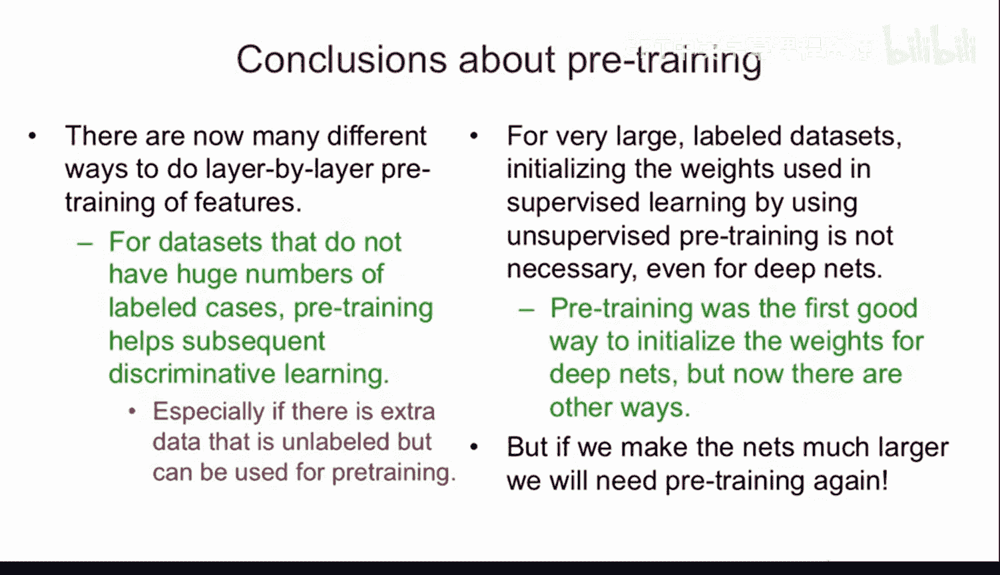

# 神经网络与机器学习：15.6：用于预训练的浅层自编码器

在本节课中，我们将探讨用于学习深度神经网络的替代性预训练方法。我们将介绍几种不同的浅层自编码器，并比较它们在预训练中的效果。

## 概述



上一节我们介绍了使用对比散度训练的受限玻尔兹曼机进行预训练。本节中，我们来看看其他几种有效的预训练方法，特别是不同类型的浅层自编码器。

## 浅层自编码器与受限玻尔兹曼机

受限玻尔兹曼机可以被视为一种浅层自编码器，尤其是在使用对比散度训练时，因为它们的目标是使重构数据看起来像原始数据。

作为一种自编码器，受限玻尔兹曼机具有非常强的正则化能力，因为其隐藏单元只允许有**二元激活**，这极大地限制了其容量。

```
# 受限玻尔兹曼机的二元隐藏单元
hidden_activation = binary(weighted_sum(inputs) + bias)
```

然而，如果用最大似然法训练受限玻尔兹曼机，它们的行为就与自编码器完全不同。例如，对于一个纯噪声像素，自编码器会尝试重构其噪声值，而最大似然训练的受限玻尔兹曼机会完全忽略该像素，仅使用该输入的偏置来建模。

## 堆叠自编码器的效果

既然我们可以将受限玻尔兹曼机视为一种强正则化的自编码器，那么或许可以用一堆自编码器来替代用于预训练的受限玻尔兹曼机。



事实证明，如果使用仅通过惩罚权重平方来进行正则化的浅层自编码器，那么堆叠这些自编码器的预训练效果不如堆叠受限玻尔兹曼机有效。

## 去噪自编码器

然而，有一种不同类型的自编码器效果同样出色，那就是由蒙特利尔小组广泛研究的**去噪自编码器**。

去噪自编码器的工作原理是，通过将许多分量设置为0来为每个样本向量添加噪声，但不同输入向量的噪声分量不同。这类似于Dropout，但它是针对输入而非隐藏单元。

去噪自编码器仍然需要重构那些被置零的输入，因此它不能简单地复制其输入。浅层自编码器的风险在于，如果给予足够多的隐藏单元，它可能只是将每个像素复制到一个隐藏单元，然后从该隐藏单元重构该像素。而去噪自编码器显然无法做到这一点。

因此，它必须使用隐藏单元来捕获输入之间的相关性，以便利用某些输入的值来帮助重构那些被置零的输入。

以下是去噪自编码器的核心思想：

```
# 去噪自编码器前向过程
corrupted_input = apply_noise_mask(original_input)  # 添加噪声
hidden_code = encode(corrupted_input)               # 编码
reconstructed_input = decode(hidden_code)           # 解码
loss = compare(reconstructed_input, original_input) # 与原始输入比较
```

如果使用一堆去噪自编码器进行预训练，效果会非常好。在某些情况下，受限玻尔兹曼机仍然表现更好，但在大多数情况下，去噪自编码器更有效。



去噪自编码器的另一个优点是，评估其预训练过程更简单，因为我们可以轻松计算目标函数的值。当我们使用对比散度预训练受限玻尔兹曼机时，无法计算我们试图最小化的真实目标函数值，通常只能使用平方重构误差，而这并非实际被最小化的目标。在去噪自编码器中，我们可以打印出我们试图最小化的目标值，这非常有帮助。

去噪自编码器的一个缺点是，它缺乏受限玻尔兹曼机所具有的漂亮的变分下界。但这只是理论上的兴趣，因为该下界仅适用于用最大似然法训练的受限玻尔兹曼机。

## 收缩自编码器

另一种自编码器是由蒙特利尔小组开发的**收缩自编码器**。

其工作原理是，我们试图使隐藏层活动对输入尽可能不敏感。当然，隐藏单元不能完全忽略输入，因为它们必须能够重构输入。

我们通过惩罚每个隐藏单元相对于每个输入的**平方梯度**来实现这种不敏感性。我们试图使每个隐藏单元在输入值改变时变化不大。

收缩自编码器在预训练中也表现得非常好。它们的编码倾向于具有这样的特性：对于空间的不同部分，只有一小部分隐藏单元处于敏感范围。这是一个不同的子集，因此这个活动集就像一个稀疏编码。其他隐藏单元都处于饱和状态且不敏感。

受限玻尔兹曼机在训练后实际上也有非常相似的行为：许多隐藏单元会饱和，而对于不同的训练样本，未饱和的“工作集”也会不同。



## 预训练的当前观点总结

现在有许多不同的方法可以进行逐层预训练，以发现良好的特征。

当我们的数据集没有大量标签时，这种在使用标签之前发现特征的方法对后续的判别性微调非常有帮助。它可以在不使用标签信息的情况下发现特征，然后利用标签信息来微调类别之间的决策边界。

如果我们有大量未标记数据，使得预训练能够很好地发现有趣特征，那么这种方法尤其有用。

然而，对于非常大的标记数据集，通过无监督预训练来初始化用于监督学习的权重是不必要的，即使网络很深。预训练是初始化深度网络权重的第一个好方法，但现在我们有了许多其他方法。

但是，即使我们有很多标签，如果我们再次使网络变得更大，我们将再次需要预训练。

我经常与来自谷歌的人争论。他们说他们有很多很多标签数据，因此不需要正则化方法，他们的网络无论如何也不会过拟合，因为他们有这么多数据。

反驳的论点是，这只是因为你们使用的网络太小了。你们应该在更强大的计算机上使用更大、更大的网络，然后你们会再次开始过拟合，并且将需要像Dropout和预训练这样的正则化方法。

如果你问大脑处于哪种状态，大脑显然处于其参数数量远多于其数据量的状态。因此，至少对于大脑来说，正则化方法非常重要。



## 总结

本节课中，我们一起学习了用于深度神经网络预训练的几种浅层自编码器方法。我们比较了标准自编码器、去噪自编码器和收缩自编码器的原理与效果，并讨论了预训练在数据量不同情况下的重要性。理解这些方法有助于我们根据实际任务和数据条件，选择合适的策略来初始化网络权重，从而提升模型性能。