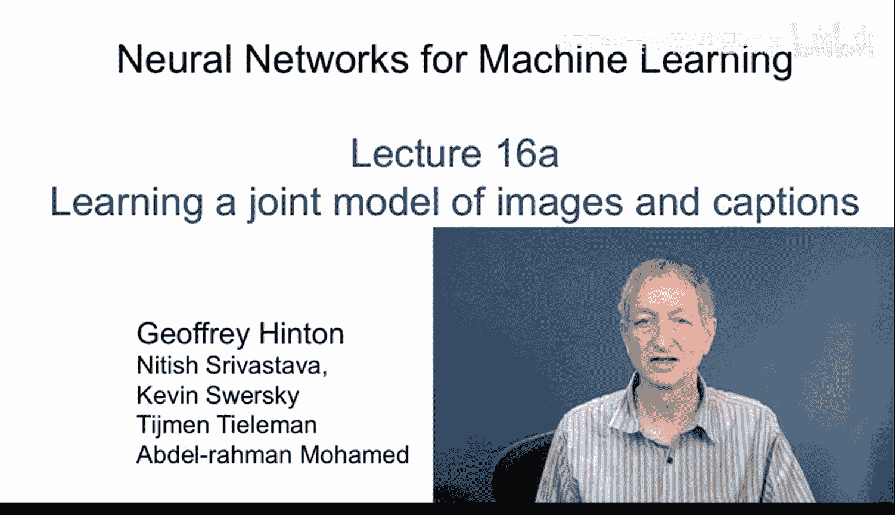
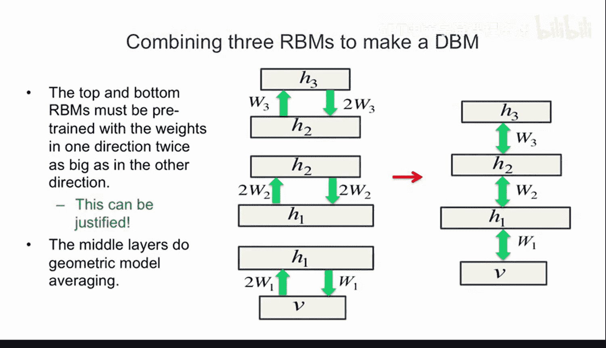
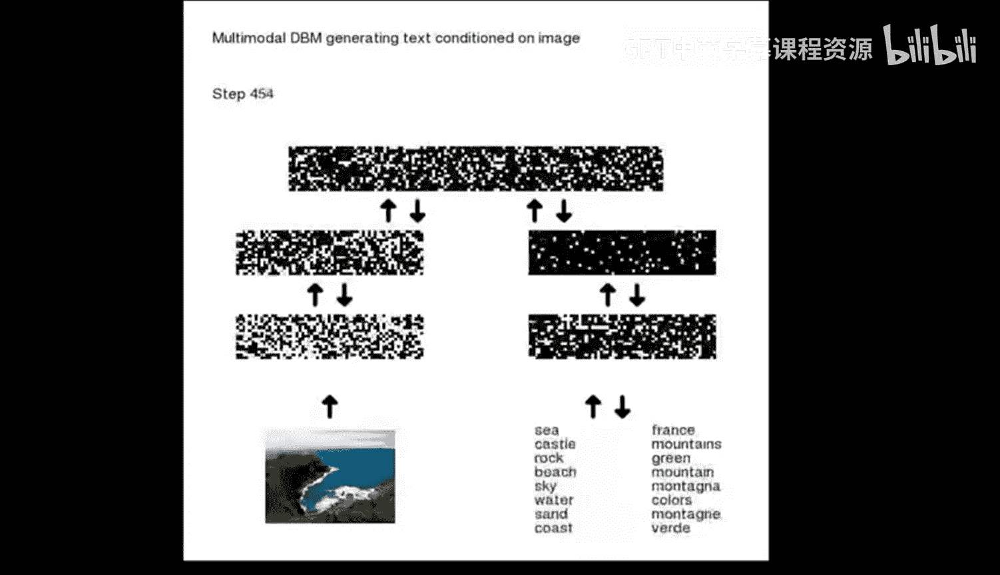
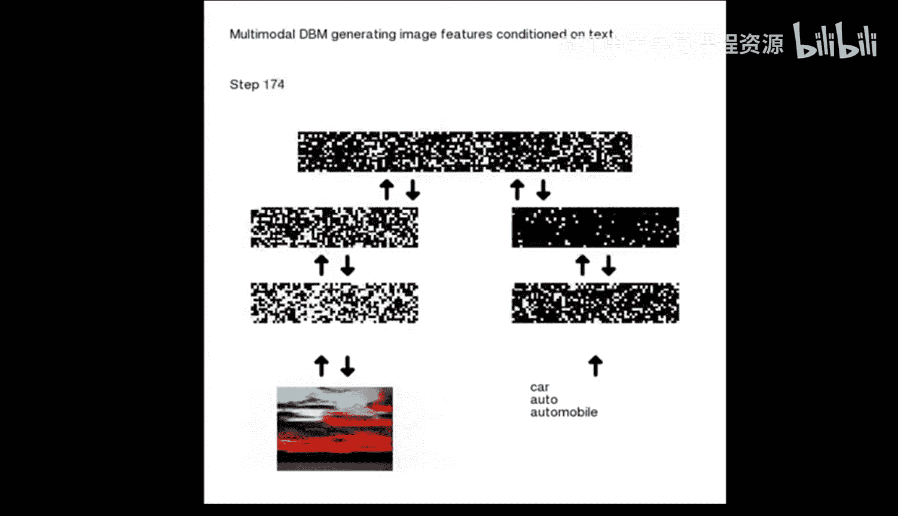

# Hinton@多伦多大学《机器学习的神经网络｜Neural Networks for Machine Learning 2016》claude-4s p75 -75-Lecture 16.1 — Learning a joint model of images and captions  -Neural Networ -BV1HtkUB2EZD_p75-

In this video， I am going to talk about some recent work on learning a joint model of captions and feature vectors that describe images。

In the previous lecture， I talked about how we might extract semantically meaningful features from images。

But we were doing that with no help from the captions。Obviously。

 the words in a caption ought to be helpful。In extracting appropriate semantic categories from images。

And similarly， the images ought to be helpful in disambiguating what the words in the caption mean。

So the idea is we're going to train a great big net that gets his input。

 standard computer vision feature vectors extracted from images。

And bag of words representations of captions。And learns how the two input representations are related to each other。

At the end of the video， I'll show you a movie。Of the final network， using words。

To create feature vectors for images and then showing you the closest image in its database。

And also using images to create bags of words。 I'm now going to describe some work by Niti Srivaovva。

 who's one of the Ts for this course and Ru and Salakkuinov that will appear shortly。

The goal is to build a joint density model of captions。And of images。

 except that the images are represented by the features standardly used in computer vision。

 rather than by the raw pixels。This needs a lot more computation。

Than building a joint density model of labels and digit images。

 which is what we saw earlier in the course。So what they did was they first trained a multi la model of images alone。

That is， it's really a multi layer model of the features they extracted from images using the standard computer vision features。

Then separately， they train a multi layer model of the word count vectors from the captions。

Once they frame both of those models， they add a new top layer that's connected to the top layers of both of the individual models。

After that， they used further joint training of the whole system。

So that each modality can improve the earlier layers of the other modality。

Instead of using a deep belief net， which is what you might expect。

 they used a deep boltsman machine。Where the symmetric connections put in all pairs of layers。

The further joint training of the whole deep Bolsman machine。

Is then what allows each modality to change the feature detectors in the early layers of the other modality。

That's the reason they used a deep Bolsman machine。

They could have also used a deep belief net and done generative fine tuning with contrastive wake sleep。

But the fine tuning algorithm for deep Balsom machines may well work better。

This leaves the question of how they pre traineded the hidden layers of a deep Bolman machine。

Because what we've seen so far in the course is that if you train a stack of restricted Baltzer machines and you combine them together into a single composite model。

 what you get is a deep belief in it， not a deep Balsmore machine。So I'm now going to explain how。

 despite what I said earlier in the course， you can actually pre train。

A stack of restricted Bolsum machines in such a way that you can then combine them to make a deep Balsmer machine。

The trick is that the top and the bottom restricted boltolsum machines in the stack。

How to be trained with weights that are twice as big in one direction as the other。

So the bottom bolts machine that looks at the visible units。

Is trained with the bottom up weights being twice as big as the top down weights。Apart from that。

 the weights are symmetrical。 So this is what I call scale symmetrical。

But the bottom up weights are always twice as big as their top down counterparts。

This can be justified， and I'll show you the justification in a little while。

The next restricted box for machine in the stack。Is trained with symmetrical weights。

I've called them 2 W here rather than W for reasons you'll see later。

We can keep training with restricted bolts and machines like that。

 with genuinely symmetrical weights。But then the top one in the stack has to be trained with the bottom up weights being half of the top down weights。

So again， these are scale symmetric weights。But now。

 the top down weights are twice as big as the bottom up weights。

That's the opposite of what we had when we trained the first restricted bolts for machine in the stack。

After having trained these three restricted bolts from machines。

 we can then combine them to make a composite model。 and the composite model looks like this。

For the restrict bolt machine in the middle， we simply halved its weights。

That's why they were 2 W2 to begin with。For the one at the bottom， we've halved the upgoing weights。

But kept the down going weights the same。 And for the one at the top。

 we've halved the down going weights and kept the upgo weights the same。Now， the question is。

 why do we do this funny business of hallving the weights？The explanation is quite complicated。

 but I'll give you a rough idea of what's going on。If you look at the layer H1。

We have two different ways of inferring the states of the units in H1。

In the stack of restricted boltsen machines on the left。We can either infer states of H1。

 bottom up from V。Or we can infer the states of H1 top down from H2。

When we combine these bolt and machines together。What we're going to do is we're going to take an average of those two ways of inferring each one。

And to take a geometric average， what we need to do is halve the weights。

So we're going to use half of what the bottom up model says。So that's half of 2 W1。

And we're going to use half of what the top down model says。That's half of 2 W2。

And if you look at the deep bolts machine on the right。

 that's exactly what's being used to infer the state of H1。In other words。

 if you're given the states in H2 and you're given the states in V。

 those are the weights you'll use for inferring the state of H1。

The reason we need to halve the weights。Is so that we don't double count。

You see in the bolts machine on the right。The state of H2 already depends on V。

At least it does after we've done some settling down in the boltsman machine。

So if you were to use the bottom up input coming from the first restricted bolts machine in the stack。

And we used the top down input coming from the second bolts machine in the stack。

Would be counting the evidence twice， because we'd be inferring H1 from V and we'd also be inferring it from H2。

 which itself depends on V。In order not to double count the evidence， we have to halve the weights。

That's a very high level and perhaps not totally clear description of why we have to halve the weights。

 If you want to know the mathematical details， you can go and read the paper。

But that's what's going on。And that's why we need to halve the weights so that the intermediate layers can be doing geometric averaging。

Of the two different models of that layer from the two different restricted bolts from machines in the original stack。

