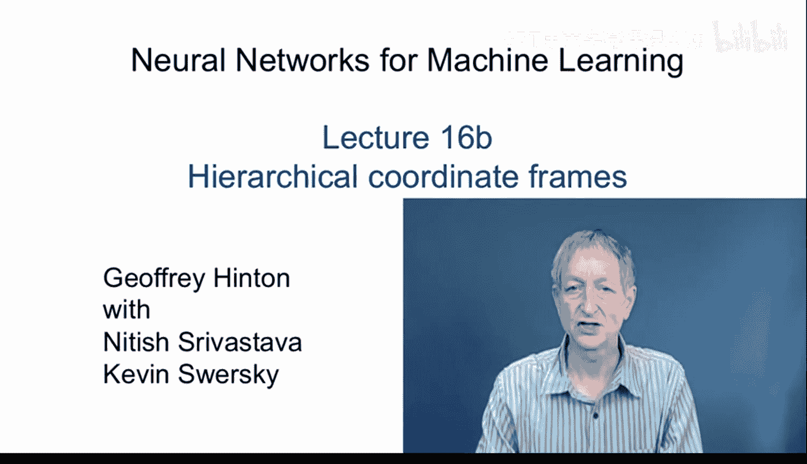
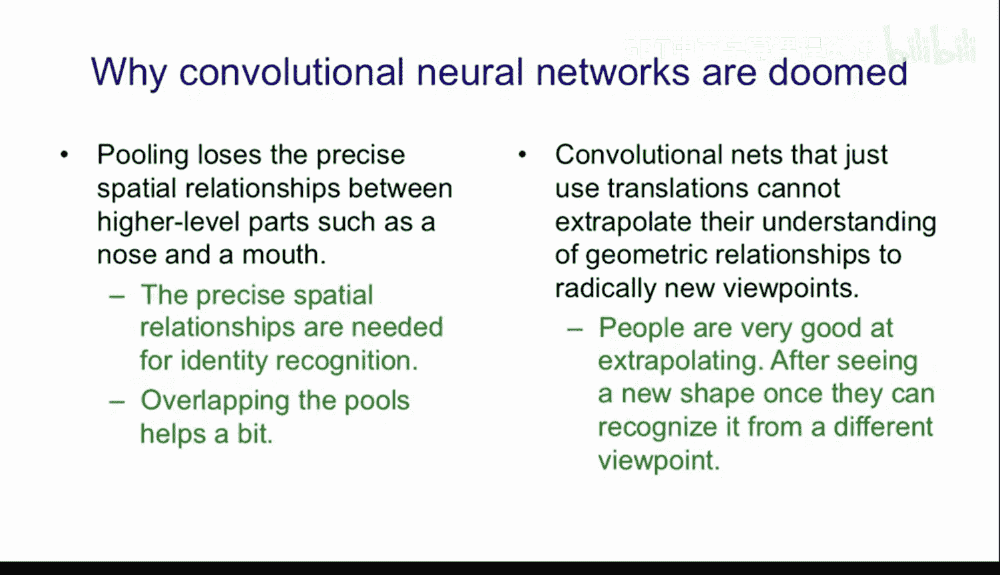
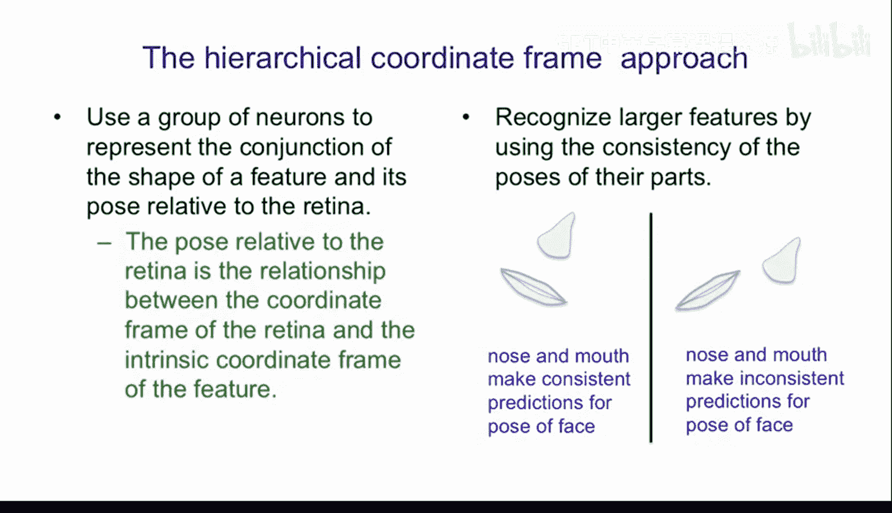
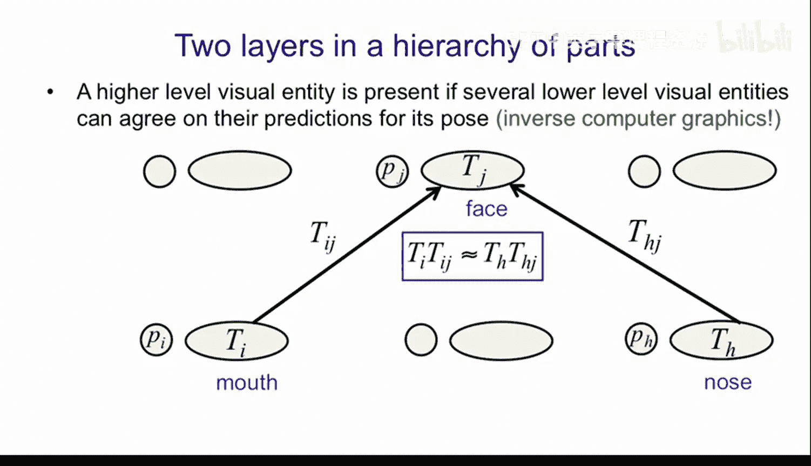
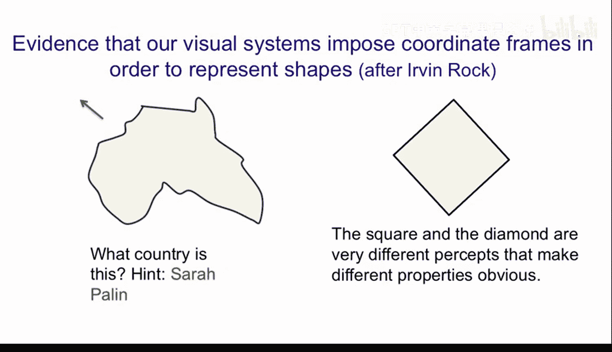

# Hinton@多伦多大学《机器学习的神经网络｜Neural Networks for Machine Learning 2016》claude-4s p76 -76-Lecture 16.2 — Hierarchical Coordinate Frames  -Neural Networks for Machine -BV1HtkUB2EZD_p76-

In this video。I'm going to describe how we might be able to combine。😔。

Recognition of objects by using the relationships between their parts。

And recognition of objects using a deep neural network。A presenting computer vision。

There's broadly three approaches to recognizing objects。

 Either you use a deep convolution on neural net。And this currently works best。

Or you use a parts based approach。Which I think in the long run， is going to work best。

Or you use the existing features that computer vision people know how to extract from images and make histograms of them。

 and then use lots of hand engineering。This is the approach that the convolutional neural networks have recently been。

The point of this video is to show how we might combine a parts based approach with early stages that use convolution on neural neural networks。

Even though convolution on neural networks。Have worked very well for recognizing objects and images。

I think there's something missing。When we pull the activities of a bunch of replicated feature detectors。

We lose the precise position of the feature detector that was most active。

This means we don't know exactly where things are。And that's fatal for high level parts。

 such as a nose and a mouth。In order to recognize whose face it is。

 you need to use the precise spatial relationships between high level parts like noses and mouths。

If you overlap the pools so that each feature occurs in several different pools。

 you retain more information about its position。And that makes things work a bit better。

 But I don't think that's the answer。A related problem is that convolutional neural nets that use translations to replicate feature detectors cannot extrapolate their understanding of geometrical relationships to radically nude viewpoint like different orientations or different scales。

We could， of course， try replicating across orientation and scale。

But then we get huge numbers of replicated feature detectors。Now。

 people are very good at extrapolating。After seeing a new shape once。

 they can recognise it from a very different viewpoint。Currently。

 the way we deal with that with convolutional neural networks is to train them on transformed data。

So this involves giving them huge training sets where we try to transform the data。

Through different orientations and scales and lightings and all sorts of other things so that the network can cope with those variations。

But that's a very clumsy way of dealing with the variations。

I think a much better way is to use a hierarchy of coordinate frames。And to use a group of neurons。

To represent the conjunction of the shape of a feature and its pose relative to the retina。

So when these neurons are active， it tells you your feature of that kind is there like a nose。

And the precise activities or relative activities of these neurons tell you the pose of the nose。

If you think about representing the pose of something。

 that's really a relationship between two coordinate frames。

So it's the relationship between a coordinate frame embedded in the thing and the coordinate frame of the camera or rationaler。

So in order to represent the pose of something， we have to embed a coordinate frame within it。

Once we've done this and we have a representation of the pose of parts of objects relative to the retina。

It's easy to use the relationships between parts to recognize larger objects。

So we're going to use the consistency of the poses of the parts。

As a cue for recognizings a larger shape。If you look at this picture。

 we have a nose and we have a mouse。And theyre in the right special relationship to one another。

One way of thinking about that is that if you ask the mouth to predict the pose of the whole face。

And if you ask the nose to predict the pose of the whole face， they'll make similar predictions。

If you look on the right here， we have the same nose and the same mags。

 but now they in the wrong spatial relationship。And that means that if they separately make predictions about the pose of the whole face。

 those predictions won't agree at all。

So here's two layers in a hierarchy of parts where the larger parts can be recognized by consistent predictions from smaller parts。

Let's suppose we're looking for a face。And so in the middle here。The ellipse with T J in it。

Is a collection of neurons。That are going to be used for recognizing the pose of the face。

And the P J next to it is a single logistic neuron。

That's going to be used for representing whether or not we think there's a face there。

We have a similar representation in the layer below。

Where we have a representation of the pose for a mouse and a representation of the pose for a nose。

And we're going to recognize a face。By noticing that those two representations make consistent predictions。

So we take a vector of activities that represents the pose of the mouth。

We multiply it by a matrix T I J that represents the spatial relationship between a mouth and a face。

And we get a prediction。T I times T I J for the pose of the face。We do the same thing with the nose。

 We take a vector of neural activities that represents the pose of the nose， T， H。

We multiply by the relationship between the nose and the face。

And we get another prediction for the pose of the face。If those two predictions agree。

 there's a face there because the nose and the mouth are in the right spatial relationship。

And that's very unlikely without the being a face there。

What we're doing here is inverse computer graphics。In computer graphics。

If you knew the pose of the face。You could now compute by using the inverse of T I J。

The pose of the mouth。 and similar for the nose。So in computer graphics。

 you're going from poses of larger things to poses of their parts。In computer vision。

 you need to go from the poses of the parts to the poses of larger things。

And you need to check consistency when you do that。

Now， if we can get a neural net to represent these pose vectors as vectors of neural activity。

Then we get a very nice property。Spatial relationships can then be modeled as linear operations。

That makes it very easy to learn a hierarchy of visual entities。

And it also makes it very easy to generalize across viewpoint。

So what's going to happen when we make small changes in viewpoint。Is the pose vectors。

 those vectors of neural activities are all going to change。What's going to be invariant。

Is the weights。It was the weights that represented the relationship between a part and a whole。

 like T I J on the previous slide。And those don't depend on viewpoint。

So we want to get the invariant properties of a shape into the weights。

And we want to have the pose vectors in the activities， because when we change viewpoint。

 all those pose vectors are going to change。So rather than trying to get neural activities that are invariant to viewpoint。

Which is what the pooling in a convolutional net is trying to do。

We're going to aim to get neural activities that are equivariant to viewpoint。

As the pose of the object varies， the activities of the neurons vary。

That means the perceptioncept of an object， not its label。

 but what it looks like is going to change as the viewpoint changes。

I am going to finish by giving you some evidence that our visual systems really do impose coordinate frames in order to represent shapes。

This was pointed out a long time ago by a great psychologist called Irve Rock。

So if you look at this shape and I tell you， it's a country。

Most people don't know which country it is。 They look at it and they think it looks a bit like Australia。

 but it's a sort of mirror image of Australia， but it's not really a familiar country at all。

If you tell them where the top is。That it's that way up。 They immediately recognize that。

 it's Africa。If they know what coordinate frame to impose on it。

 it immediately becomes a familiar shape。Similarly， if I give you a shape like this one。

 you can perceive it as a square or you can perceive it as a diamond。

Those are two completely different pers。 What you know about the shape is totally different。

 depending on which way you perceive it。So， for example。If you perceive it as a tilted square。

You're acutely sensitive to whether the angles are right angles。

If you perceive it as an upright diamond， you're not sensitive to that at all。

 The angles could be 5 degrees off， and you wouldn't notice it。

But you are sensitive to something else。If you perceive it as an upright diamond。

 you're acutely sensitive to whether the corner on the left and the corner on the right are at the same height。

And you'll probably notice now that in this figure， they're very slightly different heights。

These kinds of demonstrations are evidence that in order to represent shapes。

 we impose coordinate frames on them。Because when you're looking at that square or diamond is's the same thing you're looking at。

 but the percept's totally different depending on what coordinate frame you impose。

