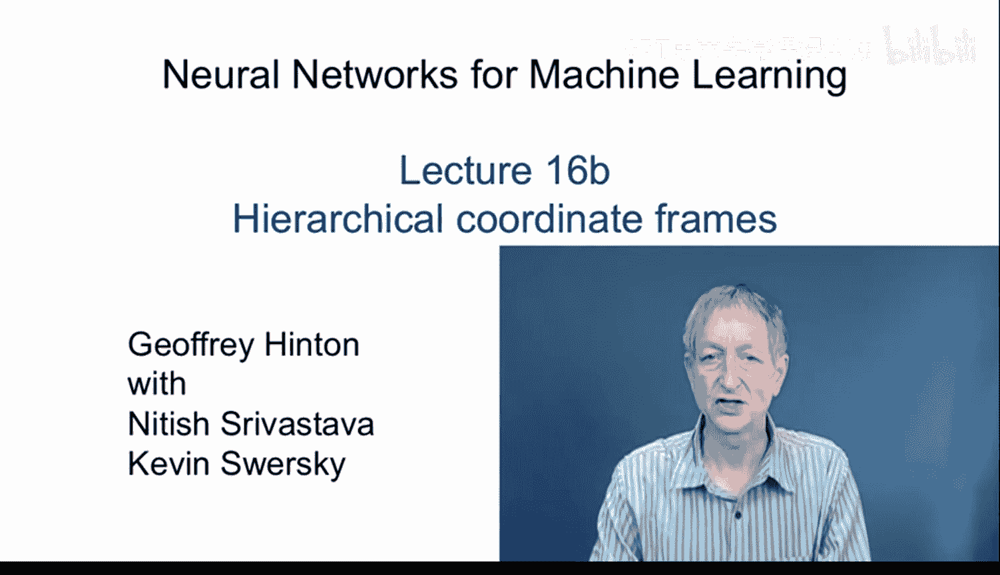
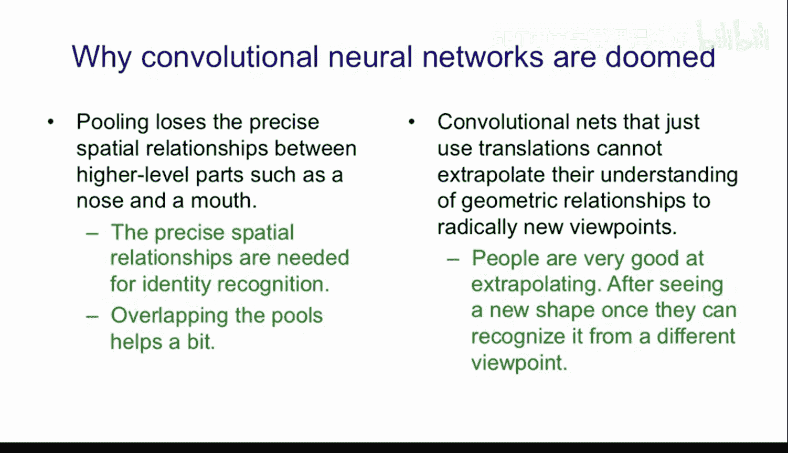
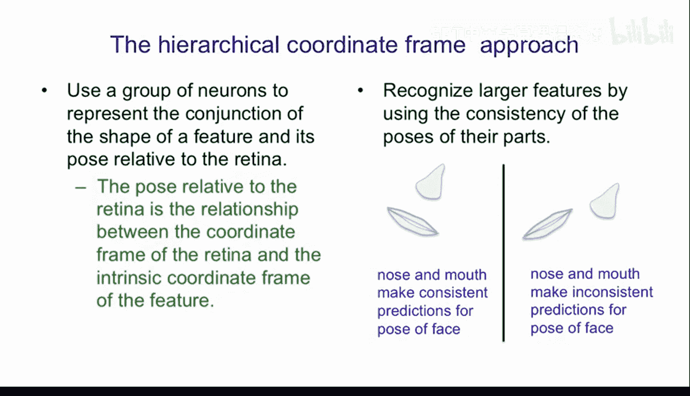
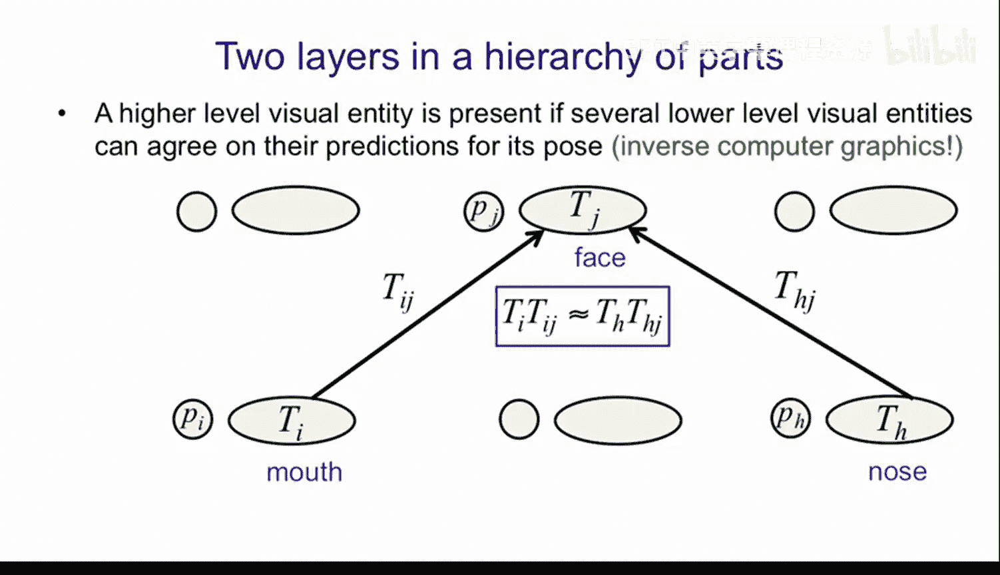
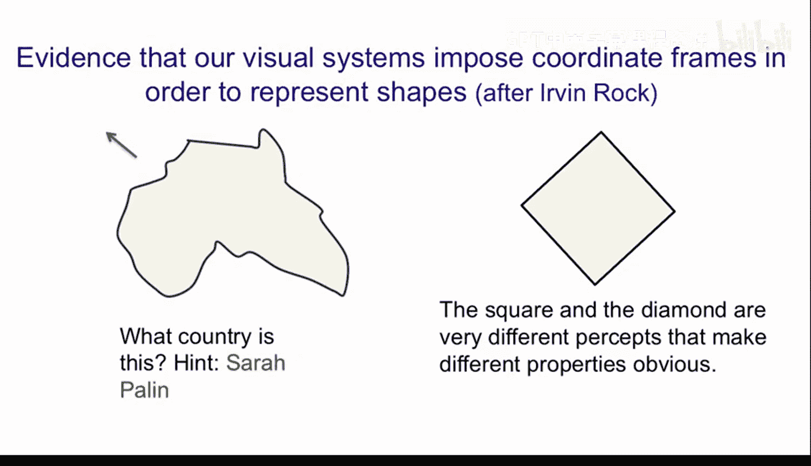

# 神经网络与机器学习：第16.2讲：分层坐标系 🧠

在本节课中，我们将要学习如何将两种物体识别方法结合起来：一种是基于部件间关系的识别方法，另一种是使用深度神经网络的识别方法。我们将探讨卷积神经网络的局限性，并介绍一种更强大的方法——分层坐标系框架。

---

## 物体识别的三种方法

目前，物体识别主要有三种方法。

以下是这三种方法的简要介绍：

*   **深度卷积神经网络**：这是目前效果最好的方法。
*   **基于部件的方法**：从长远来看，这被认为是最有潜力的方法。
*   **手工特征工程**：这种方法提取计算机视觉领域已知的图像特征，制作特征直方图，并进行大量手工设计。卷积神经网络最近已经超越了这种方法。

本视频的重点在于展示如何将基于部件的方法与使用卷积神经网络的早期阶段结合起来。

---

## 卷积神经网络的局限性

上一节我们介绍了物体识别的几种方法。本节中我们来看看当前主流的卷积神经网络存在哪些问题。

尽管卷积神经网络在图像物体识别方面表现优异，但它存在一些缺失。当我们对一组复制的特征检测器的活动进行池化时，我们会丢失最活跃的特征检测器的精确位置信息。

这意味着我们无法确切知道物体在哪里。这对于识别高级部件（如鼻子和嘴巴）是致命的。为了识别这是谁的脸，你需要利用鼻子和嘴巴等高级部件之间的精确空间关系。

如果让池化区域重叠，使得每个特征出现在几个不同的池中，可以保留更多关于其位置的信息，从而使效果稍好一些。但这并非根本的解决方案。

一个相关的问题是，使用平移来复制特征检测器的卷积神经网络，无法将其对几何关系的理解外推到全新的视角，例如不同的方向或不同的尺度。

当然，我们可以尝试在方向和尺度上进行复制。但这会导致特征检测器的数量变得极其庞大。

---

## 分层坐标系框架

为了解决上述问题，一个更好的方法是使用分层坐标系框架。我们使用一组神经元来表示一个特征的形状及其相对于视网膜的姿态的结合。

当这些神经元活跃时，它告诉你“那种特征（比如一个鼻子）在那里”。而这些神经元的精确活动或相对活动则告诉你鼻子的姿态。

思考如何表示某物的姿态，这实际上是两个坐标系之间的关系：即嵌入在该物体内部的坐标系与相机或视网膜坐标系之间的关系。

因此，为了表示某物的姿态，我们必须在其中嵌入一个坐标系。一旦我们做到了这一点，并且有了物体部件相对于视网膜的姿态表示，就很容易利用部件之间的关系来识别更大的物体。

我们将利用部件姿态的一致性，作为识别更大形状的线索。

请看这张图，我们有一个鼻子和一个嘴巴，它们处于正确的空间关系中。一种理解方式是：如果你让嘴巴预测整个脸的姿态，同时让鼻子也预测整个脸的姿态，它们会做出相似的预测。

再看右边这里，我们有相同的鼻子和嘴巴，但现在它们处于错误的空间关系中。这意味着，如果它们分别预测整个脸的姿态，这些预测将完全不一致。

---

## 通过一致性预测进行识别

上一节我们引入了利用姿态一致性进行识别的概念。本节中我们来看看其具体实现机制。

假设我们正在寻找一张脸。中间这个带有 **T_J** 的椭圆，是一组用于识别脸部姿态的神经元。旁边的 **P_J** 是一个逻辑神经元，用于表示我们是否认为那里有一张脸。

在下面一层，我们有类似的表示：一个用于表示嘴巴姿态，一个用于表示鼻子姿态。

我们将通过注意到这两个表示能做出一致的预测来识别一张脸。

具体过程如下：

1.  我们取一个表示嘴巴姿态的活动向量 **T_I**。
2.  我们将其乘以一个表示嘴巴与脸部之间空间关系的矩阵 **T_IJ**。
3.  我们得到对脸部姿态的预测：**T_I × T_IJ**。
4.  我们对鼻子做同样的事情：取表示鼻子姿态的活动向量 **T_H**，乘以鼻子与脸部的关系矩阵，得到另一个对脸部姿态的预测。
5.  如果这两个预测一致，那么就存在一张脸，因为鼻子和嘴巴处于正确的空间关系中。在没有脸的情况下，这种情况极不可能发生。

我们在这里所做的是**逆向计算机图形学**。在计算机图形学中，如果你知道脸的姿态，你可以使用 **T_IJ** 的逆矩阵来计算嘴巴的姿态，对鼻子也是如此。因此，在计算机图形学中，你是从较大物体的姿态推导出其部件的姿态。而在计算机视觉中，你需要从部件的姿态推导出较大物体的姿态，并在此过程中检查一致性。

---

## 姿态向量与权重的作用

现在，如果我们能让神经网络将这些姿态向量表示为神经活动向量，那么我们将获得一个非常好的特性：**空间关系可以被建模为线性操作**。

这使得学习视觉实体的层次结构变得非常容易，也使得跨视角泛化变得非常容易。

那么，当我们对视角进行微小改变时会发生什么？姿态向量（那些神经活动向量）都会发生变化。保持不变的是权重，即表示部件与整体之间关系的权重（如前一张幻灯片上的 **T_IJ**）。这些权重不依赖于视角。

因此，我们希望将形状的不变特性编码到权重中，而将姿态信息放在活动向量中。因为当我们改变视角时，所有的姿态向量都会改变。

所以，我们的目标不是获得对视角不变的神经活动（这是卷积网络中池化操作试图做的），而是**获得对视角等变的神经活动**。随着物体姿态的变化，神经元的活性也相应变化。这意味着，对物体的感知（不是它的标签，而是它的外观）会随着视角的变化而变化。

---

## 人类视觉的证据

我将通过一些证据来结束本次课程，证明我们的视觉系统确实会强加坐标系来表示形状。这一点在很久以前就被一位伟大的心理学家欧文·洛克指出。

如果你看这个形状，我告诉你它是一个国家，大多数人不知道是哪个国家。他们看着它，觉得有点像澳大利亚，但又是澳大利亚的镜像，总之不是一个熟悉的国家。

如果你告诉他们顶部在哪里（是那个方向），他们立刻会认出那是非洲。一旦他们知道应该强加哪个坐标系，它立刻就变成了一个熟悉的形状。

同样，如果我给你一个像这样的形状，你可以把它感知为一个正方形，也可以把它感知为一个菱形。这是两种完全不同的感知。你对形状的了解完全不同，取决于你以哪种方式感知它。

例如，如果你把它感知为一个倾斜的正方形，你会敏锐地察觉到它的角是否是直角。如果你把它感知为一个直立的菱形，你则完全不会敏感于此，即使角度偏差了5度，你也不会注意到。但你会对别的东西敏感：如果你把它感知为一个直立的菱形，你会敏锐地察觉到左边的角和右边的角是否在同一高度。你现在可能已经注意到，在这个图形中，它们的高度有非常细微的差别。

这类演示证明了，为了表示形状，我们确实会对它们强加坐标系。因为当你看着那个正方形或菱形时，你看的是同一个东西，但根据你强加的坐标系不同，你的感知会完全不同。

---

## 总结

本节课中我们一起学习了如何结合基于部件和深度神经网络的物体识别方法。我们探讨了卷积神经网络在位置信息和视角泛化方面的局限性，并引入了**分层坐标系框架**这一解决方案。该方法的核心在于使用神经活动向量表示部件的姿态，将不变的空间关系编码在权重中，从而实现通过部件姿态的一致性来识别更大物体，并能优雅地处理视角变化。最后，我们从人类视觉感知中找到了支持这一理论的证据。