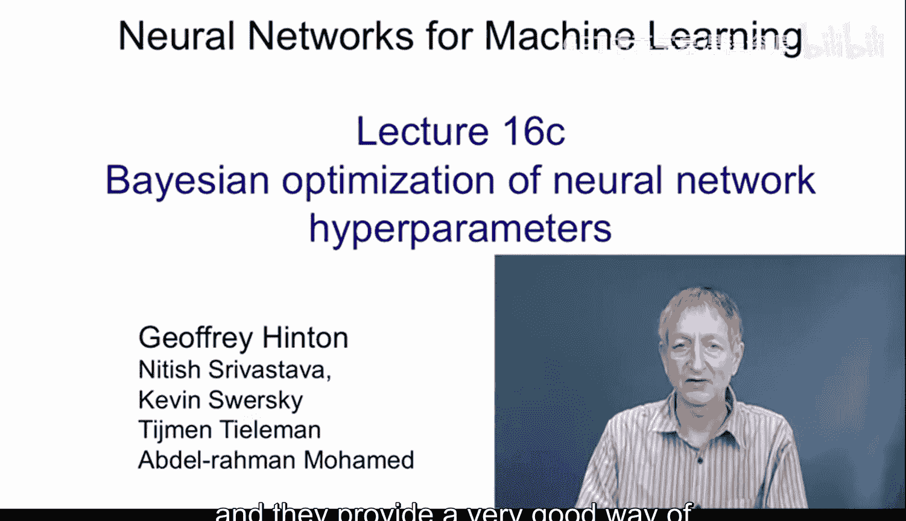
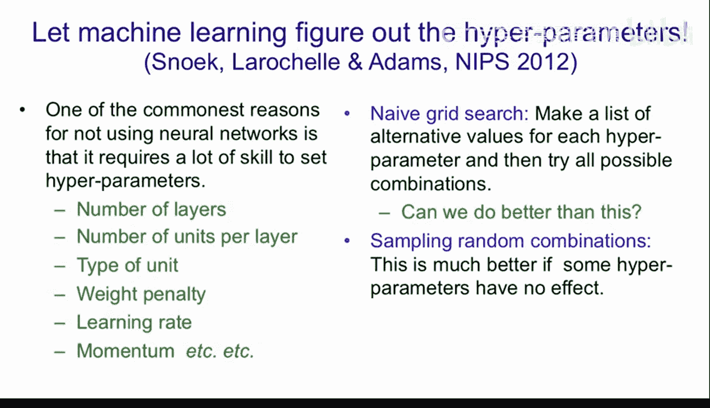
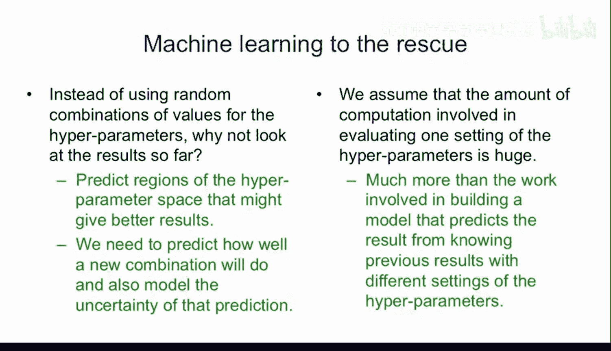
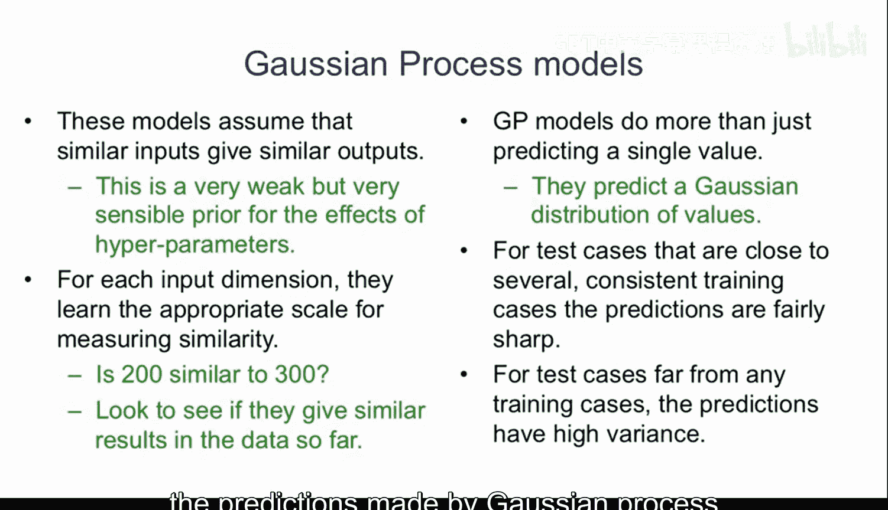
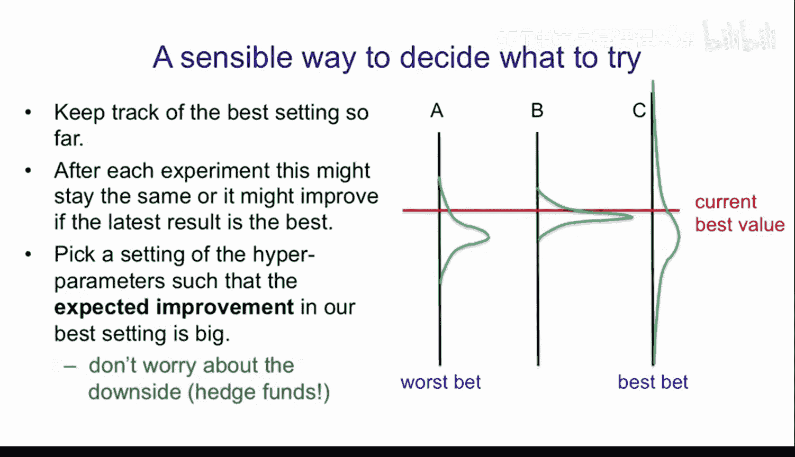
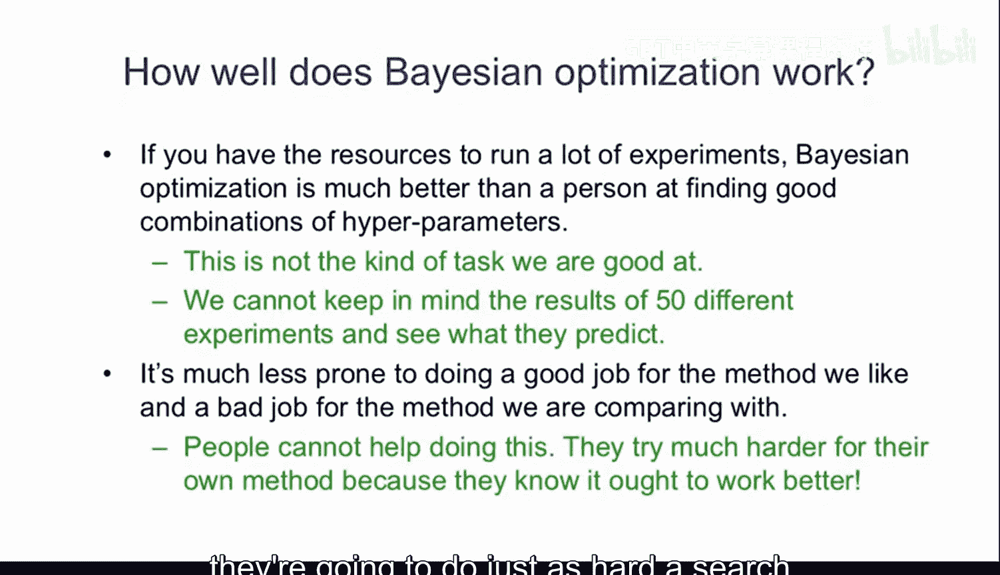

# Hinton@多伦多大学《机器学习的神经网络｜Neural Networks for Machine Learning 2016》claude-4s p77 -77-Lecture 16.3 — Bayesian optimization of hyper-parameters  -Neural Networks f -BV1HtkUB2EZD_p77-

In this video， I'm going to talk about some exciting recent work。

Which I think will go a long way towards answering the question。

 how do you settle those hyperparameters in a neural network？

This recent work uses a different kind of machine learning。

To help us decide what values to use for hyperparameters。In other words。

It's using machine learning to replace the graduate student who fiddles around with all these different settings of the hyperparameters to find out what works。

It relies on a way of modeling smooth functions， called Gaussian processes。

Which I had always thought of as inadequate for doing things like speech and vision。

And I still think they're inadequate for that。But when you're in a domain where you don't have much prior knowledge and the only thing you can really appeal to is that you expect similar inputs to have similar outputs。

 then Gaussian processes are ideal。And that's the domain we're in when we're fiddling around with vectors of hyperparameters。

 hoping to find a vector of hyperparameters that works well。So for example。

 the number of hidden units， the number of layers， the weight penalty， whether to use dropout or not。

 those are all hyperparameters。And different combinations of them work well together。

So this is a very hard space to explore by hand。It's very easy。

When we're exploring it by hand to fail to notice things。

Gueassing processes are very good at noticing trends in the data。

And they provide a very good way of finding good sets of hyperparameters if you have enough computers。

One of the commonest reasons that people give for not using neural networks。

Is that it requires a lot of skill to set the hyp of parameters。

This is actually a pretty good reason。If you don't have much experience。

 it's easy to get stuck using a completely wrong value for one of the hyperparmeters。

 and then nothing works。You have to set things like the number of layers。

 the number of units per layer， what types of units to use， the weight penalty， the learning rate。

 the momentum， and so on and so on。If you use a learning rate that's100 times too big or 100 times too small。

 your network simply won't work。One way to approach this is to do a naive grid search。

 that is for each of these hyperparameters。You make a list of alternative values。

 and then you try all possible combinations of values。

You can see that this is going blow up if you have more than a few hyperparameter。

You're going to end up with many more combinations than you can possibly try。

It turns out that there's something that's considerably better than doing a naive grid search。

We can just sample random combinations。That is three hyper parameter。We make a list of alternatives。

And then we pick one thing randomly from each list。

The reason that's better is because some of the hyperparameter won't have much effect。

 and others will have a lot of effect。

And what we don't want to do。Is exactly repeat the settings of the hypergmeters that have a lot of effect。

For different settings of hyperparameter that don't have much effect。We don't learn much that way。

In a grid search， you will have several points along each axis。

That are identical for all the other parameters。And so if moving along that axis of the grid search makes no difference。

 You've replicated the same experiment many times and haven't learnt anything about the other parameters。

There's something we can do that's much better than random combinations。And basically。

 it amounts to saying， let's use machine learning。To simulate the graduate student who was trying to decide what the Hyparmeter should be。

So instead of using random combinations。We look at the results we've got so far and try and predict what combinations are likely to work well。

That is， we have to predict regions of the hyperrameter space in which we expect to get good results。

It's not sufficient just to say how well we expect to do。

 We also have to have an idea of the uncertainty。We might， for example。

 have a region where we expect to do about the same as we're currently doing。

But maybe we would do much better。In that case， it would be worth going and exploring that region。

It's even worth exploring regions where we expect to do worse， but we might just do a lot better。Now。

 we're going to assume that the amount of computation involved in evaluating one setting of the hyperparameters is huge。

 It involves training a big neural network on a huge data set。

 and it might take several days on a big computer。Relative to that amount of work。

Building a model to predict how well a setting of the hyperparmeters will do。

Given all the settings we've experimented with so far is much less work。

And so it's going to require much less computation to fit the predictive model to the results of the experiments we've seen so far。

Then it is to run a single experiment。So what kind of model are we going to use for predicting the results of future experiments。

It turns out there's a kind of model I haven't talked about in the course called Gasian process models。

Basically， all these models do is assume that similar inputs give similar outputs。

They don't have any more sophisticated prior than that。

But they're very good at using that pry in an effective way。

So if you don't know much about what you expect hyperbrometers to do。

A week prior like that is probably the best you can do。

Guessing processes are able to learn for each input dimension。

 what the appropriate scale is for measuring similarity。So for example。

 if's the number of hidden units。Could be 200， or it could be 300。The question is。

 are those similar numbers or are those very different numbers。

 Should we expect the results we get with 200 to be very similar to the results we get with 300。

 or should we expect them to be very different。If we don't know anything about neural nets。Initially。

 we have no idea。But we could look at the results of experiments so far。

And if experiments with 200 and experiments with 300 tend to give very similar answers when you take into account the other differences between the experiments。

then 200 is probably similar to 300。And so we set a scale for that dimension。

Such that you need differences of much more than that to expect to get very different results。Now。

 it's important that Gaussing process models do more than just predicting the expected outcome of a particular experiment。

That is how well the neural net that we train will do on a validation set。

In addition to predicting a mean value for how well they expect the neural network to do。

They predict a distribution。 They predict a variance。

They're called Gasian processes because their predictions are Gasian。

When they're making a prediction for new settings of the hyperparameters。

That are close to several consistent settings that we've already run。So we know the answer。

Their predictions will tend to be fairly sharp。That is， they'll have low variance。

But when they're making predictions for experiments。

 where the hyperparameters are very different from any setting of the hyperparameter we have experimented with so。

The predictions made by Gaussian process models will have very high variance。

So here's quite a good strategy for using gas imp processes to decide what to try next。So remember。

 we have one kind of learning model， which is a big neural network that takes a long time to run。

And we're trying to figure out a good setting of the hyperparameter to try next。

We have a different kind of machine linearnyard rhythm， called a Gasian process。

That's looking at the results of the experiments we've done so far。

And trying to predict for some proposed new setting of the hypoparameters。

How well the neural network would do and also how uncertain that prediction is。

So what we're going to do is we're going to keep track of the hyperparameter that have worked best so far。

That is a single setting of all the hyperparamats。That gave us the neural net with the highest performance sofa。

Now， when we run the next experiment。Our best setting， so far。

Might be replaced by the new experiment because it gives better performance of the neural net。

 or it might stay the same。So since we're going to substitute the results of the new experiment。

 if it's better than anything we've seen so far。Our best setting sofa can only improve。

So here's a good strategy。For what setting of the hyperparameters to try next。We pick a setting。

Of the hyperparameters。Such that the expected improvement in our best setting is big。

We don't worry about the fact that we might do an experiment that leads to a really bad result。

Because if it gets a really bad result， we won't replace our best so far with this new experiment。

Also， we learn something。This is a phenomenon that managers of hedge funds know about。

They often tell the client。If the fun goes up。I'll take 3 per cent of your profits。

 If the fund goes down， you lose。Now， that's a crazy thing for a client to agree to。

Because that gives the hedge fund manager a huge incentive for taking huge risks。

Because he has no significant downside。But for finding hyperparameters that work well。

 it's a sensible strategy。So consider these three predictions， A， B， and C。

We're going to suppose that A， B and C are different settings of the hyperparameters that have not yet been tried。

And those green Gaussians are the predictions of our Gaussian process model。

For how well each of those settings would do。For setting a。

 the mean is well below our current best sofa far。And there's only moderate variance。For setting B。

The mean is closer to our best， so far。But since there isn't much variance。

 there really isn't that much upside。For setting C， the mean is actually lower than for setting B。

But because there's high variance， there's a big upside。

We're going to take the area under Gaussian Sea。 that's above the red line。

And we're going to take the moment of that area about the red line。

And that's the thing we're looking for the maximum of。

And you can see that C has a much bigger moment than B or A。

You may only have the same area as B above the light。

But some of that area is much further above the light。So we might get a very big win。

If we try setting C。So that's the one our policy would tell us to pick here。It it's the worst， bet。

Bes inter。

And C is the best bet。So how well does this work？Well。

 if you got the resources to run a lot of experiments。

It's much better than a person and finding good combinations of the hyperparameter。

The policy I gave you so far is a strictly sequential policy that assumes that it can see all of the experiments run so far。

But there's no reason why you shouldn't make it a bit more complicated and run a whole bunch of experiments in parallel using a Gaussian process model。

To predict how well a particular setting of the hyperbrameters will do。Is sensible。

Because it's not the kind of task we're good at。 It's not like， vision speech。And it's not clear。

That there's a lot of complicated structure to be found in the data。

It may be that the only real structure is that things are smooth， and they have some scale。Also。

 a person can't keep in mind the results of 50 different experiments to see what they predict。

If youre doing all this by hand， you might just fail to notice that all of your good results had very small learning rates。

 and all of your really bad results had very big learning rate。

Because you're attending to lots of other things that you're vary。

A Gaussian process model would not miss a trend like that。

One final reason why Gaussian process models are a very good way of setting the hypoparameter。

Is there much less likely than a person to cheat。Typically， when we're doing research。

 we want to compare a new method that we thought of。With some old or standard method。

And there's a very strong tendency to work harder to find good hyperpara for our new method than for the stupid old method。

That's why when you compare methods， you should really compare the results。Got by different groups。

Where for each method， the results are produced by the group that believes in that method。

If we use Gasing process models to search for good sets of hyperparmeters。

They're going to do just as hard a search for the type of model we don't believe in as they are for the type of model we do believe in。

