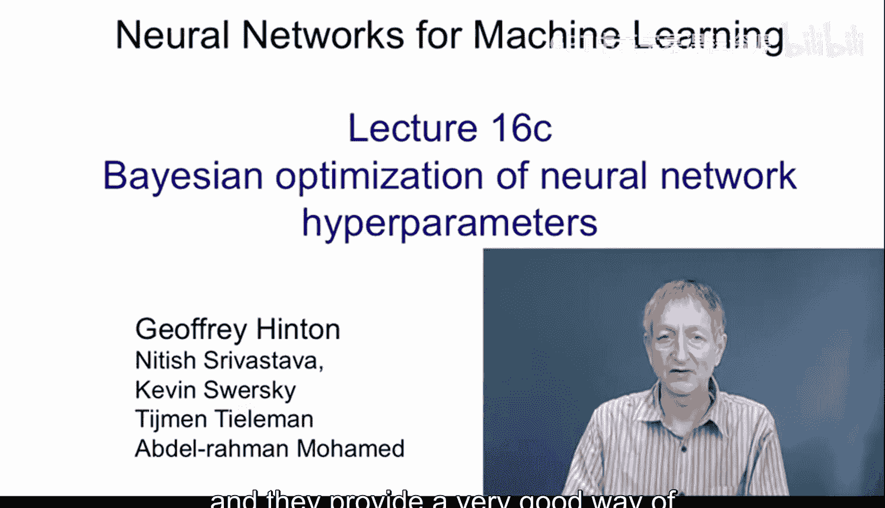
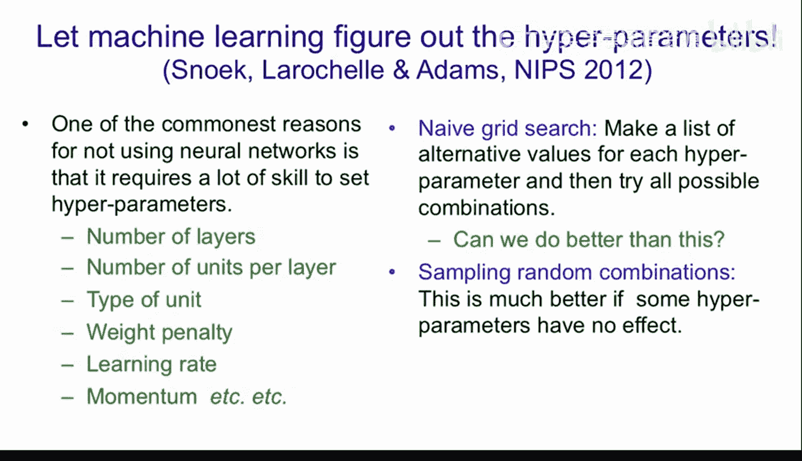
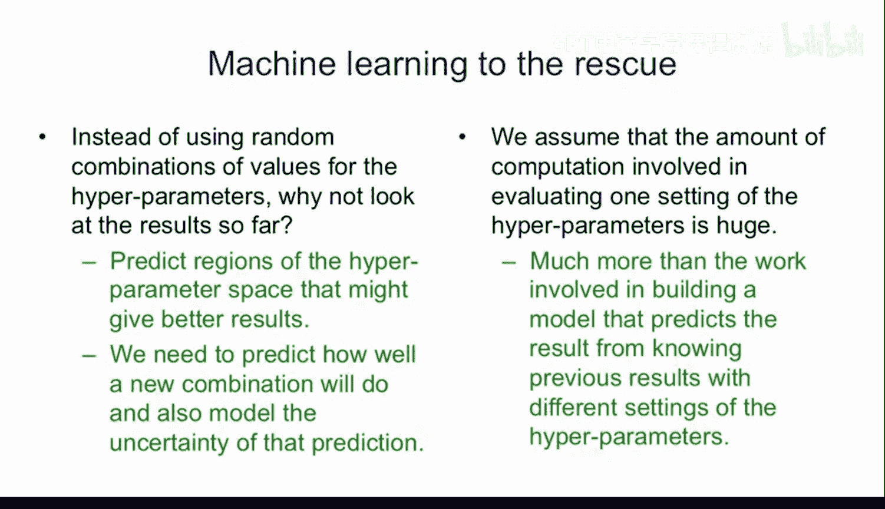
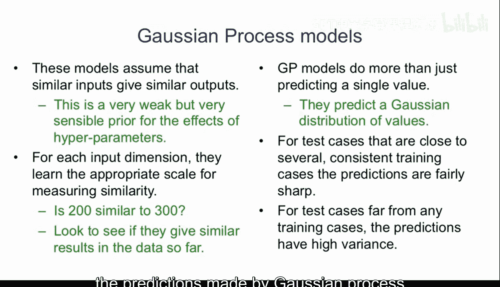
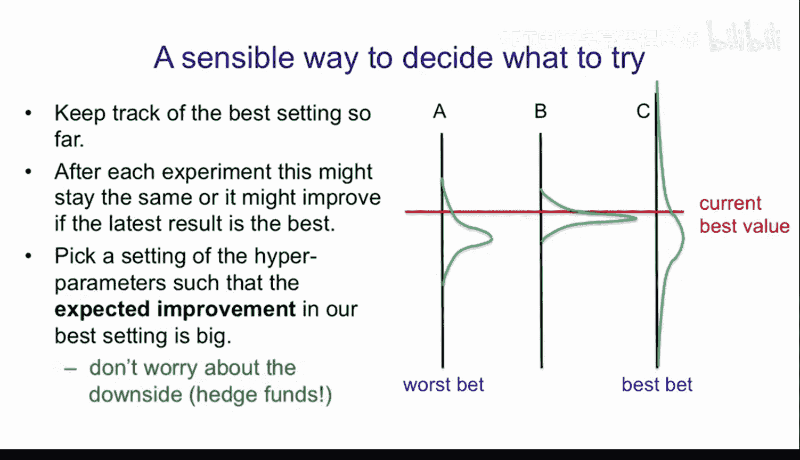
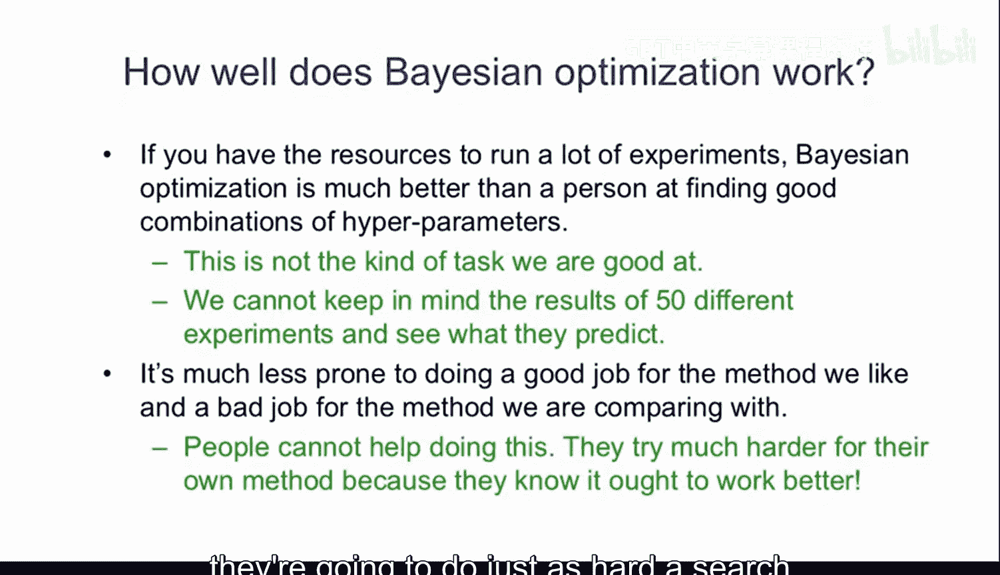

# 神经网络超参数优化：16.3：贝叶斯优化 🧠

在本节课中，我们将学习一种利用机器学习自动优化神经网络超参数的方法。这种方法可以替代人工繁琐的调参过程，通过高斯过程模型来高效地探索超参数空间，找到性能最佳的组合。

---

## 概述

神经网络的成功很大程度上依赖于超参数的设置，例如层数、每层神经元数量、学习率、权重惩罚项等。手动调整这些参数不仅耗时，而且需要大量经验。本节介绍一种基于高斯过程的贝叶斯优化方法，它能自动、高效地寻找最优超参数组合。

---

## 手动调参的挑战

上一节我们介绍了超参数的重要性，本节中我们来看看手动调参面临的具体困难。

人们常以“需要大量技巧来设置超参数”为由拒绝使用神经网络。这确实是一个合理的理由。缺乏经验时，很容易为某个超参数设置完全错误的值，导致整个网络无法工作。需要设置的超参数包括层数、每层单元数、单元类型、权重惩罚项、学习率、动量等等。如果学习率设置得过大或过小100倍，网络将无法正常工作。

一种简单的方法是进行朴素的网格搜索。即为每个超参数列出一系列候选值，然后尝试所有可能的组合。如果超参数数量稍多，组合数量就会爆炸式增长，远超实际可尝试的范围。

---

## 随机搜索的优势

事实证明，有一种方法比朴素的网格搜索要好得多，那就是随机采样组合。即对于每个超参数列表，我们随机选取一个值。

以下是随机搜索优于网格搜索的原因：
*   某些超参数影响不大，而另一些影响巨大。
*   我们不希望重复那些对结果影响巨大的超参数的相同设置。对于那些影响不大的超参数，即使改变设置，我们也学不到太多新东西。
*   在网格搜索中，每个坐标轴上会有多个点，这些点在其他所有参数上都相同。因此，如果沿着该坐标轴移动没有影响，就等于重复进行了多次相同的实验，而没有学到关于其他参数的任何信息。

---

## 引入机器学习模型

我们可以做得比随机组合更好。本质上，这意味着使用机器学习来模拟试图决定超参数应该是什么的研究生。

因此，我们不是使用随机组合，而是根据目前已获得的结果，尝试预测哪些组合可能表现良好。也就是说，我们必须预测超参数空间中我们期望获得良好结果的区域。

仅仅预测我们期望的表现如何是不够的，我们还必须对不确定性有所了解。例如，可能存在一个区域，我们预计表现与当前水平大致相同，但也可能表现得更好。在这种情况下，就值得去探索那个区域。甚至值得探索那些我们预计表现会更差，但也可能好得多的区域。

现在，我们假设评估一组超参数设置所需的计算量是巨大的。这涉及在大型数据集上训练一个大型神经网络，可能需要在一台大型计算机上运行数天。相对于这个工作量，构建一个模型来预测给定我们迄今为止实验过的所有设置下，一组超参数设置的表现如何，所需的工作量要小得多。因此，将预测模型拟合到我们迄今为止看到的实验结果所需的计算量，远小于运行一次实验。

---

## 高斯过程模型

那么，我们将使用什么样的模型来预测未来实验的结果呢？

事实证明，有一种我在课程中尚未讨论过的模型，称为高斯过程模型。基本上，这些模型所做的就是假设相似的输入会产生相似的输出。它们没有比这更复杂的先验知识。但它们非常善于有效地利用这种先验。

因此，如果你对超参数的预期作用了解不多，像这样的弱先验可能是你能做的最好选择。高斯过程能够为每个输入维度学习衡量相似性的适当尺度。例如，如果是隐藏单元的数量，可能是200，也可能是300。问题是，这些数字是相似还是非常不同？我们是否应该期望使用200得到的结果与使用300得到的结果非常相似，还是应该期望它们非常不同？如果我们对神经网络一无所知，最初我们毫无头绪。但我们可以查看迄今为止的实验结果。如果考虑到实验之间的其他差异，使用200的实验和使用300的实验往往给出非常相似的答案，那么200可能就与300相似。因此，我们为该维度设置一个尺度，使得需要比该尺度大得多的差异才能预期获得非常不同的结果。

重要的是，高斯过程模型所做的不仅仅是预测特定实验的预期结果（即我们训练的神经网络在验证集上的表现）。除了预测神经网络预期表现的均值外，它们还预测一个分布，即预测方差。它们之所以被称为高斯过程，是因为它们的预测是高斯的。当它们对接近我们已经运行过的几个一致设置的新超参数设置进行预测时（因为我们知道答案），它们的预测往往会相当精确，即方差较低。但是，当它们对超参数与我们迄今为止实验过的任何设置都大不相同的实验进行预测时，高斯过程模型做出的预测将具有非常高的方差。

---

## 优化策略

以下是使用高斯过程决定下一步尝试什么的一个相当好的策略。请记住，我们有一种学习模型，即需要长时间运行的大型神经网络。我们正试图找出一个良好的超参数设置来进行下一次尝试。我们有另一种称为高斯过程的机器学习算法，它查看我们迄今为止所做的实验结果，并尝试为某个提议的新超参数设置预测神经网络的表现如何，以及该预测的不确定性有多大。

因此，我们要做的是跟踪迄今为止效果最好的超参数设置，即所有超参数的一个单一设置，它给了我们迄今为止性能最高的神经网络。现在，当我们运行下一个实验时，我们迄今为止的最佳设置可能会被新实验取代，因为它能带来更好的神经网络性能，也可能保持不变。因此，既然如果新实验比我们迄今为止看到的任何结果都好，我们将用新实验的结果替换，那么我们迄今为止的最佳设置只会改善。

以下是一个关于下一步尝试什么超参数设置的好策略。我们选择一个超参数设置，使得我们最佳设置的预期改进很大。我们不担心可能进行一个导致非常糟糕结果的实验，因为如果得到非常糟糕的结果，我们不会用这个新实验替换我们迄今为止的最佳结果。而且，我们还能学到一些东西。这是对冲基金经理们熟知的一个现象。他们经常告诉客户：“如果基金上涨，我将收取你利润的3%。如果基金下跌，你承担损失。”对于客户来说，同意这一点是疯狂的，因为这给了对冲基金经理巨大的激励去冒巨大的风险，因为他没有显著的 downside。但对于寻找效果良好的超参数来说，这是一个明智的策略。

考虑这三个预测：A、B 和 C。我们假设 A、B 和 C 是尚未尝试过的不同超参数设置。那些绿色的高斯分布是我们的高斯过程模型对这些设置各自表现如何的预测。对于设置 A，均值远低于我们当前的最佳值，并且只有中等方差。对于设置 B，均值更接近我们迄今为止的最佳值，但由于方差不大，上升空间真的不大。对于设置 C，均值实际上低于设置 B，但由于方差高，上升空间很大。

我们将取高斯分布 C 在红线以上的面积，并计算该面积关于红线的矩。这就是我们寻找最大值的东西。你可以看到 C 的矩比 B 或 A 大得多。它可能只有与 B 相同的面积在红线以上，但其中一部分面积远高于红线。因此，如果我们尝试设置 C，我们可能会获得非常大的收益。所以，这就是我们的策略在这里会告诉我们要选择的一个。它是风险最高的赌注，但也是潜在收益最大的赌注。

---

## 效果与优势

那么，这种方法效果如何呢？如果你有资源运行大量实验，它在寻找良好的超参数组合方面比人类要好得多。

到目前为止我给你的策略是一个严格的顺序策略，它假设可以看到迄今为止运行的所有实验。但没有理由不把它变得更复杂一点，使用高斯过程模型并行运行一大堆实验。使用高斯过程模型来预测特定超参数设置的表现如何是合理的，因为这不是我们人类擅长的任务，它不像视觉或语音任务。而且，数据中是否存在大量复杂结构尚不清楚。可能唯一真正的结构是事物是平滑的，并且具有某种尺度。

此外，一个人无法记住50个不同实验的结果来预测它们。如果你手动完成所有这些，你可能只是没有注意到你所有好的结果都有非常小的学习率，而所有非常糟糕的结果都有非常大的学习率，因为你关注的是你正在改变的其他许多事情。高斯过程模型不会错过这样的趋势。

高斯过程模型是设置超参数的一个非常好的方法的最后一个原因是，它们比人更不可能作弊。通常，当我们进行研究时，我们想将我们想到的新方法与一些旧的或标准的方法进行比较。有一个非常强烈的倾向，即为我们新方法寻找良好超参数比为那个愚蠢的旧方法更努力。这就是为什么在比较方法时，你真的应该比较不同小组得到的结果，对于每种方法，结果都是由相信该方法的小组产生的。如果我们使用高斯过程模型来搜索良好的超参数集，它们将为那些我们不相信的模型类型所做的搜索，与为我们相信的模型类型所做的搜索一样努力。

---

## 总结

本节课中我们一起学习了如何利用高斯过程进行贝叶斯优化，以自动化地寻找神经网络的最佳超参数组合。我们了解了手动调参和网格搜索的局限性，认识了随机搜索的改进，并深入探讨了高斯过程模型如何通过“相似输入产生相似输出”的先验，以及预测均值和方差，来智能地指导超参数空间的探索。最后，我们看到了这种策略的有效性及其在避免人为偏差、高效利用计算资源方面的优势。