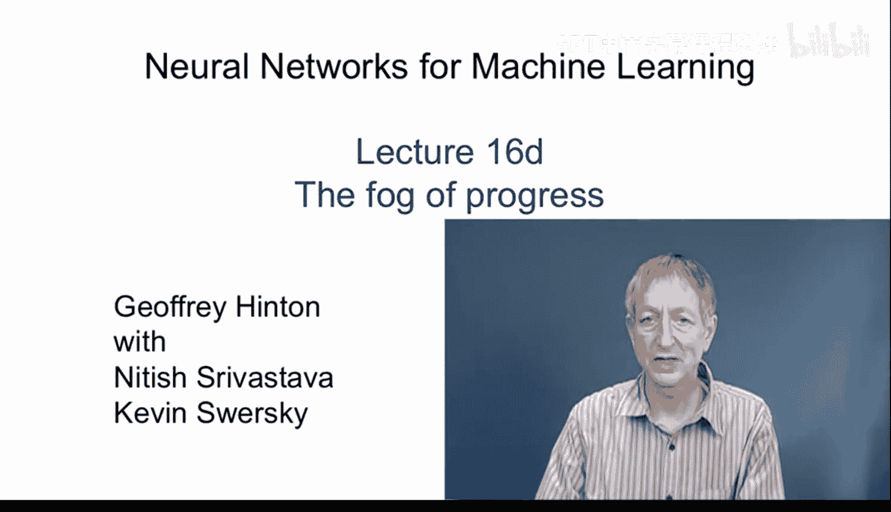
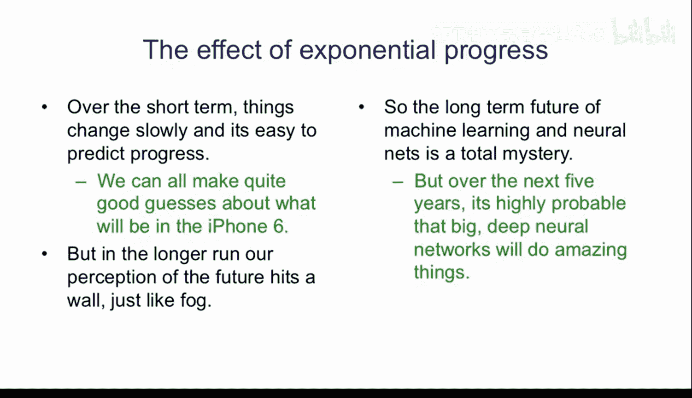

# Hinton@多伦多大学《机器学习的神经网络｜Neural Networks for Machine Learning 2016》claude-4s p78 -78-Lecture 16.4 — The fog of progress  -Neural Networks for Machine Learning-.z -BV1HtkUB2EZD_p78-

In this final video， I was tempted to make some predictions about the future of research on neural networks。

Instead， I'm going to explain to you why it would be extremely foolish to try and make any long term predictions。

Im going to try and explain why we can't predict the long term future。By using an analogy。

Imagine you're driving a car at night。And you're looking at the tail lights of the car in front。

The number of photons that you receive from the tail lights of the current front falls off as one over D squared。

 where D is the distance to the current front。That's assuming that the air is clear。

And I suppose this fog。Over short ranges， the number of photons you get from the tail lights in front of you still falls off as one over a D squared。

Because over a short range， the fog hardly absorbs any light。But for large distances。

 it falls off as E to the minus D。And that's because fog has an exponential effect。

 Fog absorbs a certain fraction of the photons per unit distance。So for small distances。

 fog looks very transparent， but for large distances， it looks very opaque。So the car in front of us。

Becomes completely invisible at a distance of which our short range model。

 the one over D squared model， predicts it will be very visible。

That causes people to drive into the back of cars in fog。 It kills people。

 The development of technology is also typically exponential。So over the short term。

 things appear to change fairly slowly and is easy to predict progress。All of us， for example。

 can probably make quite good guesses about what will be in the iPhone 6。But in the longer run。

 our perception of the future hits a wall， just like with fog。

So the long term future machine learning and neural nets。Is really a total mystery。

 We've no idea what's going to happen in 30 years time。

There's just no way to predict it from what we know now。

Because we're going to get exponential progress。In the short run， however。In a period of。

 say 3 to 10 years， we can predict it fairly well。And it seemed obvious to me that over the next five years or so。

Big， deep neural networks are going to do amazing things。

I'd like to congratulate all of you who stuck it out long enough to get this far。😊。

I hope you've enjoyed the course。And good luck with the final test。

