# 1.1：为什么需要机器学习？🤖

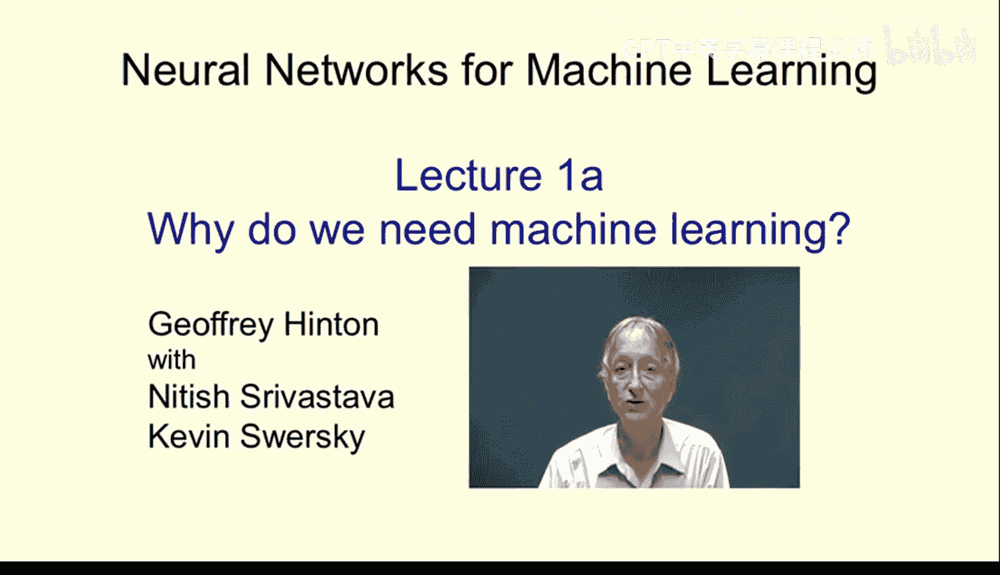

在本节课中，我们将探讨机器学习的必要性、其应用场景以及它能完成的任务。我们将从为什么某些问题难以通过传统编程解决开始，逐步了解机器学习的基本思想，并通过一些实际案例来展示其强大的能力。

---

## 为什么需要机器学习？

上一节我们介绍了课程主题，本节中我们来看看为什么我们需要机器学习。原因在于，存在一些非常难以编写程序来解决的问题。

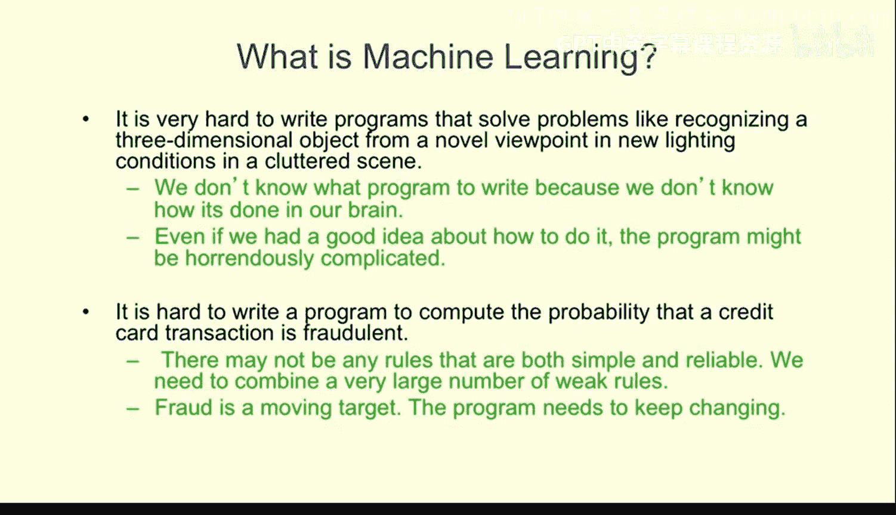

例如，识别一个三维物体。当物体处于新的视角、新的光照条件或复杂的场景中时，识别变得极其困难。我们不知道如何编写程序，因为我们甚至不清楚人类大脑是如何完成这项任务的。即使我们知道，编写出的程序也可能异常复杂。

另一个例子是检测欺诈性信用卡交易。可能不存在任何简单、明确的规则来判断一笔交易是否欺诈。实际上，我们需要组合大量并不可靠的规则。此外，这些规则会随着欺诈者手段的变化而改变。

因此，我们需要一个能够组合不可靠规则、并且易于修改的复杂程序。

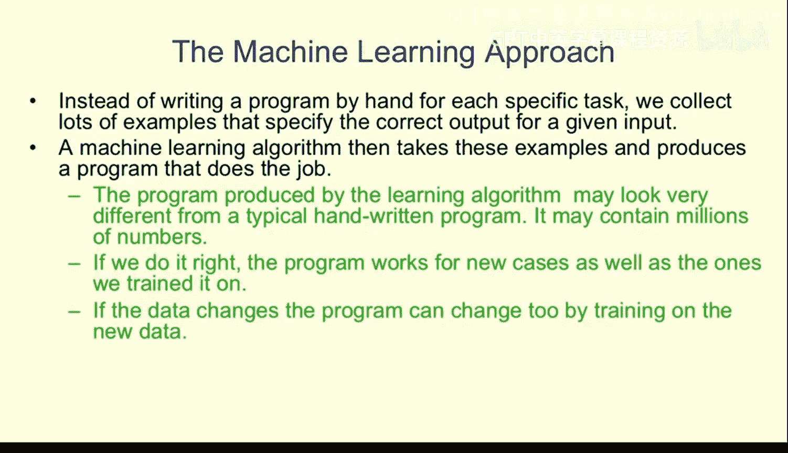

---

## 机器学习的方法

既然为每个特定任务手动编写程序如此困难，机器学习提供了一种不同的思路。

机器学习的方法是：对于特定任务，我们收集大量**输入-输出**配对示例，这些示例指明了给定输入对应的正确输出。然后，机器学习算法接收这些示例，并生成一个能完成该任务的程序。

由学习算法生成的程序，可能与典型的手写程序看起来非常不同。例如，它可能包含数百万个数字，用于表示对不同类型证据的**权重**。

如果方法得当，这个程序不仅能在训练过的案例上工作，也应该能处理新的案例。如果数据发生变化，我们也可以通过在新数据上重新训练，相对容易地更新程序。

如今，大量的计算资源比雇佣专人为特定任务编写程序更便宜。因此，我们可以负担得起使用庞大、复杂的机器学习程序来为我们生成这些特定任务的系统。

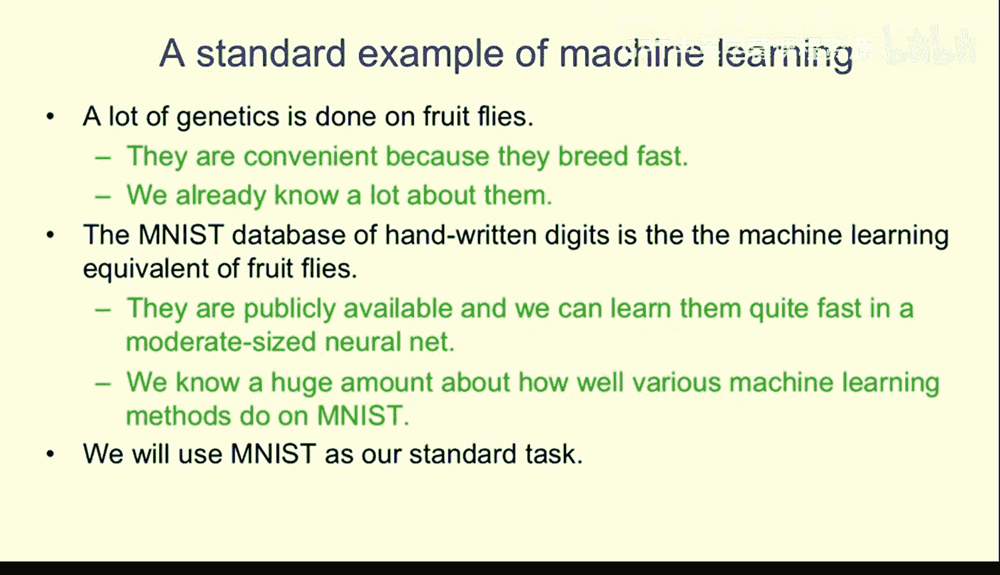

---

## 机器学习的应用领域

以下是机器学习算法最擅长处理的一些任务类型：

*   **模式识别**：例如，识别真实场景中的物体、人脸的身份或表情、以及语音中的单词。
*   **异常检测**：例如，检测信用卡交易中的异常序列，或核电站传感器读数中的异常模式。对于这类问题，我们通常不希望使用监督学习（即查看爆炸案例并找出原因），而是希望在没有监督信号的情况下，仅通过识别“行为异常”来发现问题。
*   **预测**：例如，预测未来的股票价格或汇率，或者根据用户喜欢的电影以及其他大量用户的喜好，预测该用户可能喜欢的电影。

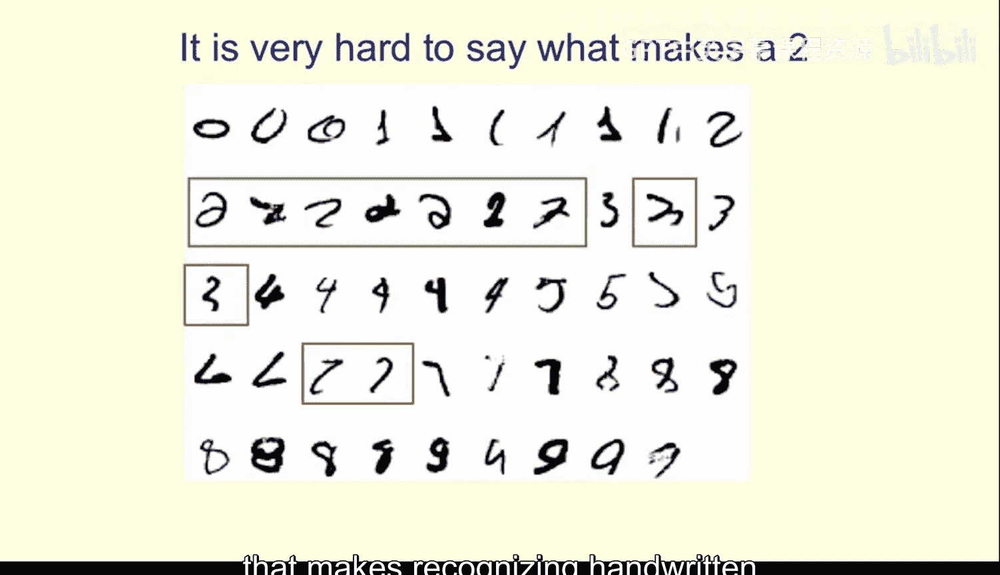

---

## 我们的“果蝇”：MNIST数据集

在本课程中，我将使用一个标准示例来解释许多机器学习算法。这类似于遗传学中使用果蝇进行研究：它们繁殖快，且已有大量已知的遗传学知识。

**MNIST** 手写数字数据库就是机器学习领域的“果蝇”。它是公开可用的数据集，我们可以让机器学习算法快速学习如何识别这10个数字（0-9），因此便于尝试各种算法变体。此外，我们已经对不同机器学习方法在MNIST上的表现有了深入的了解，特别是因为这些方法通常由其支持者实现，结果相对可靠。

基于以上所有原因，我们将使用MNIST作为我们的标准任务。

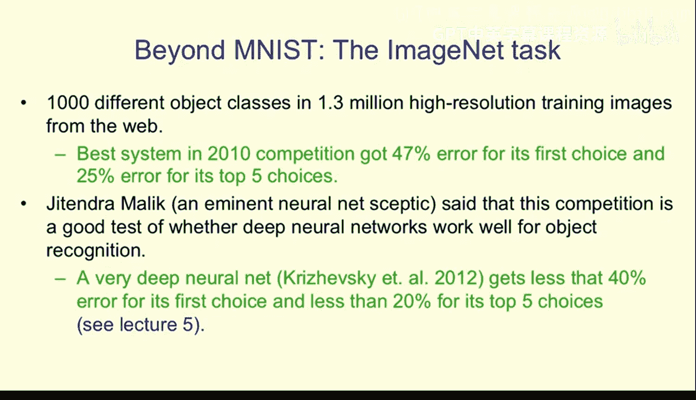

以下是MNIST中的一些数字示例。这些是神经网络首次看到时就能正确识别的数字，但也是神经网络信心不足的那些。你可以看到原因。

这些数字按标准扫描线顺序排列（先是0，然后是1、2，依此类推）。观察绿色矩形框中的一堆“2”，你会发现，即使你知道它们是手写数字，你很可能也会猜它们是“2”，但很难说清楚到底是什么让它们成为“2”。它们并没有一个简单的共同特征。特别是，如果你尝试将一个“2”叠加在另一个上，你会发现它们并不吻合。即使进行一些扭曲，也很难让它们完全重叠。因此，使用**模板匹配**的方法将无法胜任。具体来说，很难找到一个模板既能匹配绿色框中的两个“2”，又不会错误匹配红色框中的其他数字。

这正是使得手写数字识别成为机器学习理想任务的原因之一。

---

## 超越MNIST：更复杂的任务

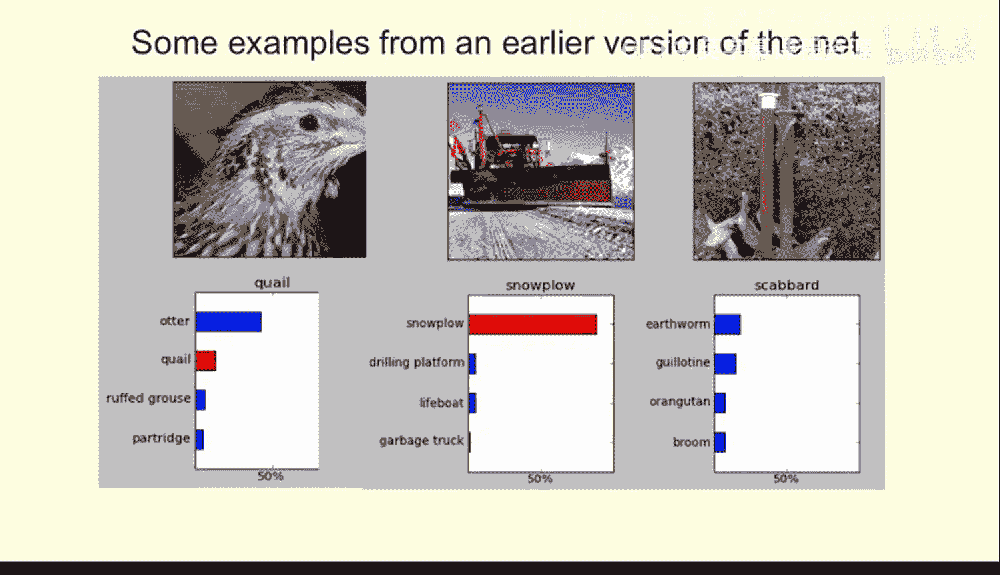

我不希望你认为MNIST是机器学习唯一能做的事情。对于现代机器学习系统来说，MNIST已经是一个相对简单的任务。

为了激发你对后续课程的兴趣，我想展示一些更困难任务的例子。

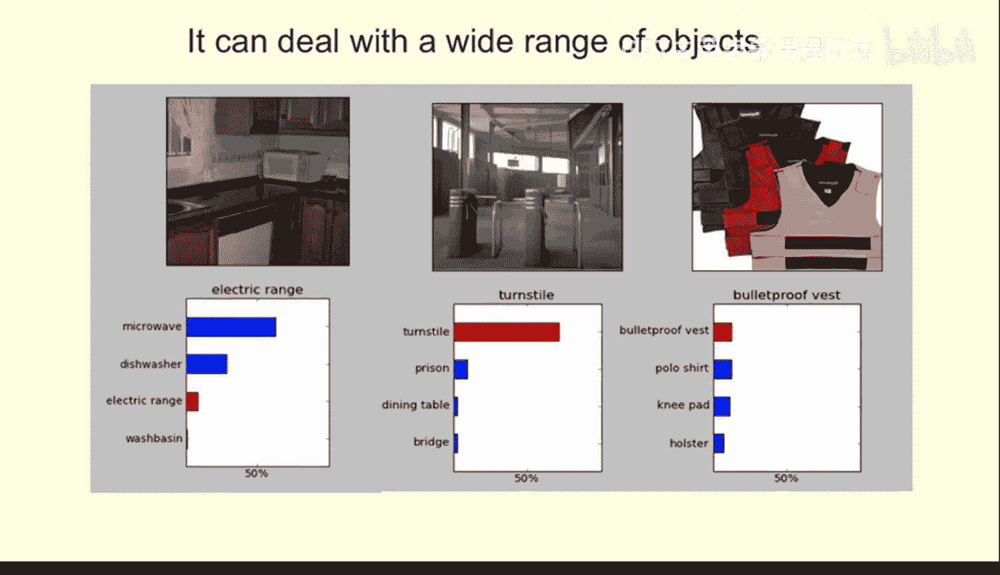

我们现在拥有参数接近**1亿**的神经网络，能够识别**1000种**不同的物体类别。这些网络在从网络获取的**130万张**高分辨率训练图像上进行训练。在2010年的一场竞赛中，最佳系统的错误率是：第一选择错误率为**47%**，如果放宽到前五个选择中包含正确答案就算对，则错误率为**25%**。这对于1000种不同物体来说已经不错了。

著名的神经网络怀疑论者、顶尖计算机视觉研究员**Geoffrey Hinton**曾表示，这场竞赛是检验深度神经网络在物体识别上能否表现出色的良好测试。如今，一个非常深的神经网络的表现已经远超当年的获胜系统，其第一选择错误率低于**40%**，前五选择错误率低于**20%**。我将在第5讲中更详细地描述这一点。

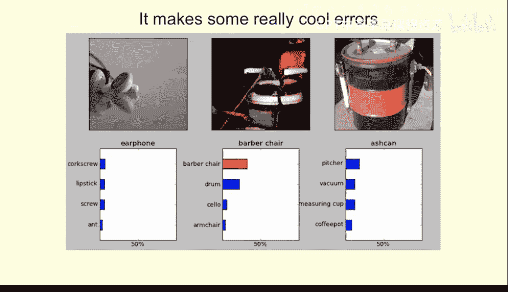

以下是一些需要识别的图像示例，这些图像来自它从未见过的测试集。在示例下方，我展示了神经网络认为的正确答案，其中水平条的长度表示其置信度，红色标注的是正确答案。

*   在中间的例子中，它正确识别出那是一辆“扫雪机”。但你可以看到，它的其他选择也相当合理。它看起来确实有点像“钻井平台”。而它的第三选择“救生艇”，看起来也非常像救生艇，你可以看到船头的旗帜、船桥、船尾的旗帜以及背景中的巨浪。因此，它的错误揭示了其工作原理，并且这些错误非常合理。
*   在左边的例子中，它识别错了，可能是因为鸟的喙缺失了，并且鸟的羽毛看起来非常像水獭湿漉漉的皮毛。但正确答案仍在它的前五个选择中。它的表现甚至比我好，我都不知道那是一只鹌鹑、松鸡还是山鹑。
*   在右边的例子中，它完全识别错了。它认为是“断头台”，你或许能明白为什么：背景看起来像丛林，中间有橙色的东西，但它未能得出正确答案。

然而，神经网络能够处理各种不同的物体。例如，在左边的图中，我可能会首先猜是“微波炉”，但实际正确答案是“电灶”，并且神经网络将其列入了前五选择。在中间的图中，它识别出了“旋转栅门”，这是一个分散的物体，表明它不仅能识别紧凑的物体，也能处理图片和真实场景（如右边的“防弹背心”）。

它还会犯一些非常有趣的错误。例如，在左边的图像（一个“耳机”）中，它完全没有识别出与耳机相关的东西，但它的第四个选择认为是“蚂蚁”。乍看之下这很荒谬，但仔细观察，你会发现这很像从下方看一只蚂蚁的视角：眼睛在向下看你，后面可以看到触角。这可不是你作为一只青蛙愿意看到的蚂蚁视角。在右边的图像中，它虽然没有得到正确答案，但它的所有答案都是圆柱形物体。

---

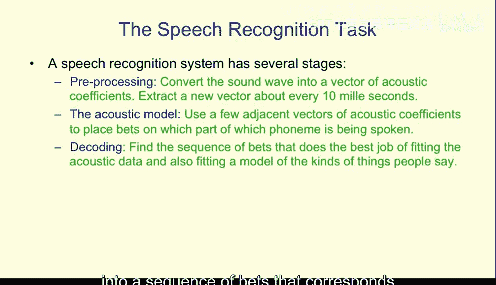

## 另一个成功领域：语音识别

神经网络和我（指演讲者）非常擅长的另一个任务是**语音识别**，或者至少是语音识别系统的一部分。

语音识别系统包含多个阶段。首先，它们对声波进行预处理，为每**10毫秒**的声波获取一个**声学系数向量**，因此每秒会得到100个这样的向量。然后，它们取几个相邻的声学系数向量，需要据此对正在发音的是哪个音素的哪个部分下注。因此，它们观察这个小窗口，并判断在窗口中心，他们认为是什么音素以及是该音素的哪一部分。

一个好的语音识别系统会为每个音素准备许多替代模型，每个模型可能包含三个不同的部分。因此，系统可能认为当前片段是数千种可能片段中的一种，并且需要对这数千种可能性都下注。下注完成后，会有一个解码阶段，它尽可能好地利用这些看似合理的下注，将它们拼接成一个符合人们说话习惯的序列。

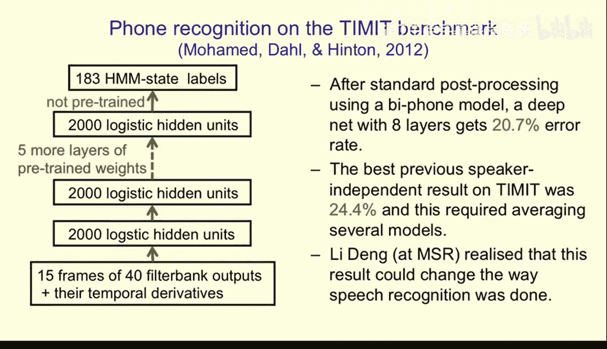

目前，由多伦多大学的**George Dahl**和**Abdel-rahman Mohamed**开创的**深度神经网络**，在声学模型上的表现优于以往的机器学习方法，并且已经开始应用于实际系统。Mohamed开发了一个使用多层**二元神经元**的系统，它接收一些声学帧并对标签进行下注。他们在一个相对较小的数据库上工作，使用了183个替代标签。为了使系统工作，他们进行了一些预训练（这将在课程后半部分描述）。经过标准的后处理后，他们在一个非常标准的基准测试（类似于语音领域的MNIST）上获得了**20.7%**的错误率。而之前在该基准测试上，说话人无关识别的最佳结果是**24.4%**。微软研究院一位经验丰富的语音研究员意识到，这是一个足够大的改进，可能会改变语音识别系统的构建方式，事实也确实如此。

观察近期的结果，来自几个领先语音研究团队的数据显示：
*   **微软**证明，这种深度神经网络用作语音系统中的声学模型时，能将错误率从**27.4%** 降低到**18.5%**。或者，可以理解为将获得可比性能所需的训练数据量从**2000小时**减少到**309小时**。
*   **IBM**在大词汇量语音识别的标准任务中拥有最佳系统之一，其高度优化的系统错误率为**18.8%**，但也被这种深度神经网络超越。
*   **谷歌**最近在大量语音数据（**5800小时**，但仍远少于其高斯混合模型的训练数据）上训练了一个深度神经网络。即使使用更少的数据，它的表现也远超之前的技术，将错误率从**16%** 降低到**12.3%**，并且错误率仍在持续下降。在最新的Android系统中，如果你使用语音搜索，它正在使用这种深度神经网络来实现高质量的语音识别。

---

## 总结

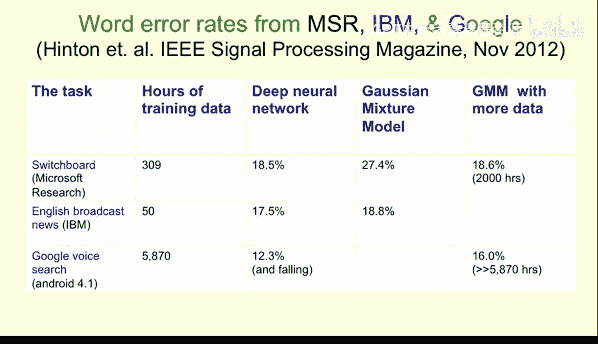

本节课中，我们一起学习了为什么需要机器学习。我们了解到，对于编写明确程序极其困难或规则复杂多变的任务（如物体识别、欺诈检测），机器学习提供了一种通过从示例中学习来自动生成解决方案的强大方法。我们以MNIST手写数字识别为例，说明了机器学习任务的典型特征。此外，我们还看到了机器学习在更复杂领域（如大规模图像分类和语音识别）取得的显著成功，这些成功证明了深度神经网络等现代机器学习技术的巨大潜力。