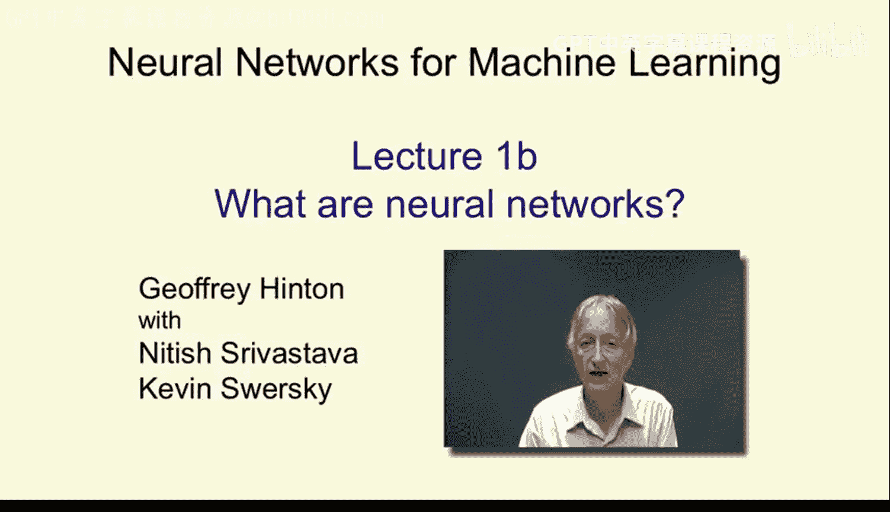
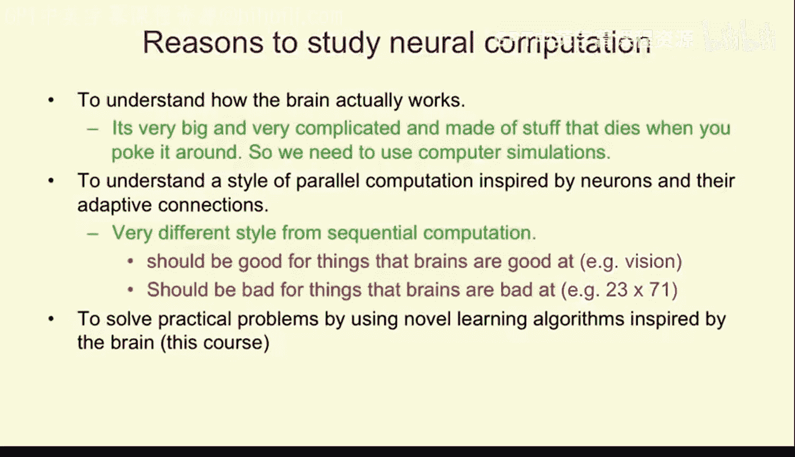
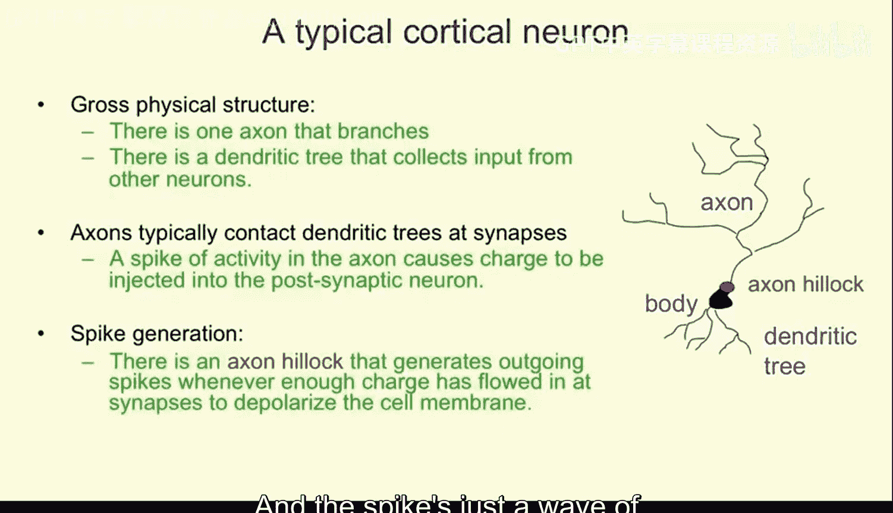
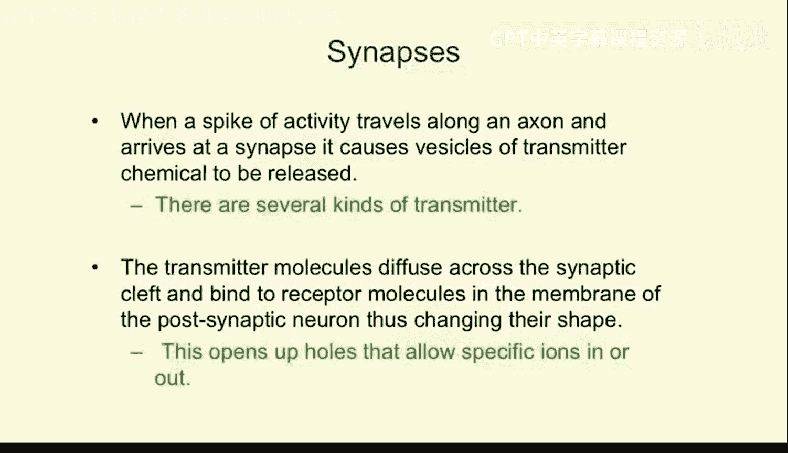
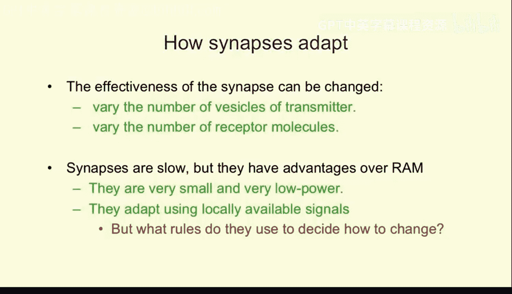
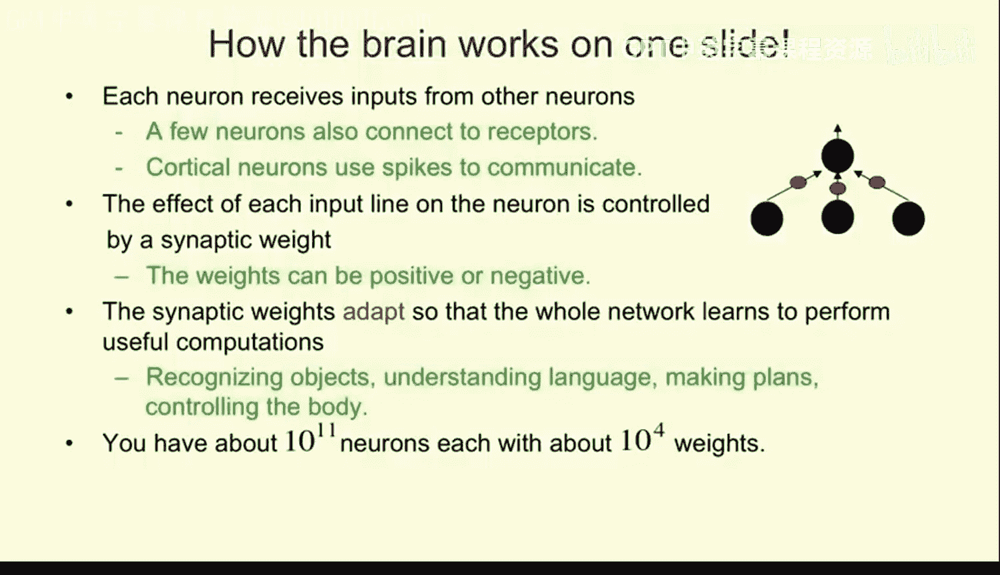
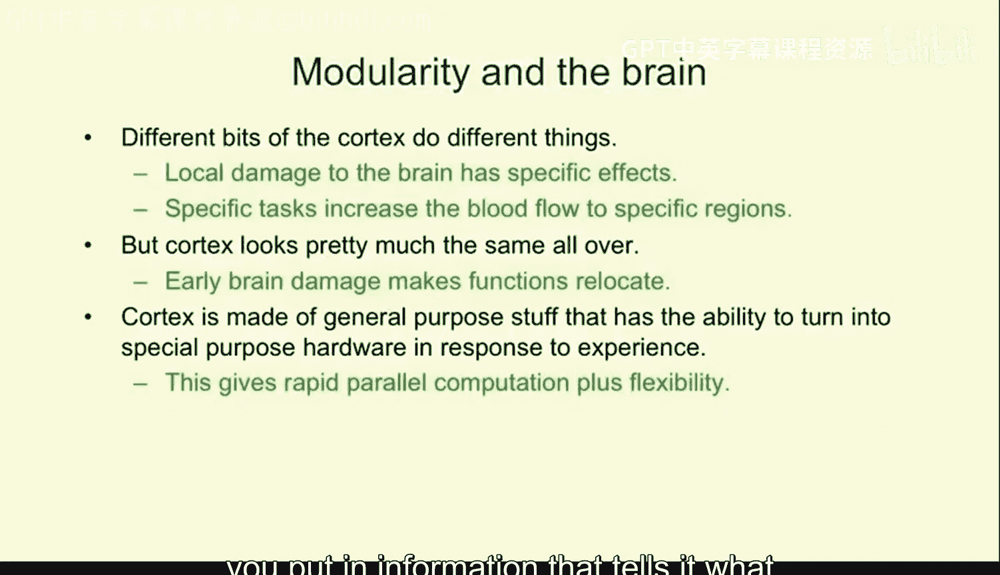

# 1.2：什么是神经网络 🧠

在本节课中，我们将要学习神经网络的生物学灵感来源——真实的大脑神经元。虽然本课程大部分内容将专注于人工神经网络，但了解其灵感来源有助于我们理解这种计算范式的核心思想。

## 概述：为何研究神经元网络

研究神经元网络如何进行计算，主要有以下几个原因。

首先，是为了理解大脑的实际工作原理。仅通过实验研究大脑非常困难，因为它结构庞大复杂，且无法承受直接的物理干预。因此，我们需要借助计算机模拟来帮助理解实证研究中的发现。

其次，是为了理解一种受大脑启发的并行计算风格。大脑能够通过一个由相对缓慢的神经元组成的大型并行网络进行计算。理解这种计算风格，可能有助于我们制造出更好的并行计算机。这种计算方式与传统的串行处理器截然不同，它非常擅长处理大脑所擅长的事务（如视觉识别），但在处理大脑不擅长的事务（如数字乘法）时则表现不佳。

第三个原因，也是与本课程最相关的，是为了利用受大脑启发的新型学习算法来解决实际问题。这些算法即使并非大脑真实的工作方式，也可能非常有用。

因此，在本课程的大部分时间里，我们不会过多讨论大脑的实际工作机制，它主要作为一个灵感来源，告诉我们大型并行神经元网络能够进行非常复杂的计算。不过，在本视频中，我们将更多地探讨大脑的实际工作原理。

## 真实神经元的结构与功能

上一节我们介绍了研究神经元网络的动机，本节中我们来看看真实神经元的具体结构。

一个典型的皮层神经元具有以下基本物理结构：
*   **细胞体**：神经元的核心部分。
*   **轴突**：用于向其他神经元发送信号。
*   **树突**：用于接收来自其他神经元的信号。

当一个神经元的轴突与另一个神经元的树突接触时，会形成一个叫做**突触**的结构。沿着轴突传播的**动作电位**（电脉冲）会导致电荷被注入到突触后神经元中。

当神经元在其树突中接收到足够的电荷，使细胞体上一个叫做**轴丘**的部分去极化时，它就会产生动作电位。轴丘去极化后，神经元会沿着其轴突发送出一个电脉冲，这个脉冲就是沿着轴突传播的去极化波。

## 突触：学习发生的关键

我们了解了神经元如何传递信号，接下来聚焦于信号传递的关键节点——突触。

突触本身具有有趣的结构，它们包含微小的**神经递质化学物质囊泡**。当动作电位到达轴突末端时，会导致这些囊泡移动到细胞膜表面，并将神经递质释放到**突触间隙**中。

神经递质有多种类型，有些实现**正权重**（兴奋性），有些实现**负权重**（抑制性）。这些递质分子扩散穿过突触间隙，并与突触后神经元膜上的**受体分子**结合。结合后，这些大分子的形状发生改变，从而在膜上形成孔洞。这些孔洞允许特定的离子流入或流出突触后神经元，从而改变其去极化状态。

**突触具有适应性**，这正是大多数学习过程的基础：改变突触的效能。它们可以通过改变每次动作电位到达时释放的囊泡数量，或改变对释放的递质分子敏感的受体分子数量来适应。

与计算机内存相比，突触的速度非常慢，但它们具有许多优势：体积非常小、功耗极低，并且能够适应。**适应性**是最重要的特性，它们利用局部可用的信号来改变自身强度，这就是我们学会执行复杂计算的方式。当然，核心问题在于它们如何决定改变强度，即适应规则是什么。

## 大脑如何工作：一个整体视图

前面我们分解了神经元和突触的细节，现在让我们从整体上理解大脑的工作方式。

大脑的工作原理可以概括如下：
*   每个神经元接收来自其他神经元的输入（少数神经元直接从感受器接收输入）。
*   神经元通过发送动作电位在皮层中相互通信。
*   输入线路对神经元的影响由**突触权重**控制，权重可以是正值或负值。
*   这些突触权重具有**适应性**。
*   通过调整这些权重，整个网络学会执行不同类型的计算，例如识别物体、理解语言、制定计划、控制身体运动。

人脑拥有大约10^11个神经元，每个神经元约有10^4个权重，因此总共有大约10^14到10^15个突触权重。在极短的时间（几毫秒）内，其中很大一部分权重可以影响正在进行的计算。与存储知识交互的带宽，甚至比现代工作站还要高。

关于大脑的最后一个要点是，**皮层是模块化的**，或者说它学会了模块化。皮层的不同部分最终会负责不同的功能。从遗传学上讲，来自感官的输入会到达皮层的不同区域，这在很大程度上决定了它们最终的功能。

成年人大脑的局部损伤会导致特定的功能丧失。例如，一个区域的损伤可能导致失去理解语言的能力，另一个区域的损伤可能导致失去识别物体的能力。我们通过脑部扫描（如fMRI）可以了解功能在大脑中的定位，因为当使用大脑的某一部分执行任务时，该部分需要更多能量，从而导致血流量增加，这在扫描仪上可以观察到。

但皮层的显著之处在于，它各处看起来都非常相似。这强烈表明它内部包含一个相当灵活、通用的学习算法。这一点也得到了早期大脑损伤研究的支持：如果大脑在早期受损，功能会重新定位到大脑的其他部分。因此，大脑的哪部分执行哪项功能并非完全由遗传预先决定。

在幼貂身上进行的令人信服的实验表明，如果切断听觉皮层来自耳朵的输入，并将视觉输入重新路由到听觉皮层，那么原本注定处理声音的听觉皮层实际上会学会处理视觉输入，并产生看起来非常像视觉系统中神经元的细胞。这表明皮层是由通用材料构成的，它有能力根据经验转变为执行特定任务的专用硬件。这提供了一个很好的组合：学习后的快速并行计算能力，加上灵活性，使你能够学习新的功能。这很像**FPGA**（现场可编程门阵列）：你先构建一些标准的并行硬件，然后在构建完成后，输入信息告诉它执行特定的并行计算。

传统的计算机通过存储**串行程序**来获得灵活性，但这需要非常快速的中央处理器来访问串行程序中的指令并执行长串行计算。

## 总结

本节课中我们一起学习了神经网络的生物学基础。我们探讨了研究神经元网络的三个主要原因，详细了解了真实神经元和突触的结构与功能，并从整体上概述了大脑通过可适应的突触权重进行并行计算的工作原理。最后，我们认识到大脑皮层具有模块化和通用学习算法的特性，这为构建灵活而强大的人工神经网络提供了深刻的灵感。理解这些生物学原理，为我们后续学习人工神经网络模型奠定了重要的概念基础。