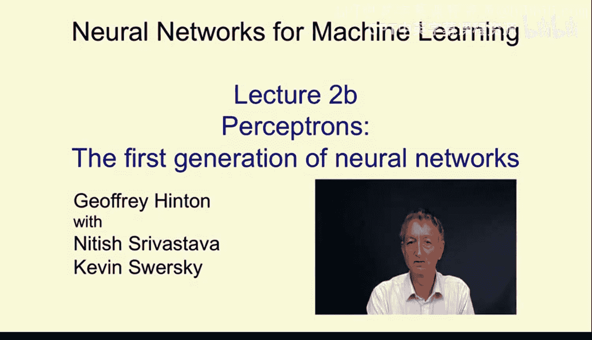
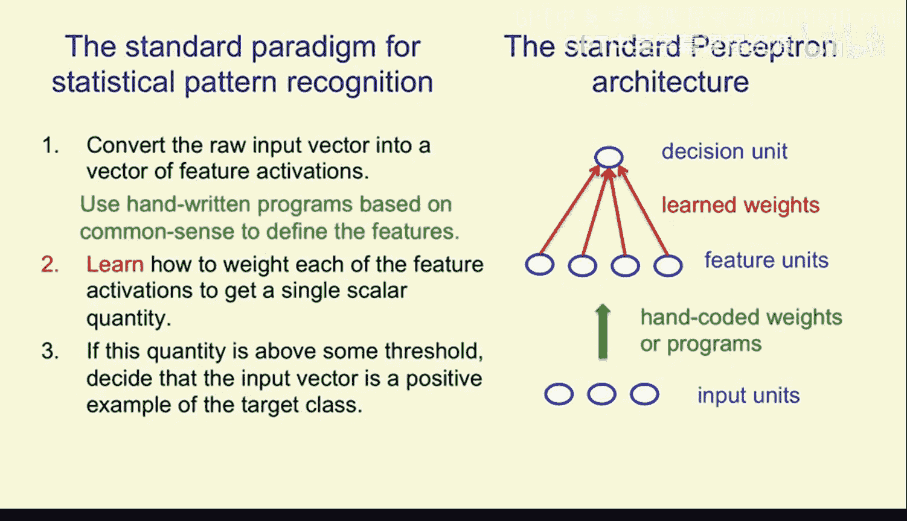
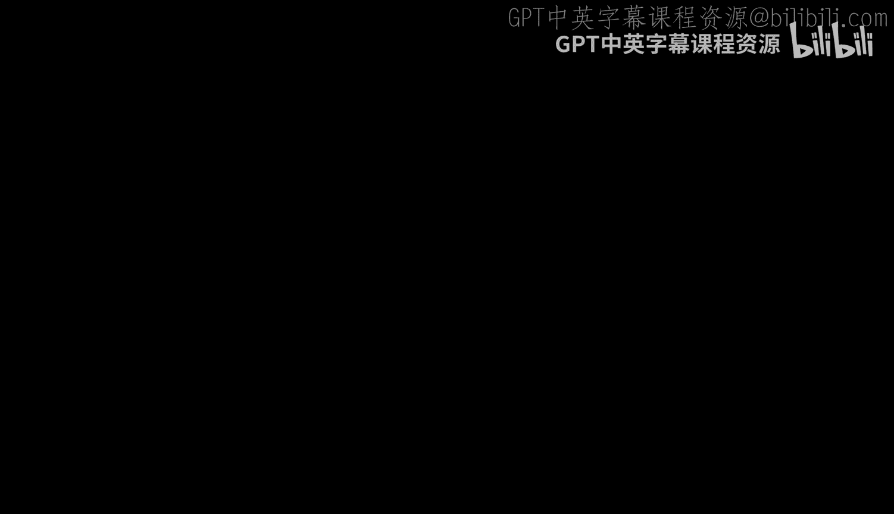
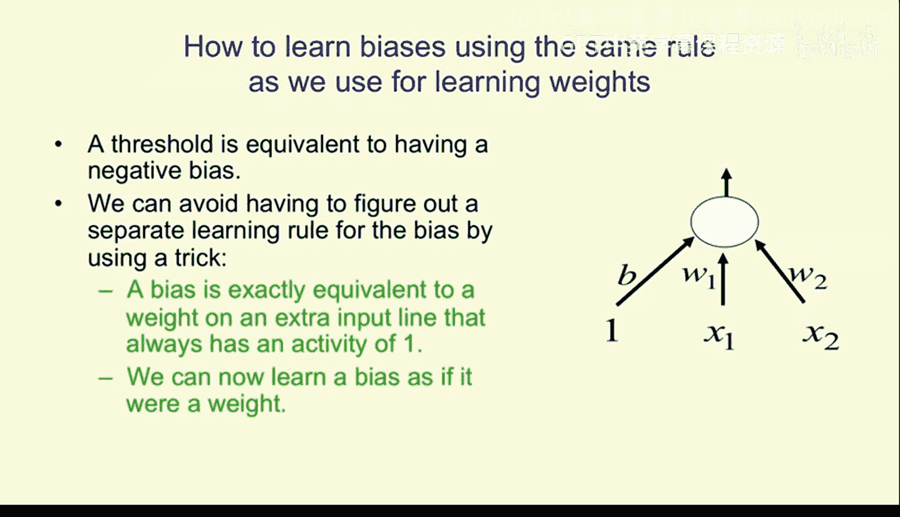
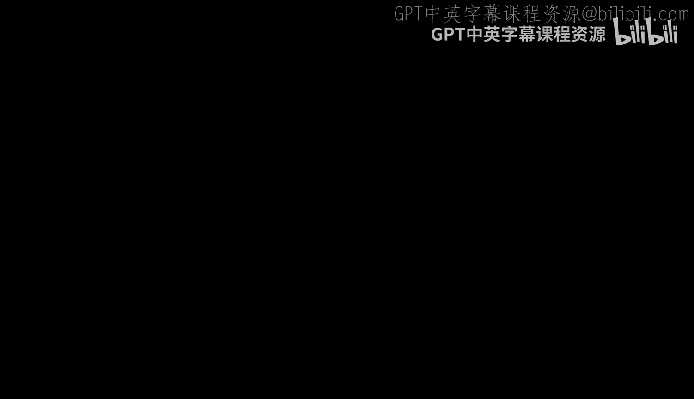
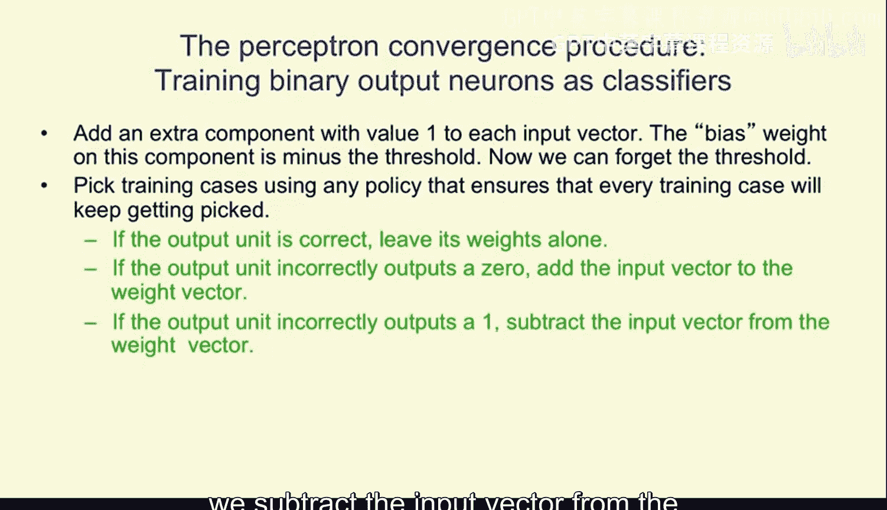

# 2.2：感知机——第一代神经网络 🧠

在本节课中，我们将要学习感知机，这是20世纪60年代早期研究的第一代神经网络模型。我们将了解它的工作原理、历史背景、强大的学习算法以及其固有的局限性。

## 概述

感知机是一种统计模式识别系统。它首先将原始输入转换为一系列特征激活值，然后通过学习为每个特征分配权重，最后通过一个决策单元来判断输入是否属于目标类别。

## 感知机的工作原理

上一节我们介绍了感知机的基本概念，本节中我们来看看它的具体工作流程。

在统计模式识别中，存在一种标准的模式识别方法。

我们首先获取原始输入，并将其转换为一组特征激活值向量。这个过程使用基于常识的手写程序完成，因此系统的这一部分不进行学习。我们观察问题，决定哪些是好的特征，尝试一些特征，看它们是否有效。如果无效，则尝试更多特征，最终得到一组能通过后续学习阶段解决问题的特征。

我们学习的是如何为每个特征激活值分配权重，以获得一个单一的标量值。特征的权重代表了该特征为“当前输入是目标模式”这一假设提供支持或反对证据的程度。

将所有加权特征相加，我们就得到了支持“这是目标模式”这一假设的总证据。如果该证据超过某个阈值，我们就判定该输入是我们试图识别的模式类别的正例。

## 感知机的定义与结构

了解了基本原理后，我们来看看感知机的具体定义。

感知机是统计模式识别系统的一个特定例子。实际上存在许多不同类型的感知机，但标准类型（罗森布拉特称之为α感知机）由一些输入组成，这些输入随后被转换为特征活动。转换过程可能由类似神经元的部件完成，但系统的这一阶段不学习。

一旦获得特征活动，你就可以学习一些权重。这样你就可以用特征活动乘以权重，并通过判断“特征活动乘以学习到的权重”之和是否大于阈值，来决定它是否是你感兴趣的类别的例子。

## 历史背景与争议

感知机有着有趣的历史。它在20世纪60年代早期由弗兰克·罗森布拉特推广。他写了一本名为《神经动力学原理》的大部头著作，其中描述了许多不同类型的感知机。

那本书充满了思想。书中最重要的内容是一个非常强大的学习算法，或者看起来非常强大的学习算法。人们为感知机使用这种学习算法所能做的事情做出了许多宏大的宣称。

以下是当时的一些宣称例子：
*   例如，人们声称感知机可以区分坦克图片和卡车图片，即使坦克和卡车部分被森林遮挡。

然而，其中一些宣称后来被证明是错误的。在坦克和卡车的案例中，结果发现坦克的图片是在晴天拍摄的，而卡车的图片是在阴天拍摄的。感知机所做的只是测量所有像素的总强度。这是我们人类相当不敏感的东西。我们注意到图片中的物体，但感知机很容易学会累加总强度。😊

正是这类事情给算法带来了坏名声。1969年，明斯基和帕普特出版了一本名为《感知机》的书，分析了感知机能做什么，并指出了它们的局限性。许多人认为这些局限性适用于所有神经网络模型。人工智能领域的普遍看法是，明斯基和帕普特已经证明神经网络模型是无稽之谈，或者它们无法学习困难的事物。

明斯基和帕普特本人知道他们并没有证明这一点。他们只是证明了那种适用于强大学习算法的感知机无法做很多事情。或者更准确地说，它们无法通过学习来完成这些事情。如果你在输入中手动编码答案，它们可以做到，但无法通过学习做到。但这个结果被过度泛化了。当我在20世纪70年代开始研究神经网络模型时，人工智能领域的人不断告诉我，明斯基和帕普特已经证明这些模型不好。

实际上，感知机收敛过程（我们稍后会看到）至今仍被广泛用于具有非常大特征向量的任务。例如，谷歌就用它来根据非常大的特征向量预测事物。

## 决策单元与偏置处理

现在，让我们深入了解感知机的核心计算单元。

感知机中的决策单元是一个二元阈值神经元。我们之前见过这些神经元，为了帮你回忆：它们计算从其他神经元获得的输入的加权和，加上一个偏置，得到它们的总输入。然后，如果该总和超过0，则输出1；否则输出0。

我们不希望必须有一个单独的学习规则来学习偏置。事实证明，我们可以像处理权重一样处理偏置。如果我们取每个输入向量，在其前面附加一个1，并将偏置视为该始终为1的第一个特征的权重，那么偏置就只是阈值的负数。使用这个技巧，我们不需要为偏置设置单独的学习规则。这完全是等价的。

为了学习这个额外维度上的权重。

## 感知机学习算法

上一节我们介绍了如何简化模型，本节中我们来看看感知机强大的学习过程。

以下是感知机非常强大的学习过程。这是一个保证有效的学习过程，这是一个很好的特性。😊当然，你稍后必须查看细则，了解为什么这个保证并不像你想象的那么好。

我们首先为每个输入向量添加一个值为1的额外分量。现在我们可以忘记阈值了。然后，我们使用任何我们喜欢的策略持续选取训练案例，只要我们确保每个训练案例都能被选取，且等待时间不会太长。我不打算精确定义“等待时间太长”的含义。如果你是数学家，可以思考一下什么可能是好的定义。

选取训练案例后，你查看输出是否正确。如果正确，则不改变权重。如果输出单元输出0，而它本应输出1（换句话说，当它确实是我们要识别的模式实例时，它却说不是），那么我们只需将输入向量加到感知机的权重向量上。相反，如果输出单元输出1，而它本应输出0，则我们从感知机的权重向量中减去输入向量。

令人惊讶的是，这个简单的学习过程保证能找到一组权重，为每个训练案例提供正确答案。但前提是存在这样一组权重。对于许多有趣的问题，并不存在这样一组权重。是否存在一组权重很大程度上取决于你使用什么特征。

因此，事实证明，对于许多问题，困难的部分在于决定使用什么特征。如果你使用了合适的特征，学习可能变得容易；如果你没有使用正确的特征，学习就变得不可能，所有的工作都在于决定特征。

## 总结

本节课中我们一起学习了感知机，作为第一代神经网络模型的核心。我们了解了它如何作为统计模式识别系统工作，其结构包括特征提取和权重学习的二元阈值决策单元。我们回顾了其历史兴衰，认识到其强大的收敛学习算法具有理论保证，但效能严重受限于手动设计的特征。最终，感知机的局限性并非神经网络的终点，而是指明了特征学习的重要性，为后续更深层网络模型的发展埋下了伏笔。