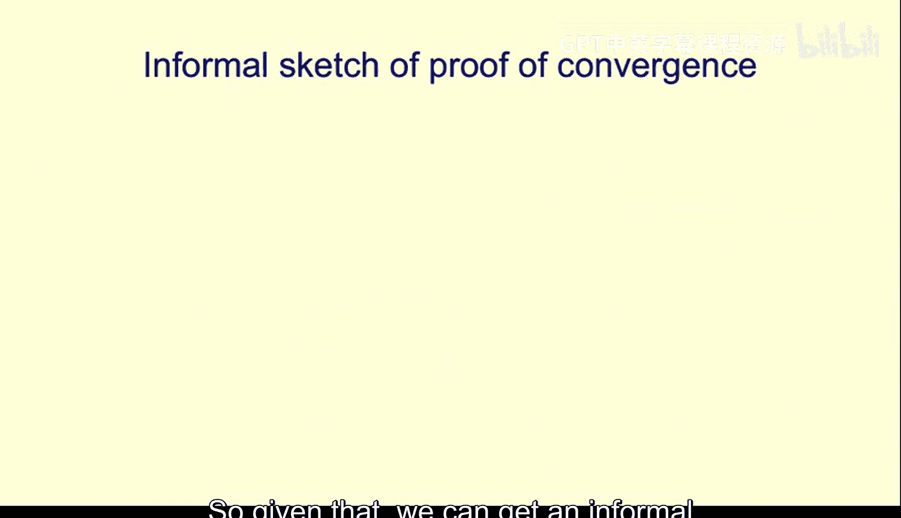
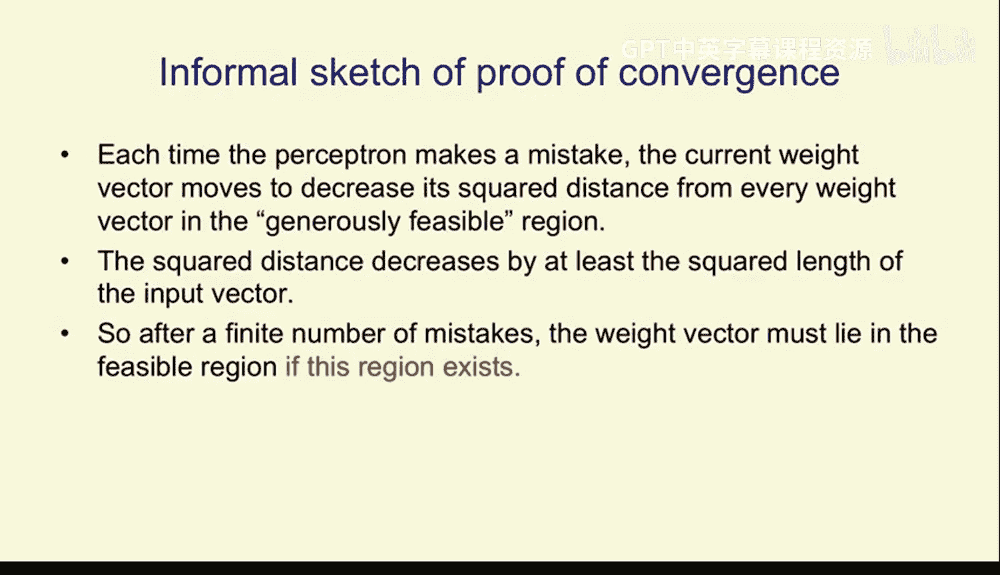

# 2.4：感知机学习为何有效 🧠

在本节课中，我们将学习一个证明，即感知机学习过程最终会将权重向量带入可行解的区域。请注意，本课程主要关注工程实践而非数学证明，因此证明内容较少。然而，通过尝试证明感知机最终能获得正确答案，我们可以更深入地理解其工作原理。

上一节我们介绍了感知机在权重空间中的几何理解。本节中，我们来看看如何利用这种理解来证明感知机最终能找到对所有训练样本都给出正确答案的权重向量，前提是存在这样的向量。

## 证明思路概述

我们的证明假设存在一个向量，它能对所有训练样本给出正确答案。我们称其为**可行向量**。在示意图中，绿色点代表一个可行向量。

我们从一个对某些训练样本分类错误的权重向量开始。示意图中展示了一个被错误分类的训练样本。证明的核心思想是：每当感知机犯一个错误时，它都会更新当前的权重向量，使其更接近每一个可行的权重向量。

我们可以将当前权重向量与一个可行权重向量之间的**平方距离**，表示为沿当前输入向量方向的距离平方，加上与该方向正交的距离平方。正交方向的平方距离不会改变，而沿输入向量方向的平方距离会减小。

因此，我们希望证明：每当感知机犯一个错误，当前权重向量都会更接近所有可行的权重向量。

## 一个潜在问题与解决方案

然而，上述思路存在一个问题。考虑一个恰好位于某个训练样本决策平面正确一侧的可行权重向量（图中金色点），而当前权重向量恰好位于错误一侧。如果输入向量很大，当我们将其加到当前权重向量上时，实际上可能离那个金色的可行向量更远。因此，我们的“希望”并不总是成立。

但我们可以通过定义一个**宽裕可行权重向量**来修复这个问题。宽裕可行权重向量不仅对所有训练样本分类正确，而且其正确分类的“裕度”至少与该训练样本的输入向量长度一样大。

于是，在可行解锥内部，我们有了另一个**宽裕可行解锥**。现在，我们的证明就可以进行了。

## 核心证明步骤

以下是证明的核心逻辑：

每当感知机犯一个错误时，当前权重向量到所有宽裕可行权重向量的平方距离，将至少减少当前输入向量长度的平方（即我们更新的大小）。

基于此，我们可以给出一个非正式的收敛性证明草图。每次犯错，权重向量都会移动，并且它到所有宽裕可行权重向量的平方距离至少减少当前输入向量的平方长度。

因此，到所有宽裕可行权重向量的平方距离至少减少该平方长度。假设没有输入向量是无限小的，这意味着在经过有限次错误后，权重向量必须进入可行区域（如果该区域存在）。注意，它不必进入宽裕可行区域，但至少必须进入可行区域才能停止犯错。

## 总结与关键前提

本节课中我们一起学习了感知机学习算法收敛性的一个非正式证明。证明的核心在于展示了每次错误更新如何使权重向量更接近一组“更好”的解（宽裕可行解），从而最终达到一个可行解。

但请注意，**整个证明都依赖于一个关键前提：存在一个宽裕可行的权重向量**。如果不存在这样的向量，整个证明将不成立。这提醒我们，感知机学习算法的有效性依赖于数据本身是线性可分的，并且存在一个具有足够分类裕度的解。