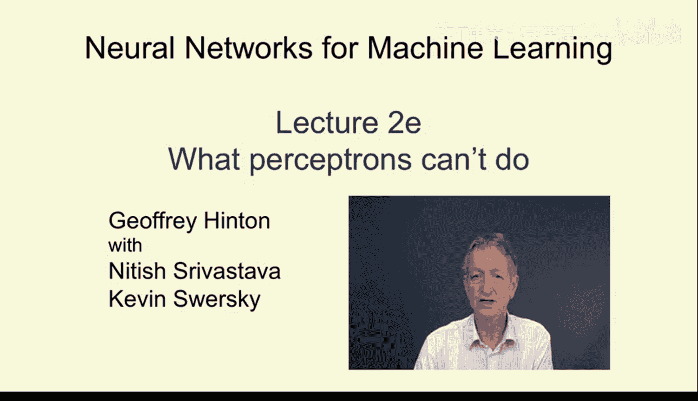
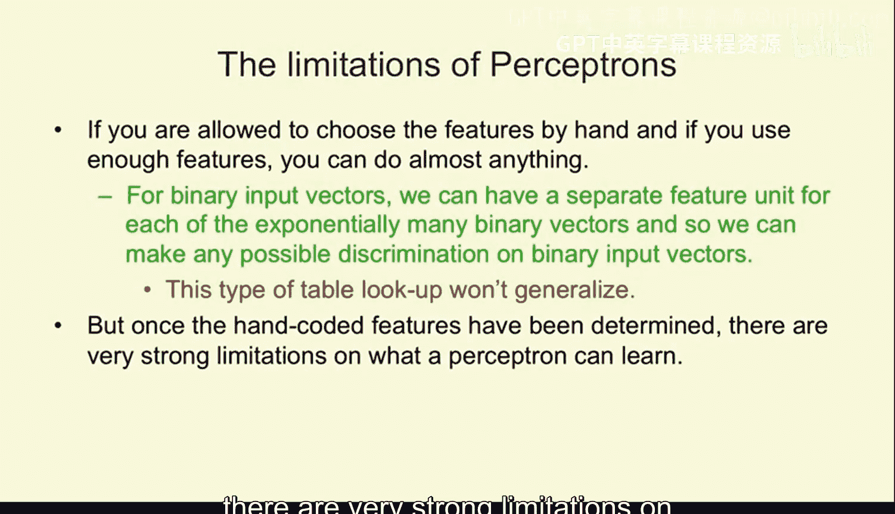
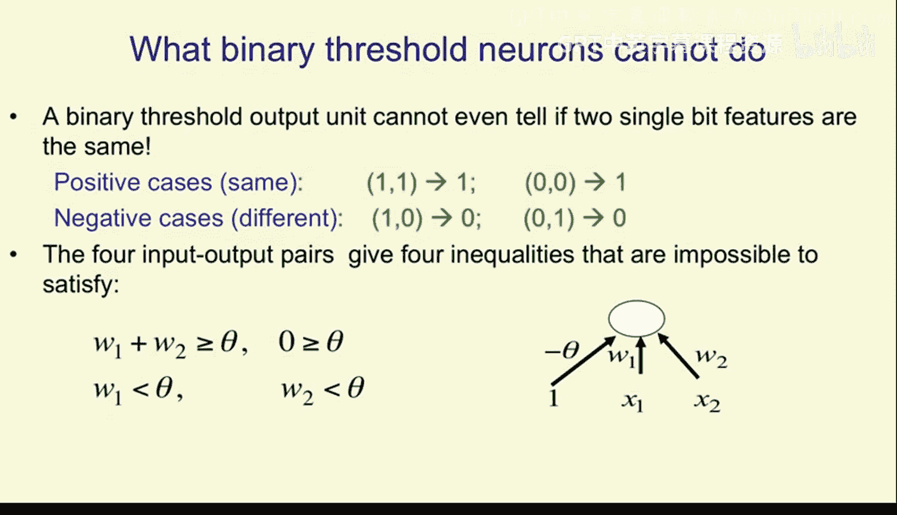
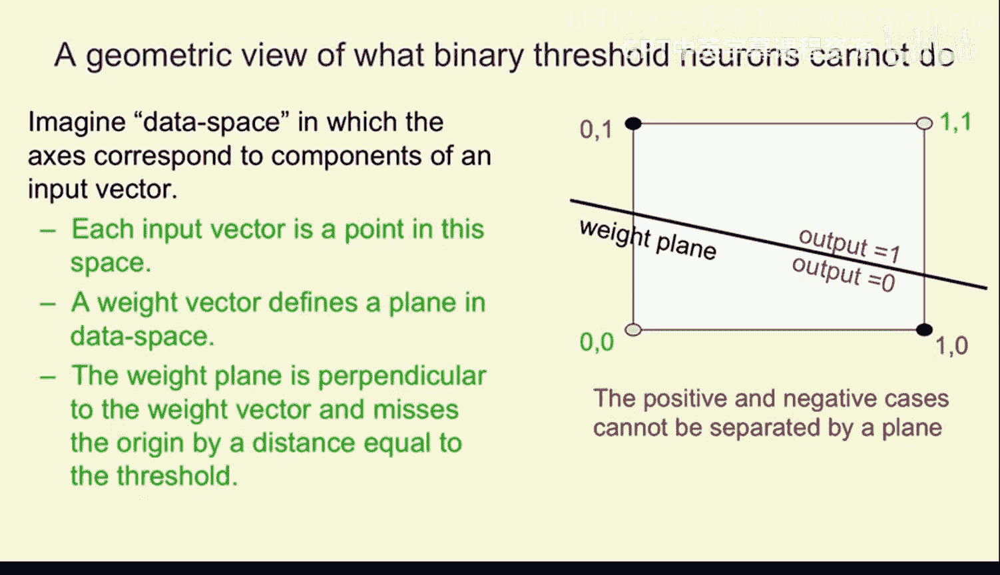
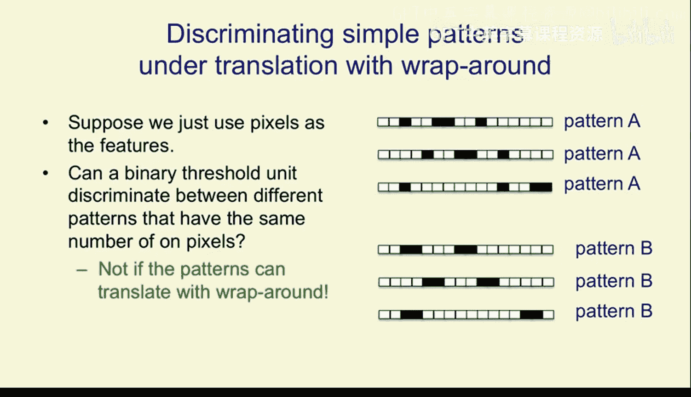
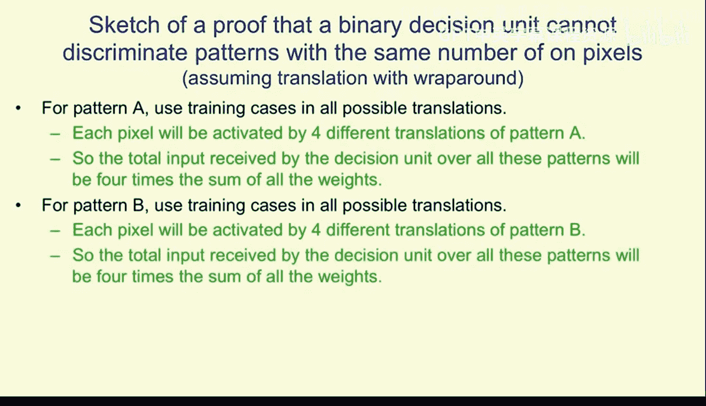
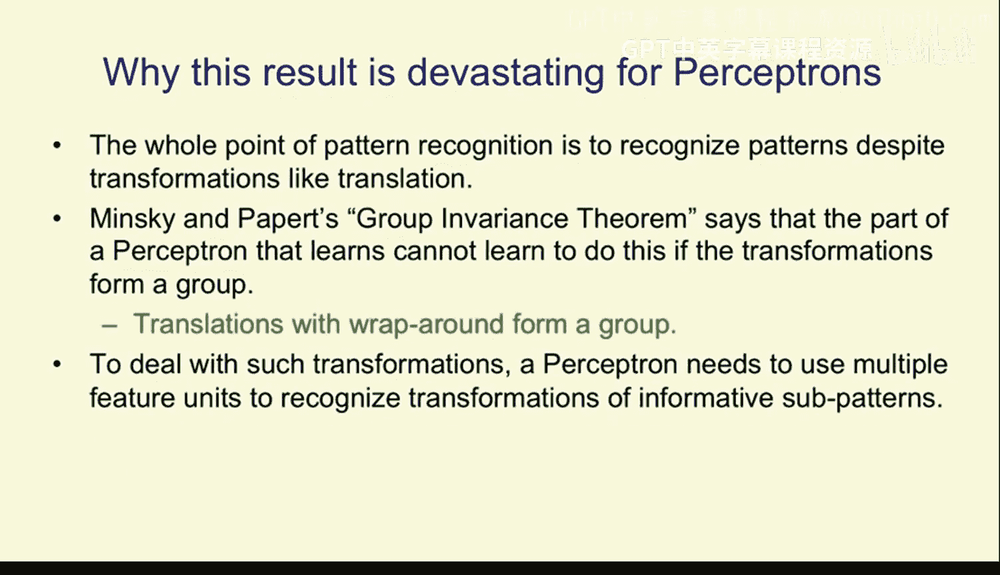
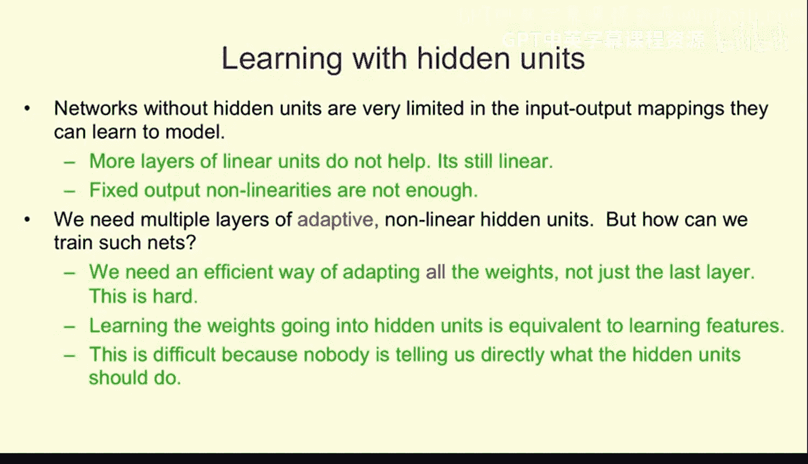

# 2.5：感知机的局限性 🧠

在本节课中，我们将探讨感知机的局限性。这些局限性源于所使用的特征类型。如果使用正确的特征，感知机几乎可以完成任何任务。但如果使用错误的特征，其学习部分的能力将受到极大限制。这正是感知机一度失宠的原因，同时也强调了机器学习中的一个核心难点：**学习正确的特征本身**。

即使不了解特征，我们仍能通过大量手动设计的特征进行学习。例如，判断一个句子是否为合理的英语句子，我们可以手动设计大量特征，然后学习如何加权这些特征以做出判断。但从长远来看，学习特征本身是必要的。

## 感知机为何停滞不前？🤔

神经网络研究在20世纪60年代末至70年代初陷入停滞，原因在于感知机被证明存在严重局限性。现在，我们来理解这些局限性是什么。

如果你愿意手动选择特征，并且使用足够多的特征，你几乎可以让感知机完成任何任务。例如，假设我们有一个二进制输入向量，并为每一个可能的二进制输入向量创建一个独立的特征单元（即，每个单元仅被一个特定的输入向量激活）。这将需要指数级数量的特征单元，但理论上，我们可以对二进制输入向量进行任何可能的区分。

然而，这并非解决实际问题的好策略。因为你需要海量的特征单元，并且模型无法泛化。你无法指望通过观察所有可能情况的一个子集，就能正确预测剩余的情况，因为那些剩余情况需要新的特征单元，而你并不知道如何为这些新单元设置权重。

一旦你决定了手动编码的特征，感知机在学习能力上就存在非常强的限制。

## 一个经典的限制案例：异或问题 ❌

我们将展示，即使是极其简单的任务，感知机也可能无法学习。最经典的例子是“异或”问题。

考虑一个只有两个特征（x1, x2）的问题，每个特征值为0或1。我们定义：
*   **正例**：两个特征值相同（即 (1,1) 和 (0,0)），期望输出为1。
*   **负例**：两个特征值不同（即 (1,0) 和 (0,1)），期望输出为0。

我们要求一个二元阈值单元（感知机）判断两个特征是否相等。事实证明，它无法学会这个任务。

我们可以用代数方法证明。这四个输入输出对产生了四个不等式，它们不可能同时被满足。

1.  对于正例 (1,1)：`1 * w1 + 1 * w2 > θ`
2.  对于正例 (0,0)：`0 * w1 + 0 * w2 > θ` => `0 > θ`
3.  对于负例 (1,0)：`1 * w1 + 0 * w2 < θ`
4.  对于负例 (0,1)：`0 * w1 + 1 * w2 < θ`

将前两个不等式相加，得到 `w1 + w2 > 2θ`。
将后两个不等式相加，得到 `w1 + w2 < 2θ`。
显然，没有一组权重 `(w1, w2)` 和阈值 `θ` 能同时满足这两个矛盾的条件。

我们也可以从几何角度理解。在由特征 `x1` 和 `x2` 构成的数据空间中，每个点代表一个数据案例。权重向量定义了一个平面（一条直线），该平面将空间分为两部分：输出为1的区域和输出为0的区域。我们的目标是找到一条直线，将两个绿色点（正例）与两个红色点（负例）分开。从图中可以直观看出，这是不可能的。

我们将这样一组无法被一个超平面（在二维中是直线）正确划分的训练案例，称为**非线性可分**的数据集。

## 更致命的限制：平移不变性识别 🔄

一个对感知机更具毁灭性的限制，出现在尝试识别**具有平移不变性的简单模式**时。

假设我们直接使用像素值作为特征。问题是：一个二元阈值单元能否区分两个不同的模式（一个作为正例，一个作为负例），如果这两个模式包含相同数量的激活像素，并且这种区分必须在模式发生平移（允许循环平移，即移出右边界后从左边界重新进入）时仍然有效？

答案是不能。

以下是证明思路：
考虑模式A（正例）在所有可能平移位置上的所有实例。由于模式A有4个激活像素，那么对于视网膜上的任何一个像素，都会有4个不同的平移位置使得模式A激活该像素。因此，决策单元在所有平移后的模式A实例上接收到的**总输入**是 `4 * (所有权重之和)`。

现在考虑模式B（负例）在所有可能平移位置上的所有实例。同理，决策单元在所有平移后的模式B实例上接收到的**总输入**也是 `4 * (所有权重之和)`。

为了让感知机正确区分，它必须设置权重，使得**每一个**模式A的实例提供的输入都大于**每一个**模式B的实例。然而，如果对所有实例求和后，模式A和模式B提供的总输入完全相同，那么上述要求显然不可能实现。

这就证明了，在允许循环平移的情况下，感知机无法学会识别具有平移不变性的模式。这是明斯基和帕佩特**群不变性定理**的一个特例。这个结果对感知机是毁灭性的，因为模式识别的核心目标之一，正是识别经过变换（如平移）后仍是同一模式的物体。

明斯基和帕佩特证明，如果变换构成一个“群”（如循环平移），那么感知机的**学习部分**就无法学会这种识别。感知机架构本身仍然可以完成识别，但你必须**手动组织特征**来完成困难的部分。你需要多个特征单元来识别那些能提供类别信息的子模式，并且对于这些子模式的每一个可能位置，你都需要单独的特征单元。

## 结论与启示：从感知机到多层网络 🚀

从感知机的局限性中，我们得出了暂时的结论：感知机不够好，因此神经网络也不够好。但更长期的结论是：**只有当神经网络能够学习特征检测器本身时，它才会真正强大**。仅仅学习特征检测器上的权重是不够的。

没有隐藏单元的神经网络（即单层感知机）在学习建模能力上非常有限。增加更多线性单元层也无济于事，因为组合后仍然是线性的。我们可以通过加入手动编码的隐藏单元来大幅提升其能力，但这些单元并非真正的“隐藏”单元，因为是我们告诉它们该做什么。

我们需要的是**多层、自适应的非线性隐藏单元**。核心问题随之而来：**如何训练这样的网络？** 我们需要一种方法来调整所有权重，而不仅仅是像感知机那样只调整最后一层的权重。这很困难。

具体来说，学习进入隐藏单元的权重，就等同于**学习特征**。这是一项艰巨的任务，因为没有人直接告诉我们隐藏单元应该做什么，应该在何时激活。真正的问题是：我们如何找出学习这些权重的方法，使得隐藏单元能够自动变成解决特定问题所需的那种特征检测器，尤其是在无人告知特征检测器应该是什么样的情况下。

**总结**：本节课我们一起学习了感知机的核心局限性，包括无法解决非线性可分问题（如异或）以及无法学习具有群变换不变性（如平移）的模式识别。这些局限性凸显了手动设计特征的不足，并引出了神经网络发展的关键方向——**开发能够自动学习多层次特征表示（即隐藏单元）的学习算法**。这为下一讲即将介绍的、开启了神经网络第二次浪潮的**反向传播算法**等深度学习方法埋下了伏笔。