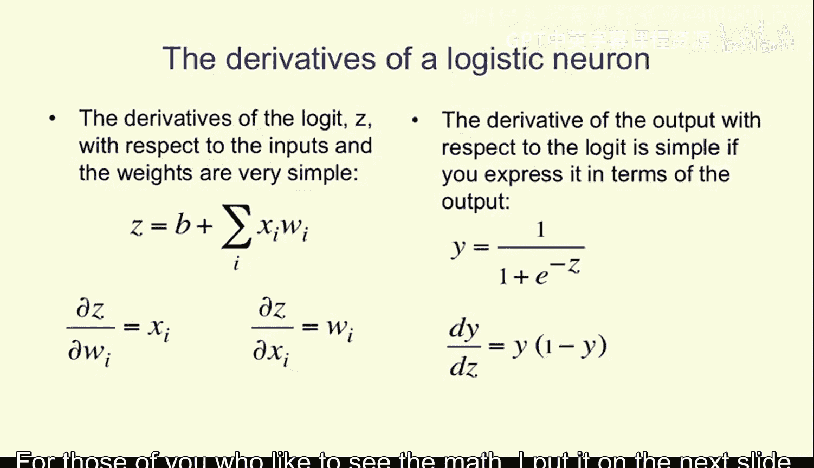
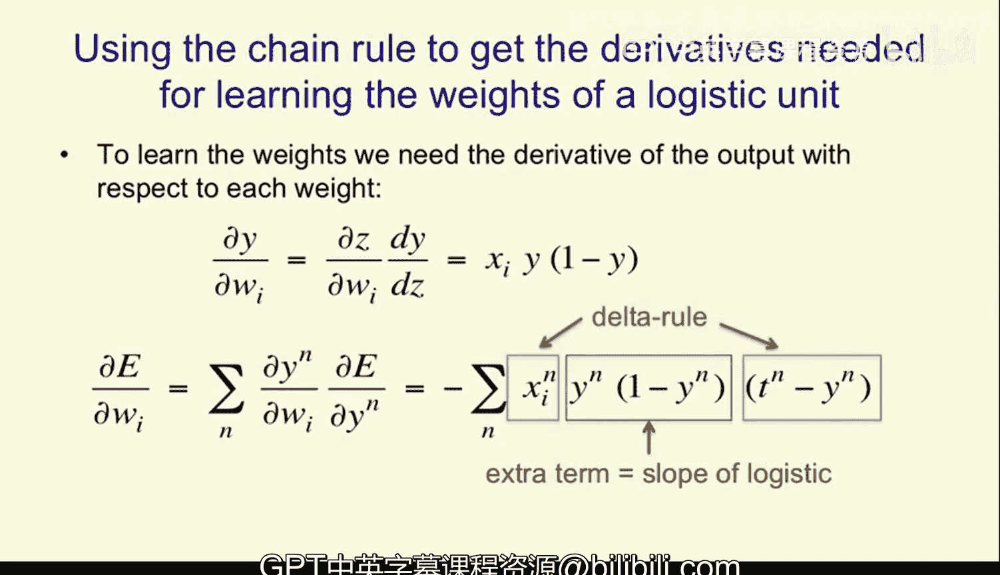

# 3.3：逻辑输出神经元的权重学习 🧠

在本节课中，我们将学习如何将线性神经元的学习规则，推广到可用于多层非线性神经网络的规则。我们将分两步进行：首先，将学习规则扩展到单个非线性神经元，这里我们以逻辑神经元为例。

上一节我们介绍了线性神经元的学习规则，本节中我们来看看如何将其应用于非线性神经元。

## 从线性到非线性：逻辑神经元

逻辑神经元首先计算其**对数几率**，即其总输入。其公式为：

**Z = b + Σ (X_i * W_i)**

其中，`b` 是偏置，`X_i` 是第 `i` 个输入的值，`W_i` 是该输入线上的权重。然后，神经元输出 `Y`，它是 `Z` 的一个平滑非线性函数。如下图所示，当 `Z` 为很大的负数时，`Y` 近似为 0；当 `Z` 为很大的正数时，`Y` 近似为 1；在中间区域，`Y` 平滑且非线性地变化。

这种连续变化的特性使其具有良好的导数，从而使学习变得容易。

## 计算导数

为了获得逻辑神经元关于权重的导数（这是学习所必需的），我们首先需要计算对数几率 `Z` 关于某个权重 `W_i` 的导数。这非常简单，因为 `Z` 是权重的线性函数：

**dZ / dW_i = X_i**

类似地，对数几率关于输入 `X_i` 的导数为：

**dZ / dX_i = W_i**

接下来，我们需要计算输出 `Y` 关于对数几率 `Z` 的导数。输出 `Y` 由逻辑函数定义：

**Y = 1 / (1 + e^{-Z})**

其导数为：

**dY / dZ = Y * (1 - Y)**

这个结果并不直观，其数学推导过程虽然繁琐但完全直接，我们将在下一张幻灯片中展示。

## 应用链式法则

现在我们已经有了 `dY/dZ` 和 `dZ/dW_i`，我们可以使用链式法则来计算输出 `Y` 关于权重 `W_i` 的导数：

**dY / dW_i = (dZ / dW_i) * (dY / dZ) = X_i * [Y * (1 - Y)]**

## 推导学习规则

为了得到完整的学习规则，我们需要误差 `E` 关于权重 `W_i` 的变化。我们再次应用链式法则，将 `dY/dW_i` 乘以误差关于输出的导数 `dE/dY`。

对于单个训练样本，假设误差 `E` 定义为目标值 `t` 与实际输出 `Y` 之差的平方的一半（即均方误差），则 `dE/dY = -(t - Y)`。

因此，对于单个训练样本 `n`，权重 `W_i` 的更新量（负梯度方向）为：

**ΔW_i ∝ - dE / dW_i = X_i^n * (t^n - Y^n) * [Y^n * (1 - Y^n)]**

对于所有训练样本，我们通常对梯度进行求和（或平均）。这得到了一个与 Delta 规则非常相似的学习规则，但多了一个由逻辑函数斜率产生的额外项 `Y*(1-Y)`。

以下是逻辑神经元梯度下降学习规则的总结步骤：
1.  对于每个训练样本，计算神经元的输出 `Y`。
2.  计算误差信号 `(t - Y)`。
3.  将误差信号乘以逻辑函数的斜率 `Y*(1-Y)`，得到 `δ`。
4.  权重的更新量与该输入值 `X_i` 和计算出的 `δ` 成正比。

这个经过轻微修改的 Delta 规则，为我们提供了训练逻辑单元的梯度下降学习规则。

## 总结

本节课中我们一起学习了如何将线性神经元的学习规则推广到逻辑神经元。我们首先回顾了逻辑神经元的结构和激活函数，然后逐步计算了其输出关于权重的导数，并最终应用链式法则推导出了基于梯度下降的学习规则。这个规则是构建和训练更复杂的多层神经网络的基础。