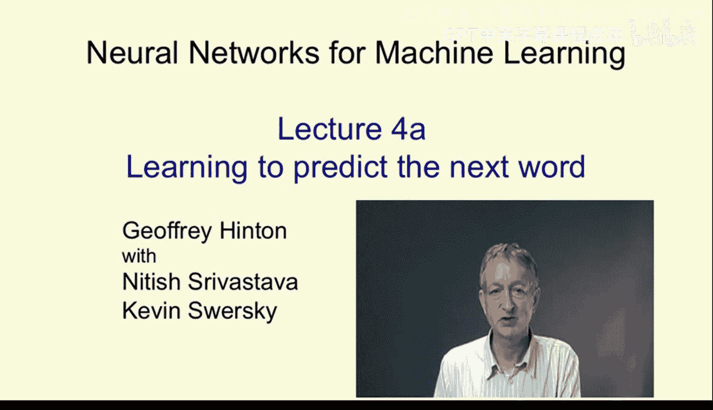
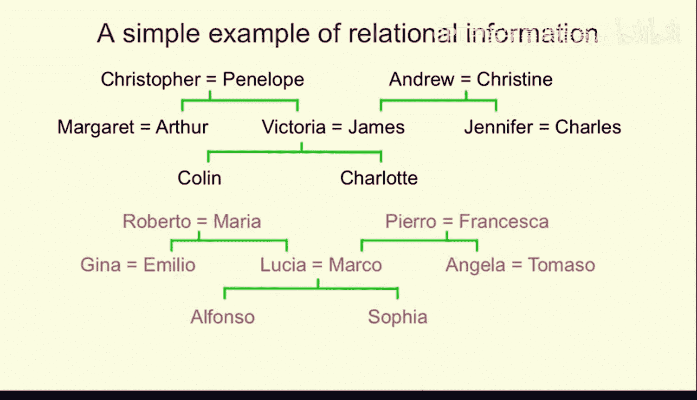
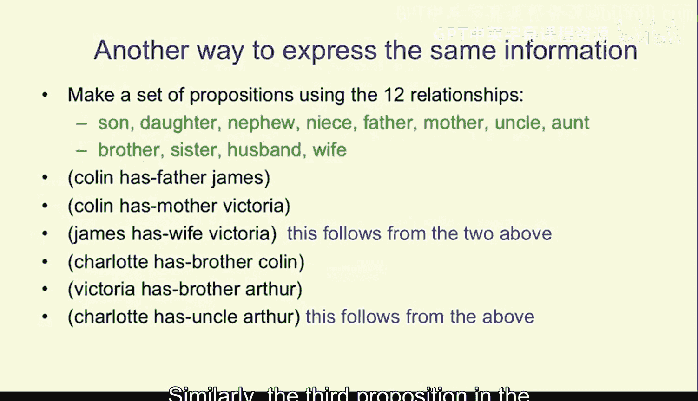
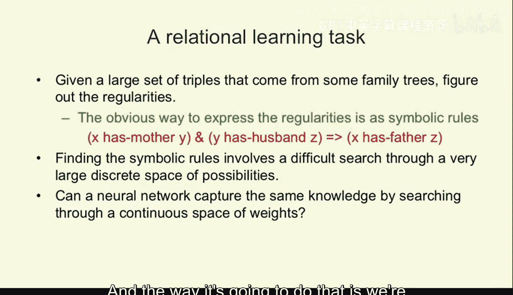
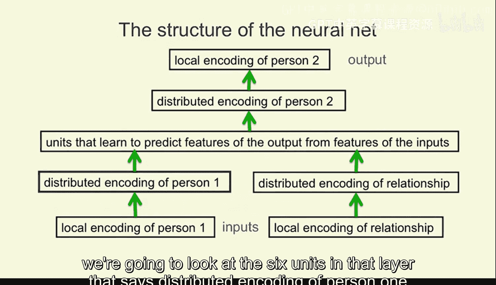
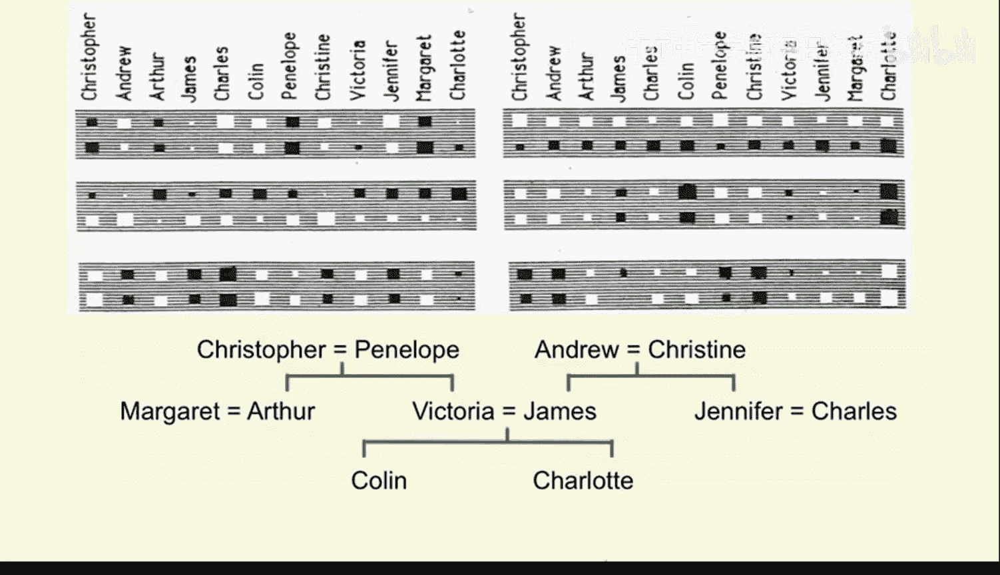
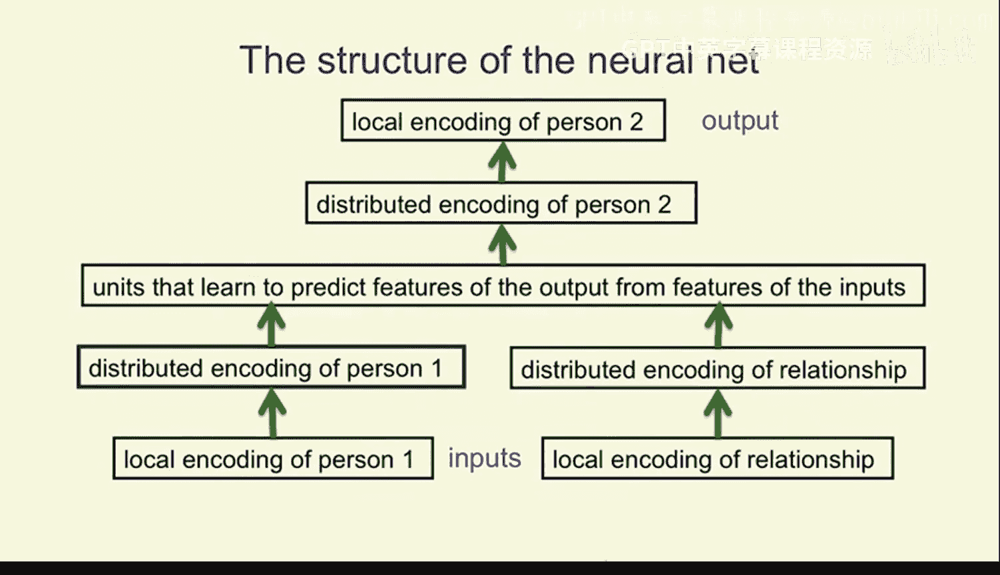
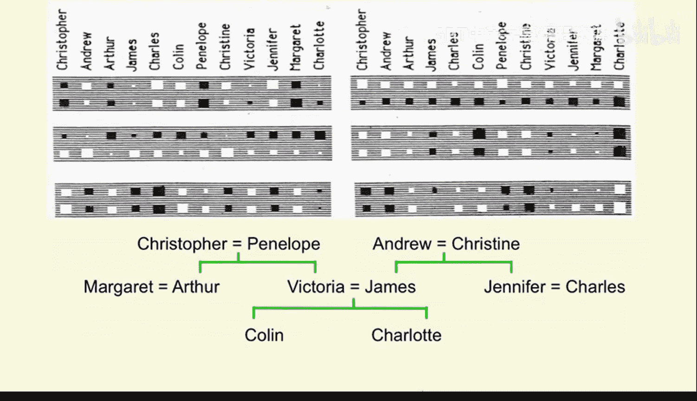
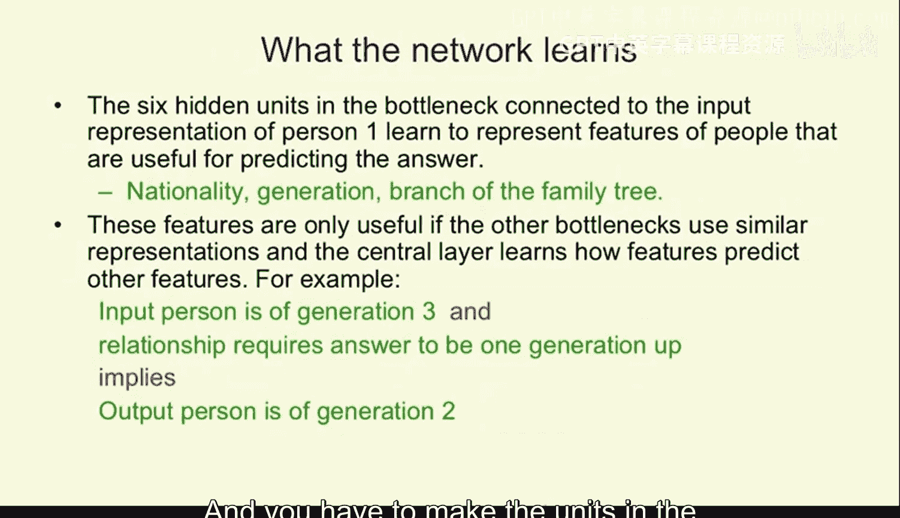
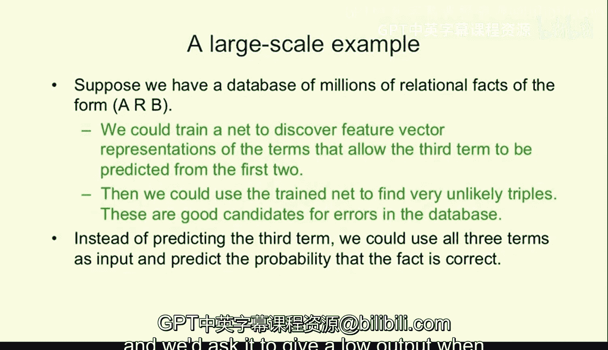

# 4.1：学习预测下一个词 🧠

在本节课中，我们将学习如何使用反向传播算法，来学习单词含义的特征表示。我们将从一个简单的案例开始，说明如何将关系信息转化为能够捕捉单词含义的特征向量。

接下来的几个视频将介绍使用反向传播算法，来学习单词含义的特征表示。我将从20世纪80年代的一个非常简单的案例开始，当时计算机速度非常慢。这是一个小案例，但它阐明了如何获取一些关系信息，并使用反向传播算法将这些关系信息转化为能够捕捉单词含义的特征向量。

上图展示了一个简单的家谱。例如，Christopher和Penelope结婚并育有孩子Arthur和Victoria。我们的目标是训练一个神经网络来理解这个家谱中的信息。我们还给了它另一个意大利人的家谱，其结构与英语家谱基本相同。也许当它试图学习这两组事实时，神经网络将能够利用这种类比关系。

## 将信息表达为命题

上一节我们看到了家谱的图示，本节中我们来看看如何用形式化的语言描述其中的信息。

这些家谱中的信息可以表达为一组命题。如果我们为家谱中描述的关系命名，我们将使用以下关系：儿子、女儿、侄子/侄女、父亲、母亲、叔叔、阿姨、兄弟、姐妹、丈夫、妻子。使用这些关系，我们可以写下一组三元组，例如：
*   Colin的父亲是James。
*   Colin的母亲是Victoria。
*   James的妻子是Victoria。

在图中描述的简单家庭中，第三个命题可以从前两个推导出来。同样，下一组中的第三个命题也可以从前两个推导出来。

## 关系学习任务

上一节我们将信息表达为三元组，本节中我们正式定义学习任务。

因此，关系学习任务，即学习这些家谱中的信息，可以看作是找出表达这些树信息的大量三元组中的规律。表达这些规律的明显方式是使用符号规则。例如，**X的母亲是Y且Y的丈夫是Z 蕴含 X的父亲是Z**。我们可以搜索这样的规则，但这将涉及在一个相当大的空间（组合上庞大的离散可能性空间）中进行搜索。

一种非常不同的尝试捕捉相同信息的方法是使用神经网络，它在实值权重的连续空间中搜索，以尝试捕捉信息。它实现这一点的方式是，我们将说它捕捉了信息，如果它能够预测...

## 神经网络架构

上一节我们提到要让网络学会预测，本节我们来看看为实现这个目标而设计的网络结构。

...三元组中的第三项。所以在这个图的底部，我们将输入一个人和一种关系。信息将通过网络向前传播。在网络学习之后，我们试图从神经网络中得到的输出是，通过该关系与第一个人相关的那个人。

这个网络的结构是手动设计的。也就是说，我决定了它应该有多少层，并且我还决定了在哪里放置瓶颈，以迫使它学习有趣的特征表示。

以下是我们的具体做法：
1.  **以中性方式编码信息**：有24个可能的人。因此，图中底部标有“人物1的局部编码”的块有24个神经元，每个训练案例中恰好有一个神经元会被激活。同样，有12种关系，恰好有一个关系单元会被激活。
2.  **期望的输出**：对于一个有唯一答案的关系，我们希望顶部的24个人（24个输出人物）中有一个被激活以表示答案。
3.  **避免预设相似性**：通过使用恰好一个神经元被激活的表示，我们不会意外地给网络提供任何人之间的相似性。所有人对之间都同样不相似。因此，我们没有通过给网络提供关于谁像谁的信息来作弊。就网络而言，人物是未被解释的符号。
4.  **引入瓶颈**：现在，在网络的下一层，我们获取了人物1的局部编码，并将其连接到一个小的神经元集合（我实际上使用了6个神经元）。因为有24个人，它不可能为每个人分配一个神经元。它必须将这24个人重新表示为这六个神经元上的活动模式。我们所希望的是，当它学习这些命题时，它编码一个人的方式（在那个分布式活动模式中）将揭示任务中的结构或领域中的结构。

因此，我们将要做的是，在112个这样的命题上训练它。我们多次遍历这112个命题，使用反向传播缓慢地改变权重。训练之后，我们将查看标有“人物1的分布式编码”的那一层中的六个单元...

## 分析学习到的特征

上一节我们介绍了网络的训练过程，本节中我们具体分析网络在瓶颈层学到了哪些有用的特征。

...看看它们在做什么。所以这里那些六个单元显示为大灰色块。我布置了24个人，12个英国人在顶部排成一排，12个意大利人在下面排成一排。你会看到，这些块中的每一个都有24个斑点。这些斑点告诉你该层中一个隐藏单元的输入权重。

回到上一张幻灯片，如果你看标有“人物1的分布式编码”的那一层，那里有六个神经元，我们正在查看这六个神经元中每一个的输入权重。

以下是网络自动学习到的几个关键特征：
*   **国籍特征**：如果你看右上角的大灰色矩形，你会看到权重的有趣结构。来自英国人的顶部权重都是正的，而底部的权重都是负的。这意味着这个单元告诉你输入的人是英国人还是意大利人。我们从未明确地给它这个信息，但显然，在这个非常简单的世界中，拥有这个信息是有用的。因为在我们正在学习的家谱中，如果输入的人是英国人，输出的人也总是英国人。所以仅仅知道某人是英国人已经允许你预测关于输出的一比特信息，这相当于说它将可能性数量减半。
*   **代际特征**：如果你看它正下方的灰色块（右边第二个），你会看到它在开头有四个大的正权重。这些对应于Christopher和Andrew，或他们的意大利对应者。然后它有一些较小的权重。接着它有两个大的负权重，对应于Colin或他的意大利对应者。然后还有四个大的正权重，对应于Penelope或Christina（她们的意大利对应者）。在最右边，有两个大的负权重对应于Charlotte或她的意大利对应者。现在，你可能已经意识到，那个神经元代表某人的代际。它对最老的一代有大的正权重，对最年轻的一代有大的负权重，对中间一代有大致为0的中间权重。所以这实际上是一个三值特征，它告诉你这个人的代际。
*   **家族分支特征**：最后，如果你看左手边的底部灰色矩形，你会看到它具有不同的结构。如果我们看顶行，并查看该单元顶行中的负权重，它对Andrew、James、Charles、Christine和Jennifer有负权重。现在，如果你看英国家谱，你会发现Andrew、James、Charles、Christine和Jennifer都在家谱的右手分支。所以那个单元学会了表示某人在家谱的哪个分支中。同样，这对于预测输出人物来说是一个非常有用的特征，因为如果你知道这是一种亲密的家庭关系，你期望输出与输入在同一家族分支中。

## 特征协同与泛化能力

上一节我们看到网络学会了有用的特征，本节我们探讨这些特征如何协同工作，以及网络的泛化能力。

因此，网络在瓶颈处学会了表示对预测答案有用的人物特征。注意，我们没有告诉它使用什么特征。我们从未提及诸如国籍、分支、家谱或代际之类的事情。它发现这些是表达该领域规律性的好特征。当然，这些特征只有在其他瓶颈（关系附近的瓶颈和输出人物之前靠近网络顶部的瓶颈）使用相似表示时才有用。并且中间层能够说明输入人物的特征和关系的特征如何预测输出人物的特征。

例如，如果输入人物是第3代，而关系要求输出人物向上推一代，那么输出人物就是第2代。但请注意，要捕捉那条规则，你必须在网络的第一隐藏层和最后隐藏层提取适当的特征，并且你必须让中间层的单元正确地关联这些特征。

另一种验证网络有效性的方法是，在除少数几个三元组外的所有三元组上训练它，看看它是否能正确补全那些三元组。即它是否能泛化。这里有112个三元组，我在其中108个上训练它，并在剩下的四个上测试。我这样做了几次。它要么答对两个，要么答对三个。对于一个24选1的问题来说，这不算太差。所以它确实会犯错，但它没有太多的训练数据。这个领域中没有足够的三元组来真正很好地确定规律性。而且它比随机猜测要好得多。如果你在一个大得多的数据集上训练它，它可以从数据的小得多的部分进行泛化。

所以，如果你有成千上万的关系，你只需要向它展示一小部分，它就可以开始正确猜测其他关系。这项研究是在20世纪80年代完成的，是一种展示反向传播可以学习有趣特征的方式。它是一个玩具示例。现在我们有了更大的计算机，我们拥有数百万关系事实的数据库。

## 现代应用与扩展

上一节我们回顾了历史案例，本节我们展望其在现代大数据场景下的应用潜力。

其中许多事实的形式是 **A R B**（A与B具有关系R）。我们可以想象训练一个网络来发现A和R的特征向量表示，使其能够预测B的特征向量表示。如果我们这样做，这将是清理数据库的一个非常好的方法。它不一定能做出完美的预测，但它可以找到数据库中它认为高度不可信的东西。

例如，如果数据库包含诸如“巴克出生于1902年”这样的信息，它可能意识到那是错误的，因为巴克是一个更老派的人，并且与他相关的所有其他东西都比1902年早得多。

我们还可以扩展这个想法。与其实际使用前两项来预测第三项，我们可以使用整个项集（在这种情况下是三项，但可能更多），并预测该事实正确的概率。为了训练一个网络做到这一点，我们需要一大堆正确事实的例子，并要求它给出高输出。我们还需要一个良好的错误事实来源，并要求它在被告知错误信息时给出低输出。

## 总结

本节课中我们一起学习了如何使用反向传播算法和神经网络来学习关系数据中的特征表示。我们通过一个简单的家谱示例，看到了网络如何自动从数据中提取出如国籍、代际和家族分支等有意义的特征，而无需人工指定。这些学习到的分布式表示使网络能够进行预测和泛化。最后，我们探讨了这种方法在现代大规模关系数据库清理和事实校验中的潜在应用。这展示了神经网络从原始数据中自动发现有用抽象的强大能力。