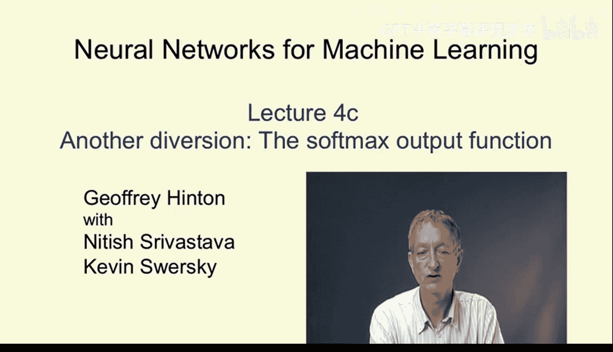
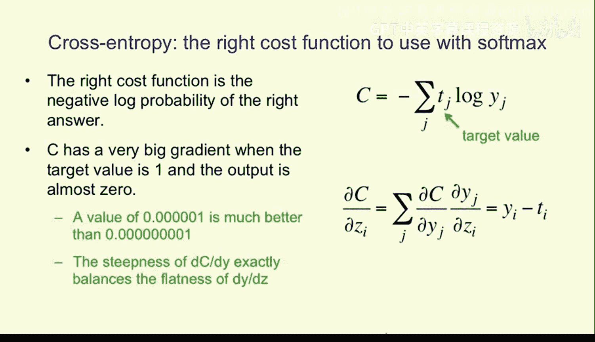

# 4.3：Softmax输出函数 🧮

在本节课中，我们将学习一种称为Softmax的输出函数。这种函数能够强制神经网络的输出总和为1，从而使其能够表示一组离散且互斥的备选方案上的概率分布。

## 为何需要Softmax？🤔

在上一节中，我们讨论了使用平方误差作为神经网络的训练目标。对于线性神经元，这是一个非常合理的选择。然而，平方误差度量存在一些缺点。

例如，如果期望输出是1，但神经元的实际输出是十亿分之一，那么误差几乎达到了最大值。然而，对于逻辑单元（如Sigmoid函数）来说，当输出接近0或1时，其梯度会变得非常平缓。这意味着即使误差很大，权重更新的速度也会非常缓慢，导致学习过程耗时极长。

此外，当我们试图为互斥的类别标签分配概率时，我们知道所有输出的概率之和应为1。任何不符合这一约束的答案（例如，说某个事物是A的概率是3/4，同时是B的概率也是3/4）都是不合理的。我们应该让网络知晓这些答案是互斥的。

因此，问题是：是否存在一种不同的、效果更好的代价函数？是否存在一种方法，既能告知网络输出是互斥的，又能使用合适的代价函数？答案是肯定的。

## 什么是Softmax？🔢

我们需要做的是，如果计划将神经网络的输出用作概率分布，就强制它们表示一组离散备选方案上的概率分布。实现这一目标的方法是使用一种称为Softmax的函数。它是最大值函数的一种“柔和”、连续的版本。

Softmax组中神经元的工作方式如下：每个神经元从下层接收一个累积的总输入，我们称之为**对数几率**（logit），记作 `z_i`（对于第 `i` 个神经元）。然后，它产生一个输出 `y_i`，这个输出不仅取决于它自己的 `z_i`，也取决于组内所有其他神经元的 `z` 值。

具体公式如下：

**`y_i = e^{z_i} / Σ_j e^{z_j}`**

在这个公式中，分母是所有神经元 `e^{z_j}` 的总和。由于分母是分子在所有可能性上的求和，我们知道所有 `y_i` 的和必须等于1。此外，每个 `y_i` 的值都介于0和1之间。这样，我们就通过Softmax方程强制 `y_i` 表示了一组互斥备选方案上的概率分布。

## Softmax的导数 📈

Softmax方程有一个简洁的导数。如果我们想知道 `y_i` 如何随 `z_i` 变化，结果会是一个简单的形式，类似于逻辑单元。对于Softmax组中的单个神经元，其输出对输入的导数为：

**`∂y_i / ∂z_i = y_i * (1 - y_i)`**

这个推导并非完全平凡。如果你尝试对上面的方程求导，必须记住分母中的归一化项包含了所有项，很容易遗漏这些项而得到错误答案。

## 合适的代价函数：交叉熵 🎯

现在的问题是，如果我们使用Softmax组作为输出层，什么是最合适的代价函数？答案通常是：最合适的代价函数是**正确标签的负对数概率**。也就是说，我们希望最大化得到正确答案的对数概率。

如果目标值中一个是1（正确类别），其余都是0（错误类别），那么代价函数 `C` 可以简单地定义为：

**`C = - Σ_j t_j * log(y_j)`**

其中 `t_j` 是目标值（对于正确类别为1，其余为0），`y_j` 是Softmax的输出。这被称为**交叉熵代价函数**。

它有一个很好的特性：当目标值是1而输出接近0时（即预测非常错误），梯度会非常大。你可以通过考虑两种情况来理解这一点：输出为百万分之一和输出为十亿分之一。虽然两者数值相差极小，但前者比后者“好得多”，因为如果你相信百万分之一的概率并据此下注，你会损失一百万；而如果你相信十亿分之一的概率，你会损失十亿。因此，这个代价函数在答案非常错误时具有非常陡峭的导数。

## 梯度的计算 ⚙️

当我们使用链式法则计算交叉熵代价 `C` 相对于输入到输出单元 `i` 的对数几率 `z_i` 的导数时，结果会非常简洁：

**`∂C / ∂z_i = y_i - t_i`**

这个结果是实际输出 `y_i` 减去目标输出 `t_i`。当实际输出和目标输出差异很大时，这个导数的值约为1或-1。只有当两者非常接近时，梯度才会变小。换句话说，在你得到基本正确的答案之前，梯度不会衰减。这正好平衡了之前提到的、当输出非常错误时 `∂y_i/∂z_i` 非常平缓的问题，使得整体学习过程更加高效。

## 总结 📝

本节课我们一起学习了Softmax输出函数。我们了解到，为了表示一组互斥类别的概率分布，需要强制网络输出和为1。Softmax通过一个指数归一化的公式实现了这一点。同时，我们认识到平方误差代价函数在此场景下的局限性，并引入了更适合的交叉熵代价函数。交叉熵代价函数在预测错误时能提供强力的梯度，与Softmax的导数特性相结合，使得神经网络在分类任务上能够进行有效且稳定的学习。