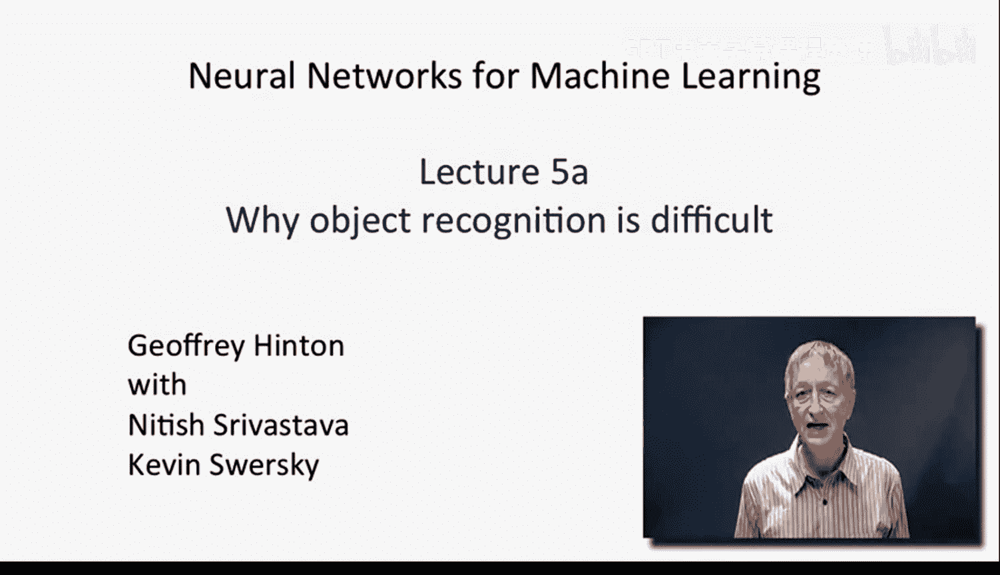
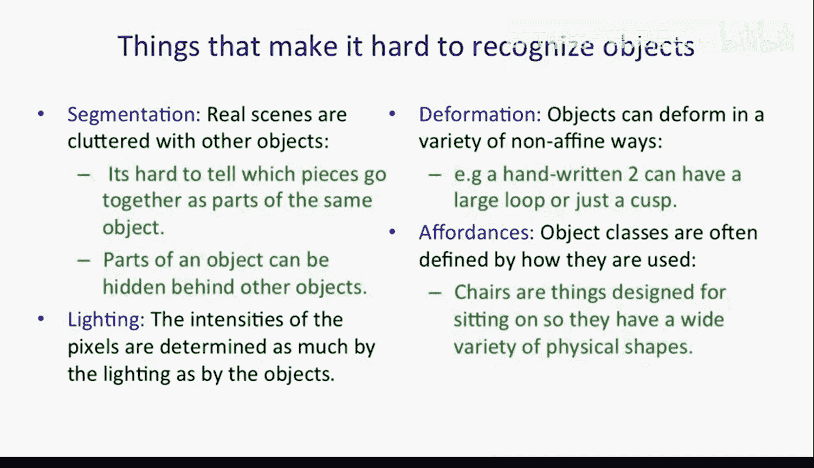
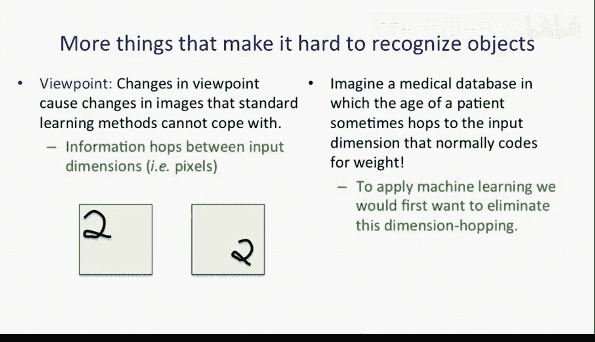

# 5.1：为何物体识别如此困难 🧠

在本节课中，我们将要学习为什么让计算机识别真实场景中的物体是一项极具挑战性的任务。人类对此非常擅长，以至于我们很难意识到，从一堆描述像素强度的数字出发，最终得出一个物体标签的过程有多么复杂。这其中存在诸多困难，包括需要将物体从背景中分割出来、处理光照和视角的变化、应对物体定义的复杂性，以及可能需要海量的知识来完成从图像到物体的映射。如果情况确实如此，那么任何手工设计的程序都很难在这些方面表现出色。

## 物体识别的核心挑战

上一节我们概述了物体识别的整体难度，本节中我们来看看构成这些困难的具体原因。以下是几个主要挑战：

### 分割困难
首先，将物体从图像中的其他元素中分割出来非常困难。在现实世界中，我们通过移动获得运动线索，通过双眼获得立体视觉线索。但在静态图像中，这些线索都不存在。因此，很难判断哪些像素片段属于同一个物体。此外，物体的某些部分可能被其他物体遮挡，导致我们通常无法看到物体的全貌。人类视觉系统过于出色，以至于我们常常注意不到这一点。

### 光照影响
另一个使物体识别变得困难的因素是，像素的强度既取决于物体本身的性质，也取决于光照条件。例如，**明亮光线下的黑色表面**产生的像素强度，可能远高于**昏暗光线下的白色表面**。请记住，识别物体需要将一组数字（即像素强度）转换为一个类别标签。而这些强度值会因各种与物体本质或身份无关的原因而发生巨大变化。

### 物体形变
物体可以以多种方式发生形变。即使是相对简单的物体，比如手写数字，也存在大量形状各异但名称相同的实例。例如，数字“2”可以是非常倾斜的、只有一个尖角而非圆环的形状，也可以是一个带有大圆环的非常圆润的形状。

### 功能定义
对于许多类型的物体，其类别的定义更多地基于其功能，而非视觉外观。以椅子为例，我们称之为“椅子”的物品多种多样，从扶手椅到由钢架和木背制成的现代椅，再到任何可以坐上去的东西。

## 视角变化带来的维度跳跃问题

除了上述挑战，视角变化也使得物体识别变得困难。我们可以从多种不同的视角来识别一个三维物体。然而，视角变化会导致图像发生变化，这是标准机器学习方法难以应对的。

问题的核心在于，信息会在输入维度之间“跳跃”。通常，在视觉任务中，输入维度对应着像素。如果一个物体在场景中移动，而你的眼睛没有跟随它移动，那么关于该物体的信息就会出现在不同的像素上。这不是我们在常规机器学习中通常需要处理的情况。

为了强调这一点，假设我们有一个医疗数据库，其中一个输入维度是患者的年龄，另一个是患者的体重。我们开始进行机器学习，然后发现某个编码员实际上调换了编码这两个属性的输入维度。对于这个编码员的数据，他们把体重数据放在了本应是年龄的位置，反之亦然。显然，我们不会继续按原样进行学习，而是会尝试修复这个问题，否则一切都会出错。我将这种现象称为“维度跳跃”，即信息从一个输入维度跳转到另一个维度。这正是视角变化所导致的问题，我们需要解决它，并且最好能以系统化的方式解决。

## 总结

本节课中我们一起学习了为什么物体识别对计算机来说如此困难。我们探讨了从图像中分割物体的挑战、光照变化对像素强度的巨大影响、物体本身的形变和多样性，以及基于功能而非外观的类别定义。最后，我们深入分析了视角变化带来的“维度跳跃”问题，这是标准机器学习方法难以直接处理的根本性障碍。理解这些困难是设计有效识别系统的第一步。