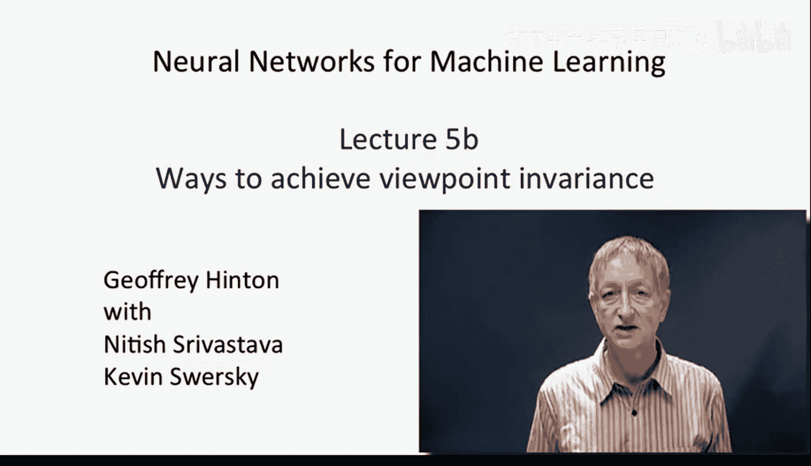
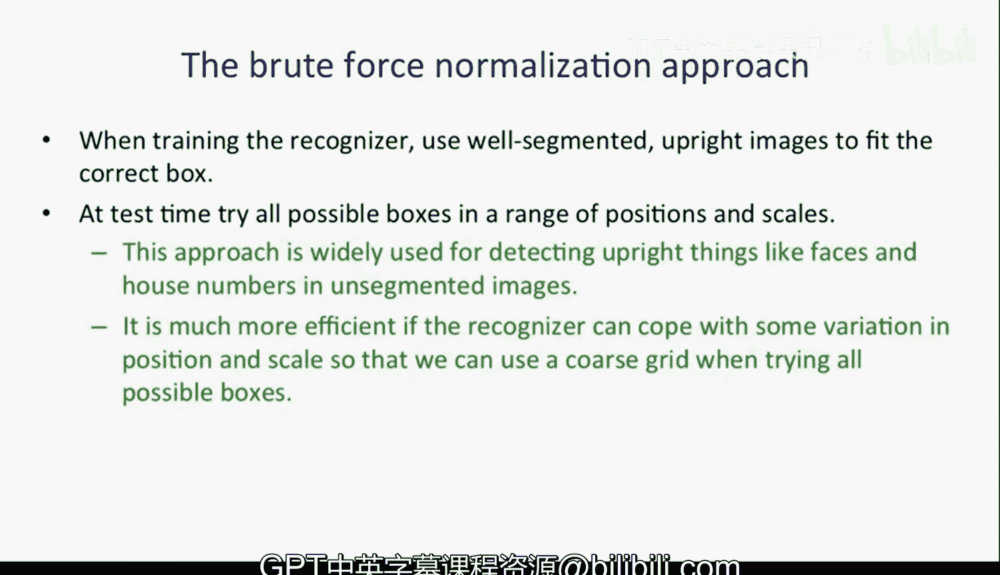
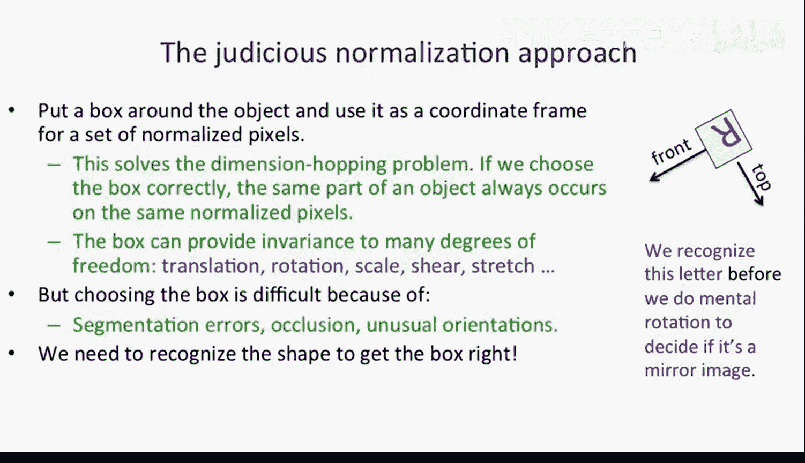

# 5.2：实现视角不变性

在本节课中，我们将探讨机器学习中的一个核心挑战：视角不变性。当我们在不同角度观察同一物体时，它在图像像素上的投影会发生变化，这使得物体识别任务变得异常复杂。我们将介绍几种应对这一挑战的主要方法。

## 视角不变性的挑战

每次我们观察场景中的一个物体，通常都会有不同的视角。因此，物体出现在不同的像素位置上。这使得物体识别与大多数机器学习任务非常不同。

人类非常擅长处理视角变化，以至于我们并未真正意识到其难度。然而，无论是在工程学还是心理学领域，这仍然是让计算机实现感知的主要困难之一，并且目前尚未有被普遍接受的解决方案。

## 应对视角变化的四种方法

以下是几种被提出的、用于应对视角变化的主要方法。

### 1. 使用冗余的不变特征

第一种方法是使用冗余的不变特征。其核心思想是提取一组数量庞大且冗余的特征，这些特征在平移、旋转和缩放等变换下应保持不变。

例如，一个不变特征可以是一对大致平行的线，中间有一个红点。有研究表明，刚孵化的雏鸥会使用这个特征来知道该在哪里啄食。如果你在一块木头上画出这个特征，它们会在木头的相应位置啄食。

理论上，只要有足够多的不变特征，就只有一种方式能将它们组合成一个物体或图像。你甚至不需要直接表示特征之间的关系，因为这些关系会被其他特征所捕获。心理学家韦恩·威肯格伦特和视觉科学家西蒙·乌尔曼都曾指出这一点：我们只需要一个包含大量特征的“特征袋”，因为重叠和冗余的特征中，一个特征会告诉你另外两个特征是如何关联的。

然而，这种方法存在一个严重问题：在进行识别时，你会得到大量由不同物体的部分组成的特征，这些特征对于识别任务具有极大的误导性。因此，我们需要避免从不同物体的部分中形成特征。

### 2. 明智的归一化

第二种方法被称为明智的归一化。其思路是为物体画一个“框”，然后相对于这个框来描述物体的特征。

例如，观察右边那个倒置的大写字母R。我（虽然画得不太好）给它画了一个框，并标记了框的“顶部”和“正面”。相对于这个框，R具有一些不变的特征，比如“背部有一条垂直线”，“顶部有一个朝前的环”。如果我们相对于这个框来描述R的特征，这些特征将是视角不变的。这假设物体是刚性形状。为一个刚性形状画框，可以解决维度跳跃问题，消除视角变化的影响——前提是我们能正确地选择这个框。

这样，物体的同一部分将总是出现在归一化后的相同像素位置上。这个框不一定是矩形，我们还可以提供对剪切、拉伸等变换的不变性。

但问题在于，选择正确的框非常困难。困难可能源于分割错误、遮挡（因此不能简单地围绕物体收缩一个框）或物体处于不寻常的朝向。那个倒置的R的例子清楚地表明：我们需要利用对形状本身的知识来帮助我们决定框应该是什么。例如，如果我们有一个像小写字母d但多了一笔的字符，我们会将其视为一个正立的字符。这就形成了一个“先有鸡还是先有蛋”的问题：为了得到正确的框，我们需要识别形状；而为了识别形状，我们又需要正确的框。

这里需要澄清一个心理学上的误解：许多心理学家认为我们通过“心理旋转”来处理方向不正确的形状。这是完全错误的。对于那个大写字母R，你在进行任何心理旋转之前就已经完美地识别了它。事实上，你需要先识别出它是一个R并且是倒置的，才知道该如何旋转它。心理旋转主要用于处理像“手性”（例如，它是正确的图像还是镜像）这样的判断，而不是用于识别一个倒置的物体。

### 3. 暴力归一化方法

暴力归一化方法的工作流程如下：在训练识别器时，使用分割良好、方向正确的图像，并明智地为其画框。在测试时，当需要处理杂乱无章的图像时，尝试所有可能位置和尺度下的框。

这种方法在计算机视觉中被广泛使用，特别是在未分割图像中检测直立物体（如人脸或门牌号）时。如果识别器本身能够容忍一定程度的位置和尺度变化，那么这种方法会高效得多，因为这样我们就可以在尝试所有可能的框时使用更粗糙的网格。

### 4. 使用层级化的部件

第四种方法，也是本讲最后要讨论的，是使用层级化的部件，并显式地表示部件相对于相机或视网膜的姿态。这种方法将在后续详细展开。

## 总结

本节课我们一起学习了实现视角不变性的核心挑战以及四种主要应对策略：**使用冗余的不变特征**、**明智的归一化**、**暴力归一化**以及**层级化部件表示**。每种方法都有其优势和局限性，理解这些是构建鲁棒视觉识别系统的关键。在接下来的课程中，我们将深入探讨其中一种极为重要的方法——卷积神经网络。