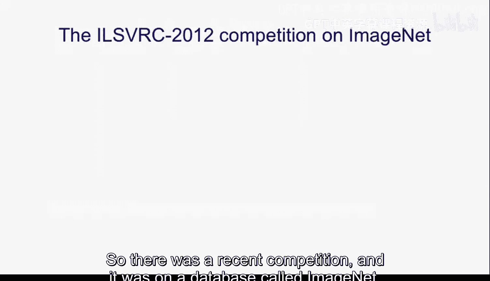
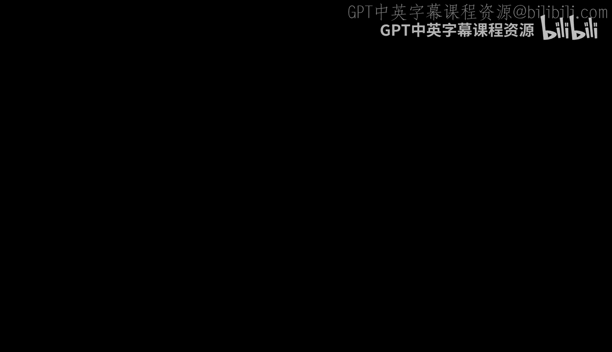
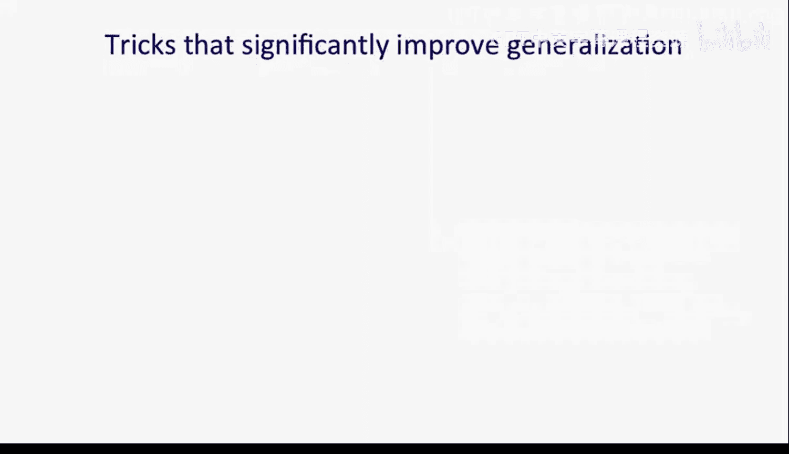
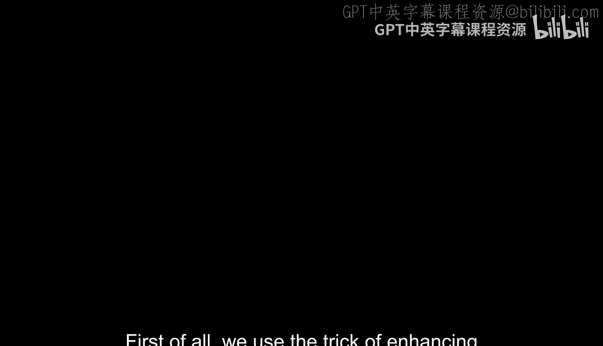
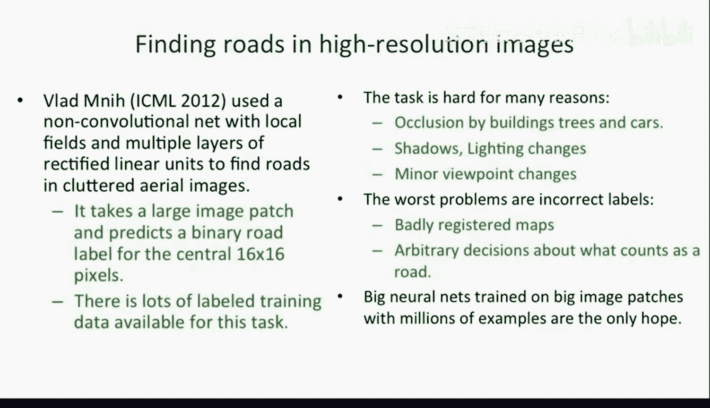

# 5.4：用于物体识别的卷积网络 🧠

在本节课中，我们将探讨卷积神经网络（CNN）如何从识别手写数字扩展到处理更复杂的任务——识别高分辨率彩色图像中的真实物体。我们将了解这一转变面临的挑战，以及以AlexNet为代表的深度卷积网络如何通过创新的架构和训练技巧，在ImageNet等大型竞赛中取得突破性成果。

---

## 从数字到真实世界的挑战

上一节我们介绍了用于手写数字识别的卷积网络。本节中我们来看看，这类网络能否成功扩展到计算机视觉领域所谓的“真实任务”上，即在杂乱场景的高分辨率彩色图像中识别物体。这类任务需要处理图像分割、三维视角变化、场景中存在多个物体等复杂问题。

自本课程开始以来，我们已经在这一领域取得了一些有趣的新成果。在第一讲中，我描述了Alex Krizhevsky开发的网络，并展示了其在物体识别方面的良好表现。但当时，它尚未与最好的计算机视觉系统进行基准测试。现在，测试已经完成。

人们研究MNIST数据集多年，逐步提升了网络识别手写数字的能力。然而，许多计算机视觉研究者认为，如果目标是识别彩色图像中的真实物体，那么研究MNIST是在浪费时间。他们认为从MNIST中学到的经验无法推广到真实图像领域。

这种想法相当合理。以下是真实物体识别任务更为困难的几个原因：

以下是几个关键原因：
*   **物体类别更多**：即使只识别100个类别，也比10个数字多出100倍。
*   **像素数量更多**：即使使用下采样至256x256的彩色图像，其像素数量也是MNIST图像的100到300倍。
*   **维度信息丢失**：真实场景是三维世界的二维投影，大量信息已经丢失。
*   **场景杂乱**：手写数字中可能包含重叠字母，但不会出现大块物体被其他不透明物体遮挡的情况。
*   **物体多样性**：同一场景中通常不会出现多种完全不同的物体。
*   **光照变化**：真实场景中存在各种光照变化，而手写数字图像则没有。

因此，核心问题是：**在MNIST上表现优异的同类型卷积神经网络，能否适用于真实的彩色图像识别？**

在真实彩色图像领域，我们很可能需要嵌入一些先验知识。因为如果我们试图以“纯粹”的方式，不嵌入任何知识，仅通过生成额外的训练样本来注入所有知识，那么计算量对当前的计算机来说仍然过于庞大。

---

## ImageNet竞赛与数据

近期举行了一场基于ImageNet数据库的竞赛。ImageNet实际上拥有超过一百万张图像，竞赛从中选取了120万张图像的子集。分类任务是为这些图像正确打上标签。这些图像被人工标注了1000个不同的类别，但标注并不完全可靠。一张图像中可能包含标注类别中的两个物体，但只标注了其中一个。

为了使任务可行，计算机视觉系统被允许做出五次预测。只要其中一次预测与人工标注的标签相符，即视为正确。

竞赛还包含一个定位任务。设置定位任务的原因是，许多计算机视觉系统对整个图像或图像的某个象限使用“词袋”方法。它们知道图像中存在哪些特征，但不知道这些特征的具体位置。这使它们能够识别物体，但无法精确定位。定位任务要求系统在识别出物体后，用一个边界框将其框出。要判断定位正确，预测框与正确框的重叠面积必须至少达到50%。

在这个任务上，来自牛津大学、法国国家信息与自动化研究所、施乐欧洲研究中心等顶尖研究团队尝试了当时最好的计算机视觉方法，发现任务非常困难。这些系统通常是复杂的多阶段系统，早期阶段通过优化少量参数进行手动调优，顶层则使用学习算法。但它们不像通过反向传播训练的深度神经网络那样进行端到端的学习，即早期特征检测器中的参数不会受到它们对最终分类决策有用性的影响。

以下是测试集中的一些示例，以便您了解数据的样子：

以下是几个示例：
*   **猎豹**：图像中的物体相当明显，但缺失了耳朵和腿等部分。Alex Krizhevsky的深度神经网络给出了未归一化的概率预测，它非常自信地认为这是一只猎豹。如果不是猎豹，它认为几乎可以肯定是豹子。它还考虑了其他可能性，如雪豹（但颜色不对）或埃及猫。
*   **子弹头列车**：图像中有许多物体，而目标物体（列车）只占像素的很小一部分。网络正确预测为“子弹头列车”，但也给出了“地铁列车”或“电力机车”等其他合理预测。图像中还有许多其他可能被标记的物体，如占据更大面积的屋顶、支撑屋顶的柱子、行人或背景中的大型公寓楼。在这类图像中，系统必须能够应对存在许多替代目标的情况。
*   **搅拌碗**：这是一种不同类型的例子。没有背景杂乱，物体隔离得很好，可能来自产品目录。网络在第一次预测中没有完全正确，但在前五次预测中包含了正确答案。然而，网络对任何预测都不是很自信。这些是相对概率，网络正确地意识到它并不真正确定。如果眯起眼睛看，您可能会理解它为何认为可能是煎锅或听诊器。

---

## 竞赛结果与网络架构

那么，各系统在这项数据上的表现如何呢？以下是计算机视觉系统的错误率。您会注意到，最好的几个系统性能都非常接近。东京大学达到了26.1%的错误率（这里只报告每个团队的最佳系统）。牛津大学（通常被认为是欧洲最好的计算机视觉团队之一）同样达到了26%左右的错误率。法国国家研究实验室和施乐帕克研究中心（同样是顶尖的计算机视觉团队）达到了27%。由此可以推测，要击败26%将非常困难，如果能做到，就意味着与最好的计算机视觉系统不相上下。

然而，Alex Krizhevsky的神经网络取得了**16%** 的错误率。这是一个巨大的差距。通常在这类竞赛中，不会看到如此大的差距。

Alex Krizhevsky的网络结构如下：
*   **网络类型**：它是一种非常深的卷积神经网络，其类型由Yann LeCun首创并用于数字识别，后来由Jianan等人应用于识别真实物体。我们借鉴了Jianan团队、Yoshua Bengio团队以及其他开发用于真实视觉任务的深度神经网络的团队所获得的所有经验。
*   **网络深度**：它具有**7个隐藏层**（不包括一些最大池化层），比通常的网络更深。
*   **卷积层**：早期层是卷积层。如果我们有更大的计算机，或许可以只使用局部感受野而不进行权值共享。但通过使用卷积，我们大幅减少了参数数量，从而减少了对训练数据量和计算时间的需求。
*   **全连接层**：最后两层是**全局连接的全连接层**，这里包含了大部分参数。我认为每对这样的层之间大约有1600万个参数。最后两层的作用是寻找由早期层提取的局部特征的组合。显然，需要寻找的组合在数量上是组合级增长的，这就是为什么那里需要大量参数。
*   **激活函数**：每个隐藏层都使用**修正线性单元（ReLU）**。这些单元的训练速度比逻辑单元快得多，并且表达能力更强。大多数认真将深度神经网络应用于真实图像进行物体识别的人，都已转向使用ReLU。
*   **竞争性归一化**：我们在层内使用了**竞争性归一化**，以抑制某个单元的活性——如果查看附近区域的其他单元非常活跃的话。这极大地帮助应对强度变化。例如，一个边缘检测器可能因为一些相当微弱的边缘而变得有些活跃，但如果周围有更强烈的特征，这个微弱边缘就几乎无关紧要。

---

## 提升性能的关键技巧

我们还使用了一些其他技巧来显著提升该网络的泛化能力。

以下是几个关键技巧：
*   **数据增强**：Elis at Skiva将竞赛中的图像下采样至256x256，但Alex Krizhevsky并没有使用整张图像。他从这些图像中随机截取224x224的图像块，这为他提供了海量的训练图像，并帮助他处理平移不变性（尽管是卷积网络，这仍然有帮助）。他还使用了图像的**左右翻转**，这再次使数据量翻倍。他没有使用上下翻转，因为重力方向非常重要。左右翻转通常不会太大改变物体的外观（除非是文字等）。在测试时，他不仅使用一个图像块。他使用了多个不同的图像块（四个角和中块），这给了他5个块。然后对所有块进行左右翻转，最终得到10个块。他将所有10个块输入网络，然后综合它们的预测结果。
*   **Dropout正则化**：在参数最多的顶层，他使用了一种称为**Dropout**的新正则化技术，这种方法非常有效，可以防止网络过拟合。这为他的结果贡献了几个百分点的提升。我将在后续课程中详细描述Dropout。目前，Dropout的基本思想是：每次呈现一个训练样本时，随机“丢弃”（即暂时忽略）某一层中一半的隐藏单元。这意味着该层中幸存的其他隐藏单元不能依赖其“同伴”的存在。它们不能学会去修正该层中其他隐藏单元留下的错误，因为其他隐藏单元可能不在那里，它们可能正在修正一个不存在的错误。因此，它们必须变得更加“个人主义”，必须各自独立地做有用的事情，但同时它们做的事情又必须与其他幸存者不同。所以，Dropout阻止了隐藏单元之间过多的协作。过多的协作对于拟合训练数据非常有益，但如果测试数据分布有显著不同，所有这些协作就会导致过拟合。

---

## 硬件与计算效率

Alex的这项工作离不开强大的硬件支持，但这些硬件的成本现在只需几千美元。Alex是一位非常优秀的程序员，他使用了卷积神经网络的高效实现。他使用了两个NVIDIA GTX 580图形处理器（GPU），每个GPU拥有超过500个快速的小核心，这些核心非常擅长做算术运算，但不擅长其他任务。GPU非常擅长进行矩阵乘法运算。

因此，如果将多个训练样本中某一隐藏层的向量活动堆叠在一起，就得到一个矩阵。然后将其乘以权重矩阵，即可计算出所有这些训练样本在下一个隐藏层的活动。如果这两个矩阵都很大，GPU能带来巨大的优势——大约30倍的加速。GPU还具有很高的内存带宽，这对于神经网络是必需的，因为在神经网络中，你需要不断访问另一个权重以便与某个活动值相乘，而这里有数百万个权重，无法全部保存在缓存中。

利用所有这些硬件，他能够在一周内训练出最终的网络。在测试时，他也能非常快速地将10个不同图像块的结果结合起来。因此，在测试时，他几乎可以达到实时帧率。

未来，随着核心变得更便宜，我们将能够把这类网络扩展到大量核心上。谷歌的研究人员已经在进行相关实验。如果我们能足够快地通信状态，我们将能够在更多核心上运行更大的网络。谷歌已经模拟了拥有17亿个连接的神经网络。我认为网络只会变得越来越大。随着核心变得更便宜、数据集变得更大，这些大型深度神经网络的改进速度将远远超过传统的计算机视觉系统，因为它们不需要太多人工工程，并且能够非常好地利用海量数据集和巨大的计算资源。

因此，我们已经拉开巨大差距的事实，我认为意味着没有回头路了。我认为从现在开始，所有最好的物体识别系统（至少在静态图像中）都将使用大型深度神经网络。

---

## 在其他领域的应用

在其他应用领域，我们也学到了同样的经验。

例如，Vladimir N. 使用了一个具有局部感受野但没有卷积的网络，从航拍图像中提取道路。这些是城市场景的杂乱航拍图像。他同样使用了多层ReLU。他取一个相对较大的图像块，并预测其中央16x16像素区域内的每个像素是否是道路的一部分。

这项任务的一个优点是，有大量带标签的训练数据可用。这是因为地图会告诉你道路的中心线在哪里，而道路的宽度大致是固定的。因此，从地图上指示道路中心线的矢量，可以估计哪些像素可能是道路。尽管如此，这项任务仍然非常困难。

存在常见的视觉问题：道路被建筑物遮挡（因为飞机拍照时并非垂直向下看）、被树木遮挡、被停在路上的汽车遮挡、建筑物的阴影效应、主要的光照变化（例如晴天与阴天），以及次要的视角变化（飞机基本上是向下看，但在任何大照片中，它不可能在每个像素点都是垂直向下看的）。

这些数据中最严重的问题是**不正确的标签**。标签不正确是因为地图没有完美配准。对于大多数用途，地图的配准精度不需要高于几米。而这些数据的像素单元大约是1米见方。因此，如果地图的配准偏差3米，那么每条道路上的像素至少会有三个标签错误。另一个严重问题是，制作地图的人必须对什么算作道路、什么算作小巷做出武断的决定。因此，在许多地图中，你看着某个东西，完全不知道它会被视为道路还是小巷，所以你根本不知道它会从地图上得到什么标签。

我认为，在数百万个样本的大型图像块上训练的大型神经网络，是出色完成这项任务的唯一真正希望。很难确定人类在这项任务上能做到多好。

这是数据的样子。这是多伦多的一部分。如果您熟悉多伦多，可以通过道路的角度辨认出来。在图像上方，我放置了从该图像中提取的两个图像块。观察这些图像块，您可以发现判断哪些像素是道路并非易事。右侧是Labir系统的输出，绿色表示正确识别的道路像素，红色表示系统认为是道路但实际上不是的像素。实际上，那个东西是一个停车场，但您可以理解为什么他可能认为那是道路。

---

## 总结

本节课中，我们一起学习了卷积神经网络如何从手写数字识别成功扩展到复杂的真实世界物体识别任务。我们探讨了ImageNet竞赛带来的挑战，深入分析了AlexNet的深度架构、ReLU激活函数、数据增强和Dropout等关键技巧，并了解了GPU加速如何使训练大规模网络成为可能。最后，我们还看到了类似技术在航拍图像道路提取等其他领域的应用。这些进展表明，端到端学习的大型深度神经网络正在成为计算机视觉领域的主导力量，其性能提升速度远超依赖大量手工设计的传统方法。