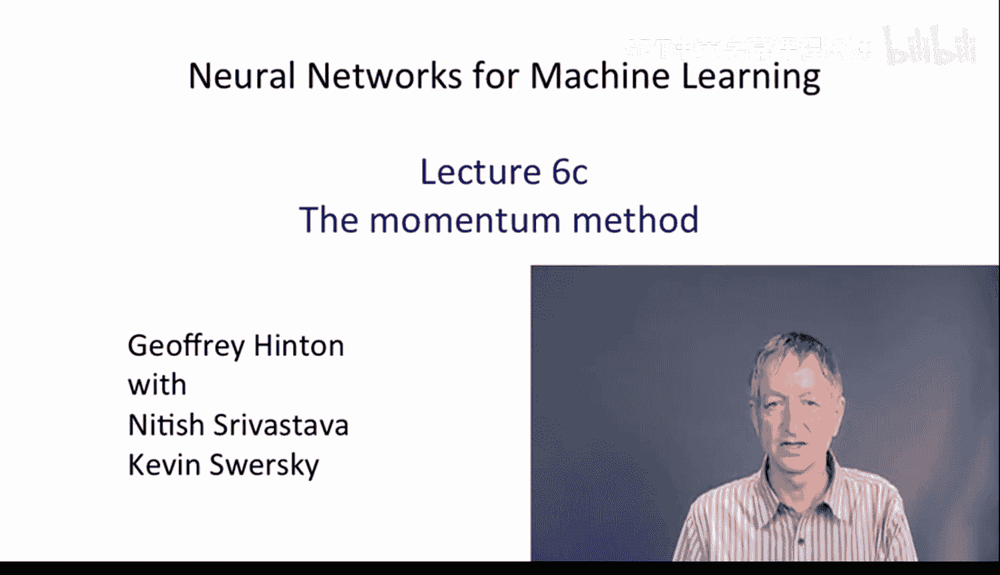
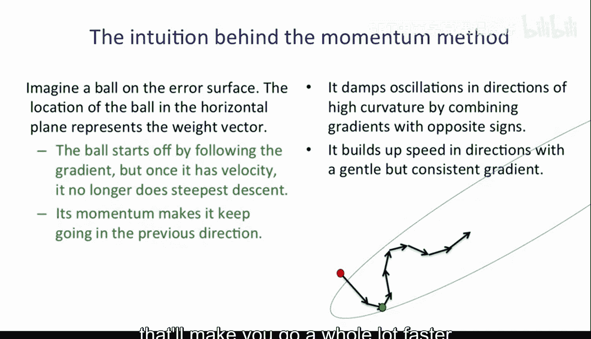
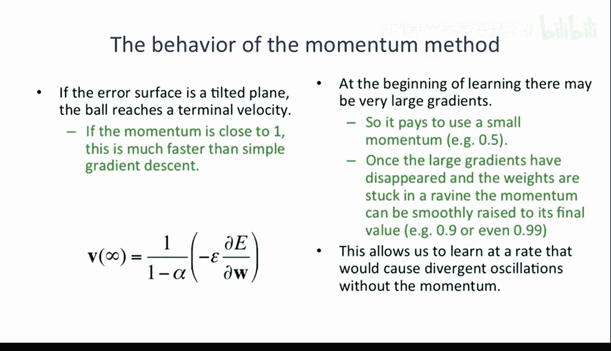
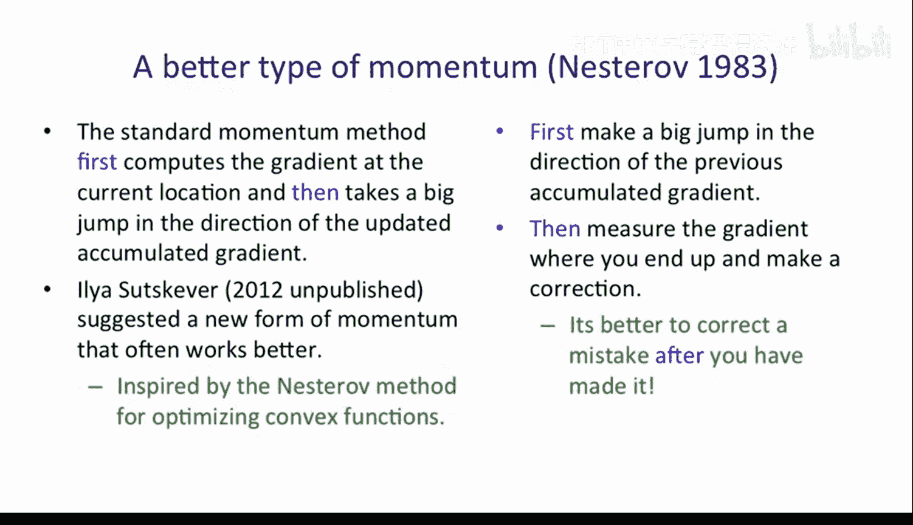
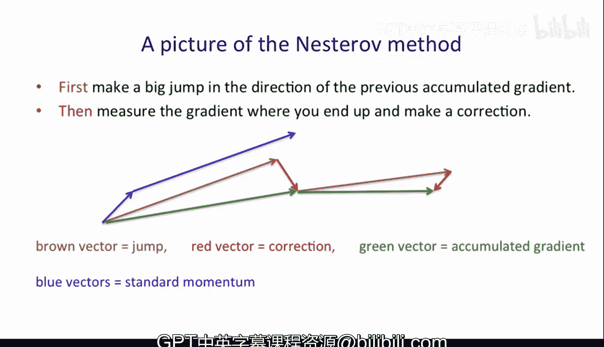

# 6.3：动量法 🚀

在本节课中，我们将学习一种名为“动量法”的技术，它用于提升神经网络中梯度下降的学习速度。动量法不仅适用于全批量学习，也适用于小批量学习。目前，训练大型神经网络最常用的方法就是结合了小批量随机梯度下降与动量法。

## 动量法的直观理解

上一节我们介绍了梯度下降的基本概念，本节中我们来看看动量法的核心思想。我们可以想象一个球在误差曲面上滚动。球在水平面上的位置代表当前的权重向量。

球从静止开始，因此初始时会沿着最陡的下降方向，即梯度方向移动。一旦它获得了一些速度，它就不再完全沿着梯度方向前进。其动量会使它保持之前的方向运动。显然，我们希望球最终能到达曲面的低点，因此需要让它损失能量。为此，我们引入一点“粘性”，即在每次权重更新时让速度平缓衰减。

动量法的作用是抑制高曲率方向上的振荡。例如，从红色起点出发，经过两步后到达绿色点，这两个点的梯度方向几乎相反。结果是，横跨峡谷方向的梯度相互抵消了，但沿着峡谷方向的梯度没有抵消。沿着峡谷方向，速度会不断累积。当动量法稳定后，球会倾向于沿着峡谷底部前进，并在此过程中积累速度。如果运气好，这将比单纯的梯度下降快得多。

## 动量法的数学公式

理解了直观原理后，我们来看看动量法的具体公式。核心概念用**公式**描述如下：

设时间 `t`（代表权重更新的次数）的速度向量 `v_t` 为：
`v_t = α * v_{t-1} - ε * ∇E(w_t)`

其中：
*   `α` 是动量系数（通常接近1，如0.9）。
*   `ε` 是学习率。
*   `∇E(w_t)` 是当前权重 `w_t` 处的梯度。

然后，权重的更新规则为：
`w_{t+1} = w_t + v_t`

这个速度向量也可以用之前的权重变化来表示（如幻灯片所示），具体推导留给大家完成。

## 动量法的行为与调参技巧

动量法的行为非常直观。在一个平坦的误差曲面上，球会达到一个终极速度。此时，梯度带来的速度增益与动量项（本质是粘性）带来的速度衰减达到平衡。如果动量系数 `α` 接近1，那么下降速度将远快于单纯使用学习率的梯度下降法。

终极速度（时间趋于无穷时的速度）近似等于梯度乘以学习率，再乘以因子 `1/(1-α)`。因此，如果 `α=0.99`，速度将大约是仅使用学习率时的100倍。

在设置动量时，学习初期需要特别注意。以下是关于动量系数设置的几个要点：

*   **学习初期**：如果初始随机权重较大，梯度可能非常大。此时你不需要大的动量，因为权重需要快速调整以显著改善性能。之后，你才进入寻找不同权重间合适相对值的困难阶段。因此，学习初期使用较小的动量（如0.5）比0更好，因为它能平均掉一些明显峡谷中的振荡。
*   **学习稳定期**：当大梯度消失，进入需要沿着峡谷底部平稳前进而不左右振荡的正常学习阶段时，可以平滑地将动量提升到最终值（如0.9或0.99）。也可以一步到位，但这可能引发振荡。
*   **与学习率的关系**：你可能会想，为什么不直接使用更大的学习率？你会发现，**使用较小的学习率配合较大的动量，可以达到比单独使用大学习率（无动量）更大的整体有效学习速度**。如果单独使用过大的学习率，会导致在峡谷两侧产生巨大的发散性振荡。

## 内斯特罗夫动量法

最近，Ilya Sutskever 发现了一种更好的动量形式。标准的动量法是先计算当前位置的梯度，然后将其与存储的先前梯度记忆（即球的速度）结合，最后沿着当前梯度与历史梯度累积的方向进行一大步跳跃。

Ilya Sutskever 发现，在许多情况下，采用由 Nesterov 提出的动量形式效果更好。Nesterov 最初是为了优化凸函数而提出的这种方法。其思想是：**我们先沿着先前累积的梯度方向进行一大步跳跃，然后测量跳跃终点的梯度，并据此进行修正**。它与标准动量法非常相似，但顺序不同。

理解差异的一种方式是：在标准动量法中，你先加入当前梯度，然后沿着这个混合方向“赌博式”地跳跃。在内斯特罗夫方法中，你先用先前累积的梯度进行“赌博式”跳跃，然后在你到达的位置进行修正。

具体步骤如下：
1.  沿着先前迭代累积的梯度方向（如图中棕色向量）迈出一大步。
2.  在跳跃终点测量梯度。
3.  沿着该梯度方向向下走一小步进行修正。
4.  将这一小步修正与之前的大跳跃结合，得到新的累积梯度。
5.  新的累积梯度经过衰减（如乘以0.9）后，用于下一次大跳跃。

事实证明，**先“赌博”再修正，比先修正再“赌博”要好得多**。

## 总结

本节课中我们一起学习了动量法。我们首先通过“球在曲面滚动”的比喻理解了动量法抑制振荡、加速峡谷方向收敛的直观原理。接着，我们学习了其核心数学公式 `v_t = α * v_{t-1} - ε * ∇E(w_t)` 和 `w_{t+1} = w_t + v_t`。然后，我们探讨了动量系数 `α` 的设置技巧，特别是在学习初期应使用较小值，稳定后可增大，并解释了其与学习率协同工作的优势。最后，我们介绍了更先进的内斯特罗夫动量法，它通过改变“计算梯度”和“沿累积方向跳跃”的顺序，实现了更稳定、更有效的优化。动量法是训练现代深度神经网络不可或缺的优化工具。