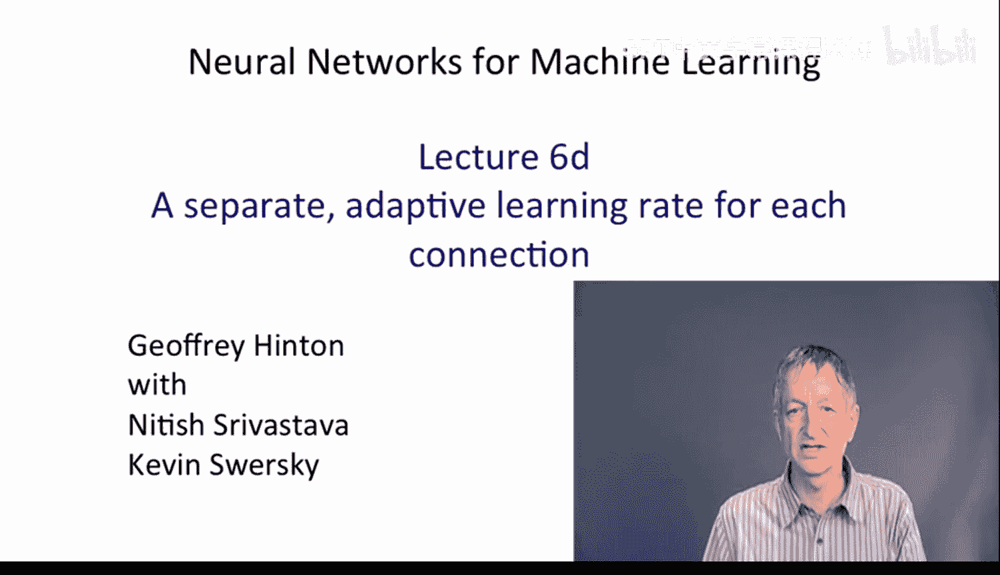
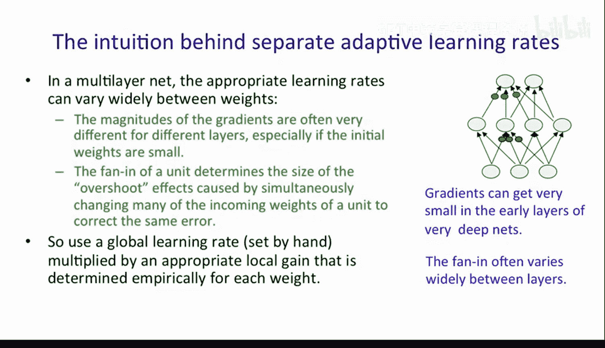
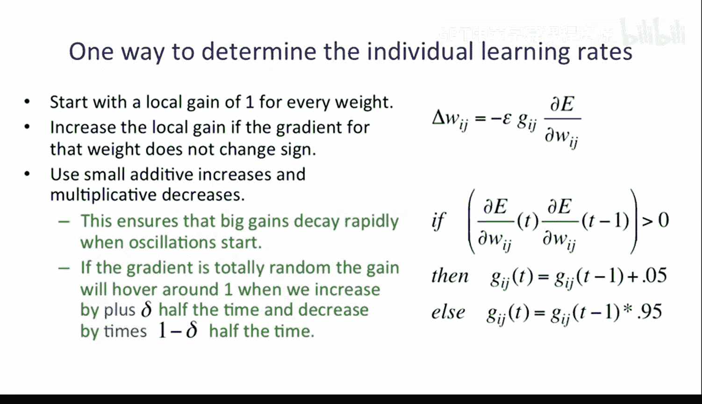
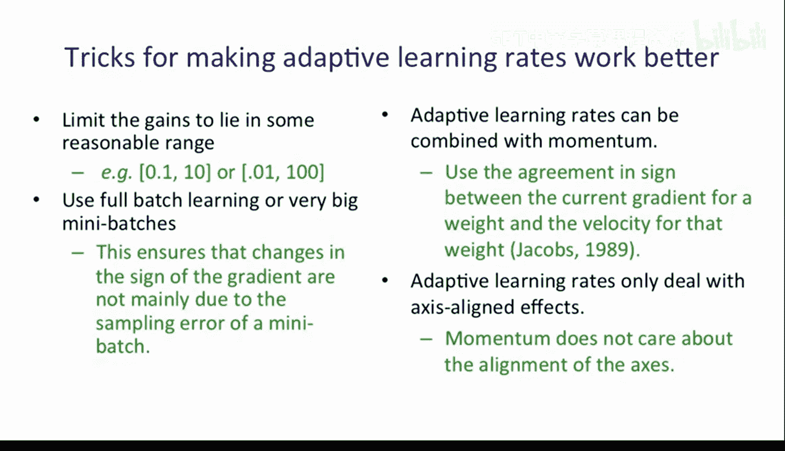

# 6.4：为每个连接设置自适应学习率 🎯

在本节课中，我们将学习一种由Robbie Jacobs在20世纪80年代末提出，并由多人改进的优化方法。该方法的核心思想是为神经网络中的**每一个连接**都设置一个**自适应学习率**。我们将通过观察权重更新时的梯度变化，来经验性地调整这个学习率。如果某个权重的梯度方向频繁反转，我们就降低其学习率；如果梯度方向保持一致，我们就提高其学习率。

## 为何需要自适应学习率？🤔

上一节我们介绍了学习率的基本概念，本节中我们来看看为何需要为每个连接单独设置学习率。在深层神经网络中，不同权重所需的学习率差异可能非常大，尤其是在不同层之间。

以下是导致这种差异的两个主要原因：
*   **梯度大小差异**：例如，如果初始权重设置得很小，那么初始层的梯度通常会远小于后面层的梯度。
*   **输入扇入数**：一个单元的扇入数决定了当你同时改变其多个输入权重来修正同一个误差时，可能产生的“超调”效应的大小。如果某个单元输入不足，当你同时调整多个权重来修正误差时，它可能会突然获得过多的输入。显然，扇入数越大，这种效应就越明显。

因此，我们的思路是：首先设置一个全局学习率，然后为每个权重乘以一个根据经验确定的局部增益因子。

## 如何确定局部增益？🔧

一个简单的方法是，初始时将所有连接的局部增益设为1。这样，权重 `W_ij` 的更新量就是学习率乘以增益 `G_ij`，再乘以该权重的误差导数。

接下来，我们将根据梯度符号的变化来调整 `G_ij`。以下是调整规则：
*   **增加增益**：如果当前时刻 `t` 的梯度与上一时刻 `t-1` 的梯度符号相同（即它们的乘积为正），则以一个小的**加性**量增加 `G_ij`。
*   **减少增益**：如果梯度符号相反，则以一个**乘性**因子减少 `G_ij`。采用乘性减少是为了在增益已经很大时能快速抑制它，防止因振荡而失控。

思考一下，如果梯度是完全随机的会怎样？每次更新时梯度符号随机，那么增益增加和减少的次数大致相等。加性增加（如+0.05）和乘性减少（如×0.95）会达到一个平衡点，即增益在1附近波动。如果梯度方向持续一致，增益可以变得远大于1；如果梯度方向持续相反（意味着在“山谷”两侧振荡），增益则可以变得远小于1。

## 实用技巧与结合动量 🚀

为了让自适应学习率更好地工作，这里有一些实用技巧。

首先，限制增益的大小非常重要。一个合理的范围是[0.1, 10]或[0.01, 100]。防止增益变得过大而导致不稳定，从而破坏所有权重。

其次，自适应学习率方法最初是为**全批量**学习设计的。你也可以将其用于小批量学习，但批量最好足够大，以确保梯度符号的变化不是由于小批量的采样误差引起的，而是真正反映了跨越“山谷”的行为。

最后，自适应学习率完全可以与**动量**方法结合使用。Jacobs建议，不要使用当前梯度与上一时刻梯度的符号一致性，而是使用当前梯度与该权重**速度**（即累积梯度）的符号一致性。这样做可以结合动量法和自适应学习率两者的优势。

自适应学习率主要处理的是坐标轴对齐的效应，而动量法则不关心坐标轴的对齐，它能处理对角线方向上的快速移动，这是单纯的自适应学习率做不到的。

## 总结 📝

本节课我们一起学习了为神经网络中每个连接设置自适应学习率的方法。我们了解了其必要性，掌握了通过梯度符号一致性来调整局部增益的基本规则，并探讨了限制增益范围、结合动量等实用技巧。这种方法通过动态调整每个参数的学习步长，有助于更平稳、高效地训练深度网络。