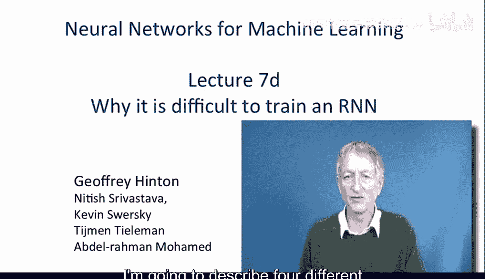
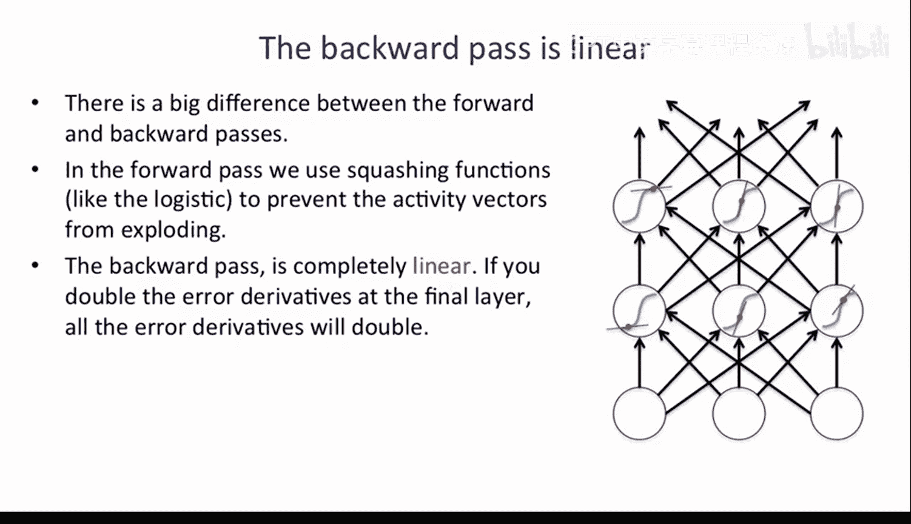
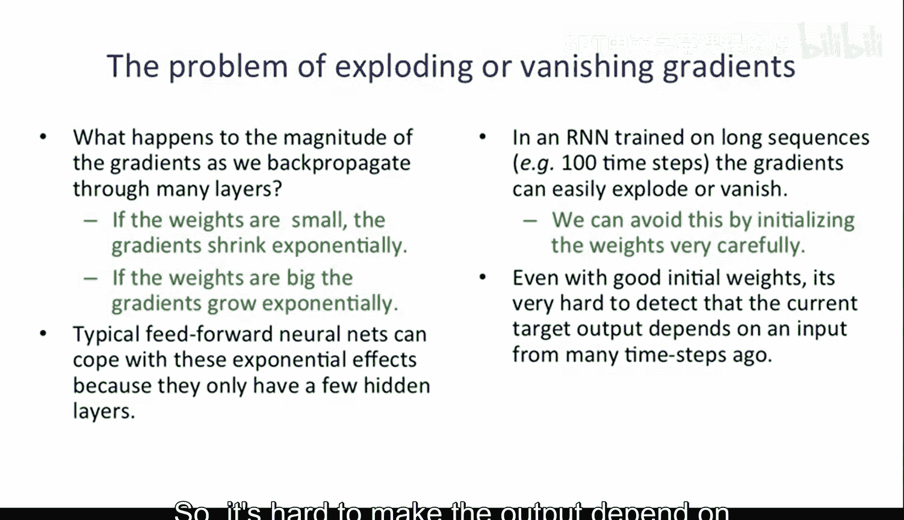
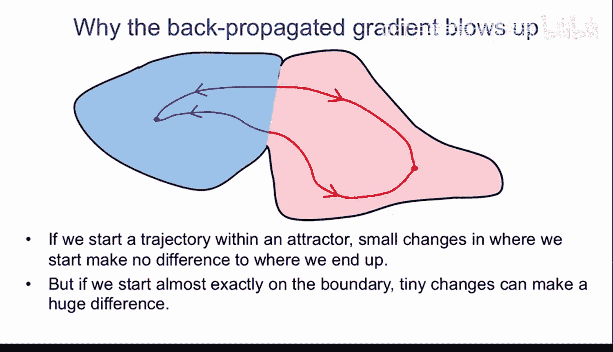
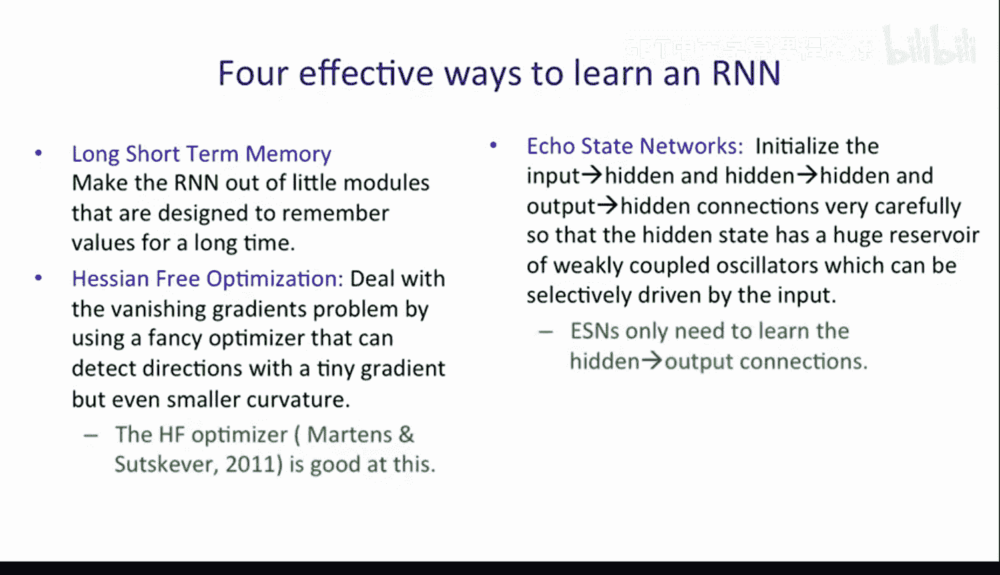

# 7.4：为何训练RNN如此困难？🤔

在本节课中，我们将探讨一个核心问题：为什么训练循环神经网络（RNN）会如此困难？我们将深入分析“梯度爆炸与梯度消失”现象，并了解这一现象如何阻碍RNN学习长期依赖关系。最后，我们将简要介绍四种解决此问题的有效方法。

---

为了理解训练RNN的困难之处，我们必须认识到RNN在前向传播与反向传播之间存在一个关键差异。

在前向传播过程中，我们使用如逻辑函数（logistic）这样的**压缩函数**来防止激活值爆炸。例如，每个神经元的输出被限制在0到1之间，这有效阻止了数值的无限增长。

然而，反向传播过程却是**完全线性**的。这一点常令人惊讶。如果你将网络最后一层的误差加倍，那么通过反向传播计算出的所有梯度也会加倍。在前向传播完成后，每个神经元激活点（如前图中的红点）处的梯度（即该点切线的斜率）就已确定。随后的反向传播过程，就如同在一个线性系统中前向传播，其线性斜率已被固定。

由于反向传播是线性的，它会遭遇线性系统的典型问题：在迭代过程中，梯度倾向于**要么爆炸式增长，要么衰减至零**。

---

以下是梯度爆炸与消失问题的具体表现：

*   **梯度消失**：当网络权重较小时，梯度在反向传播多层后会**指数级缩小**。这意味着，在通过时间反向传播时，距离目标时间点很远的早期输入所获得的梯度会变得极其微小。
*   **梯度爆炸**：当网络权重较大时，梯度在反向传播多层后会**指数级增长**。这意味着，在通过时间反向传播时，梯度会变得巨大，从而“冲毁”之前学到的所有知识。

在普通的前馈神经网络中，除非网络极深，否则这个问题并不严重。但对于在长序列（例如100个时间步）上训练的RNN而言，梯度在反向传播100步后，其增长或衰减率将被放大到100次幂，导致梯度要么爆炸，要么消失。

---

RNN难以处理长期依赖关系。这里有一个在学习“吸引子”时出现梯度爆炸和消失的例子。

假设我们训练一个RNN，使其无论从何种初始状态开始，最终都能到达两个“吸引子”状态之一。我们学习一个蓝色的吸引盆和一个粉色的吸引盆。

*   如果从蓝色吸引盆内的任何位置开始，最终都会到达同一个点。这意味着初始状态的微小差异对最终结果没有影响。因此，最终状态相对于初始状态变化的导数为**0**。这就是**梯度消失**。
*   然而，如果初始位置恰好位于两个吸引盆的边界附近，那么初始位置一个微小的、跨越分水岭的差异，就会导致最终结果天差地别。这就是**梯度爆炸**问题。

因此，每当试图用RNN学习此类吸引子动态时，都不可避免地会遇到梯度消失或爆炸的问题。

---

幸运的是，现在至少有四种有效的方法可以训练RNN。上一节我们看到了问题的严峻性，本节中我们来看看解决方案。

1.  **长短期记忆网络（LSTM）**：这种方法通过**改变神经网络的结构**，使其擅长记忆信息。我们将在本讲座后续部分详细讨论。
2.  **使用更优的优化器**：使用能够处理极小梯度的优化器。真正的问题在于优化时，需要探测那些曲率极小的微小梯度。为神经网络量身定制的**无Hessian优化**方法擅长处理此问题。
3.  **回声状态网络（ESN）**：这种方法巧妙地规避了问题。其核心思想是**精心初始化**输入到隐藏层、隐藏层到隐藏层以及输出到隐藏层的反馈权重。目标是让隐藏状态成为一个充满弱耦合振荡器的“大水库”。输入序列会在这个水库中产生长时间的回响，这些回响就记住了输入序列的信息。然后，我们尝试将这些回响耦合到期望的输出上。在ESN中，**唯一需要学习的是隐藏单元到输出单元的连接**。如果输出单元是线性的，训练将变得非常简单。
4.  **结合动量的初始化方法**：在回声状态网络那种精心初始化的基础上**使用动量**方法，可以使其性能更优。这是一种非常巧妙的方法，它先初始化RNN以获得有趣的动态特性，然后通过动量轻微调整这些动态，使其更有利于手头的任务。

---

本节课中，我们一起学习了训练RNN的核心挑战——梯度爆炸与消失问题。我们了解到，这是由于RNN反向传播的线性特性导致的，使其在处理长序列时，梯度会指数级地增长或衰减。最后，我们概述了四种应对此挑战的主流方法：LSTM结构改进、更优的优化器、回声状态网络策略以及结合动量的初始化技术。这些方法为有效训练RNN、使其能够学习长期依赖关系提供了可能。