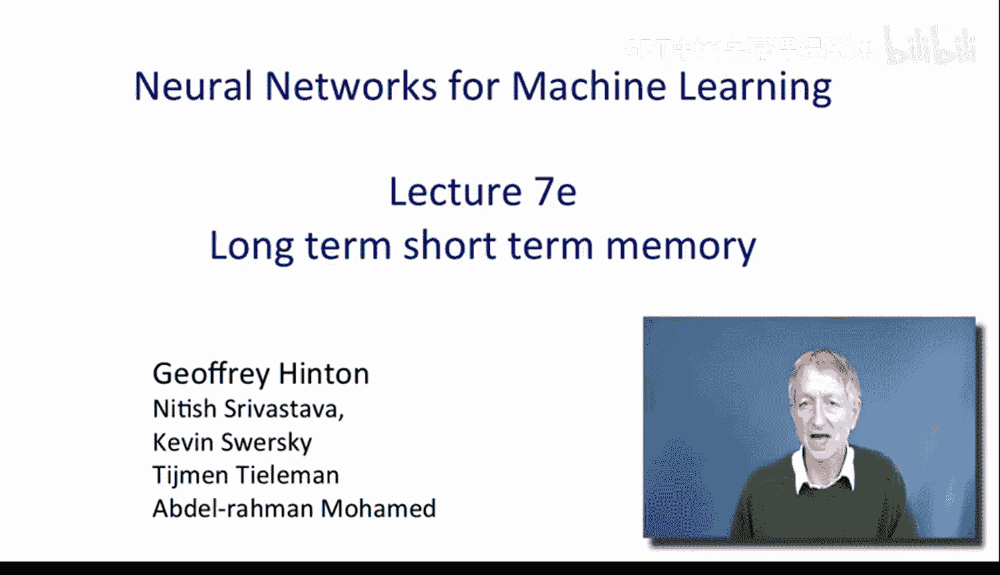
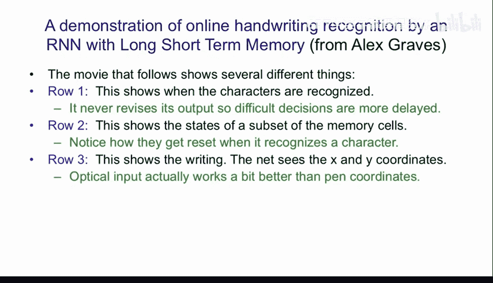
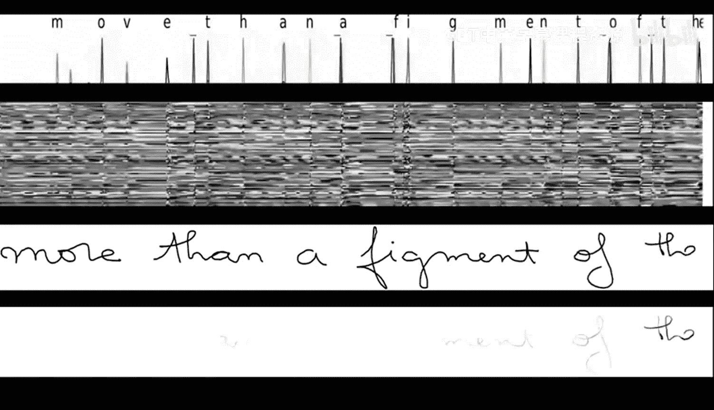

# 7.5：长短期记忆网络 🧠

在本节课中，我们将学习一种名为“长短期记忆”的训练循环神经网络的方法。我们将了解其核心概念、工作原理以及一个成功的应用案例。

## 概述

神经网络的动态状态可以被视为一种短期记忆。长短期记忆网络的目标是让这种短期记忆能够持续很长时间。这是通过创建特殊的模块来实现的，这些模块设计用于在需要时允许信息被“门控”进入，并在之后被“门控”输出。在中间阶段，门是关闭的，以确保在此期间到达的信息不会干扰被记住的状态。长短期记忆网络在手写识别等任务上取得了巨大成功。

## 长短期记忆网络的起源

上一节我们介绍了长短期记忆网络的基本概念，本节中我们来看看它的起源。

1997年，Hochreiter和Schmidhuber在《Neural Computation》上发表了一篇论文，解决了让循环神经网络长时间记住信息的问题。他们的循环网络能够记住数百个时间步长的信息。他们通过设计一个使用逻辑单元和线性单元以及乘法交互的记忆单元来实现这一点。

## 记忆单元的工作原理

了解了其起源后，我们深入探讨记忆单元的具体工作机制。

记忆单元通过三个由网络其余部分控制的“门”来管理信息流：写入门、保持门和读取门。

以下是记忆单元的三个核心操作：

1.  **信息写入**：当循环网络的其余部分想要存储信息时，它会打开一个逻辑**写入门**。此时，从网络其余部分输入到记忆单元的当前值就会被存储进去。
2.  **信息保持**：信息会一直保留在记忆单元中，只要其逻辑**保持门**处于开启状态。如果网络其余部分希望信息持续存在，就会将保持门设置为开启。
3.  **信息读取**：最后，信息通过打开一个逻辑**读取门**从记忆单元中读取出来，从而影响循环神经网络的未来状态。

记忆单元实际上存储的是一个模拟值。可以将其视为一个具有模拟值的线性神经元，它通过权重为1的连接在每个时间步长将值写回自身。这个权重为1的连接由保持门控制。如果保持门的值接近1，信息就会循环保留；如果设置为0，信息就会消失。

## 反向传播与训练

我们已经了解了记忆单元的前向信息流，本节中我们来看看如何通过反向传播来训练它。

使用逻辑单元作为门的关键在于，我们可以通过它们进行反向传播，因为它们具有良好的导数。这意味着我们可以学习在多个时间步长上使用这种电路。

考虑一个前向传播的例子：在初始时刻，假设保持门设置为0（清空旧信息），写入门设置为1，来自网络其余部分的值（例如1.7）被写入记忆单元，此时读取门为0。接着，保持门被设置为1，信息被存储。在后续时间步，写入门和读取门保持为0，信息被隔离保存。最后，当需要读取时，读取门被设置为1，值1.7被输出。

当进行反向传播时，从读取时刻输出的1.7，沿着路径回溯到存储时刻输入的1.7。只要相关的门值为1，这条路径上的有效权重就是1。因此，误差导数可以几乎无衰减地回传数百个时间步长，这正是我们想要的特性。公式上，这可以表示为梯度流的有效路径。

## 应用案例：手写识别

理论部分介绍完毕，现在让我们看一个长短期记忆循环神经网络非常擅长的实际任务。

这是一个非常自然的循环神经网络任务：读取草书手写体。输入仅仅是笔尖的X和Y坐标序列，加上笔是否在纸上的信息。输出则是一个被识别出的字符序列。

Graves和Schmidhuber在2009年证明，带有长短期记忆的循环神经网络在此任务上表现极佳。据我所知，它们目前是这方面最好的系统。加拿大邮政已开始使用它们来读取手写体。在2009年的工作中，他们并未使用笔坐标作为输入，而是使用了一系列小图像。这意味着他们可以处理光学输入，即使书写的时序未知，也可以在书写完成后查看图像并进行识别。

## 系统演示

以下是Alex Graves系统处理笔坐标输入的演示说明。在演示中，你将看到四行信息流：

1.  **第一行**：显示被识别的字符。系统从不修订其输出。如果遇到难以决策的情况，它会稍微延迟输出，以便观察未来一小段信息来帮助消除歧义。
2.  **第二行**：显示一部分记忆单元的状态。你会注意到在识别出一个字符时它们是如何被重置的。
3.  **第三行**：显示实际的书写轨迹。网络看到的只是笔尖的X和Y坐标这两个数字，以及笔是否抬起的信息。
4.  **第四行**：显示更复杂的信息。它展示了梯度一直反向传播到X、Y坐标位置的情况。对于最活跃的字符，如果你从该字符反向传播，并询问什么会使该字符更活跃，你就能看到输入的哪些部分影响了它是该字符的概率。这让你了解决策是如何依赖于过去发生的事件的。

## 总结

本节课中我们一起学习了长短期记忆网络。我们了解到，LSTM通过引入由写入门、保持门和读取门控制的特殊记忆单元，解决了标准循环神经网络难以长期保存信息的问题。其核心机制允许信息在需要时被存储、保持和读取，同时通过门的控制实现了梯度的有效长程反向传播，从而能够训练非常深的时序网络。最后，我们看到了LSTM在手写识别这一自然时序任务上的成功应用，展示了其强大的实践价值。