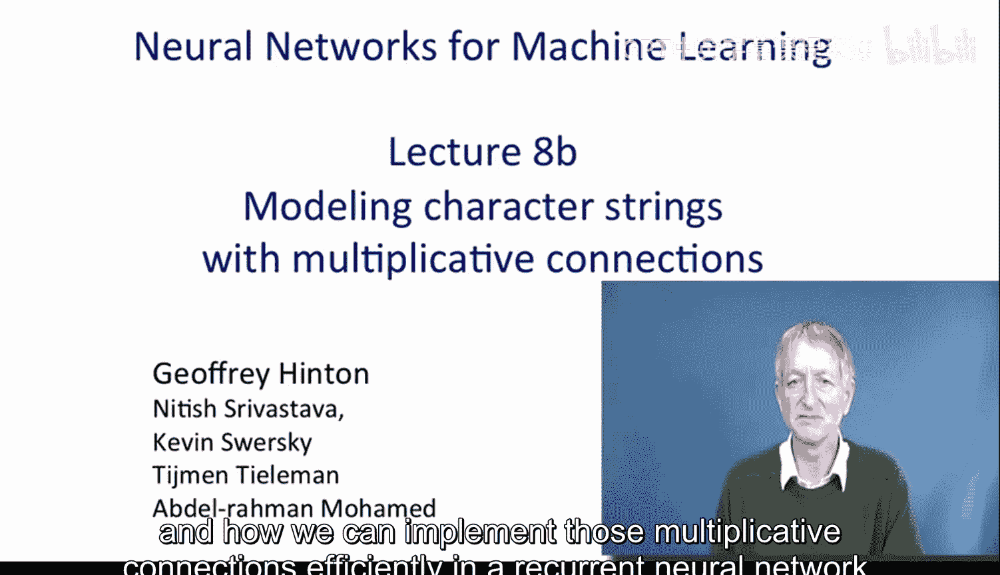
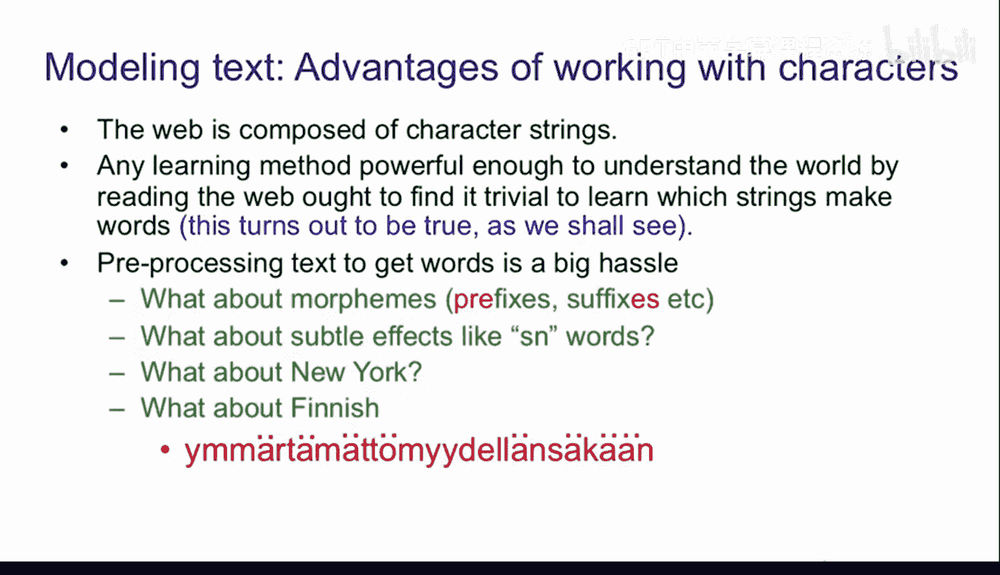
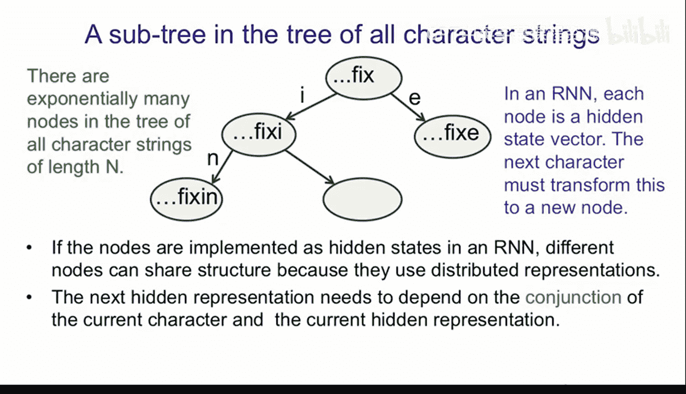
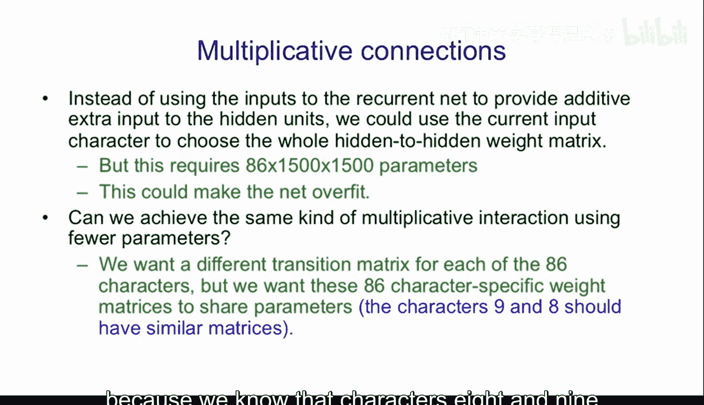
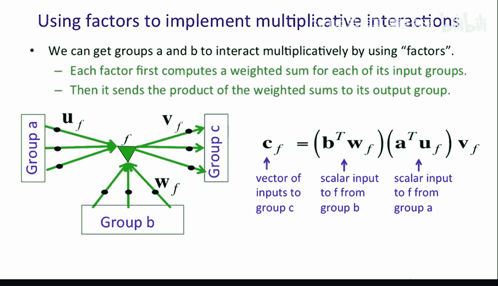
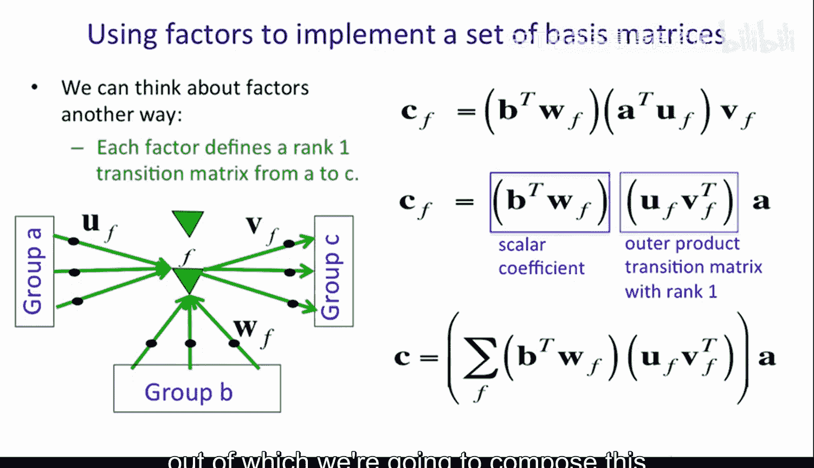
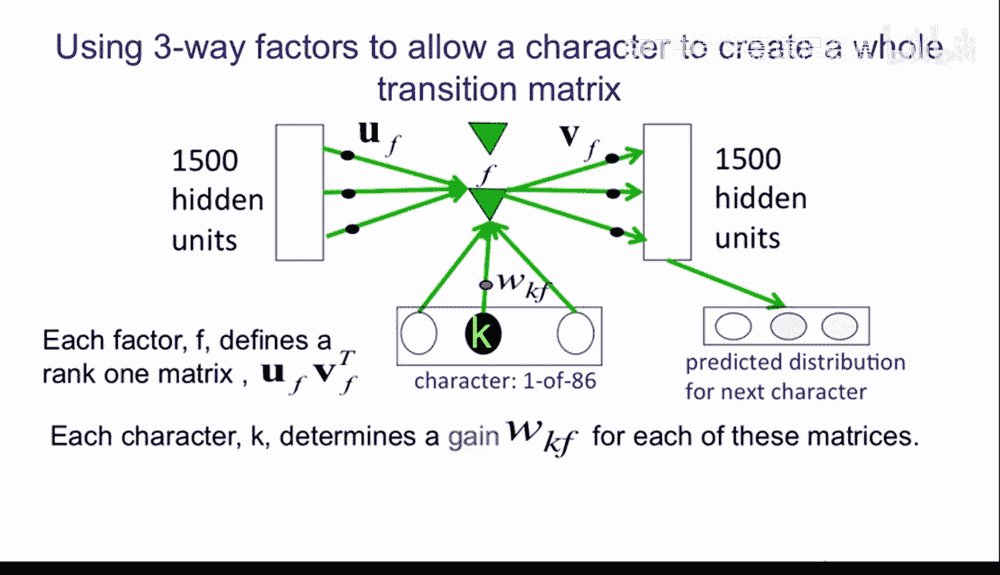

# 8.2：字符序列建模 📝

在本节课中，我们将学习如何应用无Hessian优化方法来建模来自维基百科的字符序列。核心思想是让模型阅读大量维基百科文本，并尝试预测下一个字符。在探讨模型能学到什么之前，我们需要先理解为何需要引入乘法连接，以及如何在现有神经网络中高效地实现它们。

## 为何选择字符而非单词？ 🤔

上一节我们介绍了建模任务的目标，本节中我们来看看为何选择字符作为建模单元，而不是通常用于语言建模的单词。

网络由字符序列构成。任何足够强大的学习方法，若想通过阅读网络来理解世界，或想轻松学会哪些字符串能构成单词，处理字符序列是基础。我们将看到，这确实是可行的。因此，我们的目标非常宏大：我们希望构建一个能阅读维基百科并理解世界的模型。

如果必须将维基百科的文本预处理成单词，将会非常麻烦，并带来诸多问题。

以下是预处理成单词会遇到的主要问题：

*   **语素问题**：根据语言学家的观点，最小的意义单位是语素。为了合理处理语言，我们需要将单词分解为这些语素。但问题在于，语素的界定并不完全清晰。
*   **类语素现象**：存在一些类似语素但语言学家不会称之为语素的现象。例如在英语中，以字母“sn”开头的单词有很大概率与嘴唇或鼻子（尤其是上唇或鼻子）有关，如“snarl”、“sneeze”、“snot”、“snug”、“snort”。这类词数量众多，并非巧合。
*   **复合词问题**：有些词由多个部分组成。通常，我们会将“New York”视为一个词汇项。但如果谈论“New Yorkers' roof”，我们可能希望将“New”和“Yorkers”视为两个独立的词汇项。
*   **黏着语问题**：例如芬兰语等黏着语，会将许多语素组合成很长的单词。一个芬兰语单词可能需要用五个英语单词才能表达相同的意思。这凸显了基于单词建模的复杂性。

## 基础循环网络的局限性 🔄

理解了建模单元的选择后，我们来看看一个可能用于建模字符序列的简单循环网络结构。

一个明显的循环网络结构包含一个隐藏状态（例如使用1500个隐藏单元）。其动态过程是：时间T的隐藏状态和当前字符共同作为输入，以确定时间T+1的新隐藏状态。然后，基于新的隐藏状态，通过一个覆盖86个字符的单一Softmax层来预测下一个字符。整个系统通过从该Softmax输出的正确字符的对数概率进行反向传播来训练。

预测86个字符比预测10万个单词容易得多，因此输出层使用Softmax是可行的，避免了大型Softmax层的问题。

现在，我想解释为什么我们没有使用那种循环网络，而是使用了一种效果更好的不同网络。

## 引入乘法连接的必要性 ✖️

上一节我们看到了基础循环网络的结构，本节中我们来看看其局限性以及改进方案。

你可以将所有可能的字符序列排列成一棵树，分支因子为86。循环神经网络试图通过隐藏状态向量来表示这棵巨大树中的每个节点，从而应对树规模指数级增长的问题。这种方法的一个优点是能够共享大量结构。例如，当模型到达代表“FIX”的节点时，它可能已判定这很可能是一个动词。如果它是动词，那么看到字母“I”的可能性就很高（因为“-ING”结尾）。这种“动词后可能接I”的知识可以在所有其他不包含“FIX”的动词节点间共享。

关键在于，是**当前状态**和**当前字符**的**结合**共同决定了我们想要前往的下一个状态。我们不希望字母“I”总是让我们预期下一个是“N”；我们真正希望的是：**如果**你已经认为它是一个动词，**那么**当你看到“I”时，你应该预期下一个是“N”。是“认为它是动词”和“看到了I”这个**组合**让我们进入了标记为“FIX I”并预期看到“N”的状态。

为了捕捉这种组合关系，我们将使用**乘法连接**。

## 高效实现乘法连接 🏗️

上一节我们论证了需要乘法连接来捕捉字符与上下文的组合效应，本节中我们来看看如何高效地实现它。

我们将不再使用字符输入为隐藏单元提供额外的**加性**输入，而是使用这些字符来**切换**整个隐藏层到隐藏层的权重矩阵。也就是说，字符将决定状态转移矩阵。

如果以简单直接的方式实现，我们需要让86个字符中的每一个都定义一个1500x1500的矩阵，这将导致参数数量巨大，容易过拟合，除非有海量文本数据。

因此，问题是：我们能否利用字符之间的共性（例如，所有数字在促使隐藏状态演变的方式上非常相似），以更少的参数实现这种乘法交互，让字符决定隐藏到隐藏的权重矩阵？我们希望为86个字符各自提供不同的转移矩阵，但同时希望这些矩阵能共享参数。

以下是我们的实现方法：

我们将引入称为“因子”的组件。每个因子表示组A和组B以乘法方式交互，为组C提供输入。

每个因子首先为其两个输入组各计算一个加权和（即点积）。然后，将这两个标量结果相乘，得到一个标量。最后，用这个标量来缩放出权重向量V，作为对组C的输入。

用公式表示，因子F对组C提供的向量输入为：
`输入_C = (状态_B · W_F) * (状态_A · U_F) * V_F`
其中，`·` 表示点积，`*` 表示标量乘法。

## 因子的矩阵视角 📊

上一节我们介绍了因子的计算方式，本节我们从矩阵乘法的角度来重新审视它，以获得更深入的理解。

我们可以重新排列上述公式。每个因子实际上定义了一个非常简单的转移矩阵——一个秩为1的矩阵。

重新排列后，公式可以看作：因子F对组C的输入 = `(状态_B · W_F) * (矩阵_U_V) * 状态_A`，其中 `矩阵_U_V` 是向量 `U_F` 和 `V_F` 的外积，形成一个秩为1的矩阵。

因此，`状态_B · W_F` 计算出的标量，成为了这个秩为1矩阵的系数。我们将当前隐藏状态 `状态_A` 乘以这个被缩放的矩阵，就得到了该因子对下一个隐藏状态的贡献。

如果我们对所有因子求和，那么对组C的总输入就是：`∑_F [ (状态_B · W_F) * (矩阵_U_V_F) ] * 状态_A`。这个总和构成了一个巨大的矩阵——这就是由当前字符决定的特定转移矩阵。然后，当前隐藏状态乘以这个矩阵，就产生了新的隐藏状态。

由此可见，我们通过这些因子提供的秩为1矩阵，合成了一个完整的转移矩阵。而当前字符（在组B中）的作用，就是确定每个秩为1矩阵的权重（系数）。

## 系统整体架构 🖼️

最后，让我们看看整个系统的架构图。

我们会有多个因子（例如约1500个）。字符输入是独热编码，因此每次只有一个字符是活跃的。当前字符K对因子F的权重 `W_KF`，就是用于缩放由 `U_F` 和 `V_F` 外积得到的那个秩为1矩阵的“增益”。

字符决定了每个因子对应的增益 `W_KF`。你将每个秩为1矩阵 `U V` 乘以其对应的增益，然后将所有缩放后的矩阵相加，就得到了你的（字符）特定转移矩阵。

---

**本节课总结**：在本节课中，我们一起学习了如何为字符序列建模任务设计循环神经网络。我们首先探讨了为何选择字符而非单词作为建模单元。接着，我们分析了简单循环网络在捕捉字符与上下文组合关系上的局限性，从而引出了引入**乘法连接**的必要性。然后，我们详细介绍了如何通过“因子”这种组件，以参数共享的方式高效实现乘法交互，让当前字符动态决定隐藏状态之间的转移矩阵。最后，我们从矩阵视角理解了因子的工作原理，并俯瞰了整个系统的架构。这种方法使得模型能够更有效地从字符序列中学习复杂的语言结构。