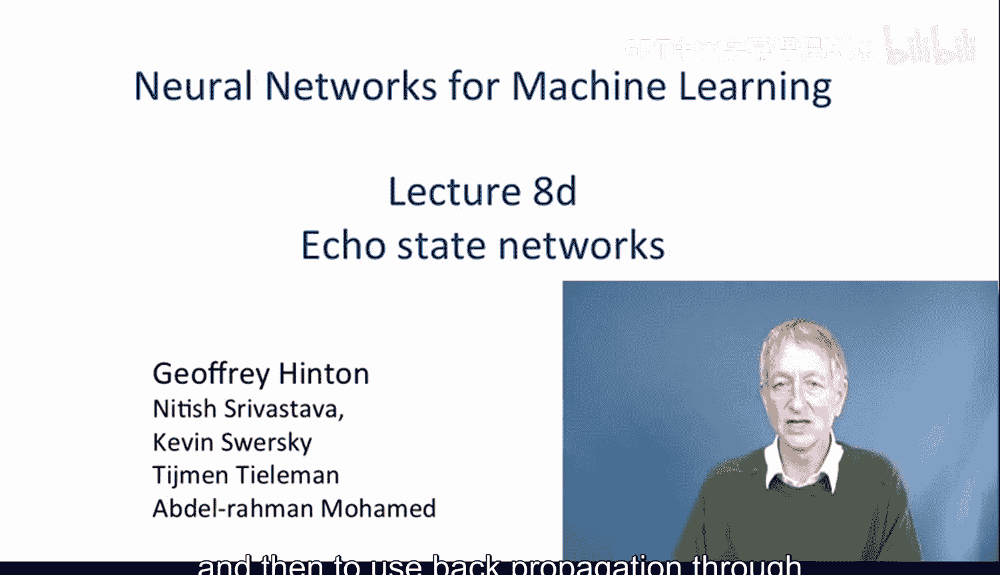
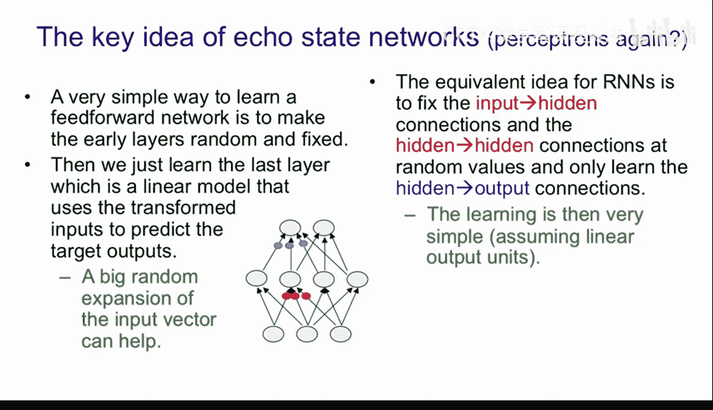
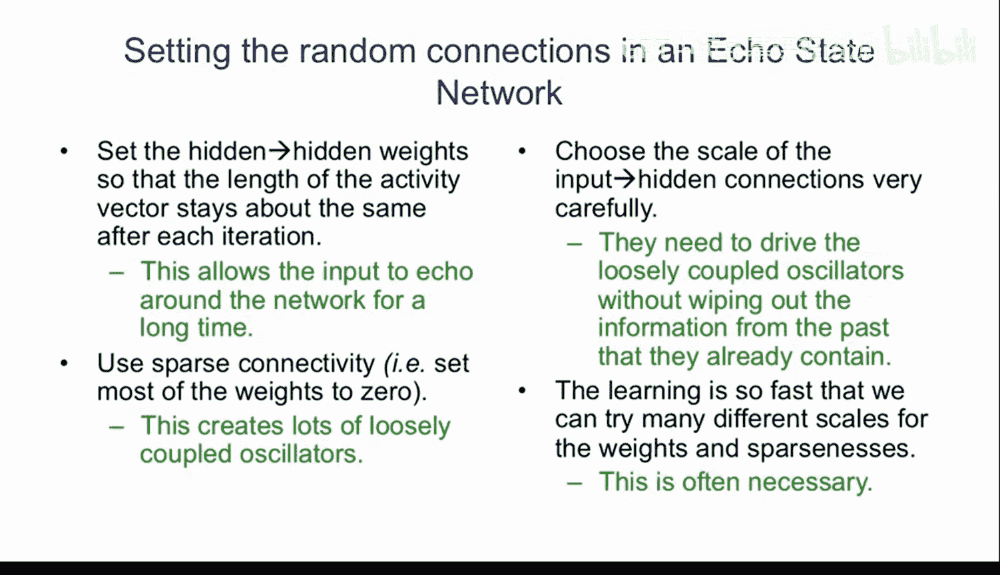
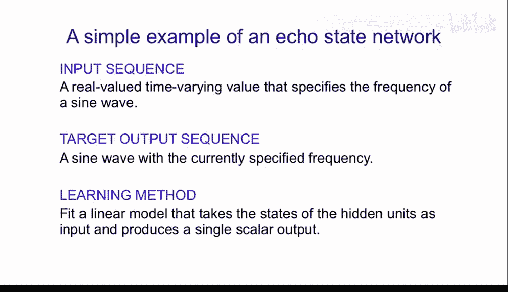
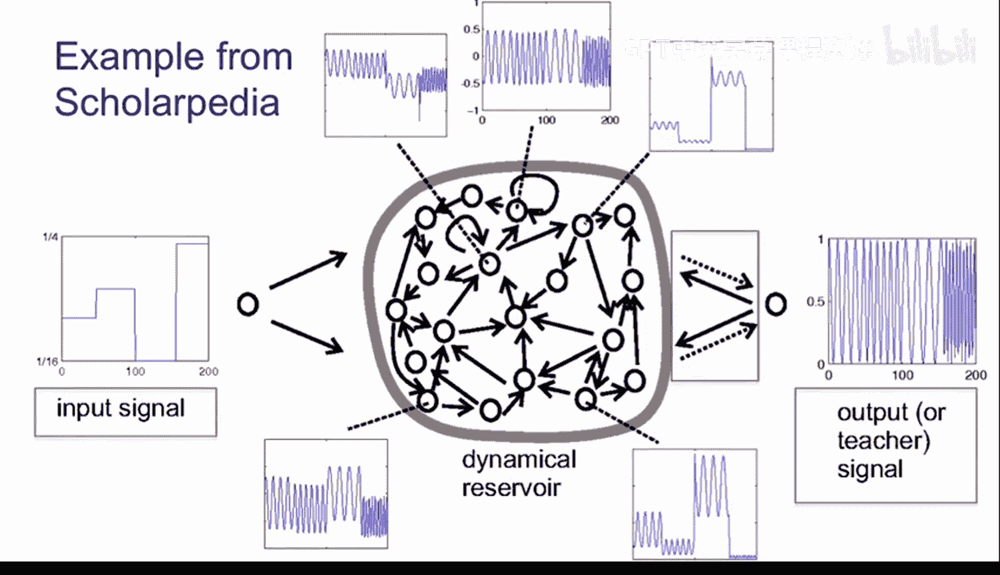
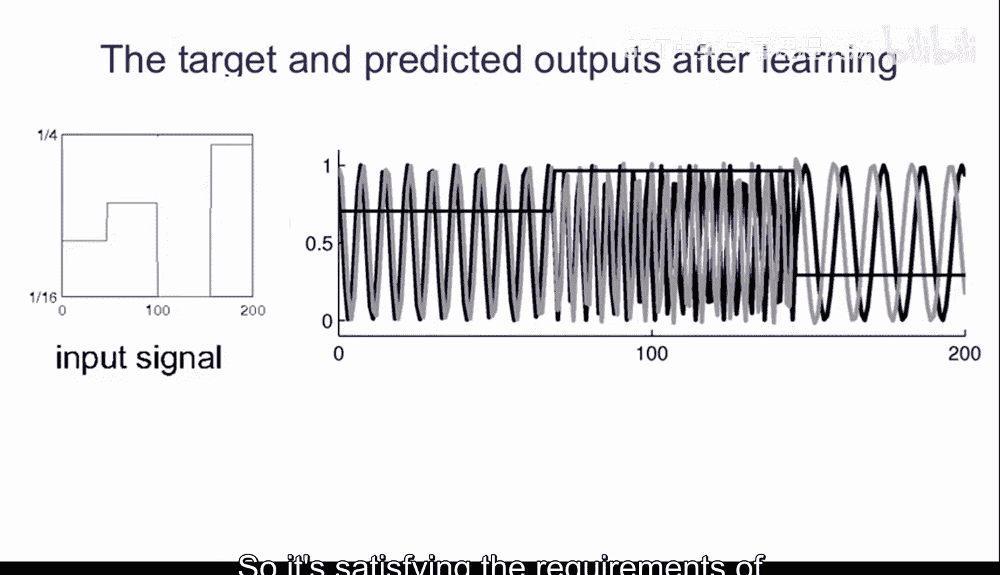
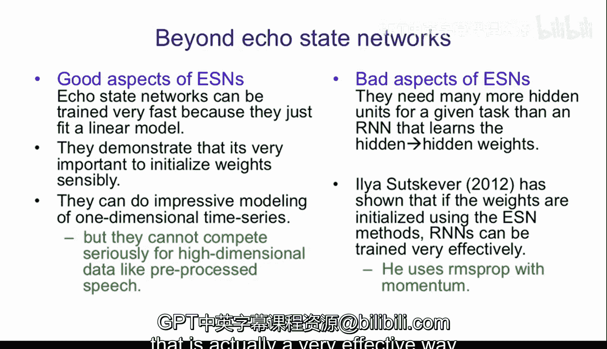

# 8.4：回声状态网络 🧠

在本节课中，我们将要学习一种名为“回声状态网络”的循环神经网络。这种网络使用了一个巧妙的技巧，使得训练循环神经网络变得更加容易。我们将了解其核心思想、工作原理、优点与局限性，并探讨如何将其初始化技巧与传统的反向传播训练相结合。

## 概述

回声状态网络的核心思想是：**固定循环神经网络中的大部分连接权重，只训练输出层的连接**。具体来说，网络会初始化一个由大量松散耦合的振荡器组成的“动态储备池”。输入信号会驱动这个储备池产生复杂的动态响应，而我们只需要学习如何将这些响应状态线性映射到期望的输出上。这完全避免了学习隐藏层到隐藏层连接或输入到隐藏层连接的难题。



## 回声状态网络的工作原理

上一节我们介绍了回声状态网络的核心概念，本节中我们来看看它是如何具体工作的。

其基本结构与一个标准的循环神经网络类似，但关键区别在于权重的处理方式：
*   **输入到隐藏层** 和 **隐藏层到隐藏层** 的连接权重被**随机初始化并固定**。
*   只有 **隐藏层到输出层** 的连接权重是**需要学习的**。

如果使用线性输出单元，学习过程就简化为一个快速的线性回归问题。

以下是其工作流程的简要说明：
1.  精心设置随机的循环连接，形成一个“动态储备池”。
2.  输入信号驱动储备池，产生复杂的、随时间演化的状态。
3.  学习一个线性模型，将储备池的当前状态映射到目标输出。

## 如何设置随机连接



仅仅随机设置连接是不够的。为了让网络有效工作，必须非常小心地设置这些随机连接，以确保网络活动既不会迅速衰减至零，也不会爆炸式增长。

以下是设置时需要遵循的几个关键原则：

1.  **控制谱半径**：将隐藏层到隐藏层权重矩阵的**最大特征值（谱半径）** 设置为接近1。在线性系统中，这能保证状态向量的长度在每次迭代后大致保持不变。在非线性系统中，我们也希望达到类似的效果。这样，输入信息才能在循环状态中“回荡”很长时间。
    *   **公式表示**：设 `W_hh` 为隐藏层到隐藏层的权重矩阵，其谱半径 ρ(`W_hh`) ≈ 1。

2.  **使用稀疏连接**：隐藏层到隐藏层的连接应该是稀疏的，即大部分权重为零，只有少数权重值较大。这能创造出许多**松散耦合的振荡器**，使得信息能在网络的一部分停留较长时间，而不会过快传播到其他部分。

3.  **精心调整输入权重尺度**：输入到隐藏层的连接权重需要仔细调整其尺度。它们需要能驱动振荡器的状态，但又不能抹掉这些振荡器所携带的近期历史信息。

幸运的是，由于回声状态网络的学习速度极快，我们可以负担得起通过实验来调整输入权重的尺度和隐藏连接的稀疏度，以找到让系统表现最佳的组合。

## 一个简单示例：生成正弦波



为了更具体地理解，我们来看一个从网上获取的简单示例。该网络的任务是根据输入值生成特定频率的正弦波。

*   **输入序列**：一个随时间变化的实数值，用于指定正弦波的期望频率。
*   **目标输出序列**：一个正弦波，其频率由输入指定。
*   **学习目标**：拟合一个线性模型，该模型以隐藏单元的状态为输入，并试图预测正确的标量输出值。



下图展示了一个回声状态网络处理此问题的结构：
```
[输入信号] -> [动态储备池] -> [输出信号]
```
输入信号驱动由松散耦合振荡器组成的动态储备池，产生复杂的动力学行为。输出权重则学习将这种复杂的动力学映射到我们期望的输出动态上。值得注意的是，图中还有从输出返回到储备池的连接，这并非必需，但有助于让储备池了解目前已产生了什么输出。

在学习完成后，系统能够产生频率正确的正弦波。不过，它可能无法确定正弦波的正确相位，除非在训练目标中明确指定。

## 优点与局限性

回声状态网络有其独特的优势，但也存在一些局限。



**优点**：
*   **训练速度极快**：因为本质上只是拟合一个线性模型。
*   **证明了初始化的重要性**：展示了明智地初始化循环权重对循环网络性能的关键影响。
*   **擅长一维时间序列建模**：在观察一段时间序列后，能够很好地预测其未来的长期走势。



**局限性**：
*   **不擅长高维数据建模**：例如音频系数帧或视频帧。为了建模此类数据，它需要比训练了全部权重的循环神经网络多得多的隐藏单元。

## 与反向传播的结合

最近，一项相当明显的改进被尝试：**使用回声状态网络开发的所有技巧来初始化一个循环神经网络**。一旦完成初始化，你当然可以通过只学习隐藏到输出的连接来获得不错的效果。但可以推测，如果进一步学习并优化隐藏到隐藏的权重，网络性能可能会更好。

因此，研究者尝试在使用回声状态网络初始化后，再使用**通过时间的反向传播**（配合动量方法，如RMSProp）进行训练。结果发现，这实际上是一种非常有效的训练循环神经网络的方法。它结合了快速初始化和精细优化的优点。

## 总结



本节课中我们一起学习了回声状态网络。我们了解到，它通过固定循环连接的随机权重并只训练输出层，极大地简化了循环神经网络的训练过程。其成功依赖于精心设置权重矩阵的谱半径、使用稀疏连接来创建动态储备池，以及调整输入尺度。虽然它在处理一维时间序列时表现出色，但在高维数据上效率较低。最后，我们看到了将其初始化策略与传统的反向传播训练相结合，可以成为一种更强大的循环神经网络训练方法。