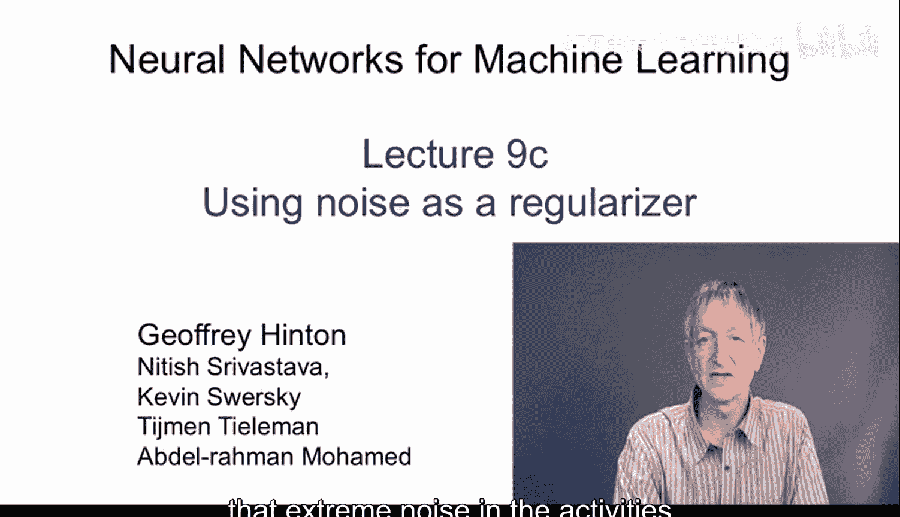
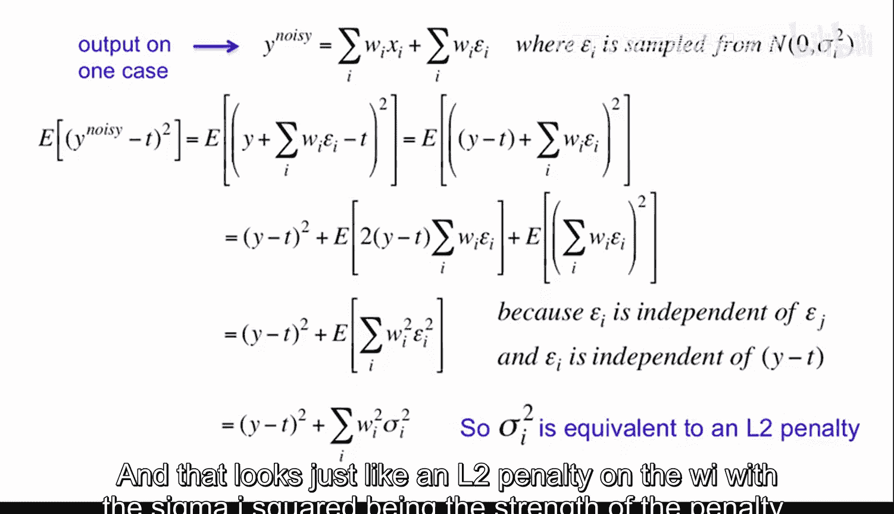
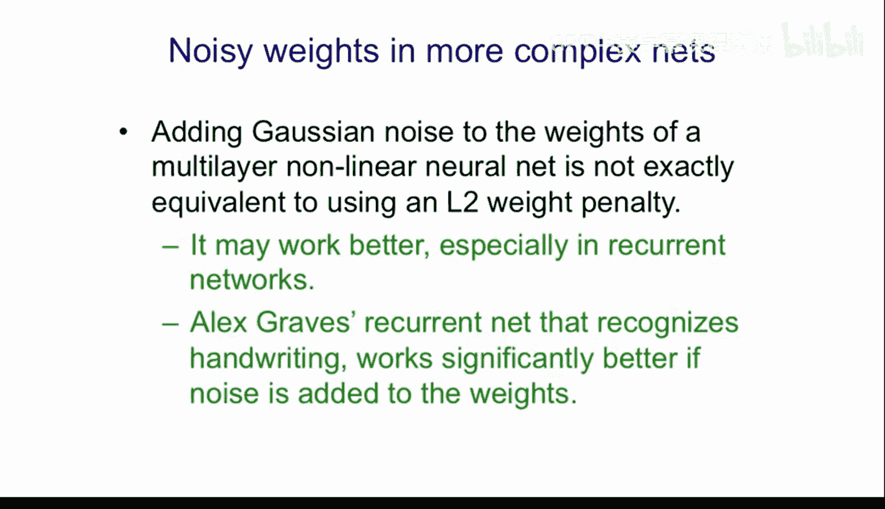
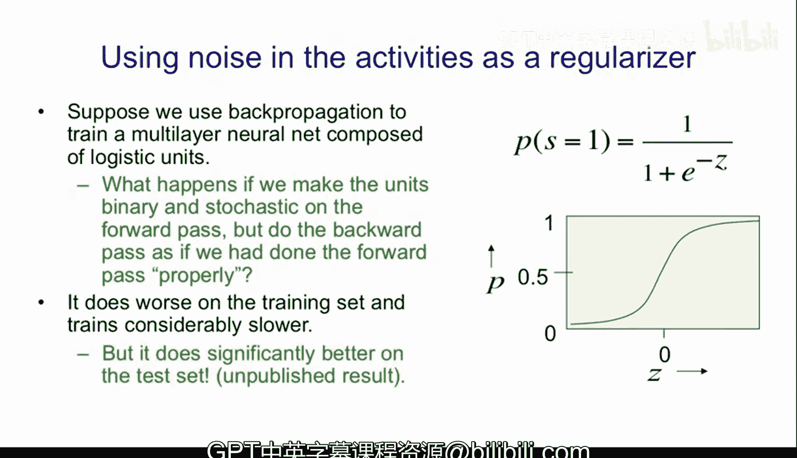

# 9.3：使用噪声作为正则化器 🎛️

在本节课中，我们将学习一种通过向神经网络添加噪声来限制其容量的方法。我们将探讨向输入或权重添加噪声的原理，并了解这种技术如何作为一种有效的正则化手段，帮助模型提升泛化能力。

## 向输入添加噪声与L2正则化的等价性

上一节我们讨论了限制网络容量的方法。本节中，我们来看看向简单线性网络的输入添加高斯噪声的效果。我们将证明，对于试图最小化平方误差的网络，这等同于对网络权重施加L2惩罚。

考虑一个简单的线性网络，其输出单元直接连接到输入。当我们向输入 `Xi` 添加均值为0、方差为 `σ_i²` 的高斯噪声时，该噪声的方差会被连接权重 `W_i` 的平方放大。

**公式描述如下：**
设无噪声系统的输出为 `y = Σ_i (W_i * X_i)`。添加噪声后，输出变为 `y_noisy = Σ_i (W_i * (X_i + ε_i))`，其中 `ε_i ~ N(0, σ_i²)`。

因此，`y_noisy = y + Σ_i (W_i * ε_i)`。`y_noisy` 与目标值 `t` 之间的期望平方误差为：

`E[(y_noisy - t)²] = E[(y - t + Σ_i W_i ε_i)²]`

展开并利用 `ε_i` 的独立性（`E[ε_i] = 0`, `E[ε_i ε_j] = 0 (i≠j)`），可得：

`E[(y_noisy - t)²] = (y - t)² + Σ_i (W_i² * σ_i²)`

由此可见，最小化带噪声输入的期望平方误差，等价于在最小化原始平方误差的同时，最小化一项额外的 `Σ_i (W_i² * σ_i²)`。这正是L2权重惩罚项的形式，其中 `σ_i²` 决定了惩罚强度。

## 在更复杂网络中使用权重噪声

向输入添加噪声在简单线性模型中等价于L2正则化。然而，在更复杂的网络（尤其是循环神经网络）中，直接向权重添加高斯噪声被证明是更有效的正则化方法。

以下是关于权重噪声的一些要点：
*   这种方法并非严格等价于L2惩罚，但实践效果往往更好。
*   例如，Alex Graves在其手写识别循环网络中发现，添加权重噪声能提升模型性能。

## 使用激活值噪声作为正则化器

除了输入和权重，我们还可以在神经元的激活值上引入噪声。这是一种近期发现的有效技术。

具体方法是：在前向传播过程中，将原本的Sigmoid（逻辑）隐藏单元视为随机的二元神经元。我们计算其激活概率 `P`，然后根据该概率随机输出1或0。然而，在反向传播计算梯度时，我们却使用确定性的概率值 `P` 进行回传。

这种“前向随机，后向确定”的做法虽然不完全精确，但在每个单元对上层贡献较小时是合理的近似。其效果是：
*   训练集上的性能会变差，训练速度会显著变慢（可能慢数倍）。
*   但模型在测试集上的泛化性能会得到显著提升。
*   注：这是一个尚未正式发表的研究结果。

## 总结

本节课中，我们一起学习了如何使用噪声作为神经网络的正则化器。
*   我们首先证明了，在最小化平方误差的简单线性网络中，向输入添加高斯噪声等价于对权重施加L2惩罚。
*   接着，我们了解到在复杂的循环网络等结构中，向权重添加噪声是更有效的正则化方法。
*   最后，我们探讨了一种前沿技术：通过在隐藏层激活值中引入极端噪声（前向传播随机二值化，反向传播使用概率值），可以显著提升模型的泛化能力，尽管这会以降低训练速度和训练集精度为代价。

这些方法的核心思想都是通过引入随机扰动来防止模型对训练数据过度拟合，从而鼓励学习到更鲁棒的特征表示。