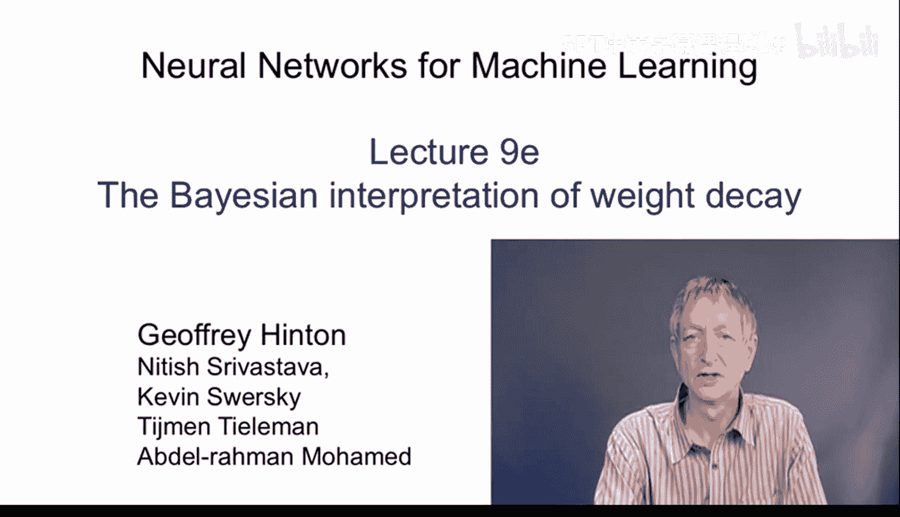
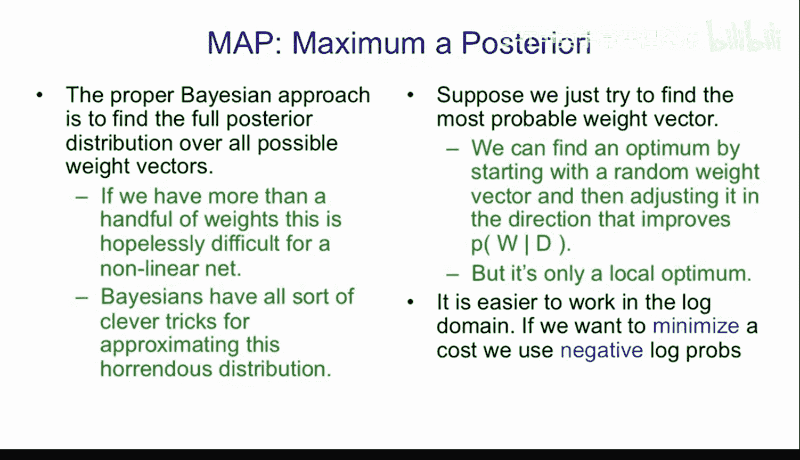
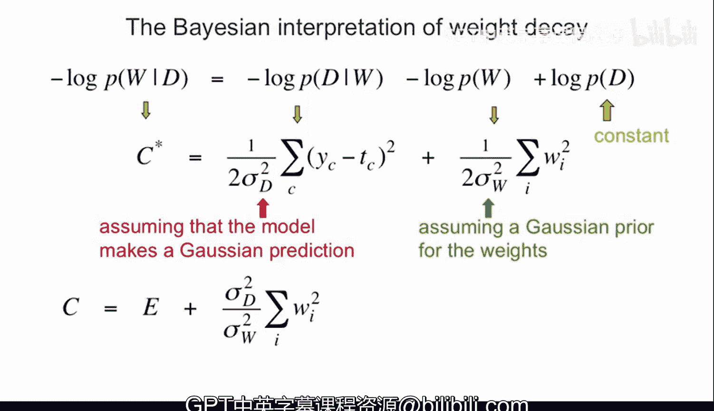

# 9.5：权重衰减的贝叶斯解释 🧠

在本节课中，我们将学习权重衰减的贝叶斯解释。我们将看到，在监督学习中最小化平方误差，以及在损失函数中添加权重惩罚项，都可以从概率的角度进行理解。这为我们控制模型容量提供了一种理论依据。

## 最大后验学习

上一节我们介绍了神经网络训练的基本目标。本节中我们来看看一种简化的贝叶斯方法。

在完整的贝叶斯方法中，我们试图计算模型所有可能参数设置的后验概率。但这通常非常困难。一个简化版本是寻找**单一的最佳参数集**，使其在拟合我们关于参数的先验信念和拟合观测到的数据之间达到最佳折衷。这被称为**最大后验学习**。它为我们使用权重衰减来控制模型容量提供了很好的解释。

## 平方误差的概率解释

现在，我们来谈谈在监督最大似然学习中最小化平方误差时，其背后的真实含义。

找到最小化平方残差（即目标值与网络预测值之间的差异）的权重向量，等价于找到最大化正确答案的对数概率密度的权重向量。

为了理解这种等价性，我们必须假设正确答案是通过在神经网络的输出上添加高斯噪声而产生的。模型输出是高斯分布的中心，我们希望目标值在该高斯分布下具有高概率。

假设在训练案例 `C` 上，神经网络的输出是 `Y_C`，这是权重 `W` 应用于输入 `C` 的结果。当我们向该输出 `Y_C` 添加高斯噪声时，得到正确目标值的概率由以 `Y_C` 为中心的高斯分布给出。

如果我们取对数并加上负号，会发现目标值 `T_C` 的负对数概率密度（给定网络输出 `Y_C`）是一个常数项加上 `(T_C - Y_C)^2 / (2 * σ^2)`，其中 `σ^2` 是高斯的方差。

因此，如果我们的成本函数是得到正确答案的负对数概率，那就转化为最小化一个平方距离。了解这一点很有帮助：**每当你看到最小化平方误差时，都可以对其做出概率解释**。在该概率解释中，你实际上是在最大化高斯分布下的对数概率。

## 从概率到损失函数

完整的贝叶斯方法是找到所有可能权重向量的完整后验分布。对于非线性网络，如果权重数量众多，这几乎不可能实现。贝叶斯方法有许多近似该分布的方法，通常使用蒙特卡洛方法。

但目前，让我们尝试更简单的方法：只寻找**最可能的权重向量**，即给定先验知识和数据后，概率最高的单一权重设置。

我们将尝试通过从某个随机权重向量开始，然后沿提高该权重向量（给定数据）概率的方向调整它，来找到 `W` 的最优值。这只会是局部最优解。在概率域中操作比较困难，因此我们通常在**对数域**中工作。如果我们想最小化一个成本，最好使用负对数概率。

以下是关于为什么我们最大化对数概率之和或最小化负对数概率之和的说明：

我们真正想做的是最大化数据的概率，即最大化在所有不同训练案例中观测到的所有目标值的概率乘积。如果我们假设不同案例的输出误差是独立的，可以将其写为所有训练案例中产生目标值 `T_C`（给定权重）的概率乘积。对数函数是单调的，因此不会改变最大值的位置。所以，我们可以最大化对数概率之和，而不是概率的乘积，这在计算机上通常更稳定。

## 最大后验学习的损失构成

在最大后验学习中，我们试图找到在拟合先验和拟合数据之间达到最优权衡的权重集。根据贝叶斯定理，如果我们取负对数来得到一个成本函数，那么权重给定数据的负对数概率等于先验项的负对数加上数据项的负对数，再加上一个额外的常数项。这个额外的常数项是所有可能权重向量的积分，因此在优化 `W` 时可以忽略它。

依赖于数据的项是目标值给定 `W` 的负对数概率，这就是我们通常的误差项。而只依赖于 `W` 的项是 `W` 在其先验分布下的负对数概率。

最大化权重的对数概率与最小化平方距离相关，其方式与最大化产生正确目标值的对数概率与最小化平方距离相关完全相同。

## 权重衰减的贝叶斯解释

因此，最小化权重的平方和，等价于在均值为0的高斯先验下最大化权重的对数概率。

假设我们有一个均值为0的高斯先验。最大化权重的概率（或对数概率），显然希望 `W` 接近均值0。高斯分布的方程如下，其中均值为0：

`P(W) = (1 / sqrt(2πσ_w^2)) * exp(-W^2 / (2σ_w^2))`

`W` 的对数概率则是 `-W^2 / (2σ_w^2)` 加上一个来自高斯归一化项的常数，该常数在改变 `W` 时无效。

最终，我们可以得到权重衰减或权重惩罚的贝叶斯解释。

我们试图最小化权重给定数据的负对数概率。这涉及最小化一个既依赖于数据又依赖于权重的项（即我们拟合目标的程度），以及一个仅依赖于权重的项（源自先验）。

*   如果我们假设在模型输出中添加了高斯噪声以进行预测，那么数据给定权重的对数概率就是网络输出与目标值之间的平方距离，除以该高斯噪声方差的两倍。
*   类似地，如果我们假设权重有一个高斯先验，那么权重在先验下的对数概率就是该权重的平方值，除以高斯先验方差的两倍。

现在，让我们对这个方程两边同时乘以 `2σ_d^2`（数据噪声方差的两倍），得到一个新的成本函数：

`C = Σ (Y_C - T_C)^2 + (σ_d^2 / σ_w^2) * Σ W_i^2`

第一项变成了所有训练案例中网络输出与目标之间平方差的总和，这就是我们通常在神经网络中最小化的平方误差。第二项现在变成了两个方差的比值乘以权重的平方和。

**因此，你会看到这两个方差的比值正是权重惩罚系数 λ。**

我们最初认为权重惩罚只是一个为了改善效果而编造的数字，通过验证集来固定其值。但现在我们看到，如果我们做出这种高斯解释（即我们有一个高斯先验，并且对网络输出与目标的关系有一个高斯模型），那么权重惩罚就由这些高斯的方差决定。它只是这些方差的比值，在这个框架下完全不是一个任意的东西。

## 总结

本节课中我们一起学习了权重衰减的贝叶斯解释。我们了解到：

1.  最小化平方误差等价于在高斯噪声假设下最大化数据的对数似然。
2.  在损失函数中添加权重的L2惩罚项，等价于假设权重服从均值为零的高斯先验分布，并进行最大后验估计。
3.  权重衰减系数 `λ` 并非一个任意的超参数，它在贝叶斯框架下具有明确的含义：`λ = σ_d^2 / σ_w^2`，即数据噪声方差与权重先验方差的比值。

这为神经网络中正则化技术的使用提供了坚实的概率论基础。