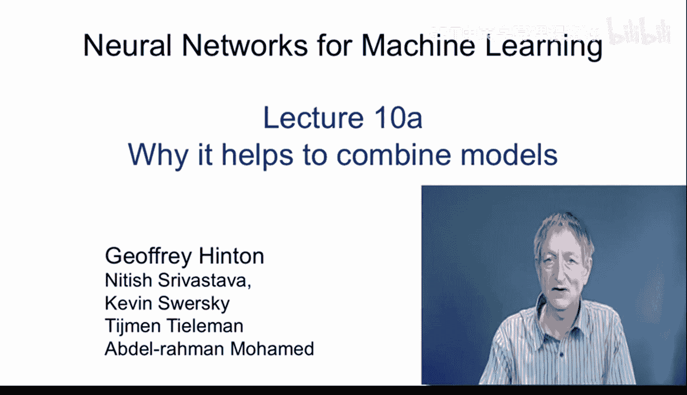
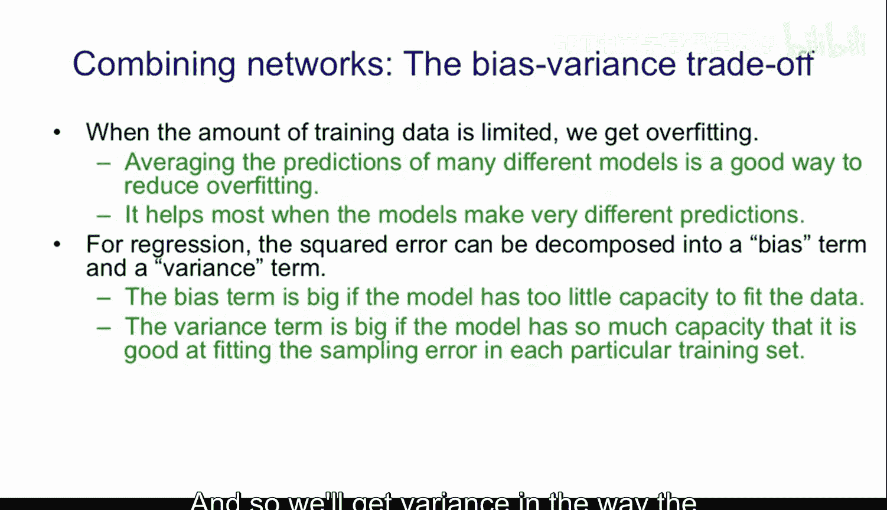
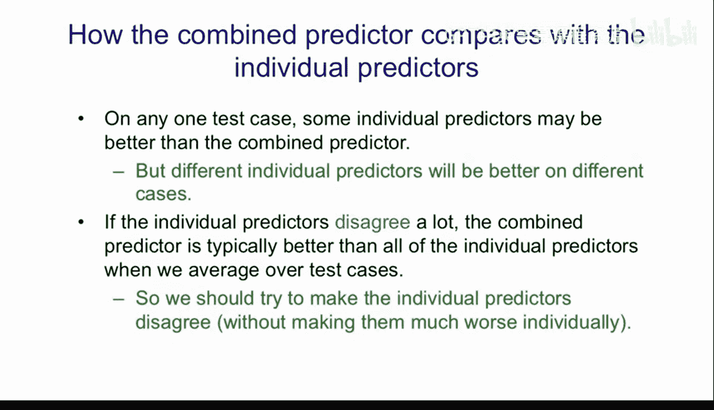
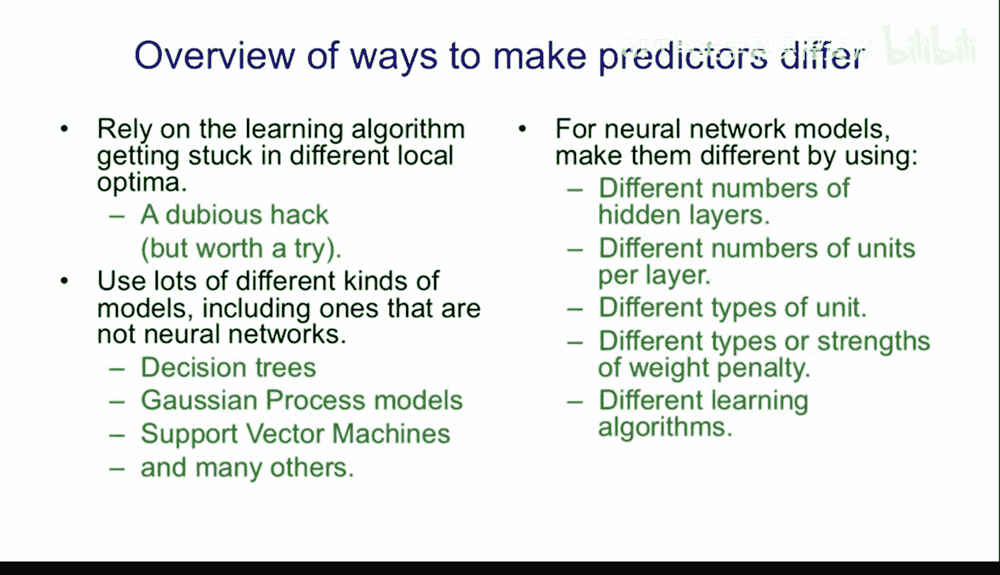
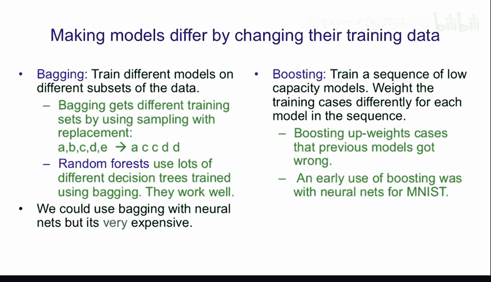

# 10.1：为何组合模型有效 🧠

在本节课中，我们将探讨在机器学习中组合多个模型进行预测的原因。我们将从模型组合的基本动机开始，分析其数学原理，并介绍几种促使模型产生多样化预测的方法。

## 概述

当使用单一模型进行预测时，我们需要为其选择一个合适的容量。如果容量选择过小，模型将无法捕捉训练数据中的真实规律。如果容量选择过大，模型则可能过度拟合特定训练集中的采样误差。通过组合多个模型，我们可以在拟合真实规律与避免过度拟合采样误差之间取得更好的平衡。

## 模型平均化的优势

上一节我们提到了模型容量选择的困境。本节中，我们来看看如何通过组合模型来解决这个问题。

当训练数据有限时，模型容易发生过拟合。如果我们对多个不同模型的预测结果进行平均，通常可以减少这种过拟合。当各个模型之间的预测差异很大时，这种方法的帮助最大。

为了分析其原理，我们可以将平方误差分解为**偏差**项和**方差**项。
*   **偏差项**：如果模型容量太小，无法充分拟合数据，偏差项就会很大。它衡量了模型对真实函数的近似程度有多差。
*   **方差项**：如果模型容量过大，以至于能够很好地拟合我们特定训练集中的采样误差，方差项就会很大。之所以称为方差，是因为如果我们从同一分布中获取另一个相同大小的训练集，模型会因不同的采样误差而产生不同的拟合结果，从而导致模型在不同训练集上的拟合方式存在差异。

当我们对模型进行平均时，实际上是在平均掉方差。这使得我们可以使用具有高容量（因此高方差）的单个模型。这些高容量模型通常具有低偏差，因此我们可以通过平均来消除方差，从而获得低偏差而不必承受高方差。

## 组合模型的数学分析

现在，让我们尝试分析单个模型与模型平均之间的比较。

在任何单个测试案例上，某些独立的预测器可能比组合预测器表现更好。但不同的独立预测器会在不同的案例上表现更优。如果独立预测器之间存在很大分歧，那么在所有测试案例上平均来看，组合预测器通常优于所有独立的预测器。因此，我们的目标应该是让独立预测器产生分歧，同时又不让它们成为糟糕的预测器。关键在于让各个预测器犯下彼此非常不同的错误，但各自仍保持相当的准确性。

以下是组合网络时的数学分析。

我们将比较两个期望平方误差。

第一个期望平方误差是：如果我们随机选择一个预测器并用它进行预测，然后对所有预测器采用此策略时可能得到的误差进行平均。用公式表示如下：

`E_i[(t - y_i)^2]`

其中，`y_bar` 是所有预测器输出的平均值，`y_i` 是单个预测器的输出。`y_bar` 就是所有单个预测器 `y_i` 的期望值，即 `y_bar = E_i[y_i]`，也可以写作 `y_bar = (1/N) * Σ y_i`。

如果我们观察随机选择预测器时的期望平方误差，我们需要将该预测器的输出与目标值 `t` 进行比较，计算平方差，然后对所有预测器进行平均。这就是等号左边的部分。

`E_i[(t - y_i)^2] = E_i[(t - y_bar + y_bar - y_i)^2]`

通过展开平方项并进行数学推导，我们可以得到：

`E_i[(t - y_i)^2] = (t - y_bar)^2 + E_i[(y_i - y_bar)^2]`

其中：
*   `(t - y_bar)^2` 是将模型平均值与目标值比较得到的平方误差。
*   `E_i[(y_i - y_bar)^2]` 是 `y_i` 的方差，即 `y_i` 与 `y_bar` 之间的期望平方差。

推导过程中，交叉项 `2 * E_i[(t - y_bar)(y_bar - y_i)]` 由于 `(y_bar - y_i)` 的期望为零，且与 `(t - y_bar)` 不相关，因此期望为零。

结果表明，随机选择一个模型得到的期望平方误差，比使用模型平均得到的平方误差要大，其差值正好等于模型输出的方差。这就是我们通过取平均所获得的收益。

## 促使模型多样化的方法

为了使模型平均化带来显著收益，我们希望各个预测器之间存在很大差异。以下是几种促使它们产生差异的方法。

### 使用不同的模型架构

你可以仅仅依赖一个效果不佳、每次都会陷入不同局部最优解的学习算法。这不是一个非常智能的方法，但值得一试。你也可以使用许多不同类型的模型，包括非神经网络的模型。例如，可以尝试决策树、高斯过程模型、支持向量机等。如果你确实想使用一堆不同的神经网络模型，可以通过以下方式使它们不同：
*   使用不同数量的隐藏层。
*   每层使用不同数量的单元。
*   使用不同类型的单元（例如，在某些网络中使用修正线性单元，在其他网络中使用逻辑单元）。
*   使用不同类型或强度的权重惩罚（例如，对某些网络使用早停法，对其他网络使用L2权重惩罚，再对其他网络使用L1权重惩罚）。
*   使用不同的学习算法（例如，如果数据集足够小，可以对某些网络使用全批量梯度下降，对其他网络使用小批量梯度下降）。

### 使用不同的训练数据

你也可以通过在不同的训练数据上训练模型来使模型产生差异。

**Bagging（自举汇聚法）**：由Leo Breiman引入的一种方法。通过对训练集进行有放回抽样来获得不同的数据子集，并在这些子集上训练不同的模型。这种方法在名为“随机森林”的方法中与决策树结合使用，效果显著。虽然可以将Bagging用于神经网络，但计算成本非常高。

**Boosting（提升法）**：另一种方法是使用整个训练集训练每个模型，但对每个模型的训练案例赋予不同的权重。在Boosting中，我们通常使用一系列容量较低的模型。我们对每个模型的训练案例进行不同的加权：增加先前模型预测错误的案例的权重，降低先前模型预测正确的案例的权重。这样，序列中的下一个模型就不会浪费时间在已经正确的案例上，而是利用其资源来处理其他模型出错的案例。Boosting的早期应用之一是用于手写数字识别的神经网络。