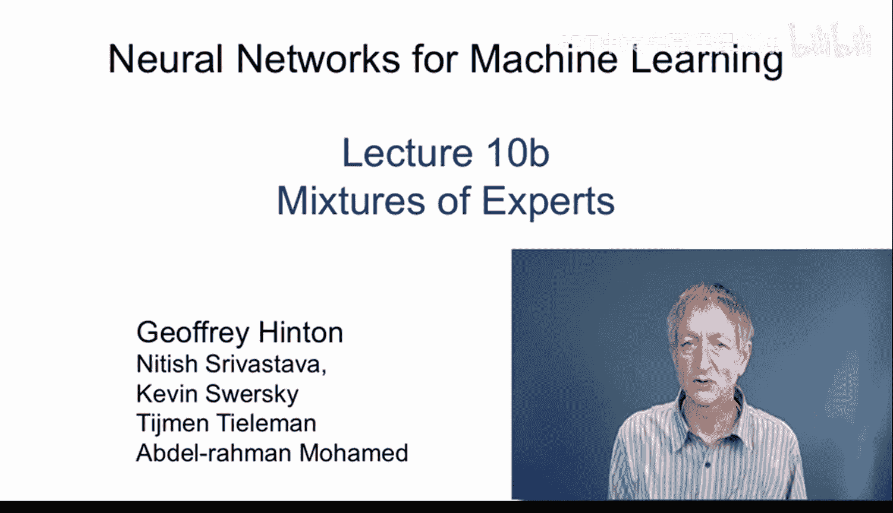
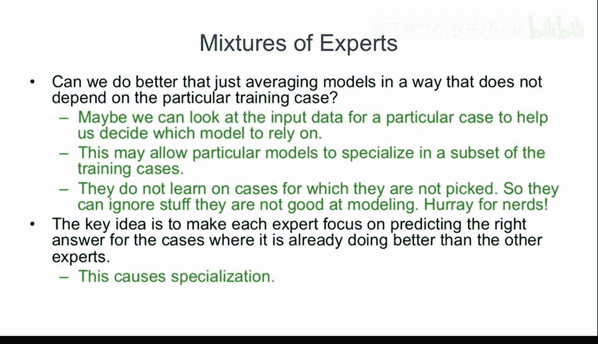
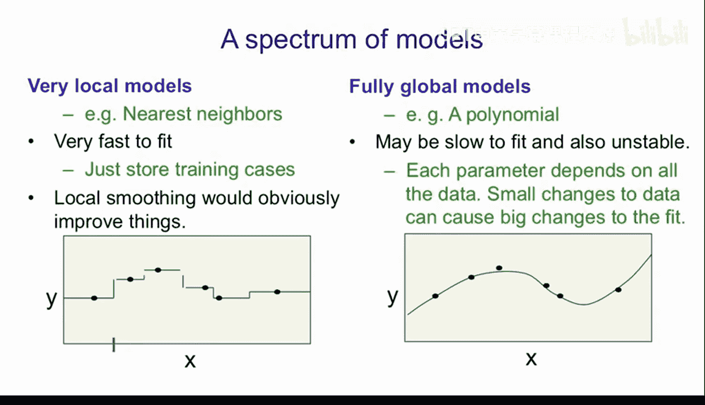
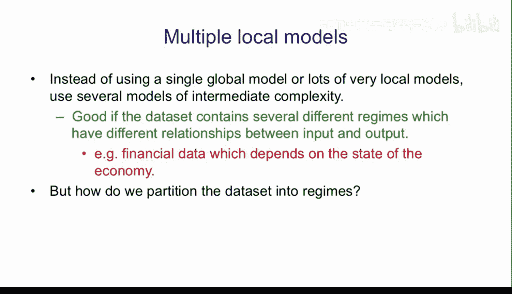
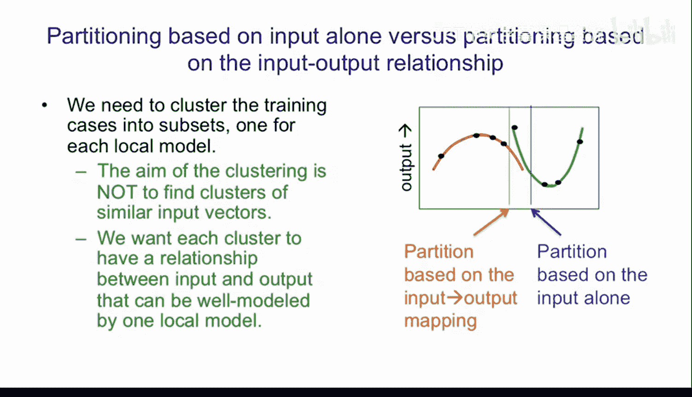
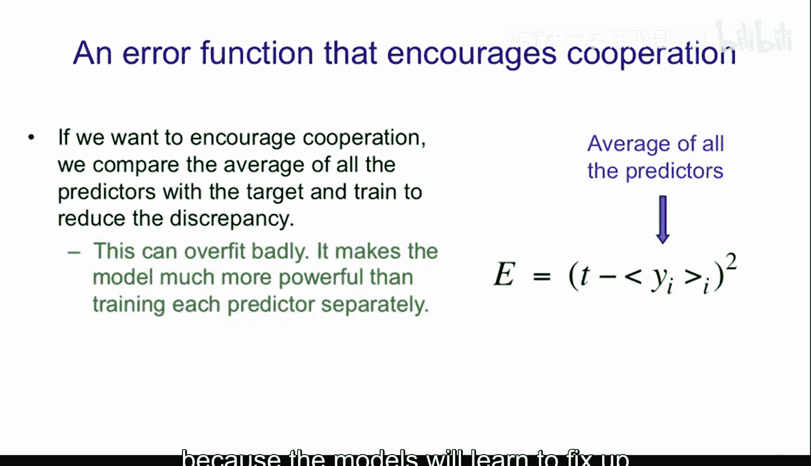
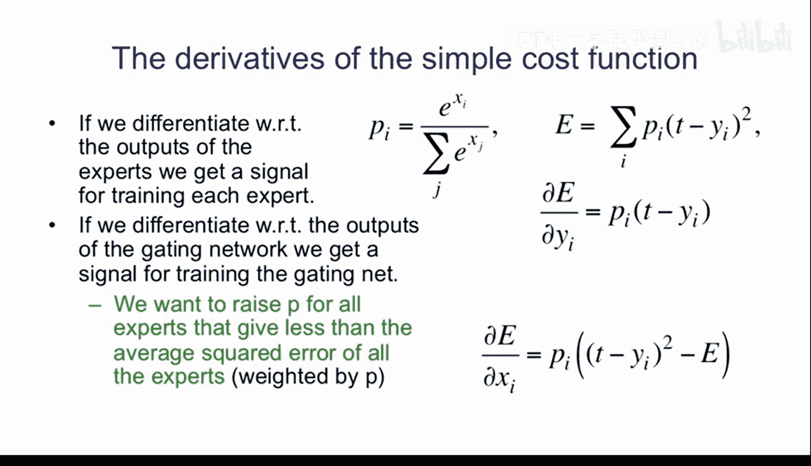
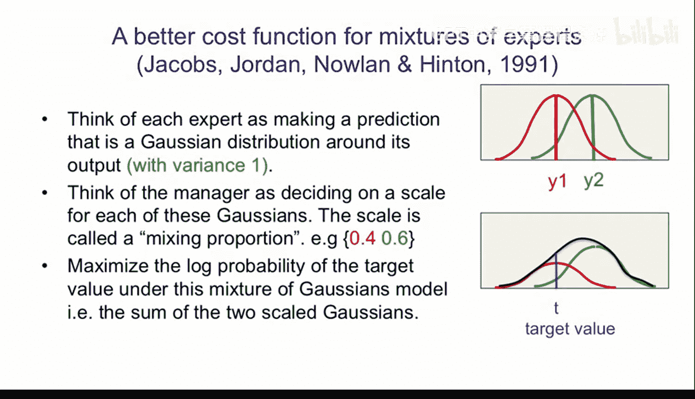
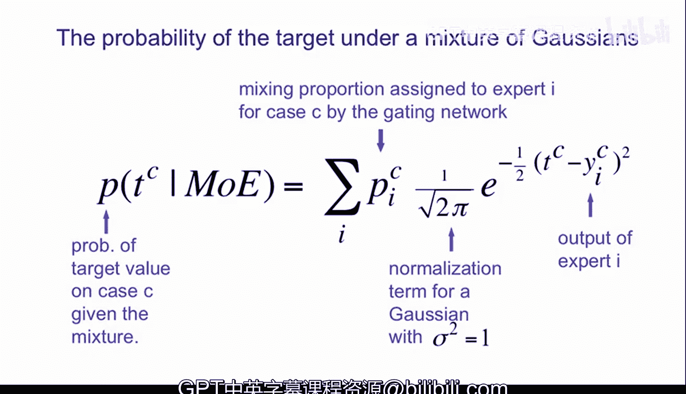

# 10.2：专家混合模型 👨‍🔬

在本节课中，我们将要学习一种名为“专家混合”的模型。这个模型的核心思想是训练多个神经网络，让每个网络专门处理数据的不同部分，并通过一个“管理者”网络来决定将输入数据分配给哪个专家。

## 模型的基本思想

上一节我们介绍了模型组合的基本概念，本节中我们来看看专家混合模型的独特之处。

该模型假设数据集来自多个不同的“机制”或“状态”。我们训练一个系统，其中每个神经网络专门处理一种机制，而一个管理者神经网络则查看输入数据，并决定将数据交给哪位专家处理。

这种系统对数据的利用效率不高，因为数据被分散给了所有不同的专家。因此，在小数据集上，它的表现可能不会很好。但随着数据集变得越来越大，这类系统可能会展现出优势，因为它能非常有效地利用极其庞大的数据集。

## 与提升法的区别

在提升法中，模型的权重并不相等，但在训练完成后，每个模型对于每个测试用例的权重是相同的。我们不会让单个模型的权重依赖于我们正在处理的特定用例。

在专家混合模型中，我们恰恰这样做。其核心思想是，我们可以在训练和测试时，查看特定用例的输入数据，以帮助我们决定可以信赖哪个模型。在训练期间，这将允许模型专注于一部分用例。它们将不会学习那些未被选中的用例，从而可以忽略它们不擅长建模的部分。这将导致每个模型在某些方面非常出色，而在其他方面则非常糟糕。

关键思想是让每个模型（我们称之为“专家”）专注于预测那些它已经比其他专家做得更好的用例的正确答案，这将促使专业化。

## 模型的频谱：从局部到全局

在模型选择上，存在一个从非常局部的模型到非常全局的模型的频谱。

以下是两种极端情况：
*   **最近邻模型**：这是一个非常局部的模型。拟合它只需要存储训练用例，这非常简单。然后，如果需要根据X预测Y，只需找到与测试X值最接近的存储X值，并预测与存储值相同的Y值。这样做的结果是，输入与输出之间的关系曲线由许多由陡峭“悬崖”连接的水平线段组成。显然，将其平滑处理会更有意义。
*   **完全全局模型**：例如，用一个多项式拟合所有数据。它们更难拟合数据，也可能不稳定。也就是说，数据的微小变化可能导致拟合的模型发生巨大变化。这是因为每个参数都依赖于所有数据。

## 中间方案：多个局部模型

在这两个极端之间，我们拥有复杂度居中的多个局部模型。如果数据集包含几个不同的机制，并且这些不同的机制具有不同的输入-输出关系，那么这种方法就很好。

例如，在金融数据中，经济状态对确定输入和输出之间的映射关系有很大影响，你可能希望为不同的经济状态使用不同的模型。但你可能事先不知道如何界定不同的经济状态，这也需要学习。

因此，如果我们打算为不同的机制使用不同的模型，就会面临一个问题：如何将数据划分到这些不同的机制中。

## 基于映射相似性的数据划分

为了将不同的模型拟合到不同的机制，我们需要将训练数据聚类成子集，每个子集对应一种机制。

但我们不希望基于输入特征的相似性来聚类数据。我们感兴趣的是输入-输出映射的相似性。

请看右侧的示例。有四个数据点可以很好地用红色抛物线拟合，另外四个数据点可以很好地用绿色抛物线拟合。如果基于输入-输出映射（即基于抛物线能很好拟合数据的想法）来划分数据，那么划分线就在棕色线处。然而，如果仅通过聚类输入来划分数据，划分线就在蓝色线处。那么，在蓝色线左侧，你将得到一个无法用简单模型很好拟合的数据子集。

## 鼓励协作与鼓励专业化的误差函数

接下来，我将解释一个鼓励模型协作的误差函数，然后再解释一个鼓励模型专业化的误差函数。我将尝试让你直观地理解为什么这两个不同的函数会产生如此不同的效果。

### 鼓励协作的误差函数

如果你想鼓励协作，你应该做的是将所有预测器的平均值与目标进行比较，并训练所有预测器共同工作，以减少目标与其平均值之间的差异。

再次使用尖括号表示期望，误差将是目标与所有预测器预测值的平均值之间的差值。这会导致严重的过拟合。它将使模型比单独训练每个预测器时强大得多，因为模型将学会纠正其他模型所犯的错误。

### 鼓励专业化的误差函数

以下是鼓励专业化的误差函数，它与协作函数差异不大。

为了鼓励专业化，我们分别将每个模型的输出与目标进行比较。我们还需要使用一个管理者来确定我们赋予每个模型的权重，这可以看作是在必须选择一个模型时，选择该模型的概率。

现在，我们的误差是所有不同模型的期望，即该模型产生的平方误差乘以选择该模型的概率。管理者或门控网络通过查看特定用例的输入来确定这个概率。

如果你试图最小化这个误差，会发生的情况是，大多数专家最终会忽略大多数目标。每个专家只处理一小部分训练用例，并学会在该小部分上做得非常好。

## 专家混合模型架构

以下是专家混合模型的架构图。

我们的成本函数是每个专家输出与目标之间的平方差，在所有专家上进行平均，但该平均值中的权重由管理者决定。实际上，我们稍后会介绍一个基于混合模型的更好的成本函数，但这是我最初想到的成本函数，我认为用这个成本函数更容易解释其直观含义。

我们有一个输入。所有不同的专家都查看该输入，并根据该输入做出预测。此外，我们还有一个管理者。管理者可能有多层，其最后一层是一个Softmax函数。因此，管理者输出的概率数量与专家数量相同。利用管理者的输出和专家的输出，我们就可以计算该误差函数的值。

## 误差函数的梯度

如果我们查看该误差函数的导数，管理者的输出由输入到管理者最后一层Softmax组的Xi决定。然后，误差由专家的输出以及管理者输出的概率决定。

如果我们对误差关于某个专家输出的导数，我们会得到一个用于训练该专家的信号。我们得到的关于专家输出的梯度，仅仅是选择该专家的概率乘以该专家输出与目标之间的差值。因此，如果管理者决定对于该特定训练用例选择该专家的概率非常低，那么该专家将获得非常小的梯度，并且该专家内部的参数不会受到该训练用例的干扰。它将能够保存其参数，用于建模管理者赋予其高概率的那些训练用例。

我们也可以对误差关于门控网络输出的导数。实际上，我们要做的是对输入到Softmax的量（称为logit，即Xi）求导。如果我们对Xi求导，我们得到的是该专家被选中的概率，乘以该专家的平方误差与所有专家的平均平方误差（使用管理者提供的权重）之间的差值。

这意味着，如果专家I产生的平方误差低于其他专家的平均值，那么我们将尝试提高专家I的概率。但如果专家I产生的平方误差高于其他专家，我们将尝试降低其概率。这正是导致专业化的原因。

## 基于混合模型的更好成本函数

现在，实际上有一个更好的成本函数，只是更复杂一些。它依赖于混合模型，我在本课程中没有解释过。同样，这些内容在Andrew Ng的课程中会有很好的解释。

然而，我之前确实解释过，在进行回归时，最大似然估计可以解释为网络实际上在进行高斯预测。也就是说，网络输出一个特定值，比如y1，我们可以将其视为对目标值可能是什么进行下注，这些下注是围绕y1、具有单位方差的高斯分布。

因此，红色专家做出围绕y1的高斯分布预测，绿色专家做出围绕y2的高斯分布预测。然后，管理者决定两个专家的概率，这些概率用于按比例缩小高斯分布。这些概率之和必须为1，被称为混合比例。因此，在按比例缩小高斯分布后，我们得到的分布不再是高斯分布，而是按比例缩小后的红色高斯分布和绿色高斯分布之和。这就是我们专家混合模型的预测分布。

我们现在要做的是，最大化目标值在该黑色曲线下的对数概率。请记住，黑色曲线只是红色曲线和绿色曲线的总和。

## 最终的概率模型与成本函数

这导致了以下关于目标值在专家混合模型下的概率模型。

左边的概率是所有专家的总和，即管理者或门控网络分配给该专家的混合比例，乘以e的负（目标与该专家输出之间的平方差）次方，再除以具有单位方差的高斯分布的归一化项。

因此，我们的成本函数将简单地是左边概率的负对数。我们将尝试最小化该概率的负对数。

## 总结

本节课中，我们一起学习了专家混合模型。我们了解了其基本思想，即通过多个专家网络和一个管理者网络来处理数据的不同机制。我们探讨了它与提升法的区别，以及它在模型频谱中的位置。我们深入分析了如何基于输入-输出映射的相似性来划分数据，并比较了鼓励协作与鼓励专业化的两种误差函数。最后，我们介绍了模型的架构、梯度计算以及基于混合模型的更优成本函数。专家混合模型为处理包含多种机制的大型数据集提供了一种有效的框架。