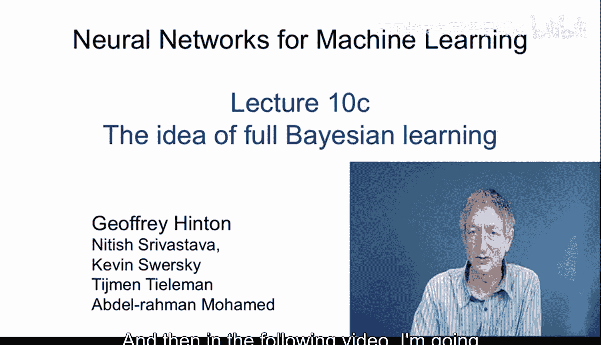
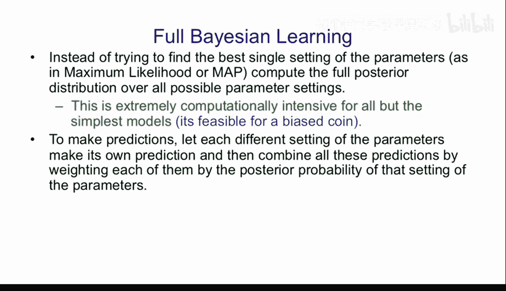
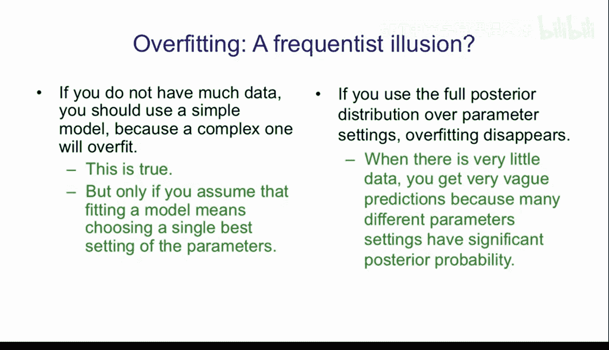
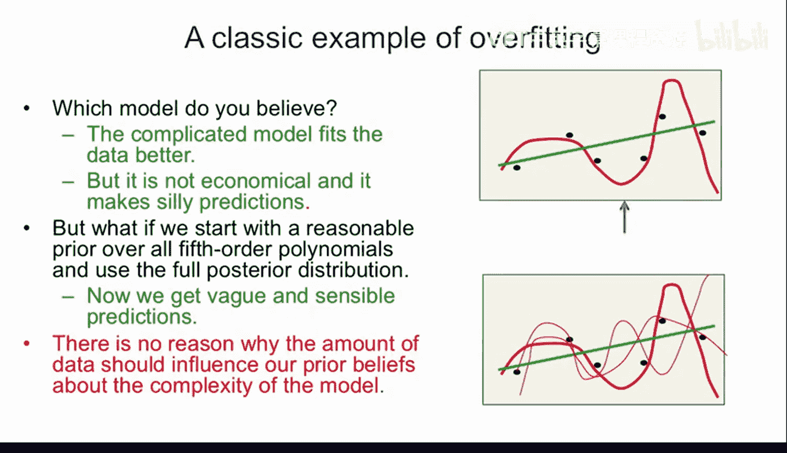
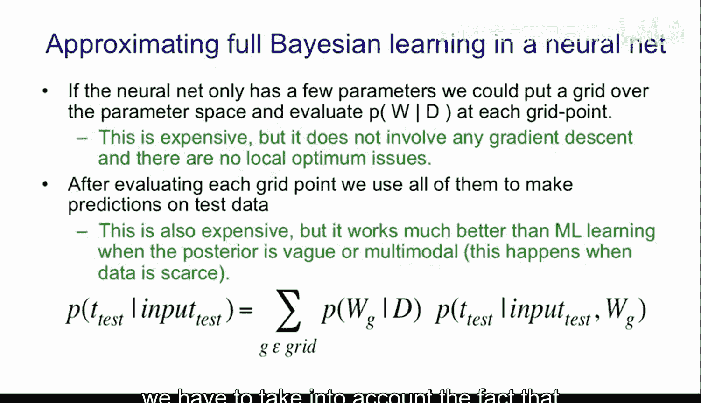
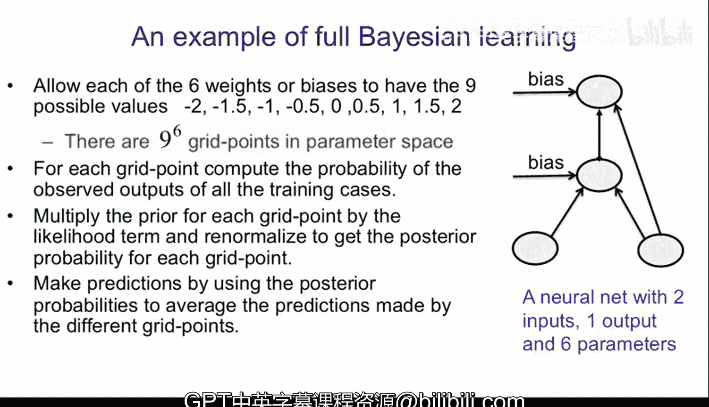

# 10.3：全贝叶斯学习的概念 🧠

在本节课中，我们将要学习**全贝叶斯学习**的核心思想。我们将探讨它如何工作，以及它如何通过考虑所有可能的参数设置来避免过拟合问题，而不是仅仅寻找单一的“最佳”参数。

---

## 概述

全贝叶斯学习不试图寻找参数的最佳单一设置。相反，它试图找到所有可能参数设置上的完整后验分布。这意味着，对于每一个可能的参数设置，我们都希望得到一个后验概率密度，并且所有这些密度加起来总和为1。

## 全贝叶斯学习的工作原理

上一节我们介绍了贝叶斯学习的基本概念，本节中我们来看看全贝叶斯方法的具体运作方式。

计算这种后验分布对于除了最简单模型以外的所有模型来说，计算量都极大。在之前的例子中，我们为一个有偏硬币（只有一个参数）做到了这一点。但对于一个神经网络来说，这通常是不可能的。

在计算了所有可能参数设置的后验分布之后，我们就可以进行预测。方法是让每一个不同的参数设置做出自己的预测，然后根据它们的后验概率对所有这些预测进行加权平均。

这个过程同样计算量巨大。但这样做的好处是，如果我们使用全贝叶斯方法，即使我们没有太多数据，也可以使用复杂的模型。

## 全贝叶斯与过拟合

这里有一个非常有趣的哲学观点。我们现在已经习惯了当你用少量数据拟合复杂模型时会出现过拟合的想法。

但这基本上只是没有费力去获取参数完整后验分布的结果。一个频率主义者会说，如果你没有太多数据，你应该使用一个简单的模型。这没错，但前提是你假设“拟合模型”意味着找到参数的单一最佳设置。

如果你找到了完整的后验分布，就能消除过拟合。如果数据非常少，完整的后验分布通常会给出非常模糊的预测，因为许多做出非常不同预测的参数设置都会具有显著的后验概率。

随着你获得更多数据，后验概率会越来越集中在少数几个参数设置上，后验预测也会变得更加清晰。

以下是过拟合的一个经典例子：

*   **数据**：我们有六个数据点。
*   **模型一**：我们拟合了一个五阶多项式。它有六个系数，几乎完全拟合了数据。
*   **模型二**：我们拟合了一条直线。它只有两个自由度，对数据的拟合没有那么好。

复杂的模型显然拟合得更好，但你不会相信它。它不经济，而且会做出愚蠢的预测。例如，在蓝色箭头所指的输入值处，红色曲线（五阶多项式）预测的输出值比任何观测到的数据点都低，这看起来很荒谬。而绿色直线则会预测一个合理的值。

但是，如果我们不是拟合一个五阶多项式，而是从一个合理的先验（例如，多项式的系数不应该太大）开始，然后计算所有五阶多项式的完整后验分布，一切就都改变了。

在图中，我展示了从这个分布中抽取的一些样本，其中较粗的线表示后验概率较高。你会看到一些细线会与某些数据点相差甚远，但它们仍然很接近大多数数据点。现在，我们得到了更模糊但更合理的预测。在蓝色箭头处，你会看到不同的模型预测出非常不同的结果，但平均而言，它们的预测非常接近绿色直线的预测。

从贝叶斯的角度来看，你收集的数据量不应该影响你对模型复杂性的先验信念。一个真正的贝叶斯主义者会说，你对事物可能有多复杂有先验信念。仅仅因为你还没有收集任何数据，并不意味着你认为事物要简单得多。

## 在神经网络中近似全贝叶斯学习

如果神经网络的参数非常少，我们可以在其中近似全贝叶斯学习。

其思想是在参数空间上放置一个网格。每个参数只允许有几个可选值。然后我们取所有参数的所有这些值的**笛卡尔积**。现在我们得到了参数空间中的许多网格点。

在每个网格点上，我们可以评估我们的模型对数据的预测效果。也就是说，如果我们正在进行监督学习，我们可以看模型对目标输出的预测有多好。

我们可以说，该网格点的后验概率是：
*   **数据似然**：它预测数据的程度。
*   **先验概率**：它在先验下的可能性。
*   **归一化**：将整个结果归一化，使得所有后验概率之和为1。

这仍然非常昂贵，但请注意它有一些吸引人的特点：不涉及梯度下降，也没有局部最优问题。我们不是在这个空间中沿着一条路径走，我们只是评估空间中的一组点。

一旦我们决定了分配给每个网格点的后验概率，我们就用它们全部来对测试数据进行预测。这也很昂贵，但当数据不多时，它的效果会比最大似然或最大后验估计好得多。

以下是预测测试输出的方式：

给定测试输入，测试输出的概率是**所有网格点**上的和：
`P(test_output | test_input) = Σ_grid_points [ P(grid_point | data, prior) * P(test_output | test_input, grid_point) ]`

换句话说，我们必须考虑到我们可能在网络的输出上添加了噪声，然后才产生测试答案。

## 图解全贝叶斯学习

这里有一张全贝叶斯学习的示意图。我们有一个小型网络，它有四个权重和两个偏置。

如果我们允许每个权重和偏置有9个可能的值，那么在参数空间中就会有 `9^6` 个网格点。这是一个很大的数字，但我们可以处理它。

对于每一个网格点，我们计算模型在所有训练案例上观测到输出的概率。我们会乘以该网格点的先验概率（例如，这可能取决于权重的值）。然后我们进行重新归一化，得到所有网格点上的后验概率。

最后，我们使用这些网格点进行预测，但根据每个网格点的后验概率对其预测进行加权。

---

## 总结

本节课中我们一起学习了全贝叶斯学习的核心概念。我们了解到，这种方法通过计算并利用所有可能参数设置的后验分布来进行预测，从而在理论上避免了过拟合问题，尤其是在数据量较少时。虽然其计算成本极高，但对于参数极少的模型，可以通过在参数空间设置网格点来进行近似。这种方法不依赖于梯度下降，也没有局部最优的困扰，为处理小数据集的复杂模型提供了一种哲学上严谨且实用的思路。