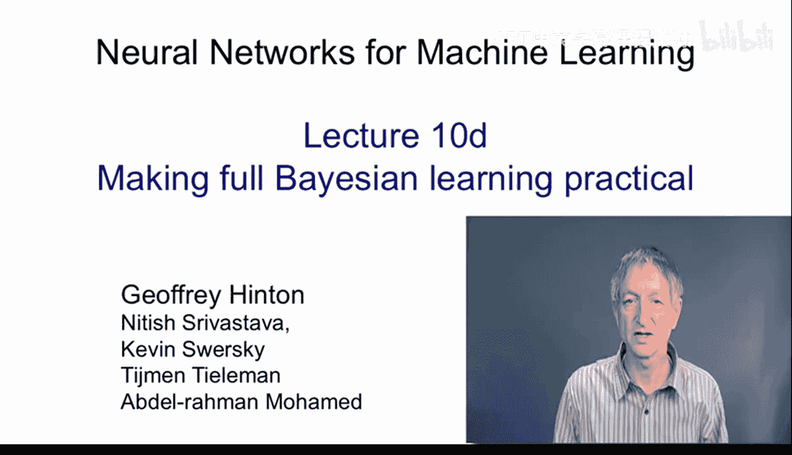
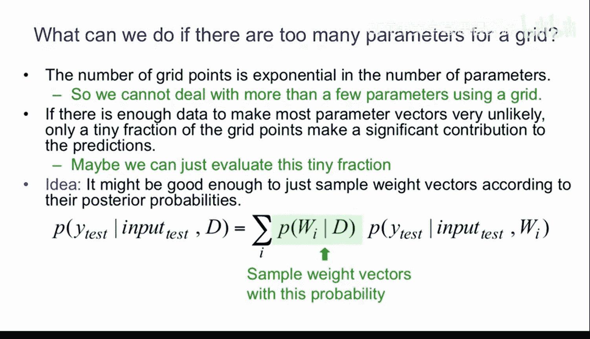
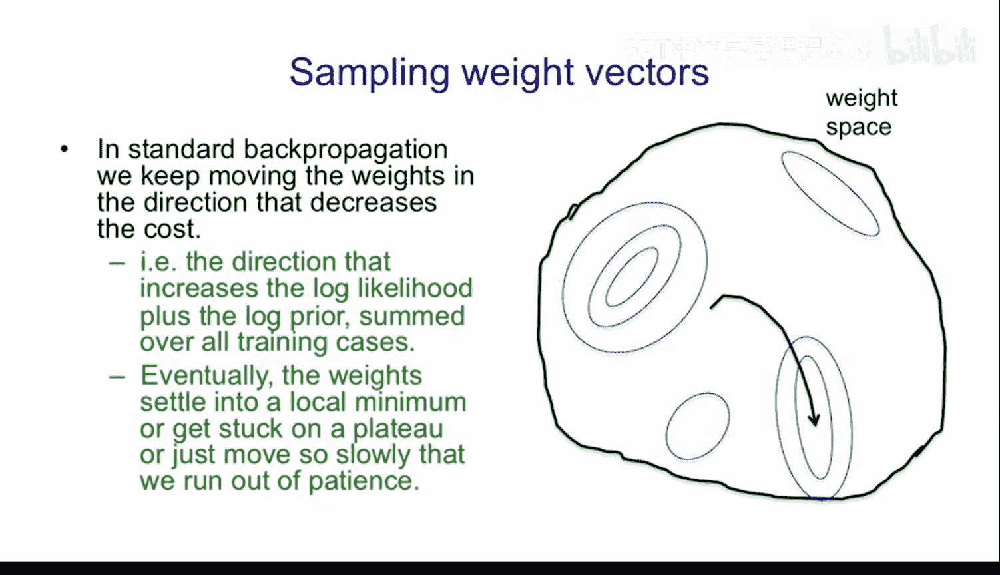
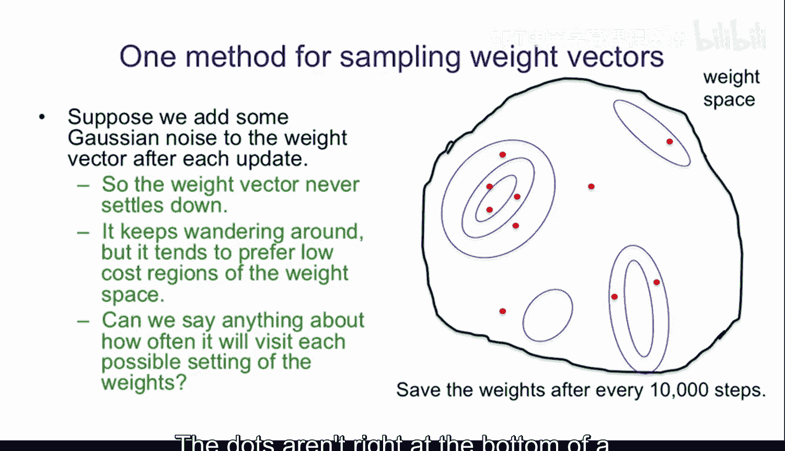
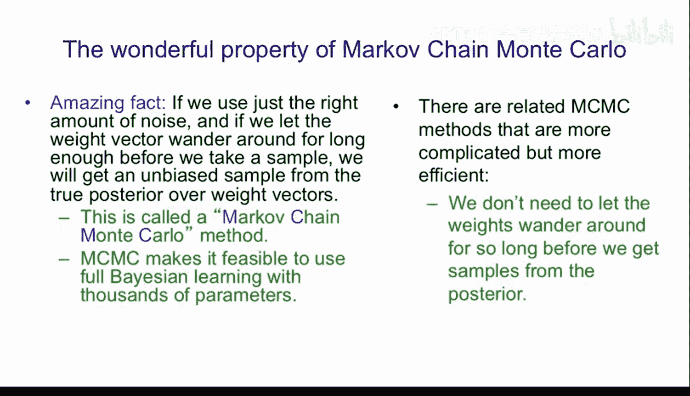
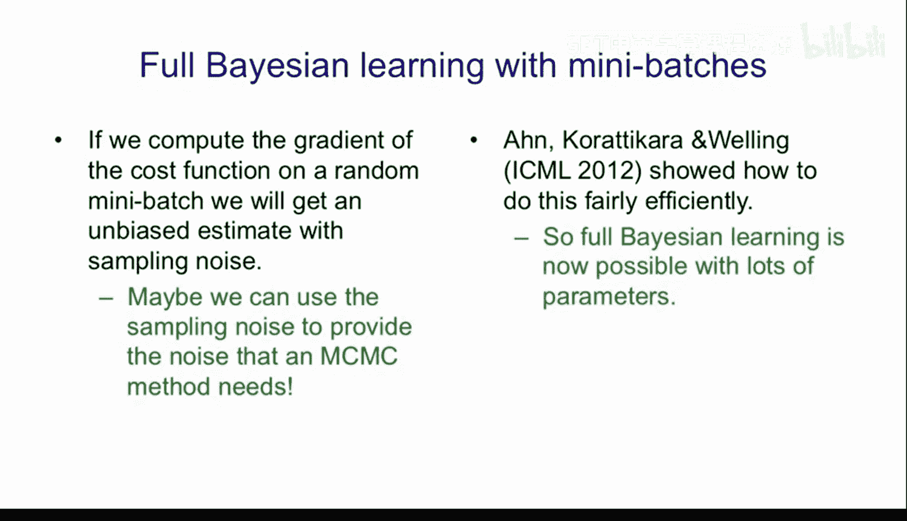

# 10.4：实现实用的完全贝叶斯学习 🧠

在本节课中，我们将要学习如何将完全贝叶斯学习应用于拥有数千甚至数百万权重的神经网络，使其变得实用。我们将探讨一种基于蒙特卡洛方法的采样技术，它允许我们通过随机游走权重空间来近似后验分布，从而避免了对整个高维空间进行穷举计算的难题。

## 贝叶斯学习的计算挑战

上一节我们介绍了贝叶斯学习的理论基础，本节中我们来看看其在实际应用中的核心障碍。

对于拥有大量参数的神经网络，其权重空间是极高维的。如果我们想通过网格点来穷举计算后验分布，其计算量将是参数数量的指数级增长。这意味着，对于超过几个参数的模型，构建这样的网格在计算上是不可行的。

然而，如果数据足够多，使得大多数参数向量的后验概率极低，那么只有权重空间中极小一部分区域会对最终的预测做出显著贡献。因此，一个关键思路是：如果我们能找到这个高概率区域，或许只需专注于评估这一小部分即可。

## 蒙特卡洛采样：核心思路

一个让贝叶斯学习变得可行的想法是：**根据后验概率对权重向量进行采样可能就足够了**。

让我们回顾一下预测公式。我们为测试输出分配的概率，是在给定测试输入和训练数据的情况下，对所有权重空间点的后验概率与该权重下预测分布的乘积求和。

**公式表示：**
`P(test_output | test_input, training_data) = Σ [ P(W_i | training_data) * P(test_output | W_i, test_input) ]`

现在，我们不必计算这个求和中的所有项，而是可以**从这个求和中采样项**。具体做法是：我们按照权重向量的后验概率对其进行采样。每个权重向量要么被采样（权重为1），要么不被采样（权重为0），而被采样的概率正是其后验概率。这样，我们就能得到等式右侧的正确期望值，尽管由于采样会引入噪声。

## 对比：标准反向传播与采样方法

为了理解采样方法，我们先回顾标准反向传播的做法。

在标准反向传播中，我们从某个较小的初始权重开始，然后沿着梯度方向，在成本函数（通常是负对数似然加负对数先验）上向下移动。最终，我们会收敛到某个局部最小值，或陷入平台期，或因为进展缓慢而停止。关键点是：**这个过程遵循一条从起点到某个单一终点的路径**。

而当我们使用采样方法时，可以从相同起点开始。但每次更新权重时，我们**添加一点高斯噪声**。这样，权重向量永远不会完全稳定下来，而是会在空间中持续游走。它倾向于向低成本区域移动，但也会因为噪声而探索其他区域。游走过程中，我们会定期（例如每10000步）保存权重向量作为样本（可视作红点）。

这些红点样本的分布具有重要特性：虽然少数可能位于高成本区域（因为这些区域可能很广），但**最深的极小值附近会有最多的红点**，其他极小值附近也会有。红点不会精确位于极小值底部，因为它们是带有噪声的样本。

## 马尔可夫链蒙特卡洛与朗之万动力学

如果我们以恰当的方式添加高斯噪声，就会得到马尔可夫链蒙特卡洛方法的一个美妙性质。

这是一个惊人的事实：只要我们游走足够长的时间，**所获得的权重向量将是真实后验分布的无偏样本**。这意味着，之前幻灯片上的红点就是从后验分布中采样得到的——后验概率高的权重向量更有可能被红点代表。

这种添加高斯噪声的方法被称为**朗之万动力学**。虽然它并非最高效的MCMC方法（存在更复杂、更高效的方法，能减少开始采集有效样本所需的游走时间），但它阐明了核心原理。

## 使用小批量的完全贝叶斯学习

一个重要的进展是，完全贝叶斯学习实际上可以与小批量训练相结合。

当我们在随机小批量上计算成本函数的梯度时，会得到一个带有采样噪声的无偏估计。一个非常巧妙的想法是：**利用这种梯度估计固有的采样噪声，来提供马尔可夫链蒙特卡洛方法所需的噪声**。

最近，Welling及其合作者成功实现了这一点，使得他们能够相当高效地使用小批量方法从权重的后验分布中获取样本。这应该使得将完全贝叶斯学习应用于更大的网络成为可能，因为对于大型网络，必须使用小批量训练才有希望完成训练。

以下是实现这一结合的关键点概述：
*   **梯度估计**：小批量提供的梯度是真实梯度的无偏但带噪声的估计。
*   **噪声利用**：该噪声被用作MCMC采样过程中的探索机制。
*   **效率提升**：这使得在大规模网络上进行贝叶斯学习变得可行。

## 总结

本节课中我们一起学习了如何使完全贝叶斯学习在大规模神经网络中变得实用。核心方法是利用**马尔可夫链蒙特卡洛采样**，通过在有噪声的梯度方向上移动，在权重空间中进行随机游走，从而获得后验分布的近似样本。我们对比了传统的确定性优化与随机采样路径，并了解了朗之万动力学的基本思想。最后，我们看到了如何将这一过程与小批量训练自然结合，利用梯度计算中固有的噪声进行采样，这为将完全贝叶斯学习扩展到现代大型深度学习模型铺平了道路。