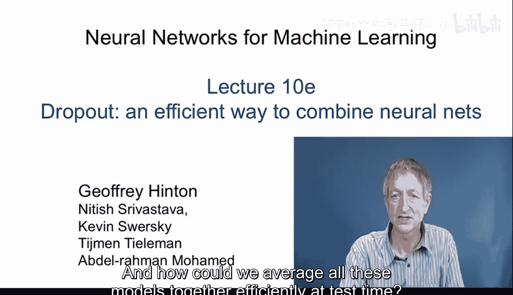
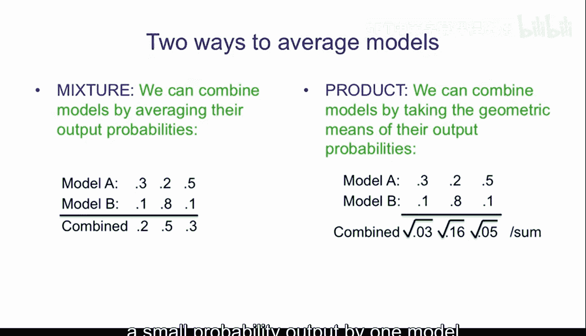
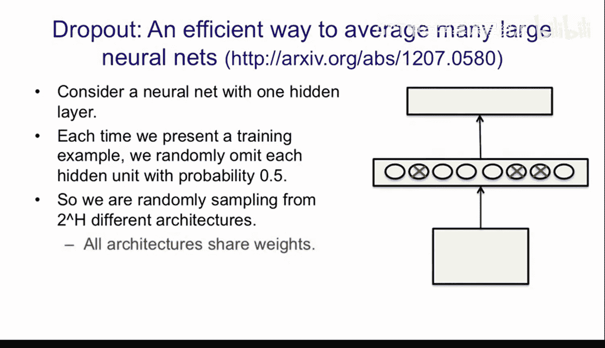
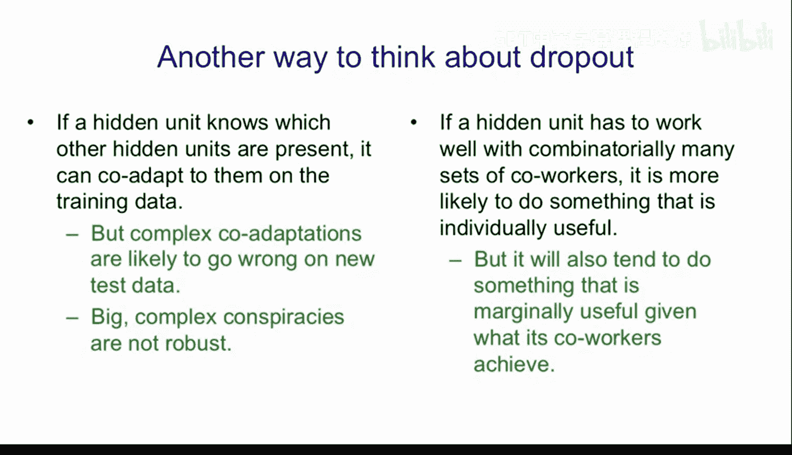

# 10.5：Dropout 技术详解 🧠

在本节课中，我们将学习一种名为 **Dropout** 的神经网络正则化技术。它通过一种巧妙的方式，组合大量不同的网络模型，而无需分别训练每一个模型，从而有效防止过拟合，提升模型的泛化能力。

---

上一节我们介绍了模型组合的基本概念，本节中我们来看看 Dropout 的具体实现机制。

Dropout 的核心思想是：在每次训练迭代中，随机“丢弃”网络中的一部分隐藏单元。这意味着，对于每一个训练样本，我们实际上都在一个随机生成的、略有不同的网络架构上进行前向和反向传播。

我们可以将此理解为，为每一个训练样本都使用了一个不同的模型。随之而来的问题是：我们如何仅用一个训练样本来训练一个模型？以及，在测试时，我们如何高效地平均所有这些模型的预测结果？

答案在于**权重共享**。所有可能的子网络都共享同一套权重参数。

---

在深入 Dropout 之前，我们先回顾两种组合多个模型输出的方式。

**1. 混合平均**
混合平均通过算术平均来组合模型的输出概率。

**2. 乘积平均**
乘积平均则通过几何平均来组合模型的输出概率。其特点是，任何一个模型给出的极小概率，都拥有对其他模型的“一票否决权”。

---

Dropout 提供了一种高效平均大量神经网络模型的方法，它是贝叶斯模型平均的一种实用近似。

考虑一个具有一个隐藏层的神经网络。每次输入一个训练样本时，我们以固定的概率（例如 0.5）随机“丢弃”每个隐藏单元。这意味着，我们从 `2^H` 个可能的网络架构中随机采样一个（`H` 是隐藏单元数）。这是一个极其庞大的模型集合。

所有这些架构都**共享权重**。因此，Dropout 可以被视为一种模型平均。每个被采样的模型只看到一个训练样本，这是一种极端的“装袋法”。模型间的权重共享，意味着每个模型都受到其他模型的强烈正则化约束，这比 L1/L2 等倾向于将权重拉向零的正则化方法更为有效。

---

接下来，我们探讨在测试阶段如何处理。

理论上，我们可以采样许多架构（例如 100 个），然后取它们输出分布的几何平均。但这计算量巨大。有一个更简单的方法：**我们使用所有的隐藏单元，但将其输出权重减半**。

这样做的结果是，使用所有单元并减半权重，恰好计算了所有 `2^H` 个模型预测的几何平均（前提是使用 softmax 输出层）。这个网络被称为 **“平均网络”**。

对于多层网络，我们可以在每一层都使用 Dropout。测试时，将所有隐藏单元的输出权重减半。这虽然不是精确的平均，但是一个良好且快速的近似。

---

我们也可以将 Dropout 应用于输入层，但通常保留输入单元的概率会设置得更高（例如 0.8）。这一技巧在“去噪自编码器”中已被成功应用。

---

那么，Dropout 效果如何？

实践证明，Dropout 能显著减少过拟合。例如，Alex Krizhevsky 破纪录的图像识别网络，在使用 Dropout 后性能得到了大幅提升。通常，如果一个深度网络出现过拟合，使用 Dropout 可以明显改善。即使网络没有过拟合，使用更大的网络并配合 Dropout 也往往能获得更好的性能。

---

最后，我们从另一个角度理解 Dropout 的动机。

如果没有 Dropout，网络中的隐藏单元知道其他所有单元的存在，它们会在训练数据上形成复杂的“协同适应”。这就像一个大而复杂的“阴谋”，在训练集上可能运作良好，但一旦遇到新的测试数据，就很容易因为某个环节的意外而失效。

Dropout 迫使每个隐藏单元必须与**组合意义上**的许多其他隐藏单元集合协作。这使得它更倾向于学习一些**独立有用**的特征，而不是仅在与某些特定伙伴协作时才有用。它需要学习在给定其“同事”们通常能完成什么的基础上，做出“边际上有用”的贡献。我认为，这正是 Dropout 网络表现出色的根本原因。

---

**本节课总结**

本节课中，我们一起学习了 Dropout 技术。我们了解了它通过随机丢弃隐藏单元来模拟大量子网络训练的思想，掌握了在测试时通过“权重减半”来高效近似模型平均的实用方法，并探讨了其防止复杂协同适应、提升模型鲁棒性的内在原理。Dropout 是一种强大且广泛应用的正则化工具，能有效提升深度神经网络的泛化能力。