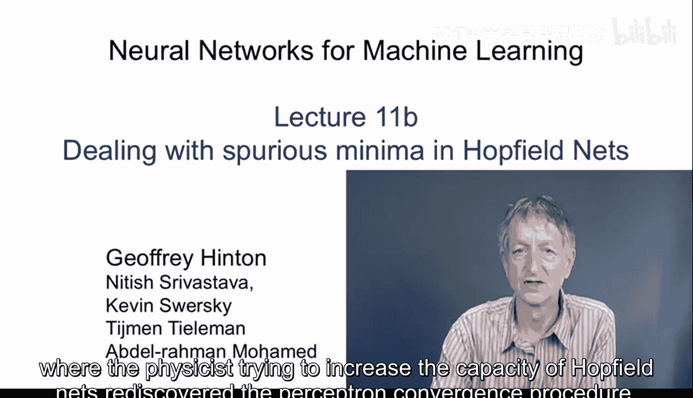
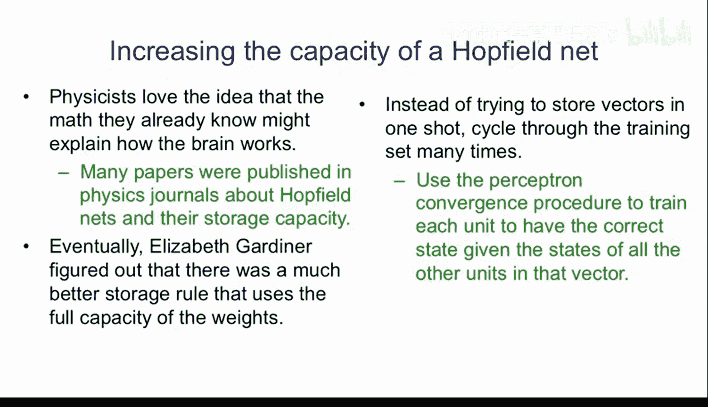

# 11.2：处理伪极小值问题 🧠

在本节课中，我们将探讨霍普菲尔德网络的存储容量限制，特别是由“伪记忆”或“伪极小值”引起的问题。我们将了解这些伪极小值如何形成，以及它们如何限制网络的记忆存储能力。随后，我们将介绍“反学习”这一有趣的概念，并探讨物理学家为提高网络容量而发现的一种更高效的存储规则。

## 霍普菲尔德网络的存储容量限制 😔

上一节我们介绍了霍普菲尔德网络的基本原理。本节中，我们来看看其作为记忆存储设备时面临的核心限制：存储容量。

霍普菲尔德网络的存储容量受限于所谓的“伪记忆”。当两个相邻的能量极小值合并，在错误的位置产生一个新的极小值时，就会发生这种情况。

使用霍普菲尔德存储规则，对于一个全连接网络，其容量大约为 **0.15N** 个记忆。这意味着，如果你有 N 个二元阈值单元，在记忆开始相互混淆之前，你大约可以存储 0.15N 个记忆。每个记忆是 N 个单元的一个随机配置，因此包含 N 比特信息。因此，霍普菲尔德网络中存储的总信息量约为 **0.15N²** 比特。

然而，这种分布式记忆并未高效利用计算机中存储权重所需的比特数。网络使用远超过 0.15N² 比特来存储权重。因此，这种基于局部能量极小值的分布式记忆方式，在比特利用效率上并不高。

我们可以分析，如果高效利用计算机中的比特，理论上应该能存储多少信息。网络中有 N² 个权重。在存储了 M 个记忆后，每个连接权重的整数值范围在 **-M 到 M** 之间（假设我们使用 -1 和 1 的状态）。以简单方式存储一个连接权重所需的比特数约为 **log₂(2M+1)**。因此，计算机内存使用的总比特数约为 **N² * log₂(2M+1)**。请注意，这个容量随 M 呈对数增长，而霍普菲尔德方法得到的容量是一个常数（0.15）。这种对数缩放关系表明，我们理应能做得更好。

## 容量限制的根源：极小值的合并

那么，是什么限制了霍普菲尔德网络的容量，导致其失效呢？答案是能量极小值的合并。

每次我们记忆一个二元配置时，都希望创建一个新的能量极小值。我们可以将网络的所有可能状态空间水平展示，能量垂直展示。我们可能为蓝色模式有一个能量极小值，为绿色模式有另一个。

但是，如果这两个模式彼此接近，我们将不会得到两个独立的极小值。它们会合并，在中间位置产生一个单一的极小值。这意味着我们无法区分这两个独立的记忆，并且我们回忆起的将是它们的混合体，而非独立的记忆。正是这种附近极小值的合并，限制了霍普菲尔德网络的容量。

需要指出的是，这种图示是一种很大的误导。霍普菲尔德网络的状态实际上是超立方体的角点，将其描绘成连续的一维水平空间并不准确。

## 一个有趣的解决方案：反学习 💡

在思考如何提高霍普菲尔德网络容量的过程中，产生了一个非常有趣的想法：“反学习”。

这个想法最早由霍普菲尔德、范斯坦和帕尔默提出。他们建议采用以下策略：让网络从一个随机初始状态稳定下来，然后进行“反学习”。也就是说，无论它稳定到哪个二元状态，都对其应用与存储规则相反的操作。

在之前的例子中，那个红色的合并极小值，如果你让网络稳定在那里，并对该合并极小值进行一些反学习，你会重新得到两个独立的极小值，因为你将那个红点“拉高”了。因此，通过消除深的、伪极小值，我们实际上可以增加记忆容量。霍普菲尔德、范斯坦和帕尔默证明了这确实是有效的。

## 反学习与快速眼动睡眠 🛌

DNA 结构的发现者之一弗朗西斯·克里克和格雷姆·米奇森提出，反学习可能是快速眼动睡眠期间发生的过程。

这个观点是：白天，你存储了许多东西，会产生伪极小值。夜晚，你将网络置于随机状态，使其稳定到一个极小值，然后对你稳定到的状态进行反学习。这实际上解释了一个重大的谜题。

这个谜题似乎没有困扰大多数研究睡眠的人，但它本应如此。每晚，你入睡并会做好几个小时的梦。当你早晨醒来时，那些梦都消失了。当然，并非完全消失。你在醒来前做的梦可以进入短期记忆，你会记得一阵子。如果你仔细回想，可能会记住很长时间。但我们很清楚，如果我们在夜晚的其他时间被叫醒，你当时也一直在做梦。而到了早晨，这些梦就不见了。

所以看起来，你根本没有存储你梦到的内容。问题是，为什么？事实上，你为什么还要做梦呢？做梦是矛盾的，因为你的大脑状态看起来与你清醒时的大脑状态极其相似，只是它并非由真实输入驱动，而是由位于真实输入之后的一个中继站——丘脑——所驱动。

因此，克里克-米奇森理论至少从功能上解释了做梦的意义：即为了消除伪极小值。

## 反学习的数学问题与解决方案 ➗

但反学习还存在另一个问题，一个更数学化的问题：我们应该进行多少反学习？

根据你目前在本课程中学到的知识，这个问题的真正解决方案是证明：反学习是使模型拟合数据过程的一部分。如果你对该模型进行最大似然拟合，那么反学习将自动从模型拟合中产生。更重要的是，你会确切知道需要进行多少反学习。

因此，我们要尝试的是，将反学习推导为最小化成本函数的正确方法，其中成本函数衡量的是你的神经网络对白天所见数据的建模效果。

## 提高容量的物理学家方法：感知器收敛程序 🔄

在深入探讨上述方案之前，我想谈谈物理学家发现的提高霍普菲尔德网络容量的方法。正如我所说，这是该领域的一大执念。

最终，一位名叫伊丽莎白·加德纳的聪明学生发现，如果关心容量，实际上有一种更好的存储规则，它能充分利用权重的容量。我想这个存储规则你会很熟悉。

我们不再试图一次性存储向量，而是将要多次循环遍历训练集。这样我们失去了只需遍历数据一次的良好的在线特性，但作为回报，我们可以获得更高效的存储。

我们将要做的是：使用感知器收敛程序来训练每个单元，使其在给定我们想要存储的全局向量中所有其他单元状态的情况下，具有正确的状态。

具体步骤如下：
1.  将你的网络置于你想要存储的记忆状态。
2.  然后单独处理每个单元，并判断：在给定所有其他单元状态的情况下，这个单元是否会采用我希望它处于的状态？
3.  如果会，则保持其输入权重不变。
4.  如果不会，则按照感知器收敛程序指定的方式更改其输入权重（注意，这些是对权重的整数更改）。
5.  你可能需要多次执行此操作。当然，如果你给它太多记忆，这个过程可能不会收敛。只有当存在一组权重可以解决问题时，感知器收敛程序才能保证收敛。

假设存在这样的权重，这是在霍普菲尔德网络中存储记忆的一种高效得多的方法。

## 伪似然与跨领域应用

这项技术也在另一个领域——统计学中得到了发展，统计学家称该技术为“伪似然”。其思想是：在给定所有其他事物的情况下，让一件事变得正确。因此，对于高维数据，如果你想为其建立模型，思路是构建一个模型，该模型试图在给定所有其他维度值的情况下，正确预测一个维度上的值。

感知器收敛程序通常用法与伪似然之间的主要区别在于，在霍普菲尔德网络中，权重是对称的。因此，我们必须为每个权重获取两组梯度并取平均。但除此之外，充分利用霍普菲尔德网络容量的方法就是使用感知器收敛程序并多次遍历数据。

---

**本节课总结**

在本节课中，我们一起学习了霍普菲尔德网络存储容量的核心限制——伪极小值的形成与合并。我们探讨了“反学习”这一概念，它不仅能提高网络容量，还被理论用于解释快速眼动睡眠的功能。最后，我们介绍了一种更高效的存储规则，即通过多次迭代和使用感知器收敛程序（或伪似然方法）来充分利用网络权重容量，这标志着从简单一次性存储到迭代优化的重要转变。