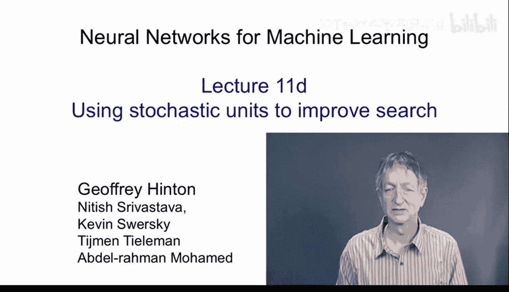
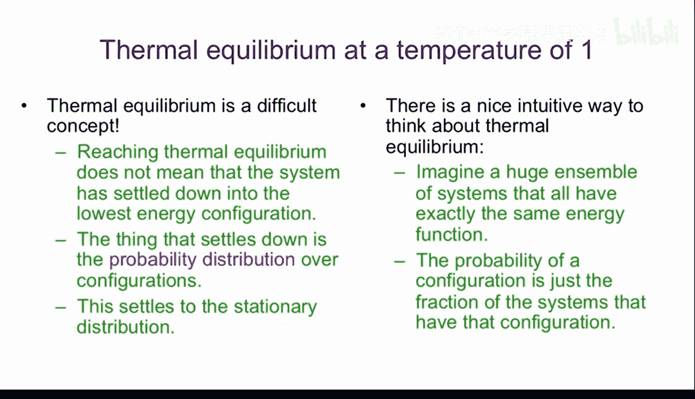
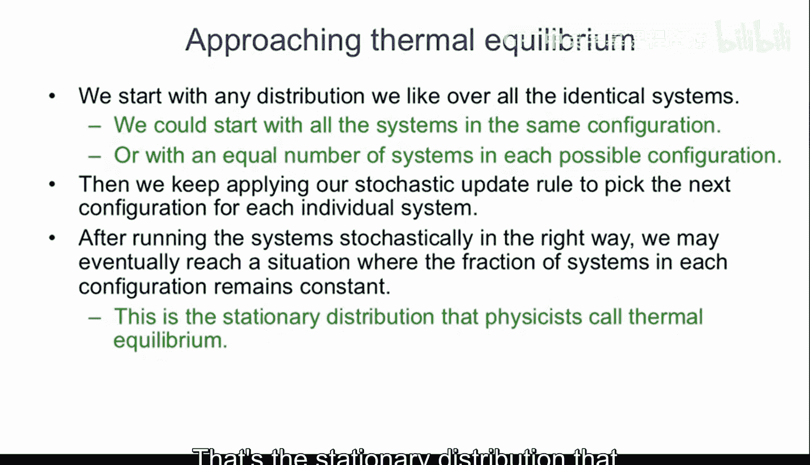
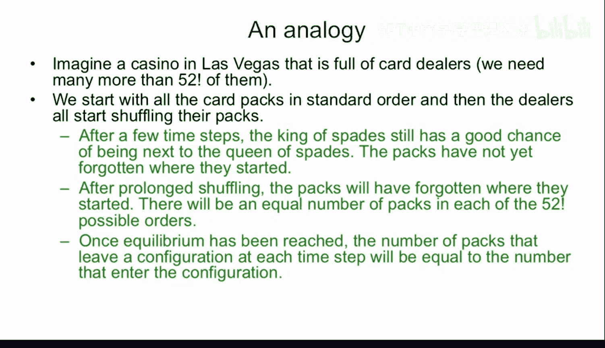

# 11.4：使用随机单元改进搜索 🔍



在本节课中，我们将学习如何通过向系统中添加噪声来帮助其逃离局部最小值，并了解如何在霍普菲尔德网络中实现这一点。

## 概述：噪声如何帮助搜索

上一节我们介绍了霍普菲尔德网络及其能量最小化的特性。本节中我们来看看，这种确定性更新规则如何导致网络陷入局部最小值，以及如何通过引入噪声来改进搜索过程。

一个霍普菲尔德网络总是做出降低能量的决策。如果它不改变单元的状态，能量则保持不变。这使得网络不可能从局部最小值中爬升出来。

观察这里的能量景观。如果我们陷入局部最小值A，我们将无法越过能量壁垒到达更好的最小值B，因为我们无法在能量上坡。如果我们引入随机噪声，就可以逃离较差的极小值，特别是那些周围没有高能量壁垒的浅层极小值。

事实证明，最有效的策略不是使用固定的噪声水平，而是从大量噪声开始。这允许你在宏观尺度上探索空间，并找到空间中普遍较好的区域，然后逐渐降低噪声水平。在大量噪声下，你可以跨越大的壁垒；随着噪声水平的降低，你开始专注于附近的最佳极小值。

如果你缓慢地降低噪声，使系统最终陷入一个深层的极小值，这被称为**模拟退火**。这个想法由Kirkpatrick提出，时间大约与霍普菲尔德网络的提出同期。

## 模拟退火的原理

模拟退火的原因在于，物理系统中的温度（或具有能量函数的模拟系统中的温度）会影响状态转移的概率。

在一个高温系统中，从B到A上坡的概率低于从A到B下坡的概率，但差距并不大。实际上，温度使能量景观变得平坦。这里的小黑点代表粒子。我们想象粒子根据能量函数和温度决定的转移概率移动。

这可能是系统在高温下运行的典型分布，此时容易跨越壁垒，但一旦到达深层极小值，也难以停留。如果系统在更低的温度下运行，跨越壁垒的概率会小得多，但概率比会好得多。从A到B的概率与从B到A的概率之比，在低温系统中要好得多。

因此，如果我们运行足够长的时间，我们期望所有粒子最终都聚集在B。但如果我们只在低温下长时间运行，粒子从A逃逸将需要非常长的时间。一个好的折衷方案是从高温开始，然后逐渐降低温度。

## 在霍普菲尔德网络中引入噪声

我们将二元阈值单元替换为做出随机决策的二元随机单元，从而将噪声引入霍普菲尔德网络。噪声量由一个称为**温度**的参数控制，你将在稍后的公式中看到。提高噪声水平相当于减小所有配置之间的能量差。

以下是我们的标准逻辑方程，但能量差被温度缩放：

```
p_i = 1 / (1 + exp(-ΔE_i / T))
```

如果温度非常高，指数项将趋近于0，因此等式右侧将约为 `1 / (1+1)`，单元开启的概率将约为二分之一。单元将大致均等地处于开启和关闭状态。

随着我们降低温度，根据ΔE的符号，单元将变得越来越坚定地开启或关闭。在温度为0时（即我们在霍普菲尔德网络中使用的），ΔE的符号决定了等式右侧是变为0还是1。当T=0时，右侧要么是0要么是1，因此单元将表现出确定性行为，这就是一个总是采用两个状态中能量较低状态的二元阈值单元。

能量差我们在之前的幻灯片中见过，它就是整个系统在单元i关闭或开启时的能量之差。

## 关于模拟退火的说明

虽然模拟退火是改进陷入局部最优搜索的一种非常强大的方法，并且对引导玻尔兹曼机器的思想产生了影响，但它实际上分散了我们对玻尔兹曼机器的理解。因此，本课程中我将不再讨论它，尽管它是一个非常有趣的想法。

从现在开始，我将使用温度为1的二元随机单元。也就是说，使用能量差的标准逻辑函数。

## 理解热平衡概念

为了理解玻尔兹曼机器的学习过程，你需要理解的一个概念是**热平衡**。因为我们设定温度为1，所以它是在固定温度下的热平衡概念。这是一个困难的概念。

大多数人认为这意味着系统已经稳定下来，不再变化。这通常是“平衡”的含义。但稳定下来的不是单个单元的状态。在热平衡下，除非温度为0，否则单个单元仍在随机变化。

稳定下来的是**配置的概率分布**。这是你第一次遇到时的难点概念，因此我将给你一个例子。

概率分布会稳定到一个特定的分布，称为**平稳分布**。这个平稳分布由系统的能量函数决定。事实上，在平稳分布中，任何配置的概率与其能量的负指数成正比：`P(config) ∝ exp(-E(config))`。



思考热平衡的一个直观方式是，想象一个由许多相同系统组成的巨大集合，这些系统都具有完全相同的能量函数。想象大量具有相同权重的随机霍普菲尔德网络。在这个巨大的集合中，我们可以将一个配置的概率定义为处于该配置的系统所占的比例。

## 接近热平衡的过程

现在我们可以理解接近热平衡时发生了什么。我们可以从这些相同系统上的任何分布开始。我们可以让它们都处于相同的配置，即一个配置的概率为1，其他所有配置的概率为0。或者我们可以让它们在每个可能配置中的系统数量相等，即均匀分布。

然后，我们将持续应用随机更新规则。在随机霍普菲尔德网络的情况下，这意味着你选择一个单元，查看其能量差，并基于该能量差随机决定是将其开启还是关闭。然后你选择另一个单元，依此类推。

我们持续以这种方式随机运行系统。最终，我们可能会达到一种状态，即每个配置中的系统比例保持恒定。事实上，如果我们有对称连接，就会发生这种情况。这就是平稳分布，物理学家称之为热平衡。

任何给定的系统都会不断改变其配置。我们应用更新规则，其单元的状态将在0和1之间不断翻转。但处于任何特定配置的系统比例不会改变。这是因为我们拥有的系统数量远远多于配置数量。



## 一个类比

以下是一个类比，以帮助理解这个概念。想象拉斯维加斯一个非常大的赌场，里面有很多发牌员。事实上，我们拥有的发牌员数量远多于52!（52的阶乘）个。

我们开始时，所有牌包都处于制造商出厂时的标准顺序（假设是黑桃A、黑桃K、黑桃Q……）。然后所有发牌员开始洗牌。他们进行随机洗牌，而不是那种能让牌序恢复原样的花式洗牌。

洗了几次之后，在任何给定的牌包中，黑桃K紧挨着黑桃Q的可能性仍然很大。因此，牌包还没有忘记它们的起始顺序。它们的初始顺序仍然影响着当前顺序。

如果我们持续洗牌，最终初始顺序将变得无关紧要。牌包将忘记它们从哪里开始。事实上，在这个例子中，在52!种可能的顺序中，每种顺序的牌包数量将相等。一旦发生这种情况，如果我们继续洗牌，在52!种顺序中的每一种，牌包数量仍然相等。

这就是为什么它被称为平衡。因为处于任何一种配置的比例不会改变，即使单个系统仍在变化。

这个类比的一个不足之处在于，一旦我们在这里达到平衡，所有配置都具有相等的能量，因此它们都具有相同的概率。通常，我们感兴趣的是为那些某些配置能量低于其他配置的系统达到平衡。



## 总结

本节课中我们一起学习了如何通过将霍普菲尔德网络中的确定性单元替换为随机单元来引入噪声，从而帮助网络逃离局部最小值。我们探讨了模拟退火的基本思想，即从高温（高噪声）开始并逐渐降温以找到更好的能量最小值。更重要的是，我们引入了**热平衡**这一核心概念，它描述了当大量相同系统随机运行时，系统配置的概率分布达到并保持稳定的状态，即使单个系统的状态仍在不断变化。理解热平衡是学习后续玻尔兹曼机器的基础。