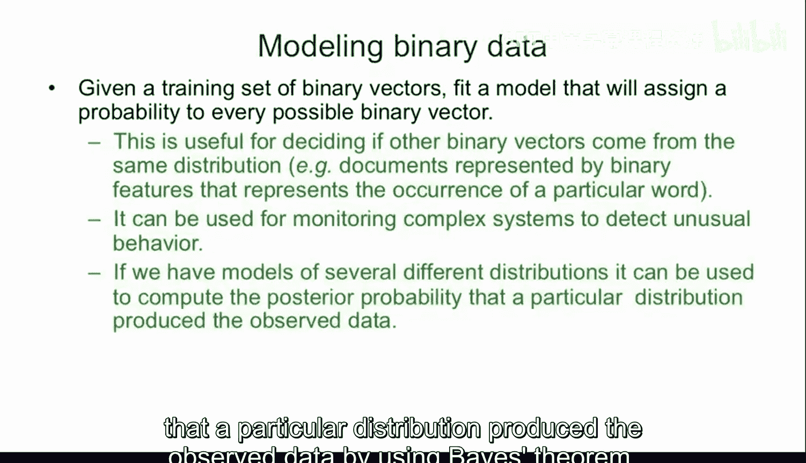
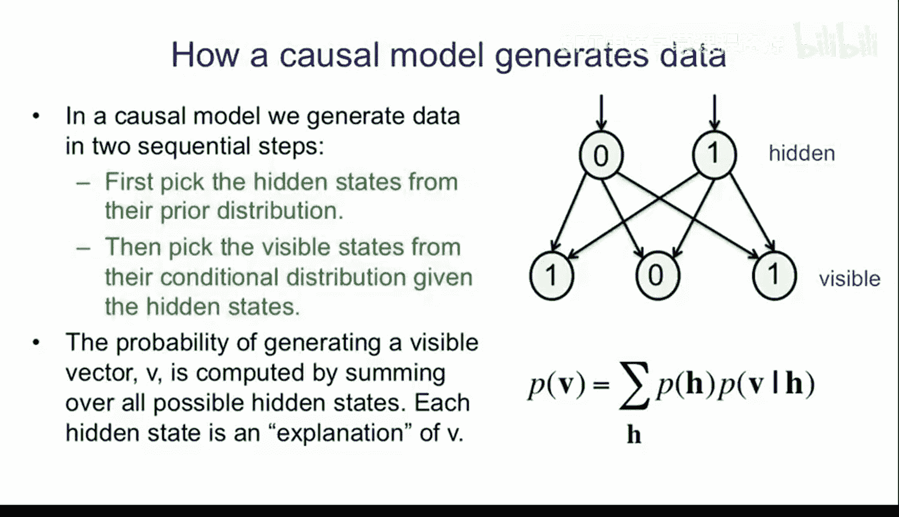
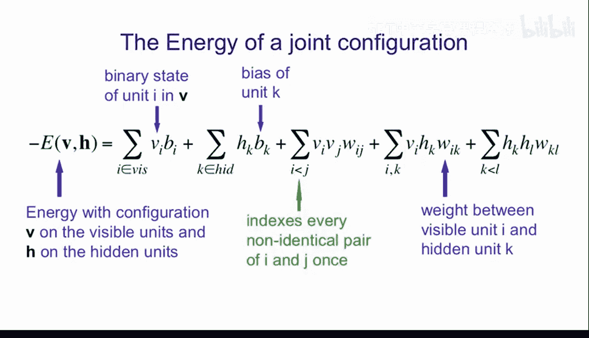
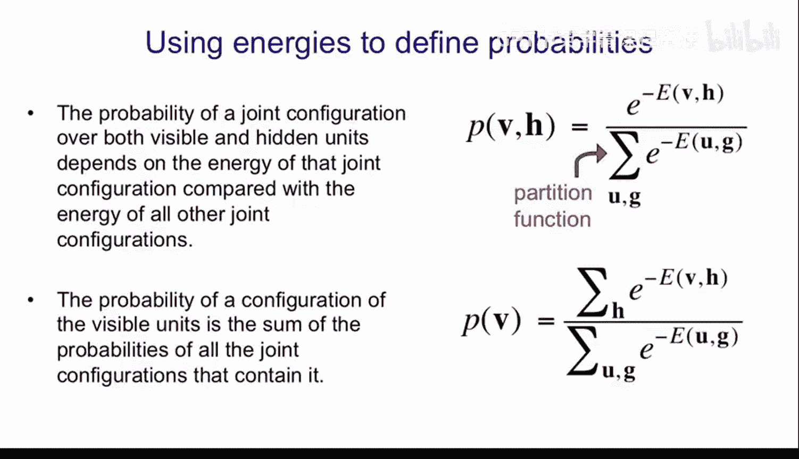
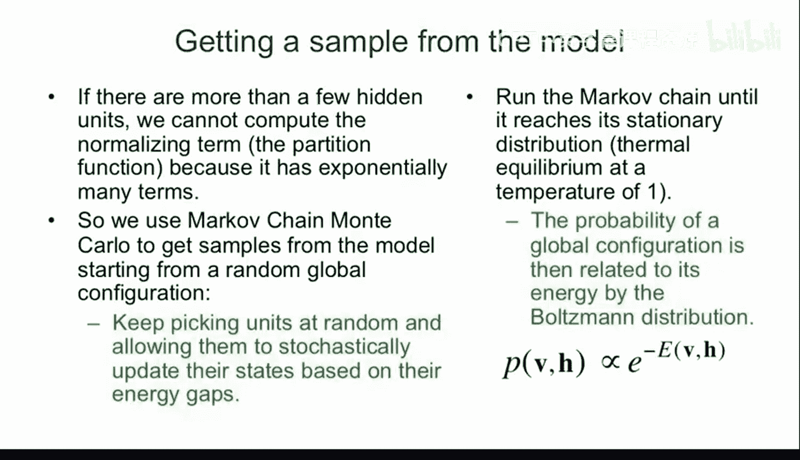
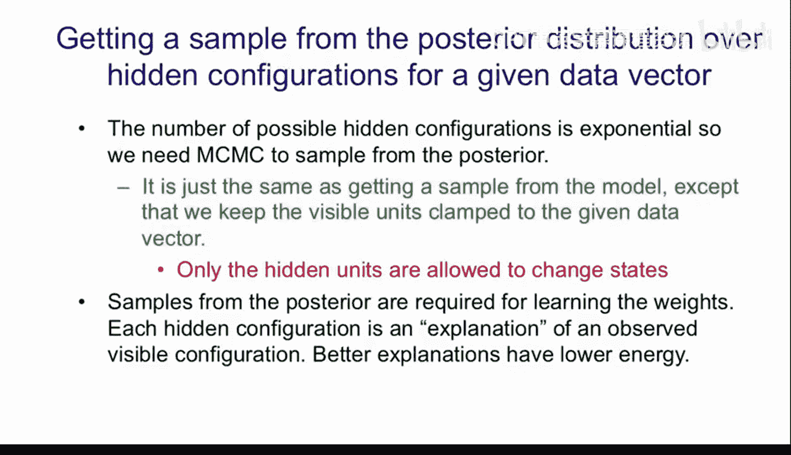

# 11.5：玻尔兹曼机如何建模数据 🔍

在本节课中，我们将学习玻尔兹曼机如何为一组二进制数据向量建立模型。我们将探讨建模二进制数据的目的、模型的应用场景，并详细解释玻尔兹曼机中权重如何决定分配给每个二进制数据向量的概率。

---

## 为何需要建模二进制数据向量？ 🤔

带有隐藏单元的随机霍普菲尔德网络，也称为玻尔兹曼机，擅长对二进制数据进行建模。给定一组二进制训练向量，它们可以利用隐藏单元来拟合一个模型，该模型为每一个可能的二进制向量分配一个概率。

以下是需要此类模型的几个原因：

*   **分类任务**：如果你拥有几种不同类型的二进制向量分布，你可能希望观察一个新的二进制向量，并判断它来自哪个分布。例如，对于不同类型的文档，你可以用一组二进制特征（每个特征表示某个特定词在文档中是否出现）来表示一个文档。不同类型的文档，其词汇出现频率和词汇间的相关性也不同。你可以为每类文档使用一组隐藏单元来建模其分布，然后通过计算新文档向量最可能由哪类文档分布生成，来为其分配类别。
*   **异常检测**：你也可以使用玻尔兹曼机来监控复杂系统，以检测异常行为。例如，假设你有一个核电站，所有仪表读数都是二进制的。你希望系统能注意到它进入了异常状态——一种你从未见过的状态。由于你不可能拥有系统爆炸状态的样本，因此不能使用监督学习。相反，你可以通过建立一个正常状态模型，然后注意到当前状态与正常状态不同来实现异常检测。

---

## 两种建模方式：因果模型与能量模型 ⚖️

上一节我们介绍了建模二进制数据的目的，本节中我们来看看两种主要的建模方式。

### 因果生成模型

生成二进制向量最自然的方式是首先生成一些潜在变量的状态，然后利用这些潜在变量来生成二进制向量。这是一个因果模型，包含两个顺序步骤：

1.  首先，根据先验分布选择潜在变量（或隐藏单元）的状态。在因果模型中，这些变量在**先验**中通常是独立的。
2.  一旦选定了隐藏单元的状态，就利用它们通过加权连接来生成可见单元的状态。

这是一个使用逻辑单元的神经网络因果生成模型。它使用隐藏单元的偏置和隐藏单元与可见单元之间的连接权重，为每个可能的可见向量分配概率。

生成特定可见向量 **V** 的概率，是对所有可能的隐藏状态 **H** 求和：`P(V) = Σ_H [ P(H) * P(V|H) ]`。因子分析就是一个使用连续变量的因果模型示例。

### 能量基础模型：玻尔兹曼机

玻尔兹曼机是一种基于能量的模型。在这类模型中，数据不是以因果方式生成的，它不是因果生成模型。相反，一切定义都基于可见单元和隐藏单元联合配置的能量。

有两种方式可以将联合配置的能量与其概率联系起来：

1.  **定义方式**：直接定义联合配置的概率与其能量的负指数成正比。
2.  **过程方式**：通过定义网络在更新所有随机二元单元足够多次以达到热平衡后，处于该状态的概率。

好消息是，这两种定义是一致的。

一个联合配置 **{V, H}** 的**负能量**（为简化符号，此处列出负能量）包含以下项：
`-E(V, H) = Σ_i b_i v_i + Σ_k b_k h_k + Σ_{i<j} v_i v_j w_{ij} + Σ_{i,k} v_i h_k w_{ik} + Σ_{k<l} h_k h_l w_{kl}`

其中：
*   `v_i`, `h_k` 是单元的二值状态（0或1）。
*   `b_i`, `b_k` 是偏置。
*   `w_{ij}`, `w_{ik}`, `w_{kl}` 是连接权重。

我们使用能量来定义概率的方式如下：可见与隐藏单元的联合配置概率为 `P(V, H) = exp(-E(V, H)) / Z`，其中 `Z` 是归一化常数（配分函数），需要对所有可能的可见和隐藏单元配置求和：`Z = Σ_{V', H'} exp(-E(V', H'))`。

要得到仅可见单元配置的概率，必须对所有可能的隐藏单元配置求和：`P(V) = Σ_H exp(-E(V, H)) / Z`。

---

## 计算示例：理解概率分配 🧮

仅仅看公式可能不够直观，让我们通过一个计算示例来更好地理解玻尔兹曼机如何为可见向量分配概率。

考虑一个简单的网络：2个可见单元，2个隐藏单元。为简化，忽略偏置，并且可见单元之间不连接。我们有三条权重：`w(v1-h1)=2`, `w(v1-h2)=-1`, `w(v2-h1)=1`。

以下是计算 `P(V)` 的步骤：

1.  **列出所有联合配置**：每个可见向量（4种可能）对应4种隐藏单元状态，共16种联合配置。
2.  **计算每种联合配置的负能量 `-E(V, H)`**：根据公式计算。例如，当所有单元都为1时，`-E = 2*1*1 + (-1)*1*1 + 1*1*1 = 2`。
3.  **计算未归一化概率 `exp(-E(V, H))`**：对每个负能量取指数。
4.  **计算配分函数 `Z`**：将所有 `exp(-E)` 值相加。
5.  **计算联合配置概率**：每个 `exp(-E)` 除以 `Z`。
6.  **计算可见向量概率 `P(V)`**：对每个可见向量，将其对应的4种隐藏状态的联合概率相加。

通过这个具体计算，你可以清晰地看到权重如何影响最终的 `P(V)`。

---

## 从模型中采样与后验分布采样 🔄

上一节我们通过一个小例子手动计算了概率，但对于大型网络，由于配置空间是指数级的，我们无法进行精确计算。

### 从模型分布中采样

当网络很大时，我们无法直接计算配分函数 `Z`。但我们可以使用**马尔可夫链蒙特卡洛**方法从模型中获取样本。具体步骤如下：

1.  从一个随机的全局配置开始。
2.  随机选择一个单元，根据该单元在当前网络状态下翻转（0变1或1变0）的**能量差**，以随机方式（通常使用逻辑函数）决定是否更新其状态。能量差由网络中所有其他单元的当前状态决定。
3.  重复步骤2足够多次，直到马尔可夫链达到**平稳分布**。

此时获得的样本即来自模型分布，样本的概率遵循玻尔兹曼分布：`P(样本) ∝ exp(-E(样本))`。

### 从给定数据向量的后验分布中采样

在学习和推理中，我们常常需要知道：给定一个观测到的数据向量 **V**，隐藏单元的可能状态（即“解释”）分布是怎样的。这个分布就是后验分布 `P(H|V)`。

同样，由于可能的隐藏配置数量是指数级的，我们使用MCMC进行采样。过程与从模型采样类似，但有一个关键区别：

*   **将可见单元钳制**到给定的数据向量 **V**。
*   在MCMC更新过程中，**只更新隐藏单元**，可见单元的状态保持不变。

这样，采样过程就会从后验分布 `P(H|V)` 中抽取样本。我们需要这个后验样本，既是为了找到对观测数据的一个良好“解释”，也是为了后续的权重学习算法（如对比散度）提供必要的信息。

---

## 总结 📝

本节课中我们一起学习了玻尔兹曼机如何对二进制数据进行建模。

*   我们首先了解了为二进制数据建立概率模型的应用，如文档分类和复杂系统异常检测。
*   接着，我们对比了**因果生成模型**和**能量基础模型**（玻尔兹曼机）这两种不同的建模范式。玻尔兹曼机通过定义联合配置的能量来分配概率，其概率公式为 `P(V, H) ∝ exp(-E(V, H))`。
*   通过一个包含2个可见单元和2个隐藏单元的小型网络示例，我们逐步演示了如何根据权重计算每个可见向量的概率，这有助于直观理解模型的工作原理。
*   最后，针对大型网络，我们介绍了如何使用**马尔可夫链蒙特卡洛**方法从模型分布 `P(V)` 中采样，以及如何通过钳制可见单元来从后验分布 `P(H|V)` 中采样。这些采样技术是训练和运用大型玻尔兹曼机的关键。